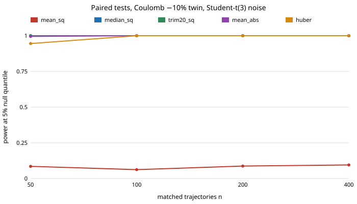

# Was the paired twin test weak, or was its statistic?

A free-choice run, picked because `research/free-c2stpower` reported that a paired error test "stalls at 0.09 to 0.20 power" for a 10% Coulomb-friction error under Student-t sensor noise, while a classifier test reaches 1.00, and named a robust paired statistic as untried. If the stall is only the mean squared residual, the usual advice (use a C2ST when errors are subtle) is partly an artefact. **Stylised and simulated only; no real data, no LLM.**

**Live page:** https://duncan-haywood.github.io/monorepo-projects/research/free-robustpaired/

Every number below is copied from `experiments/results.txt`.



## Results

Setup: same pendulum "real system" as `free-c2stpower` (RK4, dt 0.02 s, 100 steps, start angle uniform on [-2, 2] rad, viscous 0.1, Coulomb 0.3, noise sd 0.02 rad), noise Student-t(3) or Gaussian at the same sd. The twin is noise-free and uses the same start angles. Five statistics of the residual (real minus twin): mean squared (the conventional one), median squared over all cells, mean squared after dropping the largest 20% of cells, mean absolute, and mean Huber loss (threshold 0.02). A test rejects above the 95th percentile of the same statistic over 400 exact-twin replicates; power is the share of 400 fresh replicates above it.

Student-t(3) noise, power:

| twin error, statistic | n = 50 | 100 | 200 | 400 |
|---|---|---|---|---|
| Coulomb -10%, mean squared | 0.09 | 0.06 | 0.09 | 0.10 |
| Coulomb -10%, median squared | 1.00 | 1.00 | 1.00 | 1.00 |
| Coulomb -10%, trimmed 20% | 1.00 | 1.00 | 1.00 | 1.00 |
| Coulomb -10%, mean absolute | 0.99 | 1.00 | 1.00 | 1.00 |
| Coulomb -10%, Huber | 0.94 | 1.00 | 1.00 | 1.00 |
| Coulomb -20%, mean squared | 0.62 | 0.57 | 1.00 | 1.00 |
| Coulomb -20%, any robust statistic | 1.00 | 1.00 | 1.00 | 1.00 |

- **The stall was the statistic.** Under heavy-tailed noise the mean squared residual has power about 0.1 at a 10% Coulomb error at every n up to 400, as `free-c2stpower` found; every robust statistic reaches about 1.00 from n = 50 or 100. At a 20% error the mean squared statistic needs n = 200, the robust ones work at 50. This beats the C2ST's `free-c2stpower` numbers (0.62 at n = 200 for -10%), though that comparison is across projects with different nulls and replicate counts.
- **Under Gaussian noise the choice barely matters** except at n = 50: -10% power is 0.98 for mean squared, mean absolute and Huber, 0.95 trimmed and 0.82 median squared (0.93 at n = 100). The median costs the most when noise is light.
- **Pairing is still the requirement.** Robust statistics do not help the same-variance noise-shape error from `free-c2stpower`, which the paired residual cannot see by construction; this project did not re-test that.
- **Size is roughly right but noisy.** False-rejection on 400 fresh exact-twin replicates is 0.03 to 0.09 across cells (nominal 0.05; Wilson intervals of about ±0.03, see `results.txt`); the 400-replicate null threshold is itself noisy, as `free-c2stpower` warned. Differences of a few hundredths in size are not resolved.

## Builds on

`research/free-c2stpower` (simulator, setup, the question) and `research/mimic-twinc2st`. Huber (1964), "Robust estimation of a location parameter", *Ann. Math. Statist.*, and Tukey (1960) on trimmed means for the statistics. Citations are standard references and were not re-fetched in this run. No lab's work is built on, and no lab is affiliated with or endorses this project.

## Reproduce

```bash
cd research/free-robustpaired
pip install numpy
python3 -m unittest discover -s tests -v    # 6 tests
python3 experiments/run.py                  # about 6 minutes on one CPU, writes results.txt and results.json
python3 experiments/figure.py               # experiments/power_vs_n.svg, parsed from results.txt
```

## Limitations

One toy pendulum, one real parameter set, three twin errors, one seed per noise kind; nulls from 400 replicates; Huber threshold set to the known noise sd (a practitioner would estimate it); the statistics were chosen after seeing the problem, not pre-registered; the twin here is noise-free and the real noise is the only randomness. A trajectory-level outlier (a bad run) rather than heavy-tailed cells was not tested. Nothing here is a claim about a physical pendulum or a real simulator. Written with AI assistance (Claude), per the repository's integrity rules.

## Next steps

Heavier tails (Student-t with 2 degrees of freedom, outlier runs), estimating the Huber scale, head-to-head with the permutation-calibrated C2ST (`free-c2stperm`) at one shared null, and a MuJoCo twin.

## Outside dependencies

numpy (pip). No data, services or models.

MIT.
