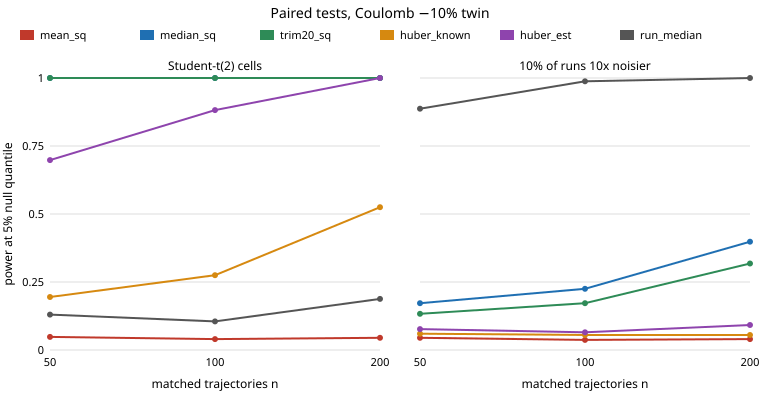

# Which robust paired test still catches a wrong digital twin when noise has infinite variance or whole runs go bad?

A free-choice run, picked because `research/free-robustpaired` showed robust residual statistics rescuing the paired twin test under Student-t(3) noise and listed heavier tails, outlier runs and an estimated Huber scale as untried. The short answer: no single robust statistic wins both failure modes, and the Huber loss with its scale estimated from the data (the only version a practitioner can run) beats the known-scale version under heavy tails. **Stylised and simulated only; no real data, no LLM.**

Every number below is copied from `experiments/results.txt`.



## Results

Setup: the `free-robustpaired` pendulum (RK4, dt 0.02 s, 100 steps, start angle uniform on [-2, 2] rad, viscous 0.1, Coulomb 0.3, scale 0.02 rad); the twin is noise-free. Three noise models: **student2** (Student-t with 2 degrees of freedom per cell, infinite variance, same scale as the t(3) of the earlier project), **badruns** (Gaussian sd 0.02, but each trajectory is with probability 0.1 a bad run with 10 times the noise sd), and **gauss** as a control. Six statistics of the residual (real minus twin): mean squared; median squared over all cells; mean squared after dropping the largest 20% of cells; mean Huber loss with the true scale as threshold (`huber_known`, 0.02); mean Huber loss with threshold 1.345 times a MAD scale estimated from that replicate's own residuals (`huber_est`); and the median over trajectories of each trajectory's mean squared residual (`run_median`). A test rejects above the 95th percentile of the same statistic over 400 exact-twin replicates; power is the share of 400 fresh replicates above it. n = 50, 100, 200.

Power at a 10% Coulomb error (n = 50 / 100 / 200):

| statistic | Student-t(2) cells | bad runs | Gaussian (control) |
|---|---|---|---|
| mean squared | 0.05 / 0.04 / 0.05 | 0.05 / 0.04 / 0.04 | 0.98 / 1.00 / 1.00 |
| median squared | 1.00 / 1.00 / 1.00 | 0.17 / 0.23 / 0.40 | 0.72 / 0.93 / 1.00 |
| trimmed 20% | 1.00 / 1.00 / 1.00 | 0.13 / 0.17 / 0.32 | 0.90 / 0.99 / 1.00 |
| Huber, known scale | 0.20 / 0.28 / 0.53 | 0.06 / 0.06 / 0.06 | 0.98 / 1.00 / 1.00 |
| Huber, estimated scale | 0.70 / 0.88 / 1.00 | 0.08 / 0.07 / 0.09 | 0.98 / 1.00 / 1.00 |
| median of per-run mean squares | 0.13 / 0.11 / 0.19 | 0.89 / 0.99 / 1.00 | 0.86 / 0.99 / 1.00 |

- **Infinite variance breaks the mean squared residual completely** (power about 0.05, the size of the test, at every n up to 200, even at a 20% error: 0.03 to 0.09). The median and trimmed statistics reach 1.00 at n = 50 for both 10% and 20% errors.
- **Bad runs defeat every cell-level statistic at a 10% error.** Median and trimmed squared residuals reach only 0.17 to 0.40, and both Huber variants stay near 0.06 to 0.09, because a bad run puts 100 high-variance cells into one trajectory. Aggregating per run and taking the median over runs reaches 0.89 at n = 50 and 1.00 at n = 200. At a 20% error median squared catches up by n = 100 (0.99), Huber does not (0.09 to 0.31).
- **No free lunch.** `run_median` is the best statistic under bad runs and nearly the worst under t(2) cells (0.11 to 0.19 at 10%, since it averages heavy-tailed cells within a run); median squared is the reverse. Under Gaussian noise the conventional mean squared is best at n = 50 (0.98 against 0.72 for median squared and 0.86 for `run_median`), so robustness is paid for in light-tailed noise.
- **Estimating the Huber scale helped under t(2)** (0.70 against 0.20 at n = 50, 10% error): a threshold fixed at the Gaussian-equivalent scale 0.02 is too small for t(2) cells, while the MAD estimate adapts. It is not a rescue under bad runs. The MAD is re-estimated inside every replicate, including alternatives, where a wrong twin inflates it slightly; the null calibration absorbs this for the comparison made here.
- **Size is roughly right but noisy.** False rejection on 400 fresh exact-twin replicates is 0.02 to 0.11 across cells (nominal 0.05; the worst is `run_median` with bad runs at n = 50, 0.107); Wilson intervals are about ±0.03 (see `results.txt`). Differences of a few hundredths are not resolved.

## Builds on

`research/free-robustpaired` (statistics, simulator, question), `research/free-c2stpower` and `research/mimic-twinc2st`. Huber (1964), "Robust estimation of a location parameter", *Ann. Math. Statist.*, and Huber's 1.345 tuning constant; MAD scale with the 1.4826 consistency factor (Hampel, 1974). Citations are standard references and were not re-fetched in this run. No lab's work is built on, and no lab is affiliated with or endorses this project.

## Reproduce

```bash
cd research/free-robusttails
pip install numpy
python3 -m unittest discover -s tests -v    # 8 tests
python3 experiments/run.py                  # about 2 minutes on one CPU, writes results.txt and results.json
python3 experiments/figure.py               # experiments/power_vs_n.svg, parsed from results.txt
```

## Limitations

One toy pendulum, one real parameter set, two twin errors, one seed per noise model; nulls from 400 replicates (noisy, especially under t(2)); the bad-run contamination (10% of runs, 10x sd) is one choice of many; the statistics were chosen after seeing the earlier project's problem and are not pre-registered; `run_median` assumes noise varies by run, which was true by construction here. A practitioner would not know which noise model they have, so the table is a map of trade-offs, not a recommendation. The twin is noise-free; the real noise is the only randomness. Nothing here is a claim about a physical pendulum or a real simulator. Written with AI assistance (Claude), per the repository's integrity rules.

## Next steps

Combine both defences (a per-run robust summary of a robust within-run statistic) and test it against both noise models, vary the contamination share and ratio, pick the statistic from the data (a robust test of tail heaviness), head-to-head with the permutation-calibrated C2ST (`free-c2stperm`), and a MuJoCo twin.

## Outside dependencies

numpy (pip). No data, services or models.

MIT.
