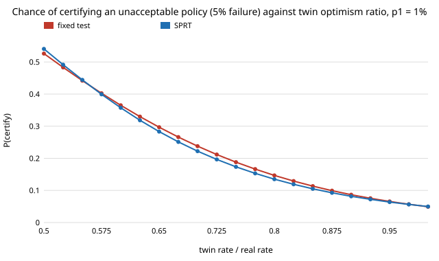

# If the twin is optimistic, how often does a rollout test certify a policy that is not safe? (free choice)

Pure Python, no dependencies beyond the sibling project `free-sprtcert` (imported for its exact SPRT and fixed-test pieces). **Free-choice project** (`PROJECTS.md`, "Picking work", step 1; draw 0.007). Why it seemed worth doing: `free-sprtcert` and `free-sprtcap` both end with "assumes the twin's failure rate equals the real one, so it says nothing about the sim-to-real gap". That is the central theme of this portfolio, and the question has an exact answer: a twin that fails less often than reality by a fixed ratio moves the certificate's error in a computable way.

**Live page:** https://duncan-haywood.github.io/monorepo-projects/research/free-sprtbias/

## Question

A policy is certified in simulation at 5% error: accept if the twin's failure rate looks like p1, reject if like p0 (p0 > p1). If the real failure rate is p but the twin fails at p times r (r < 1: optimistic twin), how often is an unacceptable policy (real rate p0) certified, how small can r be before that doubles, and how many rollouts does it cost to guard against an optimism of up to R?

## Headline result (exact; see Limitations)

- **A few percent of optimism already doubles the false-certification rate.** For p0 = 5%, p1 = 1%, the chance of certifying a policy whose real rate is 5% rises from 0.049 (r = 1) to 0.087 at r = 0.9 (twin 4.5%), 0.147 at r = 0.8 and 0.526 at r = 0.5 for the fixed test (181 rollouts); the SPRT is within 0.02 of it throughout (0.082, 0.135, 0.541). The false-certify rate reaches 10% at r = 0.874 (fixed) and 0.860 (SPRT), and 50% at r = 0.52.
- **Narrow gaps are the most fragile in absolute terms.** For 5% vs 10% (298 rollouts) and 10% vs 20% (135) the rate reaches 10% at r = 0.93, and at r = 0.7 it is already 0.57 (fixed) and 0.59 (SPRT); a twin 30% too optimistic certifies an unacceptable policy more often than not. The two wide-gap pairs (1% vs 5%, 0.5% vs 2%) tolerate r = 0.87 to 0.88 before 10%.
- **Neither test is more robust.** The SPRT's 2:1 rollout saving does not buy or cost robustness to bias: its false-certify rate is below the fixed test's for mild bias (r ≥ 0.8) and above it for severe bias (r ≤ 0.7 in the 5% vs 10% case, r = 0.5 in the 0.5% vs 2% case: 0.625 against 0.576).
- **Guarding against bias is expensive.** Testing p0/R against p1 (so an unacceptable policy is still caught if the twin is up to R times too optimistic) costs, for 1% vs 5%, 1.27 times the rollouts at R = 1.1, 1.44 at 1.25, 2.17 at 1.5 and 4.55 at 2 (823 rollouts). For 5% vs 10% R = 1.5 costs 7.2 times and R = 2 cannot be done at all, because p0/R falls to p1. The rollouts you save by choosing a sequential test are far smaller than the rollouts a modest bias allowance costs.

Figure: `experiments/falsecert_vs_optimism.svg`. Tables: `experiments/results.txt`.



## Method

`sprtbias.py` reuses `free-sprtcert`'s exact dynamic programme (SPRT, Wald boundaries) and exact binomial fixed test. If the real rate is p and the twin's is q = p r, the test, which only sees twin rollouts, accepts with the probability it has at q, so the false-certify probability at real rate p0 is `accept(q = p0 r)`. `tolerated_ratio` inverts this by bisection (the accept probability is monotone in q). `derated_size` replaces p0 by p0/R and finds the smallest exact fixed test at the same 5% errors. Nothing is sampled. Four (p0, p1) pairs at α = β = 0.05 as in the siblings.

## Reproduce

```bash
cd research/free-sprtbias
python3 -m unittest discover -s tests -v   # 6 tests, under a second
python3 experiments/run.py > experiments/results.txt   # about 12 s
python3 experiments/figure.py
```

Tests check the unbiased case against the nominal 5%, the published n = 181 of `free-sprtcert`, monotonicity in r, that the bisection inverts the forward function, and that derating restores the 5% guard at the derated rate.

## Limitations

- **The bias model is a pure ratio, q = p r, constant over the run.** Real gaps are policy- and scenario-dependent, and can be pessimistic in some regimes. An additive bias, or a bias that varies per scenario (which makes rollouts non-iid), would give different numbers and is not tested.
- **r is an input, not a measurement.** Nothing here estimates what r is for any real twin; the sweep (0.5 to 1) is a range, not a finding about a specific simulator.
- **The derated design guards the unacceptable side only.** It keeps p1 fixed and does not recompute power at p1 under bias, or treat a pessimistic twin.
- Four rate pairs, α = β = 0.05, iid rollouts. The SPRT cut is at 20 times the fixed size, as in the siblings.

## Prior work

Wald (1945), "Sequential tests of statistical hypotheses", *Annals of Mathematical Statistics* 16(2). Builds on `research/free-sprtcert` and `research/free-sprtcap`. The sim-to-real framing follows the portfolio's digital-twin theme; the citation was written from memory, not re-checked against the source.

## Next steps

Estimate r from a small number of paired real and twin rollouts and make the certificate account for its uncertainty (a composite or Bayesian test); additive and per-scenario bias.

## Owner steps
None.

## Outside dependencies
Python standard library only.
