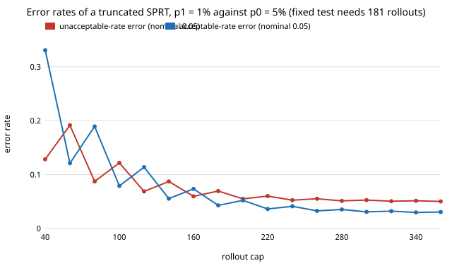

# How long can a sequential rollout test run, and what does capping it cost? (free choice)

Pure Python, no dependencies beyond the sibling project `free-sprtcert` (imported for its exact SPRT pieces). **Free-choice project** (`PROJECTS.md`, "Picking work", step 1; draw 0.006). Why it seemed worth doing: `research/free-sprtcert` showed Wald's SPRT needs about half the simulator rollouts of a fixed test *on average*, and listed "a truncated SPRT with a hard rollout cap, and the quantiles of the stopping time" as its next step. A certification run has a compute budget, so the average is not what you plan around: the tail is.

**Live page:** https://duncan-haywood.github.io/monorepo-projects/research/free-sprtcap/

## Question

For certifying a failure rate (accept at p1, reject at p0, both errors 5%): how long is the SPRT's tail (median, 90th and 99th percentile rollouts), and if you cap it at m times the fixed test's size and decide by the sign of the likelihood ratio, how much error does the cap add?

## Headline result (exact; see Limitations)

- **The tail is long even where the average is good.** For p0 = 5%, p1 = 1% (fixed test: 181 rollouts), at p = p0 the SPRT averages 79 rollouts, median 65, 90th percentile 160, 99th percentile 309; at p = p1: mean 113, median 72, 90th 192, 99th 349. The chance a run exceeds the fixed test's 181 rollouts is 7.6% at p0, 13.3% at p1 and 28.4% at the midpoint rate 3%, where the 99th percentile is 562 (3.1 times the fixed size). The other three cases show the same shape: 7.6% to 13.8% of runs exceed the fixed size at either hypothesis and 28% to 31% at the midpoint.
- **Capping at the fixed size inflates the error.** Truncating at m = 1 (cap = fixed n) and deciding by the sign of the log likelihood ratio gives an unacceptable-rate error of 0.0668 to 0.0689 across the four cases (nominal 0.05, fixed test 0.049 to 0.050): about 34% to 38% over. Halving the cap roughly doubles to triples the error (0.107 to 0.167).
- **A cap of 1.5 times the fixed size nearly removes the excess and costs almost no average.** At m = 1.5 the unacceptable-rate error is 0.0525 to 0.0566 and the acceptable-rate error 0.034 to 0.043, while the mean rollouts stay within 2% of the uncapped SPRT (for 1% vs 5%: 77.6 and 110.9 against 78.7 and 112.6); at m = 2 the error is 0.050 to 0.0525. So a hard cap of 1.5 to 2 times the fixed-test size bounds the worst-case budget at 1.5 to 2 times the fixed design's cost while keeping the average saving.

Figure: `experiments/error_vs_cap.svg` (errors against cap, 1% vs 5%; the curve is jagged because the sign rule is applied on a discrete lattice). Tables: `experiments/results.txt`.



## Method

`sprtcap.py` runs the exact dynamic programme from `free-sprtcert` over (trials, failures), but keeps the probability of stopping at each trial, so the whole stopping-time law is available, not just its mean. Truncation at `cap` trials: runs still inside Wald's boundaries decide "accept" if the log likelihood ratio log L(p1)/L(p0) is positive, else "reject". Nothing is sampled. The untruncated tables cut the DP at 20 times the fixed size (the mass still running at the cut is at most 4e-13 in every case reported, so the quantiles are exact at the precision shown).

## Reproduce

```bash
cd research/free-sprtcap
python3 -m unittest discover -s tests -v   # 5 tests, well under a second
python3 experiments/run.py > experiments/results.txt   # under a second
python3 experiments/figure.py
```

## Limitations

- **Rollouts are assumed iid Bernoulli with the same probability as the real system.** As in `free-sprtcert`, this certifies the twin, not the robot; the sim-to-real gap is not modelled.
- **Only one truncation rule** (decide by the sign of the log likelihood ratio at the cap) and four (p0, p1) pairs at α = β = 0.05. A rule tuned to the cap (a different final threshold) could do better; Wald's truncation bounds and Armitage-style restricted designs are not compared.
- **No boundary re-tuning.** The Wald boundaries are not recomputed to hold the error at 5% under truncation; the table shows the error you get if you simply add a cap.
- The error with a cap is not monotone in the cap (see section 3 of `results.txt`) because the final decision is made on a discrete count.
- No measurement of any real simulator's rollout time or cost.

## Prior work

Wald, A. (1945), "Sequential tests of statistical hypotheses", *Annals of Mathematical Statistics* 16(2). Wald (1947), *Sequential Analysis*, Wiley, treats truncated sequential tests. Both citations written from memory, not re-checked against the source. Builds directly on `research/free-sprtcert`.

## Next steps

Re-tune the boundaries (or the final cut) so the capped test holds 5% exactly and report the cap that does so at the least extra mean; add a twin-to-real bias term to show how the decision shifts.

## Owner steps
None.

## Outside dependencies
Python standard library only.
