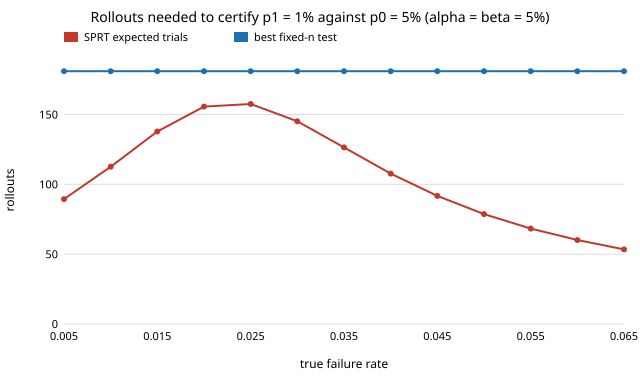

# How many simulator rollouts does a sequential test save when certifying a failure rate? (free choice)

Pure Python, no dependencies. **Free-choice project** (`PROJECTS.md`, "Picking work", step 1; draw 0.001). Why it seemed worth doing: a twin is used to decide "is this policy's failure rate below p1 or above p0?", and the usual answer is a fixed batch of rollouts. Wald's sequential probability ratio test (SPRT) stops as soon as the evidence is clear. I wanted exact numbers, not a simulation, for how much it saves, and for what it costs when the true rate falls between the two hypotheses.

**Live page:** https://duncan-haywood.github.io/monorepo-projects/research/free-sprtcert/

## Question

To accept a policy when its failure rate is p1 (acceptable) and reject it when it is p0 (unacceptable), with both error rates at most 5%: how many rollouts does the best fixed-size test need, how many does the SPRT need on average, and where is the SPRT worst?

## Headline result (exact; see Limitations)

- **At either hypothesis the SPRT roughly halves the rollouts.** For p0 = 5%, p1 = 1%: fixed test 181 rollouts (accept if at most 4 failures), SPRT 79 on average when p = p0 and 113 when p = p1. Other cases: 298 vs 140/163 (10% vs 5%), 523 vs 244/336 (2% vs 0.5%), 135 vs 66/75 (20% vs 10%).
- **In between, the saving shrinks but never reversed in these four cases.** The SPRT's worst expected sample size over the true rate is 253, 159, 483 and 117 rollouts against fixed sizes 298, 181, 523 and 135: a 6% to 17% saving at the worst point, near the middle of the two rates (for 5% vs 1%, at p = 2.4%). Note the sample size of any one run is random and has a long tail.
- **Error rates are met.** Exact achieved SPRT error is 0.048 to 0.051 on the unacceptable side (nominal 0.05; one case, 2% vs 0.5%, is 0.0506, slightly over) and 0.029 to 0.040 on the acceptable side. The fixed test gets 0.049 to 0.050 and 0.036 to 0.050.

Figure: `experiments/asn_vs_rate.svg`. Tables: `experiments/results.txt`.



## Method

`sprtcert.py` computes everything by exact dynamic programming over the number of failures after n trials; nothing is sampled. The SPRT uses Wald's approximate boundaries `log(β/(1−α))` and `log((1−β)/α)` on the log likelihood ratio, and its true error rates, expected sample size and acceptance probability at any p are then computed exactly. The fixed test is the smallest n for which some failure cutoff gives P(accept | p0) ≤ α and P(accept | p1) ≥ 1 − β, by exact binomial sums. The DP is cut at 6n trials; the probability mass still undecided there is at most 2e-7 in every case reported (`results.txt`, section 2), so the reported expected sizes are lower bounds off by a negligible amount.

## Reproduce

```bash
cd research/free-sprtcert
python3 -m unittest discover -s tests -v   # 5 tests, ~6 s
python3 experiments/run.py > experiments/results.txt   # ~2 s
python3 experiments/figure.py
```

## Limitations

- **Rollouts are assumed iid Bernoulli with the same probability as the real system.** A twin whose failure rate differs from reality (the sim-to-real gap) certifies the twin, not the robot; this project says nothing about that gap.
- **Only four (p0, p1) pairs and α = β = 0.05.** The "never worse than fixed" observation is about these cases, not a theorem; I did not test other error levels or a wider range of rate ratios.
- **Expected size is not worst case.** A single SPRT run can use several times its expected size; no truncation or quantile is analysed here.
- Wald's boundaries are approximate, so the nominal error is not exactly met (one case is slightly over).
- Not compared against group-sequential designs or Bayesian stopping rules.

## Prior work

Wald, A. (1945), "Sequential tests of statistical hypotheses", *Annals of Mathematical Statistics* 16(2). Citation written from memory, not re-checked against the source.

## Next steps

Add a truncated SPRT with a hard rollout cap and report the quantiles of the stopping time; add a bias term for the twin-to-real gap and show how it shifts the decision.

## Owner steps
None.

## Outside dependencies
Python standard library only.
