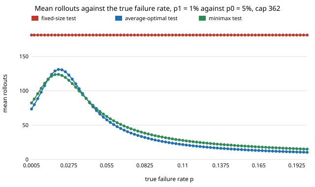

# What is the cheapest capped certification test in the worst case, not just at the two design rates? (free choice)

Python with numpy and scipy (HiGHS); imports the sibling projects `free-sprtcert` and `free-sprtopt`. **Free-choice project** (`PROJECTS.md`, "Picking work", step 1; draw 0.009). Why it seemed worth doing: `research/free-sprtopt` computed the best capped test for the *average* of the mean rollouts at the two design failure rates, and noted that such a test "may be slow at intermediate rates" and that a minimax design is a different problem. Nobody here had asked how much the intermediate rates cost, or whether a test that controls them is much worse at the ends.

**Live page:** https://duncan-haywood.github.io/monorepo-projects/research/free-sprtminimax/

## Question

To certify a failure rate of a robot policy in a digital twin (accept at p1, reject at p0, both errors at most 5%) with at most `cap` rollouts, which test has the smallest *worst-case* mean number of rollouts over every true failure rate between p1 and p0, how much does it save over the average-optimal test of `free-sprtopt`, and what does it cost at p0 and p1?

## Headline result (exact LP optima; see Limitations)

- **The average-optimal test is not the cheapest in the worst case, and the gap grows with the cap.** For p0 = 5%, p1 = 1% (fixed test 181 rollouts) the largest mean over p in [1%, 5%] is 133.4 for the average-optimal test and 132.3 for the minimax test at a cap of 181 (0.8% lower), but 131.0 against 123.8 at 362 (5.5% lower) and 134.8 against 123.8 at 543 (8.2% lower). For 10% vs 5% the saving is 0.7% at a cap of 298, 6.4% at 596 and 9.7% at 894; for 20% vs 10% it is 0.6%, 6.4% and 9.7% at caps of 135, 270 and 405.
- **The average-optimal test gets worse in the middle as the cap grows; the minimax test does not.** Its worst-case mean is 133.4, 131.0 and 134.8 at caps of 1x, 2x and 3x the fixed size (1% vs 5%), because the objective only constrains the two ends, while the minimax value is flat at 123.8 from 1.5x on. Extra cap is spent on the ends, which the average objective rewards and the worst case does not.
- **The worst case sits between the two rates, a little below the geometric mean of the two rates:** 1.9% for 1% vs 5%, 6.9% for 10% vs 5% and 13.9% for 20% vs 10% (`p_worst` in `results.txt`).
- **Against the fixed test the minimax design needs 32% fewer rollouts at worst** (123.8 against 181 for 1% vs 5%; 207.6 against 298 for 10% vs 5%, 30%; 95.2 against 135 for 20% vs 10%, 29%).
- **The price is 3 to 6% more rollouts at the design rates:** at a cap of 2x, 69.9 and 110.8 at p0 and p1 against 66.1 and 107.4 for the average-optimal test (1% vs 5%); 63.5 and 75.8 against 60.2 and 72.6 (20% vs 10%).

Figure: `experiments/mean_vs_p.svg` (mean rollouts against the true failure rate, cap 362). Tables: `experiments/results.txt`, `experiments/curve.txt`.



## Method

*Occupation measure.* Let r(n, f) be the sum, over the paths that reach node (n, f) (n rollouts, f failures), of the product of the probabilities of continuing at the earlier nodes. Every path to (n, f) has probability p^f (1-p)^(n-f), so the probability of visiting the node under any p is r(n, f) p^f (1-p)^(n-f). Split r into stop-accept A, stop-reject R and continue X, with r(n+1, f) = X(n, f) + X(n, f-1). Then P_p(accept), P_p(reject) and the mean E_p[N] (the continue mass weighted by the visit probability) are all linear in (A, R, X). Dividing each variable by the path count C(n, f) makes every coefficient a binomial pmf in [0, 1], which HiGHS handles.

*Two LPs.* "Average": minimise (E_p0[N] + E_p1[N]) / 2 subject to P_p0(accept) <= 0.05 and P_p1(reject) <= 0.05, which is the problem of `free-sprtopt`, here solved directly over randomised tests. "Minimax": minimise t subject to E_p[N] <= t on a grid of p. The grid starts at 9 points on [p1, p0]; the policy is evaluated exactly on a 161-point grid and the worst p found is added to the grid until the two maxima agree to 0.001 (cutting planes, 1 to 8 rounds).

*Validation.* The average LP equals the dual lower bound of `free-sprtopt` to two decimals in every case compared (98.78, 89.52, 87.64, 86.77 and 86.57 for 1% vs 5% at caps of 1x, 1.25x, 1.5x, 2x and 3x; 85.69 and 66.15 for 20% vs 10% at 1x and 3x), which is the exact optimum by a different route (a Lagrangian over a pattern search there, an LP here). The tests check it against that bracket, against brute-force enumeration of all deterministic rules at cap 2, and that the returned policy, evaluated by an independent forward recursion, holds both errors and reproduces the reported worst case.

## Reproduce

```bash
cd research/free-sprtminimax
python3 -m pytest -q tests                      # 5 tests, about 10 seconds
python3 experiments/run.py > experiments/results.txt     # about 10 minutes (the 3x caps dominate)
python3 experiments/curve.py > experiments/curve.txt     # about 10 seconds
python3 experiments/figure.py
```

Needs numpy and scipy (`PY=$(python3 platform/ci/pyenv.py pytest numpy scipy)` from the repository root).

## Limitations

- **Rollouts are assumed iid Bernoulli with the twin's failure rate,** as in `free-sprtcert`, `free-sprtcut` and `free-sprtopt`. This certifies the twin, not the robot; the sim-to-real gap is not modelled.
- **The worst case is over p in [p1, p0] only.** Outside it the means are lower (the curve falls on both sides, `curve.txt`), but the minimax test is *not* the minimiser of the maximum over all p. The exact maximum is checked on a 161-point grid, not proved over the continuum.
- **Randomised tests.** The LP optimum may randomise at some nodes. Randomisation is a mathematical convenience here (it gives the exact bound); a deterministic rule within a small margin may exist, but this project did not look for one, so the saving is a bound on what any test can do.
- **Pruning.** Nodes that no controlled rate reaches with probability above 1e-9 are dropped from the LP (HiGHS ignores coefficients that small), and the evaluator treats them as reject. The error this can add is below about 1e-6; the tests allow 1e-6.
- **A table, not a rule.** The optimal test is a table of (n, f) decisions, harder to state and audit than an SPRT's two lines.
- Three (p0, p1) pairs at alpha = beta = 0.05; caps of 1x to 3x the fixed size.

## Next steps

- Find a deterministic or two-line-boundary test close to the minimax value, to see how much of the 5 to 10% a practitioner can keep.
- Minimise a prior-weighted mean (a Bayesian design with a prior over the true failure rate) and compare with the two designs here.

## Outside dependencies

numpy and scipy (HiGHS). Nothing else; no data, no hardware, no model API.
