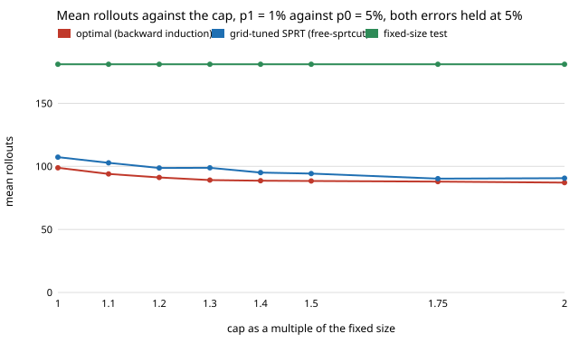

# How few rollouts can a capped certification test need while keeping both errors at 5%? (free choice)

Pure Python, no dependencies beyond the sibling project `free-sprtcert` (imported for the fixed-size test). **Free-choice project** (`PROJECTS.md`, "Picking work", step 1; draw 0.042). Why it seemed worth doing: `research/free-sprtcut` re-tuned a capped SPRT on a coarse grid and said a backward-induction design "would lower the means". Nobody knew by how much, or whether the grid result was already near the floor. This project computes the floor and certifies it, which turns "the tuned test is good" into a number.

**Live page:** https://duncan-haywood.github.io/monorepo-projects/research/free-sprtopt/

## Question

To certify a failure rate (accept at p1, reject at p0, both errors at most 5%) with at most `cap` rollouts, what is the smallest possible mean number of rollouts over all stopping rules, and how far above it is the grid-tuned SPRT from `free-sprtcut`?

## Headline result (exact; see Limitations)

- **The grid-tuned SPRT is 3 to 9% above the optimum.** For p0 = 5%, p1 = 1% (fixed test 181 rollouts) the optimal mean (average of the means at p1 and p0) is 98.9 at a cap of 181, 94.0 at 1.1x, 91.2 at 1.2x, 88.4 at 1.5x and 87.1 at 2x, against 107.3, 102.8, 98.7, 94.3 and 90.6 for the grid-tuned test: excess 8.5%, 9.4%, 8.2%, 6.6% and 4.1% (grid / optimum - 1). The 10% vs 5% and 20% vs 10% pairs give 2.7 to 7.2%.
- **The answer is certified, not just found.** In all 21 cases (3 pairs, caps 1x to 3x the fixed size) the lower bound valid for *every* test (randomised included) and the best deterministic rule found that holds both errors differ by at most 1.04%, and by at most 0.2% in 12 of them (e.g. 98.78 to 98.92 for 1% vs 5% at a cap of 181).
- **Caps beyond about 2x buy almost nothing.** At 3x the fixed size the optimum is 86.6 to 86.8 for 1% vs 5%, against 87.1 at 2x. The optimum with a loose cap is about half the fixed test: 86.8 vs 181 (1% vs 5%), 143.9 vs 298 (5% vs 10%), 66.3 vs 135 (10% vs 20%).
- **The optimal rule is asymmetric.** At 1% vs 5%, cap 181, it uses 71.9 rollouts on average at the unacceptable rate and 125.9 at the acceptable one (the objective only constrains their average).

Figure: `experiments/mean_vs_cap.svg`. Table: `experiments/results.txt`.



## Method

A rule decides, at each (n rollouts, f failures), to accept, reject or continue, and must stop at `cap`. Write A = P(accept | p0) and B = P(reject | p1), both required at most 0.05. For multipliers c0, c1 >= 0 the Bayes problem "minimise E_p0[N] + E_p1[N] + c0 A + c1 B" is solved exactly by backward induction in `sprtopt.bayes`: a prefix reached with probabilities a (under p1) and b (under p0) costs a + b to continue, c0 b to accept and c1 a to reject.

*Lower bound.* If a rule has A <= 0.05 and B <= 0.05 then its mean sum is at least V(c0, c1) - 0.05 (c0 + c1), for every c0, c1 (weak duality). `solve` maximises this over (log c0, log c1) by pattern search; the function is concave, and whatever point the search stops at, the bound it reports is valid. It covers randomised rules too.

*Upper bound.* Every Bayes rule met during the search is evaluated exactly (forward dynamic programme); the cheapest one with A and B both within 0.05 is a feasible deterministic test. The optimum lies between the two bounds. Nothing is sampled.

## Reproduce

```bash
cd research/free-sprtopt
python3 -m unittest discover -s tests -v   # 5 tests, about 4 seconds
python3 experiments/run.py > experiments/results.txt   # about 90 seconds
python3 experiments/figure.py
```

The tests check that the fixed test is in the family and reproduces the exact binomial acceptance probabilities, that the DP value equals the Lagrangian of the rule it returns, that backward induction matches brute-force enumeration of all 3^10 policies at cap 3, that the bounds bracket and the rule holds both errors, and that a larger cap never raises the bound. The grid-tuned figures are parsed from `../free-sprtcut/experiments/results.txt`, not retyped.

## Limitations

- **Rollouts are assumed iid Bernoulli with the twin's failure rate.** As in `free-sprtcert` and `free-sprtcut`, this certifies the twin, not the robot; the sim-to-real gap is not modelled.
- **The bracket is not zero-width.** Discrete errors mean no deterministic Bayes rule may sit exactly on both constraints, so the upper bound can exceed the lower by up to 1% (largest 1.04%, 0.91 to 0.95% at 1.5x and 1.75x for 1% vs 5%). The excess of the grid-tuned test is measured against the upper bound, so it is slightly understated, never overstated.
- **Only the average of the two means is optimised** (as in `free-sprtcut`), not the worst case over p, so the optimal rule may be slow at intermediate rates (`free-sprtcap` shows that tail). Minimising the maximum over p, or a prior-weighted mean, is a different problem.
- Three (p0, p1) pairs at alpha = beta = 0.05; caps of 1x to 3x the fixed size. The optimal rule is a table of (n, f) decisions, so it is harder to state and audit than an SPRT's two lines; this project does not simplify it into closed-form boundaries.

## Next steps

- Minimise the worst-case mean over all p in [p1, p0] (a minimax design) and compare the three designs at intermediate rates.
- Fit two straight boundaries to the optimal table, to see how much of the 3 to 9% a practitioner can keep with a rule they can write on one line.
