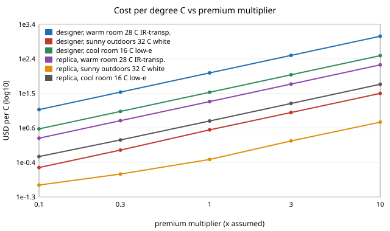

# garment-comfortcost: what does a degree of comfort cost in fabric?

A follow-up in the engineered-clothing track (`PROJECTS.md`, track 6), and the follow-up that `garment-thermal` listed ("what does a degree of comfort cost?"). It joins `garment-thermal`'s comfort-equivalent shifts to `garment-teardown`'s cost chain, for five fabric levers: infrared transmittance, low outer emissivity, white (low solar absorptance), thinner cloth and thicker cloth. Everything is a model on a CPU; no textile was measured and no price is quoted. Produced with AI assistance (Claude).

**Builds on.** `garment-thermal` (PMV and optical extension, whose own caveats apply in full) and `garment-teardown` (trench-coat cost chain and its replica). The idea of an infrared-transparent or infrared-gating textile comes from Hsu et al. (2016) and Zhang et al. (2019); I use them only for that idea and no number comes from them. It builds on none of the CU Boulder groups in `prompt.md` and claims no connection to them.

## Method
- `src/garment_comfortcost/cost.py`:
  - `benefit`: comfort-equivalent shift of a set of levers, solved jointly by `garment-thermal` (so two levers do not add), signed so that positive is a benefit in the scenario's direction: cooler for the warm room (28 C) and the sunny outdoors (32 C, 200 W/m2), warmer for the cool room (16 C).
  - `CostModel.added_retail`: added shell-cloth cost = premium (USD per m2 of treated cloth) x the cloth the marker uses (`garment-teardown`, 3.73 m2 for the trench), plus overhead, then the brand and retail multipliers (2.2 x 2.2 for the designer trench, none for the replica). Thinner or thicker cloth changes the cloth price as (clo/0.5)^exponent, exponent 1 unless stated.
  - `best_under_budget`: exhaustive search over lever subsets (thin and thick excluded together) within an added-retail budget.
- **Assumed premiums, USD per m2** (round numbers, none a quote): infrared-transparent 12, low-emissivity coating 6, white 0.5. The designer trench uses `garment-teardown`'s $28/m2 shell price.

## Reproduce
```bash
python3 -m pip install numpy scipy pytest
cd research/garment-comfortcost
python3 -m pytest -q tests          # 7 tests
python3 experiments/run.py          # seconds; writes experiments/results.txt
```

## Results (from `experiments/results.txt`; every cost rests on the assumed premiums)



*Figure: Cost per degree against premium multiplier (section E). Drawn by `experiments/figure.py`, which parses the committed `experiments/results.txt`.*
**Comfort benefit alone (C).** Warm room: infrared-transparent +2.37, thin +0.89; low-emissivity -1.57 and thick -1.24 are harms. Sun: white +3.57, thick +1.40; thin -1.38. Cool room: thick +4.04, low-emissivity +4.00; infrared-transparent -7.31. Levers combine sub-additively: infrared-transparent plus thin is +2.58 C jointly against +3.25 C summed; white plus thick is +3.77 against +4.97.

**Cost per degree, added retail (designer trench / replica).** At the assumed premiums: infrared-transparent in the warm room $114 / $19 per C; white in the sun $3 / $0.5 per C; low-emissivity in the cool room $34 / $6 per C. In each scenario exactly one treatment helps, so the ranking among treatments is fixed by physics and the premium decides only the price (section E tabulates it linearly over x0.1 to x10). A treatment that works against the scenario's direction has no benefit at any price.

**Premium ceilings.** For a treatment to cost at most $10 per C of added retail on the designer trench it must carry no more than about $1.0/m2 (infrared-transparent, warm room), $1.6/m2 (white, sun) or $1.8/m2 (low-emissivity, cool room); on the replica the ceilings are $6.3, $9.6 and $10.7/m2. The multiplier chain therefore makes the same treatment about six times harder to justify on the designer coat, because the retail chain scales the treatment's cost along with everything else. That ratio comes from the assumed 2.2 x 2.2 chain, which `garment-teardown` found does not reproduce the reported prices.

**Budget frontier (exhaustive search).** Warm room, replica: thinning alone gives +0.89 C up to a $20 budget, and infrared-transparent plus thin gives +2.58 C for $34. Sun, replica: white alone (+3.57 C for $2) is best up to $20; $23 adds thick for +3.77 C. Cool room, replica: low-emissivity plus thin (+2.36 C, $12 under the assumption that thin saves money) up to $20, then thick alone (+4.04 C for $21), then low-emissivity plus thick (+6.46 C for $43).

**Thinning is "free" only by assumption.** With cloth price proportional to insulation (exponent 1), thinning the designer trench from 0.5 to 0.3 clo saves $253 retail; at exponent 0.5, $143; at exponent 0 (price independent of weight) it saves nothing. Real cloth price does not scale with insulation in any such simple way, so every row of section D that includes a negative cost is an artefact of this assumption and should be read at exponent 0 to 0.5.

## Limitations
- **Stylised.** The premiums, the exponent, the multiplier chain and the fabric properties are assumed. Nothing here says what a real infrared-transparent or low-emissivity fabric costs.
- Comfort comes from `garment-thermal`: a steady-state whole-body index, an unvalidated optical extension, and the sunny scenario outside the index's usable range. See that README.
- Only shell cloth is treated; a coat needs lining, trims and tailoring that would change with the lever. Treatment cost is linear in area and ignores setup and minimum order.
- Three scenarios only; a wearer moves between them, so a lever that helps in one and harms in another (infrared-transparent: +2.37 in the warm room, -7.31 in the cool room) is not one number. A gated textile is the natural next lever and is not modelled here.
- Simulated comfort and assumed cost are not claims about any real garment, person or product.

## Next steps
Replace the premiums with sourced, dated prices; price thickness from real cloth weights; weight the three scenarios by wearing time (climate data) to get an expected benefit per dollar; add a gated-fabric lever with a switching threshold; fit the retail multiplier to reported prices.

## Owner steps
Sourcing fabric and coating prices (with dates) for builds at about $300, $1,000 and $3,000 is an owner step; none is quoted here, so no bill of materials is given.

## Outside dependencies (vitamins)
Python, numpy, scipy, `garment-thermal` and `garment-teardown`. The premiums, the thickness pricing and the fabric properties come from outside the model.

## References
- Hsu, P.-C. et al. (2016). Radiative human body cooling by nanoporous polyethylene textile. *Science* 353(6303):1019-1023. https://doi.org/10.1126/science.aaf5471 (title, journal, volume, pages and year checked against Crossref on 2026-10-13; not read in full)
- Zhang, X. A. et al. (2019). Dynamic gating of infrared radiation in a textile. *Science* 363(6427):619-623. https://doi.org/10.1126/science.aau1217 (checked against Crossref on 2026-10-13; not read in full)
- Gagge, Stolwijk and Nishi (1971) and ISO 7730 as cited by `garment-thermal`, which this project inherits; not re-checked here.
