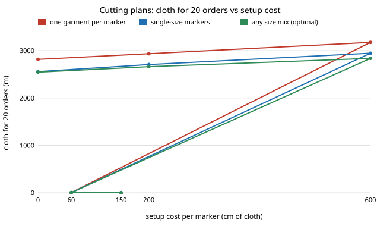

# garment-cutplan: how much cloth does a cutting plan save by mixing sizes in one marker, and is the saving real?

**Question.** A factory cutting an order of several sizes chooses which size mixes to lay in each marker and how many plies of each (*cutting-order planning*, an integer program). `garment-markercost` showed that one three-size marker is 9% shorter than three separate ones, but it never asked what that does to a whole order. **Headline (stylised shirt, 3 sizes, 20 random orders of 60 to 150 garments, modelled).** Laying several garments per marker saves about 9 to 11% of cloth against one garment per marker, and that is robust. Mixing *sizes* on top of that looks like a further 0.4 to 3.7% (more as the per-marker setup cost rises) when the exact integer program is run on the annealed marker lengths, but it is not distinguishable from nesting noise: re-nesting the markers the plan picked with fresh seeds, the mixed-size plan's edge over a plan using single-size markers only shrinks from 0.9% to nothing (+0.09%). The planner partly selects markers whose annealed length was luckily short. Everything is a model on a CPU with invented shapes; no real pattern, cloth or order was used. Produced with AI assistance (Claude).

**Live page:** https://duncan-haywood.github.io/monorepo-projects/research/garment-cutplan/

**Builds on.** `garment-markercost` (stylised shirt, seam allowance, size scaling 0.94 / 1.00 / 1.06), `garment-nesting` (raster annealing nester; I added an optional `max_len` argument to `anneal_raster`, default unchanged, because four-garment markers outgrow its 600 cm strip) and `garment-teardown`. The problem is the classic cutting-order (marker-plan) problem of apparel operations research; I cite no paper for it because I did not read one for this project. It builds on none of the CU Boulder groups in `prompt.md` and claims no connection to them.

## Method
- `src/garment_cutplan/plan.py`: `combos` lists the marker mixes (counts of each size, 1 to 4 garments: 34 mixes). `plan` solves, exactly with HiGHS through `scipy.optimize.milp`, for integer plies x_m of each mix m (at most 100 per marker) and a use flag y_m, minimising cloth = sum of marker length x plies plus a *setup* charge in cm of cloth per marker used, so that every size is cut at least as many times as ordered (over-cutting is allowed and paid for in cloth). `allowed` restricts the markers: `one_each` (1-garment markers only), `pure` (any single-size marker) or all mixes.
- `experiments/run.py`: nests all 34 mixes once (3 sizes of the stylised shirt, 1 cm allowance, 140 cm cloth, 100 annealing decodes, best of 2 seeds), cached in `experiments/marker_lengths.json`; then plans 30 seeded random orders (totals 60, 150, 300; size shares Dirichlet(4, 6, 4)). Orders that any of the three plans cannot cut within the ply cap are dropped, which removes all ten 300-garment orders, so the results are for 20 orders.
- Experiment D re-nests every marker the optimal and the pure plans used with seeds the planner never saw and re-costs the same plans. This is the check that matters.

## Reproduce
```bash
python3 -m pip install numpy scipy pytest
cd research/garment-cutplan
python3 -m pytest -q tests          # 7 tests
PYTHONPATH=src:../garment-markercost/src:../garment-nesting/src:../garment-teardown/src python3 experiments/run.py
                                    # ~6 min to nest the markers the first time, seconds from the cache
python3 experiments/figure.py       # redraws experiments/cloth.svg from results.txt
```

## Results (from `experiments/results.txt`)



*Figure: Experiment B. Drawn by `experiments/figure.py` from the committed `results.txt`.*

- **Several garments per marker pack tighter, and sizes barely matter.** Two identical shirts in one marker are 12% shorter than two 1-garment markers, four are 9% shorter; a mixed (1,1,1) marker is 9% shorter than its three singles. Over all 34 mixes the ratio to the sum of single-garment markers has median 0.94, minimum 0.87 (Experiment A). The annealer's own noise is about 5% (the same 9-piece marker re-nested with six seeds spans 124 to 130 cm).
- **Laying several garments per marker is the saving.** One garment per marker needs 2,815 to 3,175 m for the 20 orders against 2,546 to 2,837 m for the optimal plan: the optimal plan uses 9.3 to 10.7% less (Experiment B).
- **Mixing sizes adds 0.4% (setup 0), 1.7% (200 cm) or 3.7% (600 cm) over single-size markers, in sample.** The gap is larger for small orders (2.6% mean at 60 garments against 1.25% at 150; Experiment C), as expected when ply counts cannot fill many single-size markers. The optimal plan uses 1.6 to 1.8 mixed markers per order.
- **Most of that is selection of lucky markers.** Re-nested with fresh seeds, the optimal plan's cloth rises 2.8% against its prediction, the pure plan's 1.8%, and the optimal plan ends 0.09% *longer* than the pure plan (before: 0.9% shorter; this cloth-only figure differs from Experiment B's 1.7% because B includes the setup charge). With the noise this large and one re-nesting draw, I cannot tell whether a small real gain exists.
- **The ply cap is a minor effect.** Cloth per garment demanded is 126.9, 125.8 and 125.7 cm at caps of 20, 50 and 100 plies (Experiment E).

## Limitations
- **Stylised.** One invented shirt, three sizes that are a linear scaling of it (real grading is not uniform), one cloth width, one ply height, no grain or pattern matching, no end-of-ply or spreading loss, no defects. The annealer has a small budget; a better nester would shrink the noise and might reveal a real mixing gain, or might not.
- Mixes are capped at 4 garments (a longer table would give mixing more room). The setup charge is a free parameter, not a measured cutting-room cost.
- The re-nesting check uses one fresh pair of seeds; it shows a bias, not a confidence interval.
- Orders are random draws I chose; real orders have size curves and colour/lot constraints this ignores.
- Simulated cloth use is not a claim about any real garment, factory or price.

## Next steps
Re-nest every marker with many seeds and plan on the mean (or a lower confidence bound) to remove the selection effect, then see whether a mixing gain survives; use a real graded pattern (FreeSewing) for the sizes; allow the 6-garment tables that need a longer strip; add a cost per extra ply cut and an overage penalty.

## Owner steps
None: cloth prices are not used and no bill of materials is given.

## Outside dependencies (vitamins)
Python, numpy, scipy (HiGHS), pytest, `garment-markercost`, `garment-nesting` and `garment-teardown`. The shirt outline, size scaling, setup cost and order sizes are my assumptions.

## References
- `research/garment-markercost`, `research/garment-nesting` and `research/garment-teardown` in this repository; no external source is cited.
