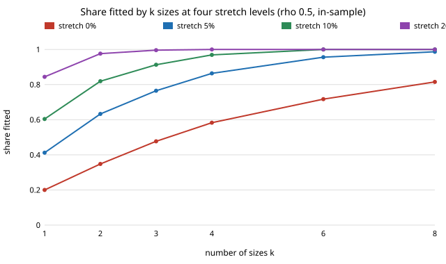

# garment-sizestretch: how many clothing sizes does a stretch fabric save?

Stylised and preliminary: on a synthetic bust/hip population (assumed parameters, no survey), allowing a garment to stretch 10% over the body cuts the sizes needed to fit 80% of people from 6 to 8 (or more than 8) down to 2 or 3. This is the follow-up `garment-sizeset` named ("a stretch-dependent tolerance"), and a new question after the run of micro-variants: it changes the fit model, not the seed or N. Track 6 (`PROJECTS.md`). Produced with AI assistance (Claude).

**Live page:** https://duncan-haywood.github.io/monorepo-projects/research/garment-sizestretch/

**Builds on.** `garment-sizeset` (maximum-coverage size runs; Nemhauser, Wolsey and Fisher 1978, *Mathematical Programming* 14, 265-294). It builds on none of the CU Boulder groups in `prompt.md` and claims no connection to them.

## Method
- `src/garment_sizestretch/sizes.py`: a person is (bust, hip) in cm from a bivariate normal, assumed means 95 and 100, sd 8, correlation rho in {0, 0.5, 0.9}. Not from any survey.
- A size is a nominal garment circumference s per measurement. A body m fits when `s - 8 cm <= m <= s * (1 + stretch)`: at most 8 cm loose, and the fabric stretches up to `stretch` over the body. Both measurements must fit. Window width is `8 + stretch * s` cm, so stretch helps larger sizes more. Stretch 0 has an 8 cm window, as in `garment-sizeset`'s +-4 cm.
- Choosing k sizes to fit the most people: exact 0-1 integer program (HiGHS via `scipy.optimize.milp`) over candidate sizes that put a sample person on either window end (2n candidates), so it is exact over that set. 250 people per draw, 3 seeds, stretch 0, 5, 10, 20, 30%.

## Reproduce
```bash
pip install numpy scipy pytest
cd research/garment-sizestretch
python -m pytest -q tests                                            # 5 tests
PYTHONPATH=src python experiments/run.py > experiments/results.txt  # about 2.5 min
python experiments/figure.py                                         # writes experiments/coverage.svg
```

## Results (from `experiments/results.txt`; mean of 3 seeded draws of 250; 270/270 solves proven optimal)
Share fitted in-sample, rho = 0.5:

| stretch | k=1 | k=2 | k=3 | k=4 | k=6 | k=8 |
|---|---|---|---|---|---|---|
| 0% | 0.200 | 0.348 | 0.477 | 0.583 | 0.717 | 0.815 |
| 5% | 0.412 | 0.633 | 0.765 | 0.864 | 0.956 | 0.987 |
| 10% | 0.604 | 0.819 | 0.913 | 0.969 | 1.000 | 1.000 |
| 20% | 0.844 | 0.976 | 0.996 | 1.000 | 1.000 | 1.000 |



- **Sizes needed for 80% fitted:** rho 0 / 0.5 / 0.9 need >8 / 8 / 6 with no stretch, 4 / 4 / 3 at 5%, 3 / 2 / 2 at 10%, and 1 at 20%.
- **Stretch matters most where correlation is weakest.** With no stretch, uncorrelated measurements are the hardest case (4 sizes fit 53%); at 10% stretch 4 sizes fit 96%.
- **Held-out (k = 4, fresh 20,000 people):** the overfitting penalty shrinks with stretch: 10 to 11 points lost at 0% (rho 0 and 0.5), about 3 points at 10%, about 2 at 20%. At 20% stretch the held-out share is 0.98 at all rho.

## Limitations
- The stretch model is idealised: a garment is assumed to fit anywhere up to its full stretch, but real fabric is uncomfortable, pressure-marking and wears out near its limit, and stretch recovery, direction and fabric weight are ignored. 20% rated stretch fitting everyone with one size is an upper bound, not a recommendation. Comfortable usable stretch is much smaller than a fabric's rated stretch.
- Two measurements only (no height, rise or sleeve length), synthetic Gaussian population with assumed parameters, three seeds, no cost model (stock, grading, returns).
- Fit is pass/fail; see `garment-pattern-fit` for strain-based fit.

## Next steps
Calibrate usable stretch from fabric data (for example an open textile property dataset), use an open anthropometric survey (licence checked), and price the SKU saving through `garment-teardown`.

## Outside dependencies
numpy and scipy (HiGHS) from pip. No survey data, hardware or paid service.
