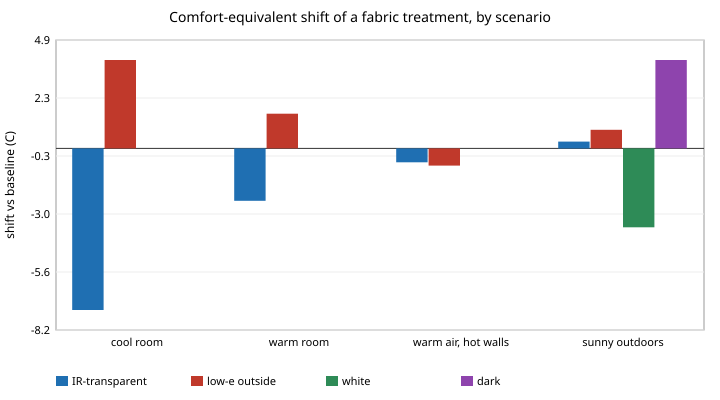

# garment-thermal: how much comfort can a radiative-cooling or infrared-gating textile buy, and which fabric properties matter most?

Fourth milestone of the engineered-clothing track (`PROJECTS.md`, track 6). A stylised heat balance of body, clothing and surroundings: the ISO 7730 / Fanger PMV comfort index and a Gagge-style two-node (core, skin) model, both extended with four fabric properties (outer-surface infrared emissivity, infrared transmittance, solar absorptance, moisture permeability). Everything is a model on a CPU; no textile was measured. Produced with AI assistance (Claude).

**Live page:** https://duncan-haywood.github.io/monorepo-projects/research/garment-thermal/

**Builds on.** The two-node idea of Gagge, Stolwijk and Nishi (1971); the Fanger PMV/PPD comfort index as standardised in ISO 7730 (Fanger, 1970 book); the motivation from textiles that cool the body by passing its infrared (Hsu et al., 2016) and that gate infrared with humidity (Zhang et al., 2019). It extends `garment-teardown` and the track's other models by giving the "fabric" an optical side. It builds on none of the CU Boulder groups in `prompt.md` and claims no connection to them. **Citation check.** The Hsu, Zhang, Gagge and ISO entries were taken from the reference list in `PROJECTS.md` (checked 2026-10-12). This run could not re-check them: the container blocks Crossref and doi.org. I did not read the papers' full texts; I use them only for the qualitative idea, and no number below comes from them.

## Method
- `src/garment_thermal/model.py`:
  - `dry_loss`: dry heat from the skin through clothing. Conduction through the cloth (0.155 m2K/W per clo) to an outer surface that exchanges heat by convection (ISO 7730 forced/natural form), by radiation with emissivity `eps_out`, and absorbs `alpha_sol` x solar flux. A fraction `tau_ir` of skin-to-surroundings infrared bypasses the cloth in a parallel path, and the outer surface radiates with weight `1 - tau_ir`. This parallel-path form is my simplification, not taken from a paper. The surface temperature is found by root-finding, not by the ISO iteration.
  - `pmv`: the ISO 7730 PMV heat balance with `dry_loss` in place of its clothing term; `ppd`; `comfort_equivalent_shift` (the temperature offset, applied to air and radiant temperature together, at which the baseline fabric would give the PMV of a new fabric).
  - `two_node`: a one-minute-step core and skin model with skin blood flow, regulatory sweating, shivering, a skin-wettedness limit and a clothing vapour resistance set by `im`. I wrote the control constants from my recollection of the Gagge-model literature and did not check them against a source; treat the two-node output as qualitative.
- Fabric presets (assumptions, not measurements): baseline (emissivity 0.95, tau 0, alpha 0.5, 0.5 clo); infrared-transparent (tau 0.8); low-emissivity outside (0.2); white (alpha 0.15) and dark (alpha 0.9). Sun is a body-averaged 200 W/m2 absorbed at the outer surface only (no shortwave through the cloth).
- Scenarios: cool room 16 C; warm room 28 C; warm air with hot walls (26 / 34 C); sunny outdoors 32 C at 1 m/s and 1.6 met.

## Reproduce
```bash
python3 -m pip install numpy scipy pytest pythermalcomfort   # pythermalcomfort only for the cross-check
cd research/garment-thermal
python3 -m pytest -q tests                      # 11 tests
python3 experiments/run.py                      # a few seconds; writes experiments/results.txt
```

## Results (from `experiments/results.txt`)



*Figure: Comfort-equivalent shift per treatment and scenario (section C). Drawn by `experiments/figure.py`, which parses the committed `experiments/results.txt`.*
**Validation.** With no optics the PMV agrees with `pythermalcomfort`'s ISO implementation to within 0.0062 over 144 combinations (16 to 34 C, 30 to 80% rh, 0.1 and 0.3 m/s, 1.0 and 1.6 met, 0.3 to 1.0 clo), including points outside the standard's validity range. At 22 C, 1.2 met, 0.5 clo, 0.1 m/s, 60% rh it gives PMV -0.75, PPD 16.9%. This checks my PMV code, not the physics of the optical extension, which has no reference here.

**Which property matters (comfort-equivalent shift, C, over each property's span with the others at baseline; the span is my choice):**

| scenario | tau_ir 0 to 0.8 | eps_out 0.95 to 0.2 | alpha_sol 0.9 to 0.15 | clo 0.7 to 0.3 |
|---|---|---|---|---|
| cool room 16 C | -7.3 | +4.0 | 0 | -6.4 |
| warm room 28 C | -2.4 | +1.6 | 0 | -1.8 |
| warm air, hot walls 26/34 C | -0.6 | -0.8 | 0 | -1.1 |
| sunny outdoors 32 C | +0.3 | +0.8 | -7.7 | +2.7 |

A negative number means the second end of the span feels cooler (it equals the baseline in a room that many degrees cooler).

- Indoors with no sun, infrared transmittance is the largest optical lever: an 0.8-transmittance cloth feels like a 2.4 C cooler room at 28 C, slightly more than cutting insulation from 0.7 to 0.3 clo (1.8 C). The same cloth in a 16 C room feels 7.3 C colder, so it is only an advantage when the wearer is too warm.
- A low-emissivity outer surface trades the other way: it keeps the wearer warmer when the surroundings are colder than the cloth (+1.6 to +4.0 C) and cooler when the walls are hotter (-0.8 C).
- Outdoors in sun, solar absorptance dominates the infrared properties by an order of magnitude in this model: white against dark is a 7.7 C span, while infrared transmittance moves comfort by 0.3 C. The sign of the infrared effect there is that more transmittance feels slightly warmer, because the surroundings are as warm as the skin and the sun already dominates. The PMV for the sunny case (+2.5 to +5.0) is far outside the index's usable range, so only the differences are meaningful.
- Two-node, 3 h at 34 C and 60% rh: the infrared-transparent cloth lowers skin temperature by 0.1 C and sweat loss by 25 g (346 against 371 g); a poor vapour-permeable cloth (im 0.2) raises skin wettedness from 0.55 to 0.79. In hot humid air, vapour permeability moves wettedness more than infrared transmittance does.
- Bounds for a gated textile (tau between 0.15 and 0.8; switching dynamics not modelled): open at 31 C saves 43 g of sweat in 3 h against closed (194 against 237 g); closed at 16 C keeps skin 1.5 C warmer (27.0 against 25.6 C). An ideal gate gets the better of both; a real one would depend on the switching threshold and speed, which are not modelled.

## Limitations
- **Stylised.** All fabric properties are assumed round numbers, not measurements of any real textile, and the parallel-path treatment of transmitted infrared is my simplification. It ignores wavelength dependence, multilayer garments, air gaps, wind pumping, moisture in the cloth and body-region differences.
- The comfort index is a steady-state, whole-body, population-average vote. The index is out of range in the hot and sunny scenarios. Comfort-equivalent shifts there are extrapolations.
- No ground-truth validation of the optical extension or of the two-node constants. Validation covers only the no-optics PMV.
- The two-node model uses my recalled constants, a fixed 70 kg, 1.7 m body and a one-minute step; it is not checked against published tables.
- Sun is crude (body-averaged, absorbed at the outer surface, no transmission, no ground reflection). Radiant temperature is a single value.
- Simulated comfort is not a claim about any real garment or person.

## Next steps
Measured emissivity and transmittance spectra for real textiles (weighted by the body's emission spectrum); check the two-node constants against a published description or `pythermalcomfort`'s two-node output; add body regions and layers; connect the shift to the cost model in `garment-teardown` (what does a degree of comfort cost?).

## Owner steps
None required. Measuring infrared transmittance or emissivity of real fabrics (an FTIR or emissometer) is an owner step if the property values are to be grounded.

## Outside dependencies (vitamins)
Python, numpy, scipy. Fabric optical and moisture properties, body parameters and the two-node control constants come from outside the model; `pythermalcomfort` is used only as a test oracle.

## References
- Gagge, A. P., Stolwijk, J. A. J., Nishi, Y. (1971). An effective temperature scale based on a simple model of human physiological regulatory response. *ASHRAE Trans.* 77(1). https://hdl.handle.net/2115/37901
- Fanger, P. O. (1970). *Thermal Comfort: Analysis and Applications in Environmental Engineering.* Danish Technical Press, Copenhagen. (Not re-checked in this run.)
- ISO 7730 (the PMV/PPD method; the 2025 edition is listed at https://www.iso.org/standard/85803.html). The formulation used here is the long-standing one; I did not read the 2025 text.
- Hsu, P.-C. et al. (2016). Radiative human body cooling by nanoporous polyethylene textile. *Science* 353(6303):1019-1023. https://doi.org/10.1126/science.aaf5471
- Zhang, X. A. et al. (2019). Dynamic gating of infrared radiation in a textile. *Science* 363(6427):619-623. https://doi.org/10.1126/science.aau1217
- `pythermalcomfort` (test oracle only), https://pypi.org/project/pythermalcomfort/
