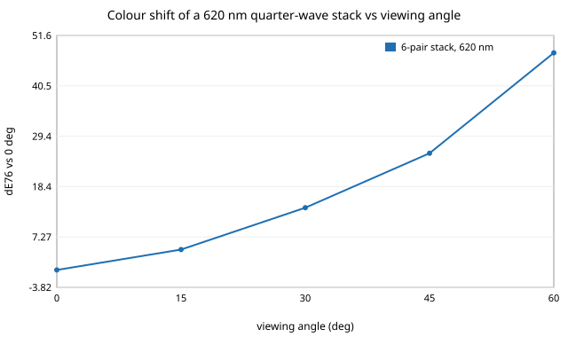

# garment-thincolor: how thin must a coating be to colour a fibre without dye, and how fragile is that colour?

Follow-up to `garment-optics` (its "structural colour (thin-film transfer matrix)" next step), in the engineered-clothing track (`PROJECTS.md`, track 6). A stylised plane-wave transfer-matrix model of a dielectric coating on a flat nylon-like substrate: reflectance spectrum, colour, angle dependence and sensitivity to thickness error. Everything is a model on a CPU; no fabric or coating was made or measured. Produced with AI assistance (Claude).

**Live page:** https://duncan-haywood.github.io/monorepo-projects/research/garment-thincolor/

**Builds on.** The standard characteristic-matrix method of optical thin films (e.g. Macleod, *Thin-Film Optical Filters*; Born and Wolf, *Principles of Optics*) and the analytic CIE 1931 colour-matching-function fit of Wyman, Sloan and Shirley (2013), *JCGT* 2(2):1-11. It builds on none of the CU Boulder groups in `prompt.md` and claims no connection to them. **Citation check.** Checked this run: the Wyman, Sloan and Shirley paper exists with those authors, title, journal and year 2013 (NVIDIA Research publication page); volume/issue 2(2) is inferred from the JCGT URL and the page range 1-11 is unverified. The two books are cited from memory; editions are unverified. The Gaussian-fit coefficients were typed from memory; tests only check sanity (peak of y-bar near 1 at 560 nm, perfect white gives L*=100), not exact agreement with the CIE tables.

## Method (`src/garment_thincolor/model.py`)
- Characteristic-matrix reflectance for s and p polarisation at any angle, layers on a semi-infinite substrate in air; unpolarised is the mean of s and p. Checked against the closed-form single-layer result and the Fresnel and quarter-wave anti-reflection limits.
- Constant indices (no dispersion, no absorption): substrate 1.53 (nylon-like), high 2.4 (TiO2-like), low 1.46 (SiO2-like). Round values recalled, not sourced. Densities 4230 and 2200 kg/m3 likewise recalled.
- Colour: reflectance times an **equal-energy** illuminant (not D65, to avoid typing in tabulated data), tristimulus normalised so a perfect white has Y=1, CIELAB relative to that white, so L*, C*, hue h are not directly comparable to sRGB/D65 swatches. Colour difference is dE76.
- Quarter-wave stacks `[hi, lo] x k` at a design wavelength; coating mass per area is density x thickness.

## Reproduce
```bash
python3 -m pip install numpy pytest
cd research/garment-thincolor
python3 -m pytest -q tests          # 8 tests
python3 experiments/run.py          # under a second; writes experiments/results.txt
```

## Results (from `experiments/results.txt`)



*Figure: Colour shift against viewing angle (section 3). Drawn by `experiments/figure.py`, which parses the committed `experiments/results.txt`.*
- A single TiO2-like film on nylon-like substrate reflects up to 34%, but the spectrum is broad and its colour weak and irregular (C* 5 to 45 over 40 to 200 nm), so one thin layer is a poor colour source; see the table for the sweep.
- Quarter-wave stacks give saturated colour with only a few g/m2 of oxide: designed at 620 nm, 2, 4 and 6 pairs reach Rmax 0.70, 0.95, 0.99 with C* 55, 70, 75 at 1.0, 2.0 and 3.0 g/m2 of oxide. Designed at 450 nm, C* peaks at 4 pairs (53) and is lower at 6 (45), and the 530 nm (green) stack is the least saturated (C* 11 to 28), so more pairs do not always mean more colour in this model.
- Angle: the 620 nm, 6-pair stack's peak moves to 614, 594, 568 and 540 nm at 15, 30, 45 and 60 degrees; dE76 against normal incidence is 4.5, 14, 26 and 48. This blue shift (iridescence) is the main practical limit for drape and body curvature, since a garment is seen at many angles.
- Thickness tolerance: with independent Gaussian layer-thickness errors of 2, 5, 10 and 20% (200 draws, 6-pair 530 nm stack), the median dE76 from nominal is 2.0, 5.8, 9.6 and 17.5, and the 90th percentile 4.8, 13.5, 23 and 42. Chroma is roughly preserved (median C* 27 to 28 against 28.1), so error mostly shifts hue rather than washing out colour.

## Limitations
Flat substrate, plane wave: a real fibre is a curved 10 to 20 um cylinder that scatters, and yarns are rough, so specular stack behaviour will not carry over directly. No dispersion, absorption, interface roughness, substrate absorption or dye. Equal-energy illuminant and an approximate CMF fit. Layer errors are independent and Gaussian; real deposition errors are correlated. dE76 is an old, crude colour-difference measure. No claim about any real fabric, and no deposition process, cost or durability is modelled.

## Next steps
Add dispersion from published index data; curved-fibre scattering (Mie or FDTD of a coated cylinder); D65 and sRGB output; an optimiser for stacks that minimise angle shift (a track 5 style loop with a non-LLM baseline); a coating-process cost model.

## Owner steps
Depositing a coating (sputtering, ALD or layer-by-layer assembly) and measuring reflectance with a spectrometer would ground the model. No price is given here: I have no dated, sourced price list, so a bill of materials at about $300 / $1,000 / $3,000 is left to the owner.

## Outside dependencies (vitamins)
Python, numpy. Refractive indices, densities and the CMF coefficients come from outside the model.

## References
- Wyman, C., Sloan, P.-P., Shirley, P. (2013). Simple Analytic Approximations to the CIE XYZ Color Matching Functions. *Journal of Computer Graphics Techniques* 2(2):1-11. (Existence, authors, journal and year checked; volume/issue inferred, pages unverified.)
- Macleod, H. A. *Thin-Film Optical Filters*, CRC Press. (Edition not re-checked.)
- Born, M., Wolf, E. *Principles of Optics*, Cambridge University Press. (Edition not re-checked.)
