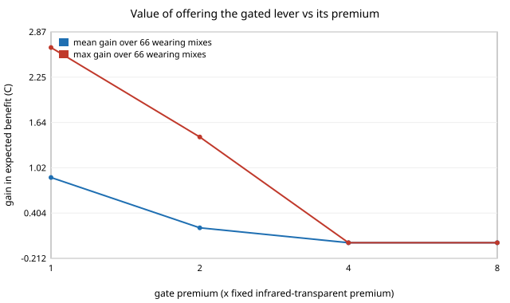

# garment-wearmix: does a fabric lever pay once you weight it by where the garment is worn?

A follow-up in the engineered-clothing track (`PROJECTS.md`, track 6), taking the first items on `garment-comfortcost`'s list of next steps: weight its three scenarios by wearing time, and add a gated-fabric lever. `garment-comfortcost` scored each lever in one scenario at a time, so infrared-transparent cloth looked good in the warm room (+2.37 C) and was only footnoted as bad in the cool room (-7.31 C). A coat is bought once and worn in all of them. Here a garment is scored by its wearing-time-weighted expected benefit, and the best garment is found for every wearing mix. Everything is a model on a CPU; no textile was measured, no price is quoted and no climate data is used. Produced with AI assistance (Claude).

**Builds on.** `garment-comfortcost` (levers, assumed premiums, cost chain), `garment-thermal` and `garment-teardown`, whose caveats apply in full. The gated lever is the idea of Zhang et al. (2019), used only as an idea; no number comes from it. It builds on none of the CU Boulder groups in `prompt.md` and claims no connection to them.

## Method
- `src/garment_wearmix/mix.py`:
  - Expected benefit of a lever set = sum over scenarios of wearing share x the jointly solved comfort benefit from `garment-comfortcost` (harms count as negative). Shares are (warm room 28 C, sunny outdoors 32 C, cool room 16 C) and sum to 1. A degree is worth the same in every scenario, which is itself an assumption.
  - `ir_gated`: an infrared-transparent shell whose transmittance can be switched off. In each scenario it takes the better of its two states (so its benefit is never negative), at an assumed multiple of the fixed infrared-transparent premium (2x unless stated). Switching is free and perfect: an upper bound on a real gate.
  - `best_for_mix`: exhaustive search over lever subsets within an added-retail budget (thin and thick excluded together; fixed and gated infrared excluded together).
  - The PMV root-finder leaves about 1e-7 C of noise on levers that do nothing; values under 1e-6 are reported as 0.
- Premiums are `garment-comfortcost`'s assumed round numbers (USD per m2): infrared-transparent 12, low-emissivity 6, white 0.5. Costs are for the replica trench.

## Reproduce
```bash
python3 -m pip install numpy scipy pytest
cd research/garment-wearmix
python3 -m pytest -q tests          # 7 tests
python3 experiments/run.py          # seconds; deterministic; writes experiments/results.txt
python3 experiments/figure.py       # redraws experiments/gatevalue.svg from results.txt
```

## Results (from `experiments/results.txt`; every cost rests on assumed premiums and every wearing share is a round-number scenario)



*Figure: mean and maximum gain in expected benefit from offering the gated lever, against its premium multiple (section E). Drawn by `experiments/figure.py`, which parses the committed `experiments/results.txt`.*

**A fixed infrared-transparent shell needs a warm-room majority.** Its expected benefit is positive only if the warm room takes more than 75.5% of wearing time when the rest is cool room, or more than 11.6% when the rest is sunny outdoors (section B). In the three mixes with a cool-room share of 20% or more it loses; in the 70%-cool mix it is -0.126 C per added dollar (section F). Per-scenario cost-per-degree numbers from `garment-comfortcost` therefore overstate this lever for anyone who is not mostly in warm rooms.

**White is the robust lever.** It never harms (0 in the warm and cool room, +3.57 C in the sun) and costs $2 on the replica, so its expected benefit per dollar is +0.19 to +1.34 C/USD across the four mixes, the best in every one (section F).

**The best garment depends on the mix, mostly through three sets.** Across 66 wearing mixes on a $50 replica budget the best set is low-emissivity + white + thick in 34, infrared-transparent + white in 11 and low-emissivity + thick in 8 (section D). At a $20 budget it is low-emissivity + white + thin in 26 and white alone in 17; the thin results rely on the assumption that thinner cloth is cheaper (see limitations), and the $20-budget "office" optimum has a negative added cost ($-9).

**The gate pays only if it is cheap.** Offering it at the same price as the fixed shell makes it the choice in 65 of 66 mixes (mean gain +0.89 C). At twice the premium it is chosen in 18 of 66 and the mean gain falls to +0.20 C, its largest single gain +1.44 C. At four times the premium or more it is never chosen at a $100 budget (section E). At $50 it is never chosen at 2x (section D), so at the replica's assumed premiums the gate is a luxury item, not a default.

## Limitations
- **Stylised.** The premiums, the gate multiple, the four wearing mixes and the fabric properties are assumed; no climate or activity data was used. Replacing the shares with measured hours per climate is the obvious next step.
- A degree of benefit is valued equally in every scenario and the scenarios are summed linearly; a real wearer would weigh a cold hour differently from a warm one, and might own several coats.
- The gate is ideal (free, perfect, instant switching, no weight or reliability cost), so its gain here is an upper bound. Its cost multiple is a guess.
- Thinning is cheaper only by `garment-comfortcost`'s linear cloth-price assumption, so thin appears in several optima and sometimes with negative cost. Read those rows at an exponent of 0 to 0.5 as that project says.
- Comfort comes from `garment-thermal`: a steady-state whole-body index with an unvalidated optical extension, and the sunny scenario outside the index's usable range. Costs are for the replica trench only.
- Simulated comfort and assumed cost are not claims about any real garment, person or product.

## Next steps
Weight the scenarios by measured wearing time per climate; price thickness from real cloth weights; let the wearer carry two garments (a shell and a layer) and optimise the pair; add a switching threshold and delay to the gate.

## Owner steps
Sourcing fabric and coating prices (with dates) for builds at about $300, $1,000 and $3,000 is an owner step; none is quoted here, so no bill of materials is given.

## Outside dependencies (vitamins)
Python, numpy, scipy, `garment-thermal`, `garment-teardown` and `garment-comfortcost`. The premiums, the gate multiple, the wearing shares and the fabric properties come from outside the model.

## References
- Zhang, X. A. et al. (2019). Dynamic gating of infrared radiation in a textile. *Science* 363(6427):619-623. https://doi.org/10.1126/science.aau1217 (checked against Crossref on 2026-10-13 by `garment-comfortcost`; not read in full)
- Gagge, Stolwijk and Nishi (1971) and ISO 7730 as cited by `garment-thermal`, which this project inherits; not re-checked here.
