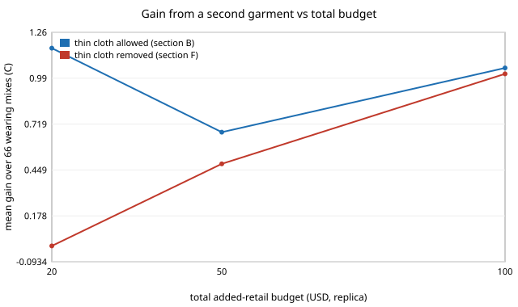

# garment-wearpair: does owning a second garment beat a better single garment?

**Question.** If you can add a fixed amount of fabric-lever cost to your wardrobe, is it better to spend it on one garment or to split it across two (say a shell and a layer) and wear whichever suits the day? **Headline (modelled, assumed premiums).** At a $50 added-retail budget on the replica trench, the best pair beats the best single garment in 58 of 66 wearing mixes (mean +0.67 C), but at $20 the whole gain (65 of 66 mixes, mean +1.17 C) comes from a modelling artefact: thin cloth has a negative added cost here, so owning it "pays for" a second garment. With thin cloth removed the gain at $20 is exactly 0, at $50 it is +0.49 C (54 of 66 mixes) and at $100 it is +1.02 C. Everything is a model on a CPU; no textile was measured, no price is quoted. Produced with AI assistance (Claude).

**Live page:** https://duncan-haywood.github.io/monorepo-projects/research/garment-wearpair/

**Builds on.** `garment-wearmix` (wearing-time weighting; its "Next steps" asked for a two-garment wearer), `garment-comfortcost` (levers, assumed premiums, cost chain), `garment-thermal` and `garment-teardown`, whose caveats apply in full. It builds on none of the CU Boulder groups in `prompt.md` and claims no connection to them. No new external source is used, so there are no new citations.

## Method
- `src/garment_wearpair/pair.py`: a wardrobe is a pair of lever sets (each from `garment-comfortcost`'s five fixed levers; the gated lever is left out). In each scenario (warm room 28 C, sunny outdoors 32 C, cool room 16 C) the wearer wears the best of {nothing, A, B}. Expected benefit = sum over scenarios of wearing share x that best benefit. Cost is the sum of the two garments' added retail against one total budget. Exhaustive search over all 24 valid lever sets, so about 300 pairs.
- Garments are worn one at a time; stacking a layer under a shell is not modelled.
- Single-garment baseline: `garment-wearmix`'s `best_for_mix`, restricted to the same five levers, at the same total budget.
- Sweep: 66 wearing mixes in steps of 0.1, plus four named mixes. Premiums (USD per m2) are `garment-comfortcost`'s assumed round numbers: infrared-transparent 12, low-emissivity 6, white 0.5.

## Reproduce
```bash
python3 -m pip install numpy scipy pytest
cd research/garment-wearpair
python3 -m pytest -q tests          # 5 tests
python3 experiments/run.py          # seconds; deterministic; writes experiments/results.txt
python3 experiments/figure.py       # redraws experiments/pairgain.svg from results.txt
```

## Results (from `experiments/results.txt`; every cost rests on assumed premiums and every wearing share is a round-number scenario)



*Figure: mean gain in expected benefit over 66 wearing mixes from a second garment, against total budget. Drawn by `experiments/figure.py`, which parses the committed `experiments/results.txt`.*

- **The cheap-budget gain is an artefact.** `garment-comfortcost` prices thin cloth linearly, so a thin garment has negative added cost (about -$10 on the replica). A pair can own it and spend the saving on the other garment. At a $20 budget the winning pairs are `thin | white+thick` in 55 of 66 mixes (section C). Remove thin cloth and the pair gains exactly nothing at $20 (section F), because no second garment fits.
- **At realistic budgets a second garment still helps, by specialising.** Without thin cloth, at $100 the usual winner is `ir_transparent+white | low_emissivity+thick` (44 of 66 mixes): a warm-weather shell and a cold-weather coat, each of which would harm the wearer in the other's weather. Mean gain +1.02 C, largest +3.19 C (section F). At $50 the gain is smaller (+0.49 C) and the typical pair is `low_emissivity+thick | white`.
- **Adding a garment beats halving the spend.** Comparing a pair at total budget 2B with a single garment at B, the pair gains a mean +1.07 to +1.63 C across B = $10, $25, $50 (section D). That compares different budgets and shows only that the second garment is worth its price in this model, not that two cheap garments beat one dear one at equal cost (section B/F does that).
- In 59 of 66 mixes at $50 both owned garments are the best choice in at least one scenario, so the second garment is really worn (section E).

## Limitations
- **Stylised.** Premiums, wearing shares, the three scenarios and the fabric properties are assumed; no climate or activity data was used. A degree of benefit is valued the same in every scenario.
- The $20 and, to a smaller degree, the $50 results with thin cloth depend on `garment-comfortcost`'s linear cloth-price assumption (negative added cost for thin cloth). Section F is the control; read the unqualified numbers with it.
- No stacking of garments, no laundry or wear-out, no cost of the second garment's storage or the wearer's choice error: a wearer who picks the wrong garment is not modelled.
- The gated lever is excluded; a pair of fixed garments is the alternative to it, and the two are not compared here.
- Comfort comes from `garment-thermal`: a steady-state whole-body index with an unvalidated optical extension, and the sunny scenario outside the index's usable range. Costs are for the replica trench only.
- Simulated comfort and assumed cost are not claims about any real garment, person or product.

## Next steps
Price thickness from real cloth weights so thin cloth stops funding the pair; allow stacking (a layer under a shell) and optimise three-garment wardrobes; compare the pair with the gated lever at equal cost; add a wrong-garment penalty.

## Owner steps
Sourcing fabric and coating prices (with dates) is an owner step; none is quoted here, so no bill of materials is given.

## Outside dependencies (vitamins)
Python, numpy, scipy, pytest, `garment-thermal`, `garment-teardown`, `garment-comfortcost` and `garment-wearmix`. The premiums, the wearing shares and the fabric properties come from outside the model.

## References
- `research/garment-wearmix`, `research/garment-comfortcost` and `research/garment-thermal` in this repository; their sources (Gagge, Stolwijk and Nishi 1971; ISO 7730) are inherited and not re-checked here.
