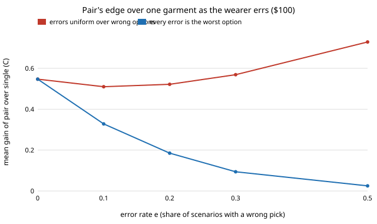

# garment-wearwrong: how often can a wearer pick the wrong garment before a second garment stops paying?

**Question.** `garment-wearpair` found that owning two garments (a shell and a layer) beats one garment at the same budget, but it assumed the wearer always wears the right one. What happens to that edge when the wearer sometimes wears the wrong garment for the weather? **Headline (modelled, assumed premiums, assumed error rates).** It depends on what a mistake looks like. If a wrong pick is a random wrong option, the pair's edge does not shrink (at $100, thin cloth removed: +0.55 C at no error, +0.57 C at 30% error), because errors punish a single garment's all-or-nothing choice more than a hedged pair. If every mistake is the worst owned option (the cold-weather coat in a heat wave), the $100 edge falls from +0.55 C to +0.09 C at a 30% error rate, and in 54 of 66 wearing mixes there is an error rate (median 0.72, as low as 0.04) at which one garment does as well. At $50 the pair's edge is negligible (+0.009 C) either way. Everything is a model on a CPU; no wearer was observed, no textile measured, no price quoted. Produced with AI assistance (Claude).

**Live page:** https://duncan-haywood.github.io/monorepo-projects/research/garment-wearwrong/

**Builds on.** `garment-wearpair` (the wardrobe search; its "Next steps" asked for a wrong-garment penalty), `garment-wearmix`, `garment-comfortcost`, `garment-thermal` and `garment-teardown`, whose caveats apply in full. It builds on none of the CU Boulder groups in `prompt.md` and claims no connection to them. No new external source is used, so there are no new citations.

## Method
- `src/garment_wearwrong/wrong.py`: in each scenario the wearer picks a right option with probability 1 - e and otherwise a wrong one. Options are the *distinct* garments owned plus nothing; identical garments collapse to one option (otherwise owning duplicates would dilute errors, an artefact the first version of this code had and the test `test_duplicate_garments_cannot_dilute_errors` now guards). A tied best option counts as right.
- Two error models: `uniform` (a wrong pick is uniform over the wrong options) and `worst` (every wrong pick is the single worst option).
- The wardrobe search is `garment-wearpair`'s, re-run with the noisy benefit: the best pair and the best single garment are each re-optimised at every e (so a wearer who knows they err buys differently), under one total added-retail budget on the replica trench. Thin cloth is removed in the main sweeps because its negative added cost (a `garment-comfortcost` pricing assumption) funds the second garment; section D shows it allowed.
- Sweep: 66 wearing mixes in steps of 0.1, e in {0, 0.1, 0.2, 0.3, 0.5}, break-even e on a 0.02 grid.

## Reproduce
```bash
python3 -m pip install numpy scipy pytest
cd research/garment-wearwrong
python3 -m pytest -q tests          # 6 tests
python3 experiments/run.py          # seconds; deterministic; writes experiments/results.txt
python3 experiments/figure.py       # redraws experiments/errgain.svg from results.txt
```

## Results (from `experiments/results.txt`; every cost rests on assumed premiums, every wearing share is a round-number scenario and every error rate is assumed)



*Figure: mean gain over 66 wearing mixes, thin cloth removed, $100 budget (sections A and F). Drawn by `experiments/figure.py` from the committed `results.txt`.*

- **Uniform errors do not hurt the pair.** At $100 the pair beats the single garment in 54 of 66 mixes at e = 0 and 65 of 66 at e = 0.1 to 0.5; the mean gain stays +0.51 to +0.73 C (section A). A single garment has only two options, so its error always throws away the garment's whole benefit, while the optimiser buys overlapping pairs (e.g. `low_emissivity+white+thick | white+thick`, 25 of 66 mixes at e = 0.3) whose wrong pick still keeps part of the benefit (section E). Break-even is reached in only 9 of 66 mixes before e = 1 (median 0.84).
- **Worst-option errors erode the edge.** At $100 the mean gain is +0.55, +0.33, +0.19, +0.09, +0.03 C at e = 0, 0.1, 0.2, 0.3, 0.5, and the pair beats one garment in 39 of 66 mixes at e = 0.5 (section F). Break-even e: median 0.72 over the 54 mixes where the pair wins at e = 0, minimum 0.04.
- **At $50 there is little to erode.** With thin cloth removed the pair beats the single garment in only 37 of 66 mixes at e = 0 (mean +0.009 C), and 29 mixes have no gain at all (section B).
- **The $20 gain is the same artefact as before.** With thin cloth allowed the mean gain falls from +0.95 C (e = 0) to +0.52 C (e = 0.5) under uniform errors (section D); it is thin cloth's negative price, not the wearer's choice, that makes it.

## Limitations
- **Stylised.** The error rate is a free parameter, the same in every scenario and for every wearer; no study of real clothing choices backs any value. Real errors are likely correlated with forecast surprise, which neither model has.
- The two error models bracket the question (a random wrong pick, and the worst one); a realistic wearer sits somewhere between, and the conclusion flips across that range. That is the finding: the pair's value depends on what a wrong pick costs, which this model cannot supply.
- Each wearer re-optimises their purchase knowing e; one who buys without allowing for errors is not modelled.
- Inherits `garment-wearpair`'s limits: garments are worn one at a time (no stacking), no laundry or wear-out, three scenarios, an unvalidated optical extension of the comfort index and linear cloth pricing.
- Simulated comfort and assumed cost are not claims about any real garment, person or product.

## Next steps
Price thickness from real cloth weights so thin cloth stops funding the pair; let errors depend on forecast surprise; compare the pair with the gated lever at equal cost with errors on both (a gate never picks wrongly if automatic); allow stacking.

## Owner steps
Sourcing fabric and coating prices (with dates) is an owner step; none is quoted here, so no bill of materials is given.

## Outside dependencies (vitamins)
Python, numpy, scipy, pytest, `garment-thermal`, `garment-teardown`, `garment-comfortcost`, `garment-wearmix` and `garment-wearpair`. The premiums, wearing shares, error rates and fabric properties come from outside the model.

## References
- `research/garment-wearpair`, `research/garment-wearmix`, `research/garment-comfortcost` and `research/garment-thermal` in this repository; their sources (Gagge, Stolwijk and Nishi 1971; ISO 7730) are inherited and not re-checked here.
