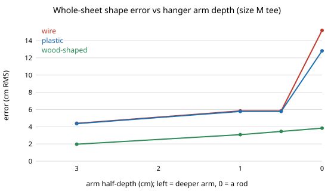

# hanger-3d: does the 2D hanger result survive in 3D, with front and back panels and a hanger arm of finite depth?

In a 3D cloth-sheet drape, **the 2D `hanger-fit` result holds where the two can be compared: with an arm as deep as the garment the 3D shape error matches the 2D chain to within 0.05 cm for the round-ended and wooden hangers (0.6 cm for thin wire), and the best arm width is again 1 cm wider than the half shoulder for child, M and XXL tees. What 2D cannot show is arm depth: a wooden hanger's whole-sheet error rises from 0.4 cm on a deep arm to 2.0 cm on a 3 cm half-depth arm and 3.8 cm on a rod, because the front and back panels fall 5–8 cm below the arm.** Produced with AI assistance (Claude). Track 18 (`hanger`, `PROJECTS.md`, milestone 4). Every number is from a stylised simulation with assumed fabric constants, not a measurement of real garments.

**Live page:** https://duncan-haywood.github.io/oss-monorepo/research/hanger-3d/



## Why this question

`hanger-fit` drapes a 1D chain along the shoulder line, with the garment's 20 cm depth folded into a mass and stiffness (`DEPTH`). That cannot show the front and back panels, shear, or an arm that is thinner front to back than the garment. Milestone 4 asks for the drape in 3D, checked against milestone 1 on the cases both can run. The check matters more than the new numbers: a 3D solver nobody has compared to the 2D one only adds a second set of unverified numbers.

## Builds on

- `hanger-fit` (this repository): garments, hangers, worn shape, fabric constants, score and the L-BFGS solver are imported unchanged.
- Baraff and Witkin (1998), large steps in cloth simulation, SIGGRAPH: stretch, shear and bend springs on a grid with penalty contact. This project solves for the static drape rather than time-stepping.
- Bergou et al. (2008), discrete elastic rods, *ACM TOG* 27(3): the turning-angle bending energy, now along both grid directions.
- Kawabata (1980), KES-FB: the unit of bending rigidity. Values are assumptions, not KES measurements.

Citations were not re-checked online in this run. **Lab tags:** none; builds on no group in `prompt.md`.

## Method

`src/hanger_3d/cloth3d.py`. The sheet is 20 cm deep (9 columns, 2.2 cm apart) and runs from the neck line along the shoulder and sleeve (rows 0.5 cm apart; `hanger-fit` uses 2.5 mm). Energy is gravity, stretch springs along both directions and both diagonals (shear stiffness 0.1 of stretch, assumed), turning-angle bending along both directions, and a penalty contact with the arm. The arm is `hanger-fit`'s capsule, extended ±`zh` in depth. The neck row is pinned where it lies on the arm and pinned in x only elsewhere. Starting state: the 2D start copied across the depth. Solved with L-BFGS (3,000 iterations).

- **Score.** As in `hanger-fit` on the centre column (`err`, `crease`), plus `err_all` over every column and `sag`, how far an edge column hangs below the centre column.
- **Checks.** Analytic gradients of the angle and of the whole energy against finite differences (unit tests). A slab arm (`zh` = 12 cm, deeper than the sheet) makes the problem independent of depth.

## Results (all from `experiments/results.txt`)

- **A. Slab arm against the 2D chain** (size M, 3 stock hangers × 3 fabrics). Largest error difference to the 2D chain at the same 5 mm row spacing: 0.61 cm (thin wire on a sweater); round-ended and wooden hangers differ by under 0.03 cm on tees and shirts and 0.05 cm on sweaters. Largest crease difference 2.3 deg/cm. Thin-ended wire is the sensitive case: the 2D chain itself moves by up to 0.18 cm between 2.5 mm and 5 mm rows.
- **B. Arm depth** (M tee). Wooden hanger, whole-sheet error: 0.38 cm (deep arm), 1.97 (3 cm half-depth), 3.08 (1 cm), 3.84 (rod). The edge columns hang 4.8, 6.7 and 7.9 cm below the centre column for 3, 1 and 0 cm. Centre-column error rises less (0.39 to 1.18 cm), so a centre-line score hides most of it. Wire and plastic are poor at any depth (3.1–3.4 cm centre error) and a rod makes them worse (9–11 cm).
- **C. Width.** Wooden-shaped hanger (slope 16°, bow 0.8, r 2 cm), tees. Best offset of arm width from half shoulder, on a 1 cm grid: +1 cm for child, M and XXL in 2D, in 3D with a slab arm, and with a 1.5 cm half-depth arm. The 3D slab column matches 2D to 0.003 cm; at 1.5 cm half-depth the minimum is 0.2–0.3 cm higher.

- **D. Design loop in 3D** (`experiments/design.py`, `experiments/design_results.txt`; M tee, CMA-ES over `hanger-fit`'s four shape variables, 64 drapes per run, two seeds, `hanger-fit`'s crease-penalised objective but on the whole-sheet error). Best whole-sheet error found: 2.0 and 2.2 cm at 1.5 cm half-depth, 1.3 and 1.7 cm at 3 cm, 0.74 and 0.66 cm at 6 cm. **Arm depth sets the floor; hanger shape moves it much less.** The hangers `hanger-fit` designed on the centre line (150 drapes, two seeds), drawn in 3D, score 2.4 and 2.7 cm, 1.6 and 1.8 cm, and 0.57 and 0.63 cm at the same three depths: at 6 cm they are as good as or better than the 3D loop's (budget-limited), at 3 cm the 3D loop is 0.34 and 0.17 cm better on the two seeds, and at 1.5 cm 0.42 and 0.44 cm better. The three stock hangers on a 6 cm arm: wooden-shaped 0.72 cm, wire 3.7 cm, plastic 3.5 cm. Optimising the centre column only (3 cm, two seeds) gives 1.8 and 1.7 cm whole-sheet error even though its centre-column error is 0.3 to 1.0 cm: the centre-line score is the wrong target once the arm is shallow.

## Limitations

- One 20 cm strip, not a shirt: no collar, sleeve seam, front opening or body below the shoulder. "Front and back panels" are the two halves of the strip either side of the arm.
- Coarse grid across the depth (2.2 cm). Because only the centre column lies at 0, arm half-depths 0.5 and 1 cm touch the same columns and give identical results for wire and plastic (section B); the arm depth below about 2 cm is not resolved.
- Fabric constants, the shear fraction and the contact stiffness are assumed. No friction (the milestone's friction item is still open). The static minimum is found from one start, so it may not be the global one.
- Convergence was not tested against iteration count or grid refinement beyond the two row spacings in section A.
- Section C varies width only, for tees and one hanger shape. Section D is one garment (M tee), 64 drapes and two seeds per cell; the arm depth is fixed per loop, not a design variable, because a deeper arm is always better here and the model has no cost for depth.

## Next steps

1. Add friction and a sleeve seam, then rerun section B with a finer depth grid.
2. Section D fixes the arm depth per loop and uses 64 drapes with two seeds, so the gap between the 3D and 2D designs at 3 cm is within seed noise; more seeds and a larger budget would settle it. Several 3D designs sit on the end-radius bound (3 cm), so the bounds need widening for a shallow arm.
3. A full shirt (front and back panels joined at the shoulder and side seams, collar) in an open solver.

## Reproduce
```bash
cd research/hanger-3d
python3 -m unittest discover -s tests      # 4 tests, ~25 s; needs numpy
python3 experiments/run.py                 # writes results.txt, ~6 min on 4 cores
python3 experiments/design.py              # writes design_results.txt, ~35 min on 4 cores
python3 experiments/figure.py              # writes experiments/err_vs_depth.svg
```
