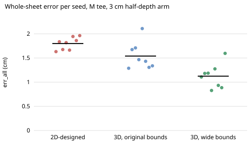

# hanger-3dseeds: is a hanger designed in 3D really better than one designed on the 2D centre line, once seed noise is counted?

**Yes. At a 3 cm half-depth arm, 8 CMA-ES seeds per route, the 3D-designed hangers have a whole-sheet error 0.26 cm lower than the 2D-designed ones with `hanger-fit`'s bounds (1.54 against 1.80 cm, exact permutation p = 0.033) and 0.68 cm lower once the end-radius and bow limits are widened (1.12 cm, p < 0.001).** The gain is real but comes with a cost: the 3D designs have a worse centre-line error (0.77 against 0.40 cm), so the two scores disagree about which hanger is best. Produced with AI assistance (Claude). Track 18 (`hanger`, `PROJECTS.md`); follows `hanger-3d`'s next step 2. Stylised: see Limitations.

**Live page:** https://duncan-haywood.github.io/oss-monorepo/research/hanger-3dseeds/



## Why this question

`hanger-3d` section D ran the 3D design loop on two seeds and found it 0.17 and 0.34 cm better than 2D-designed hangers at 3 cm, which it called within seed noise, and noted that several 3D designs sat on the 3 cm end-radius bound. This project spends the compute to settle both points.

## Builds on

`hanger-3d` (cloth solver, score, design loop) and `hanger-fit` (garment, hanger model, CMA-ES, crease-penalised objective), both imported unchanged. No lab tag.

## Method

M tee, arm half-depth 3 cm, objective = whole-sheet error + 0.05 × max(0, crease − 30), as in `hanger-3d`. Three routes, seeds 0 to 7 each:

- **2d-design**: `hanger-fit`'s loop on the centre-line error (150 drapes, original bounds), then drawn in 3D.
- **3d-orig**: the 3D loop (64 drapes) with `hanger-fit`'s bounds (`experiments/control.py`).
- **3d-wide**: the 3D loop with bow −2 to 5 cm and end radius 0.15 to 6 cm (`experiments/run.py`; the other two bounds are unchanged).

The comparison is a difference of means with a 4,000-resample bootstrap interval and an exact permutation test over all 12,870 splits (`src/hanger3dseeds/stats.py`, unit-tested on a hand-countable case).

## Results (`experiments/results.txt`, `experiments/control_results.txt`)

| route | whole-sheet error, cm (mean ± sd) | centre-line error | crease, deg/cm | sag, cm |
|---|---|---|---|---|
| 2d-design | 1.80 ± 0.13 | 0.40 | 25 | 4.6 |
| 3d-orig | 1.54 ± 0.28 | 0.96 | 21 | 4.4 |
| 3d-wide | 1.12 ± 0.25 | 0.77 | 11 | 2.9 |
| stock wooden-shaped | 1.97 | 0.47 | 29 | 4.8 |

- 3d-orig minus 2d-design: −0.26 cm, CI [−0.44, −0.03], p = 0.033. 3d-wide minus 2d-design: −0.68, CI [−0.85, −0.49], p < 0.001. 3d-wide minus 3d-orig: −0.42, CI [−0.67, −0.18], p = 0.006.
- 3d-wide designs are blunt: end radius 4.7 to 6 cm, and three of eight sit exactly on the 6 cm limit, so the bound still binds. They roughly halve the crease and the sag. Whether such a blunt end is a usable hanger is not tested here.
- 3d-orig seed spread (1.29 to 2.11) is about twice the 2D spread, which is why two seeds could not settle it.

## Raising the radius limit (`experiments/radius_cap.py`, `experiments/radius_cap_results.txt`)

The 3d-wide optimum sat on the 6 cm limit in three of eight seeds, so the loop was rerun with the limit at 9 and 12 cm (same other bounds, 8 seeds, 64 drapes).

| end-radius limit | whole-sheet error, cm (mean ± sd) | seeds on the limit | optimum radius range, cm |
|---|---|---|---|
| 6 (3d-wide) | 1.12 ± 0.25 | 3 of 8 | 4.7 to 6.0 |
| 9 | 1.02 ± 0.22 | 2 of 8 | 5.6 to 9.0 |
| 12 | 1.01 ± 0.32 | 0 of 8 | 4.8 to 10.4 |

- At 12 cm no seed sits on the limit, so the bound has stopped binding. The error barely moves: 9 against 6 cm is −0.10 cm (CI −0.32 to +0.11, p = 0.41), 12 against 6 cm is −0.11 cm (CI −0.36 to +0.16, p = 0.45). Both are within seed noise, so a wider limit gains nothing measurable.
- The optimum radius is poorly determined: it ranges from 4.8 to 10.4 cm across seeds at nearly equal error, so the error is flat along the radius. A 10 cm half-width end is not a usable hanger tip, which supports the next step (a contact-width penalty) rather than a still wider box.
- In `radius_cap_results.txt` the summary labels read `mean3d`/`mean2d`; there `mean2d` is the 6 cm-limit group, not the 2D route.

## Limitations

- One garment (M tee), one arm depth (3 cm), 64 drapes per 3D loop against 150 for 2D, so the budgets differ; the 3D loop wins with less compute, and a longer search could change the gap (untested).
- The 2D loop has no access to the wide bounds, so the 3d-wide against 2d-design contrast mixes loop and bound. The like-for-like contrast is 3d-orig against 2d-design (−0.26 cm).
- Fabric constants, shear fraction and contact stiffness are assumed (`hanger-3d`); the 20 cm strip has no collar or seam; no friction. Nothing is measured on a real garment. A bound-limited optimum (radius) shows the design space, not a manufacturable hanger.
- Citations: none beyond those in `hanger-3d` and `hanger-fit`.

## Next steps

Add a width or contact-patch constraint so blunt ends are penalised; repeat across garments and depths; measure real garments (owner step).

## Reproduce

```bash
cd research/hanger-3dseeds
python3 -m unittest discover -s tests      # 4 tests, <1 s; needs numpy
python3 experiments/run.py                 # results.txt, ~25 min on 4 cores
python3 experiments/control.py             # control_results.txt, ~10 min
python3 experiments/figure.py              # err_by_route.svg
```
