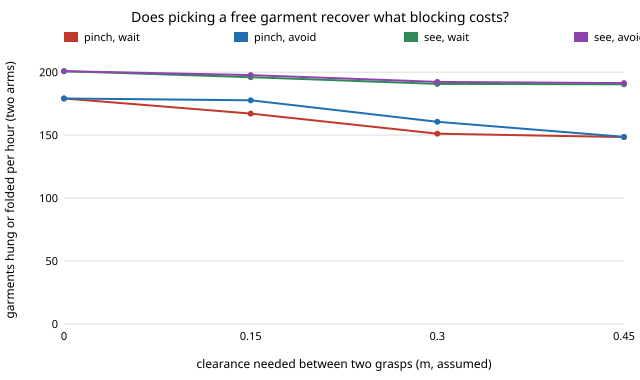

# hanger-avoid — can a second laundry-hanging arm pick a free garment instead of waiting?

**Live page:** https://duncan-haywood.github.io/oss-monorepo/research/hanger-avoid/

**Live page:** https://duncan-haywood.github.io/monorepo-projects/research/hanger-avoid/

Two arms share one dryer pile, and when their grasps would be too close the later arm waits (`hanger-sharedpile`). Does choosing a different, non-clashing garment recover the loss? **Partly, and mostly for blind pinching.** At 0.30 m clearance blind pinching goes from 151 to 161 garments hung or folded per hour (it lost 28 to blocking), aiming from 191 to 192 (it lost 10), sweeping from 186 to 191. At 0.45 m nearly every pair clashes in the 0.60 m bin and avoiding does nothing.

Track 18 (`hanger`, [`PROJECTS.md`](../PROJECTS.md)). Takes the first "Next steps" item of [`hanger-sharedpile`](../hanger-sharedpile). Built on none of the CU Boulder groups in `prompt.md`; no connection to them is claimed.



## Method

`src/hanger_avoid/avoid.py` (stdlib only) imports `hanger-sharedpile`, `hanger-pick` and `hanger-cell` unchanged.

- Same pile, arms, blocking rule and `hanger-cell` re-timing as `hanger-sharedpile`.
- New: `pick_allowed` is `hanger-pick`'s `pick` restricted to a set of allowed garments (the policy's own rule applied to that set; occlusion still counts every garment, so a hidden garment stays hidden).
- With `avoid=True`, an arm that would otherwise choose a garment within `sep` of the other arm's current pick (found by probing a copy of the pile and the random state) chooses among garments farther than `sep` instead. If none is, it waits as before.
- 200 loads per cell, seeded; intervals are 95% percentile bootstraps over loads. Wait and avoid use the same seeds.

Checks (tests): with every garment allowed `pick_allowed` returns the same time, outcome and random state as `pick`; `avoid=False` equals `hanger-sharedpile`'s sequence exactly; the wait columns here reproduce its published numbers (179 / 167 / 151 / 148 pinch, 201 / 196 / 191 / 190 see); avoiding lowers total waiting.

## Results (`experiments/results.txt`)

- **A. Two arms.** Done per hour at sep 0.15 / 0.30 / 0.45, wait then avoid: pinch 167.1 → 177.7, 151.1 → 160.6, 148.4 → 148.6; see 196.0 → 197.7, 190.7 → 192.3, 190.4 → 191.3; sweep 193.1 → 195.2, 185.6 → 190.8, 180.5 → 185.9. Redirected picks per load at 0.30 m: pinch 4.7, see 3.7, sweep 6.2. At 0.15 m pinching recovers 10.6 of its 12 lost; at 0.30 m 9.5 of 28.
- Aiming's gain (0.8 to 1.7 per hour) is smaller than the width of its intervals (about 6); the intervals are from separate bootstraps, not a paired test, so read the aiming gain as small and unproven. The pinch and sweep gains of 5 to 11 per hour are larger than their interval half-widths (about 2).
- **B. Third arm, see.** At 0.30 m: 195.2 waiting, 199.8 avoiding, against 190.7 / 192.3 for two arms; so with avoidance the third arm adds about 7.5 per hour.
- **C. Spacing, see, 0.30 m.** Avoiding gains 3.5 per hour when the arms return after 5 s, 1.6 at 14 s, 0.4 at 30 s and 0.7 at 60 s: it matters when the arms meet often.

## Limitations

- The clash rule is a centre distance with an assumed clearance; real grippers have shape, reach and cable limits.
- Avoiding only redirects the choice among what the policy would pick from; it does not plan where the other arm will go next, nor reorder to keep the pile reachable. Sweeping still moves garments during a redirected pick.
- A garment left behind because it clashed is simply picked later; if clashes then cluster at the end of a load (few garments left, near each other) the model still pays the wait there.
- Cell stations, pick times, `downstream` and the pile are `hanger-cell` and `hanger-pick` placeholders; nothing here is a measurement of a robot.

## Reproduce
```bash
cd research/hanger-avoid
python3 -m unittest discover -s tests      # 6 tests
python3 experiments/run.py                 # writes results.txt (about 45 s)
python3 experiments/figure.py              # writes experiments/avoid.svg
```

## Owner steps
Measure the real clearance two grippers need over one bin; not a run's to do.

## Next steps
Plan the second arm's target against the first arm's next move (not just its current pick); link pile garment kinds to the cell's archetypes (`hanger-kindlink`); a paired test of the aiming gain with more loads.

## Outside dependencies
None beyond the Python standard library. Imports [`hanger-sharedpile`](../hanger-sharedpile), [`hanger-pick`](../hanger-pick) and [`hanger-cell`](../hanger-cell).
