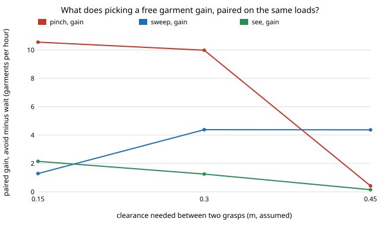

# hanger-avoidpaired — is a laundry-hanging arm's gain from picking a free garment real? A paired test on 2000 loads

**Live page:** https://duncan-haywood.github.io/oss-monorepo/research/hanger-avoidpaired/

**Live page:** https://duncan-haywood.github.io/oss-monorepo/research/hanger-avoidpaired/

[`hanger-avoid`](../hanger-avoid) left one result unsettled: aiming's gain from avoiding a clash (0.8 to 1.7 garments an hour) was smaller than its two separate 200-load intervals. Pairing the runs on the same 2000 loads settles it. **Yes, it is real but small.** At 0.30 m aiming gains +1.25 an hour (95% interval 0.60 to 1.92); sweeping gains +4.4 (3.7 to 5.1) and blind pinching +10.0 (9.6 to 10.4). At 0.45 m aiming gains nothing distinguishable from zero (+0.15, −0.05 to 0.36).

Track 18 (`hanger`, [`PROJECTS.md`](../PROJECTS.md)). Takes the "paired test of the aiming gain with more loads" next step of `hanger-avoid`. Built on none of the CU Boulder groups in `prompt.md`; no connection to them is claimed. Produced with AI assistance.



## Method

`src/hanger_avoidpaired/paired.py` (stdlib only) imports `hanger-avoid` (and through it `hanger-sharedpile`, `hanger-pick`, `hanger-cell`) unchanged.

- Load *i* uses seed `i` whether avoiding is on or off, so the two runs start from the same pile and arrival draws. After the first redirect their random streams diverge, so the pairing is partial, not exact.
- Per load, difference = done/h with avoid − done/h with wait. Interval: 95% percentile bootstrap (2000 resamples) of the mean difference over loads. Also reported: the paired standard error against the unpaired one hanger-avoid's method implies, and the share of loads where avoiding was strictly better (a tie counts as not better).
- Two arms, load 25, 2000 loads per cell, clearances 0.15 / 0.30 / 0.45 m, policies see (aiming), sweep, pinch. Parameters are hanger-avoid's, which are `hanger-pick`/`hanger-cell` placeholders (nothing here is a measurement of a robot).

Checks (tests): a constant shift gives a zero-width interval; the bootstrap is deterministic and ordered; with a zero clearance avoiding has nothing to do and the per-load numbers equal the waiting run's exactly.

## Results (`experiments/results.txt`, about 3 minutes)

| policy | sep (m) | wait /h | avoid /h | paired gain | 95% interval | se paired | se unpaired | avoid better |
|---|---|---|---|---|---|---|---|---|
| see | 0.15 | 196.2 | 198.4 | +2.15 | 1.48 to 2.85 | 0.36 | 0.73 | 56% |
| see | 0.30 | 191.3 | 192.5 | +1.25 | 0.60 to 1.92 | 0.34 | 0.67 | 53% |
| see | 0.45 | 190.5 | 190.6 | +0.15 | −0.05 to 0.36 | 0.11 | 0.68 | 5% |
| sweep | 0.15 | 193.0 | 194.3 | +1.29 | 0.71 to 1.88 | 0.31 | 0.64 | 50% |
| sweep | 0.30 | 186.6 | 190.9 | +4.38 | 3.74 to 5.05 | 0.35 | 0.61 | 60% |
| sweep | 0.45 | 181.2 | 185.6 | +4.37 | 3.75 to 5.03 | 0.33 | 0.60 | 60% |
| pinch | 0.15 | 167.0 | 177.5 | +10.55 | 10.09 to 11.05 | 0.24 | 0.52 | 85% |
| pinch | 0.30 | 150.8 | 160.8 | +9.98 | 9.62 to 10.35 | 0.19 | 0.54 | 90% |
| pinch | 0.45 | 147.6 | 148.0 | +0.42 | 0.33 to 0.52 | 0.05 | 0.54 | 12% |

- Pairing roughly halves the standard error (0.2 to 0.4 against 0.5 to 0.7), and 2000 loads against 200 cuts it by another √10. Together that turns hanger-avoid's "small and unproven" into a measured +1 to +2 an hour for aiming at 0.15 and 0.30 m.
- The load-to-load spread of the difference is large (SD about 15 for aiming and sweeping): on any single load avoiding wins only about half the time. The gain is a mean over many loads, not something one dryer load shows.
- Pinching at 0.45 m gains a statistically clear +0.4, which is negligible in size.
- Unlike hanger-avoid, the sweep gain at 0.45 m (+4.4) is as large as at 0.30 m; hanger-avoid's 200-load figures (185.9 − 180.5 = 5.4) are consistent with it.

## Limitations

- Clearance, spacing, station times and the pile are placeholders from earlier hanger projects; only the statistics are tightened here, not the inputs.
- Pairing is partial (streams diverge after a redirect); the paired interval is still a valid interval for the mean difference, only less tight than exact pairing would be.
- Bootstrap over loads treats loads as independent draws of one stylised pile; it says nothing about a real dryer.

## Reproduce
```bash
cd research/hanger-avoidpaired
python3 -m unittest discover -s tests      # 5 tests
python3 experiments/run.py                 # writes results.txt (about 3 min; argument = loads per cell)
python3 experiments/figure.py              # writes experiments/paired.svg
```

## Next steps
Plan the second arm's target against the first arm's next move; link garment kinds to cell archetypes (`hanger-kindlink`); measure real two-gripper clearance (owner step).
