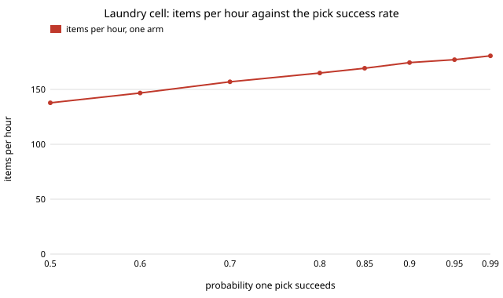

# hanger-cell: how many dryers can one laundry-hanging robot serve, and what limits it?

In a discrete-event model of the whole cell (pick, sense, hanger feeder, insertion, rail, fold
table), **the hanger design barely matters to throughput, and the stations that do matter are the
ones this track has not yet built: the pick and the fold table.** With the assumed times, one arm
clears a 25-item dryer load in 8.9 minutes (169 items an hour), enough for about 5 dryers on a
45-minute cycle. The five hanger designs from `hanger-insert` differ by at most 3% in time per
load (8.9 min for the telescoping hanger, 9.1 for rigid ones, 9.2 for the folding one). Doubling
the pick time adds 3.4 minutes and doubling the fold time 5.9; doubling every insertion time adds
under one. A second arm raises throughput by 22%, and then the fold table (95% busy) is the
bottleneck, so a third arm adds nothing. With the learned hang-or-fold rule two thirds of a
household load is folded, so this is mostly a folding cell with a hanging branch; a
shirt-heavy load (76% hung) is 11% slower per item than a household one on one arm, because
hanging takes the arm longer than handing off to the fold table.
Produced with AI assistance (Claude). Sixth project of research track 18 (`hanger`, `PROJECTS.md`,
milestone 6). The insertion times and the hang shares are read from the earlier projects'
results; every other time and rate is an assumed placeholder, because `hanger-pick`
(milestone 5) and the fold mechanism have not been built. Nothing here is a measurement of a
robot.

**Live page:** https://duncan-haywood.github.io/monorepo-projects/research/hanger-cell/

## Why this question

Milestones 1 to 3 asked whether one garment can be hung well, whether to hang it, and how to get the
hanger in. A product is a cell: a dryer or loader, a picker, a hanger feeder, a rail and a place
to put what should not hang, all sharing time. A station that is fast alone can still be starved or
blocked in the cell, and the first decision a builder needs is which station sets the pace. This
project asks that, and which of the earlier projects' numbers it is sensitive to.

## Builds on

- [`hanger-insert`](../hanger-insert): insertion time and success per hanger design and fabric
  (its section A), parsed from `experiments/results.txt` at run time.
- [`hanger-fold`](../hanger-fold): the share of each fabric archetype better hung than folded
  (its section B), used as the chance the learned rule hangs a garment of that archetype.
- [`hanger-fit`](../hanger-fit): the hanger designs, through `hanger-insert`.
- Discrete-event simulation is textbook material (event queue plus FIFO resources, as in SimPy);
  the engine here is about 60 lines of stdlib Python written for this project, no code copied.
  References were not re-checked online in this run. **Lab tags:** none. This project builds on no
  group listed in `prompt.md`.

## Model

- **Load.** 25 items dumped at time zero (a household dryer load, assumed), drawn from a mix of
  five archetypes: tee 40%, shirt 25%, linen 5%, fleece 15%, sweater 15% (assumed). Linen borrows
  the shirt's insertion row and fleece the sweater's, since `hanger-insert` has three fabrics.
- **Item path.** Wait for a free arm. Pick: 8 s, success 0.85, up to 3 tries with a 4 s reset after
  each miss, then the item is left for a person ("aside"). Sense (lift, weigh, measure): 3 s.
  Decide: hang with the archetype's `hanger-fold` share (the learned rule), always, or never.
  Hang: a hanger from the feeder (1.5 s; the feeder is down 90 s after every 30 hangers), then
  insertion for the `hanger-insert` time and success of the design and fabric, then 3 s to put it on the
  rail. A failed insertion falls back to folding. Fold: 3 s to set the item on the fold table,
  which frees the arm; the table folds one item at a time in 25 s.
- **Jitter.** Every duration is scaled by U(0.8, 1.2). Each result is the mean of 200 seeded loads.
- **Cost of a station** is reported as seconds of station time per item and utilisation (G, A),
  not dollars: no price in this repository has a source, and the sourced bill of materials is an
  owner step (below).

## Results

Numbers are from `experiments/results.txt`, written by `experiments/run.py`.

**A. One arm is the pace, then the fold table.**

| arms | min per load | items/h | busiest station |
|---|---|---|---|
| 1 | 8.9 | 169 | arms (90%) |
| 2 | 7.4 | 206 | fold table (95%) |
| 3 | 7.3 | 209 | fold table (96%) |

(adjustable hanger, learned rule). A hung item holds the arm for about 22 s (pick 8, sense 3, feed 1.5,
insertion about 7, rail 3, plus misses) and a folded one about 14 s, so mostly-folded loads leave the arm waiting for the table
from the second arm on.

**B. The hanger matters when more is hung, and then by a few percent.** On one arm,
"always fold" gives 141 items/h whatever the hanger. The learned rule gives 164 to 169 (hanging
takes load off the fold table), and "always hang" 140 to 146, where the choice of hanger shows
most: the telescoping hanger is 4% faster than the folding one and 1% faster than wire. The
choice is small next to the policy: hanging everything is no faster than folding everything, and
the learned rule beats both by 16 to 20%.

**C. Mix.** A tee-heavy load (14% hung) runs at 159 items/h, a shirt-heavy one (76% hung) at 151,
a household one at 169: the cell is fastest when the load is split between the two branches.

**D. What moves the time per load** (one at a time, halved and doubled, baseline 8.9 min):

| parameter | at ×0.5 | at ×2 | swing |
|---|---|---|---|
| fold time | 8.1 | 14.8 | 6.6 min |
| pick time | 7.8 | 12.3 | 4.4 |
| pick success (0.95 / 0.60) | 8.5 | 10.3 | 1.8 |
| all insertion times | 8.5 | 9.8 | 1.3 |
| sense time | 8.5 | 9.8 | 1.3 |
| hand-off to fold table | 8.7 | 9.4 | 0.8 |
| rail, reset, feeder | | | under 0.5 each |
| feeder refill | 8.9 | 8.9 | 0 (a 25-item load never reaches the 30-hanger refill) |

So the two least-known numbers, the pick and the fold, dominate, and `hanger-pick`
(milestone 5) is the next project that moves this result.



**E. Recovery: a poor picker costs people, not just time.** From 0.85 down to 0.60 pick success
the throughput falls only 13% (169 to 147 items/h) but the items left for a person rise from 0.3 to
6.8 per 100, and at 0.50 it is 13 per 100 (22 failed grasps per load). Insertion failures are
rare (0.005 to 0.02 per load) and recovered by folding.

**F. Dryers per cell.** At 45 minutes a dryer yields 33 items an hour, so one arm (177 items/h on a
pile of 100) serves 5.3 dryers, two arms 6.3, and more arms stay at 6.4 because the single fold table is the limit.

**H. Slower insertion.** One arm: 8.9, 9.8, 10.8 and 12.9 min per load at 1, 2, 3 and 5 times the
modelled insertion time; two arms: 7.4, 7.6, 7.7 and 8.1.

**G. Station time per item** is the same for every design to within 0.5 s on the arm (19.1 to 19.9 s),
0.47 s on the feeder and 17 s on the fold table.

## What this does and does not show

- In this model the cell is limited by pick and fold, not by the hanger. That is a statement about
  these placeholder times: the insertion times come from a geometry model of the neck (not
  cloth), and `hanger-insert` D shows they could grow if the blind hem step is worse than assumed.
  H scales every insertion time: on one arm a threefold time costs 22% more per load (8.9 to
  10.8 min) and fivefold 45%; with two arms the same scalings cost 4% and 10%, because the arm
  then waits on the fold table anyway. So insertion would matter on a one-arm cell if it is slow,
  and the telescoping hanger's faster neck route is worth most there.
- It does not show that real robots reach 169 items an hour. Eight seconds to pull one garment
  from a tangled dryer pile and a 25 s fold are guesses, and published folding robots are slower
  per item by an amount this repository has not checked. Treat the results as a ranking of what to
  measure first, not as a forecast.
- The 2-arm gain assumes two arms do not collide or share a workspace, which is optimistic.

## Limitations

No physical layout, travel between stations or arm collisions; one pile, no tangling beyond a
pick success rate that does not depend on the garment; a single fold table and a single feeder;
no rail capacity or unloading; the hang share is `hanger-fold`'s share per archetype used as a
probability, so mistakes of the sensing rule are not modelled; neck stretch is not a cell input;
the dryer is not simulated, only its cycle time; 200 loads per cell, deterministic seeds.

## Owner steps

Time a human or a simple gripper pulling garments from a dryer pile (for `hanger-pick`), time a
fold on a real table, and price each station from quoted sources with the date. None is done
here and no hardware is built or powered by this project. A real cell has pinch points between arm
and rail, heat from the dryer, and a moving rail next to people: every design needs a stop that cuts power to
the arm and the rail.

## Reproduce

```
cd research/hanger-cell
python3 -m unittest discover -s tests            # 12 tests, under 1 s
PYTHONPATH=src python3 experiments/run.py        # ~3 s, writes results.txt
python3 experiments/figure.py                    # pick_vs_throughput.svg from results.txt
```

Python 3.9+, standard library only. It reads `../hanger-insert/experiments/results.txt` and
`../hanger-fold/experiments/results.txt`.

## Next steps

1. `hanger-pick` (milestone 5): replace the 8 s, 0.85 pick with a simulated one; D says it is the
   second biggest swing.
2. Put layout and travel in: two arms sharing a rail, with a collision rule.
3. Measure a real fold and pick time (an owner step) and rerun D.
4. `hanger-print` (milestone 7), then `hanger-3d` (milestone 4).

## Outside dependencies

None beyond the standard library. All station times and rates other than the two parsed inputs
are assumptions that only an owner measurement can replace.
