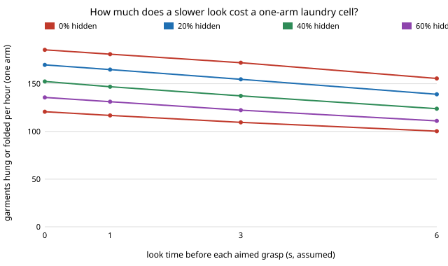

# hanger-cellpick: how many dryers can one laundry-hanging arm serve once the pick is simulated, not assumed?

**In the stylised model, replacing `hanger-cell`'s assumed 8 s, 0.85 pick with `hanger-pick`'s simulated pile cuts a one-arm cell from 169 to 147 garments hung or folded per hour (5.1 to 4.4 dryers) with the look-then-aim policy, and to 104 (3.1 dryers) with blind pinching; a second arm hides most of it (206 assumed, 201 with aiming, 179 with pinching), because the fold table, not the picker, is then the limit.** Aiming leaves 2.8 garments per 100 for a person against 7.2 for pinching. Sweeping the pile first is slower than aiming in the cell too (126 per hour on one arm). Produced with AI assistance (Claude). **Stylised: every station time is an assumed placeholder from `hanger-cell` or `hanger-pick`; nothing here is a measurement of a robot, a dryer or a garment.**

**Live page:** https://duncan-haywood.github.io/oss-monorepo/research/hanger-cellpick/

Track 18 (`hanger`, [`PROJECTS.md`](../PROJECTS.md)). Takes the first "Next steps" item of [`hanger-cell`](../hanger-cell) ("replace the 8 s, 0.85 pick with a simulated one"). Built on none of the CU Boulder groups in `prompt.md`; no connection to them is claimed.



## Why this question

`hanger-cell` found that pick and fold, not the hanger, set the cell's pace, and flagged its own pick time (8 s, 0.85) as a guess. `hanger-pick` then simulated picking from a tangled pile and found 13 to 23 s per garment. This joins them: what does the cell's capacity look like with the simulated picker, and does the pick policy change how many dryers one cell serves?

## Method

`src/hanger_cellpick/cellpick.py` imports both sibling models unchanged in behaviour (stdlib only). `hanger-cell`'s `run_once` gained one optional argument, `picks`, a list of `(seconds, ok)` consumed in order in place of the assumed pick; with `picks=None` every `hanger-cell` result is unchanged (its 12 tests pass, and a test here checks equality).

- For each dryer load of 25 garments, a fresh `hanger-pick` pile of 25 is emptied by one policy (`pinch`, `see`, `sweep`); each pick's seconds (including double-garment returns) and outcome go to the cell. A garment whose opening is never found is set aside for a person: it is cleared from the dryer but neither hung nor folded.
- 200 loads per cell, deterministic seeds; intervals are 95% percentile bootstraps (1,000 resamples) over loads, on pick randomness only.
- **Metric.** Garments hung or folded per hour (not items cleared; set-aside garments are not counted, since counting them made blind pinching look falsely fast). A dryer yields 25 garments per 45 minutes (assumed), i.e. 33.3 per hour.
- Cell settings are `hanger-cell`'s defaults: adjustable hanger, learned hang-or-fold rule, one feeder, one fold table.

## Results (all from `experiments/results.txt`)

- **A. Policy and arms.** Garments hung or folded per hour, dryers served (interval on the rate):

| picker | 1 arm | 2 arms | 3 arms |
|---|---|---|---|
| assumed 8 s / 0.85 | 168.9 (5.1) | 205.8 (6.2) | 208.6 (6.3) |
| simulated, see | 146.8 (4.4), 145.0 to 148.7 | 200.8 (6.0) | 204.8 (6.1) |
| simulated, sweep | 126.1 (3.8) | 195.7 (5.9) | 205.5 (6.2) |
| simulated, pinch | 104.3 (3.1), 102.8 to 105.7 | 179.1 (5.4) | 198.8 (6.0) |

The limit moves from the arm (one arm, every policy) to the fold table (95% busy) once there are two arms with aiming, but pinching still leaves the arm the bottleneck on two.
- **B. Look time and hidden openings (one arm, see).** Each extra second of look costs about 4 to 6 garments an hour; going from 40% to 80% hidden openings costs 30 an hour at 1 s look (147 to 117). With nothing hidden and no look time the arm reaches 185 an hour.
- **C. Faster picking, two arms.** Halving every pick time gives 207 an hour; quartering it gives 206: the fold table caps the cell at about 6.2 dryers however fast the picker. Doubling pick times drops it to 170 (5.1) and the arm is again the limit.
- **D. People.** Pick seconds per garment on the arm: 19.1 (assumed), 22.5 (see), 27.2 (sweep), 31.5 (pinch); garments left for a person per 100: 0.3, 2.8, 2.9, 7.2.

## Limitations

- Pick times come from a 2D disc-pile model with assumed times; the cell's other stations are `hanger-cell`'s placeholders. Both are guesses and the result ranks what to measure, not a forecast.
- Pile garment kinds and cell archetypes are not linked: a pick takes the same time whatever the cell thinks the garment is.
- With two or three arms the picks are drawn from one pre-computed sequence per load, so arms do not interfere on the pile or collide; this flatters multi-arm cells.
- Intervals cover pick sampling only. Section B and C vary assumptions; they are not sampled.
- The cell ignores that the learned hang-or-fold rule and the pick both need the garment kind; they are modelled independently.

## Reproduce
```bash
cd research/hanger-cellpick
python3 -m unittest discover -s tests      # 6 tests
python3 experiments/run.py                 # writes results.txt (about 10 s)
python3 experiments/figure.py              # writes experiments/lookhidden.svg
```

## Owner steps
Time a person or gripper emptying a real dryer load garment by garment, and a real fold; not a run's to do.

## Next steps
Let two arms share one pile so they block each other; link pile garment kinds to the cell's archetypes so a knit's hidden opening and its hang-or-fold decision come from the same garment.

## Outside dependencies
None beyond the Python standard library. Imports [`hanger-pick`](../hanger-pick) and [`hanger-cell`](../hanger-cell).
