# hanger-codesign: how good does a cloth simulator have to be before the laundry-robot hanger it designs is the right one?

A research programme (opened 2026-11-10) on designing a laundry robot's hangers in a cloth
simulation: how much simulator fidelity and how much measured fabric data the design loop needs
before the hanger it picks is still the best one on a validated, calibrated cloth solver. **First
result (milestone 1): on four fabrics with published KES-FB bending rigidity and weight, our 2D
chain and 3D sheet agree on every hanger decision (the wood-shaped hanger, with an arm 1 cm wider
than the half shoulder), but on a deep arm they agree to 0.004 cm because they are the same
model, so the agreement says nothing about fidelity; and on a 3 cm deep arm the solver's own
convergence error (0.05 to 0.11 cm) is as large as the margin that decides the arm width (0.08
to 0.13 cm). Milestone 1b solves those cases to convergence. The 3 cm arm's best width then moves
to +1.5 cm on all four fabrics, while the 2D chain stays at +1.0 cm: the tiers disagree by 0.5 cm,
and the iteration cap had hidden it by flattering narrow arms (bias +0.22 cm at -1 cm, -0.07 cm at
+3 cm). Milestone 2a builds a simulated Cusick drape test on the same 3D sheet and finds its drape
coefficient cannot calibrate bending rigidity: it orders the four fabrics by bending length
(0.19, 0.21, 0.32, 0.45), but the unmeasured stretch stiffness moves it by 0.15 to 0.23 (more than
a 16-fold change in B does on the softest fabric), and as stretch stiffness rises towards an
inextensible cloth every fabric's drape coefficient climbs to about 0.77 and the fabrics stop
being told apart, and the mesh moves it by up to 0.05 (0.12 with stiffer springs): the square
spring grid locks. Milestone 1c reruns the 3 cm arm across stretch stiffness and mesh: the mesh
does not move the width choice, but the unmeasured stretch stiffness does, from +2.0 to +2.5 cm at
EA 40 N/m to +0.5 to +1.0 cm at 800 N/m, while the 2D chain stays near +1.0 cm, so the 3D-against-2D
disagreement changes sign with a fabric property no table here supplies, and a shallow-arm hanger
cannot be designed from bending rigidity and weight alone. Milestone 2b refines the drape test's
grid to 2.5 mm: the stiff suiting converges (to about 0.01) but the soft jersey does not at EA 800
N/m and up (0.70 to 0.37 at EA 3200, still falling), and swapping springs shows most of the
leftover "stretch" dependence is the shear spring that the model ties to EA (on the suiting, shear
alone +0.046, stretch alone +0.027). Shear rigidity is measured: the same KES table gives G = 26
to 89 N/m per radian, so the next tier comparison can take it from data. Milestone 1d does that
for the 3 cm arm: with the shear spring set to measured G, stretch still moves the best width by 1.0 cm
across 40 to 800 N/m, but from 800 N/m up, including the stiffness the same table's tensile LT and WT
imply, all four fabrics pick +1.0 cm, the 2D chain's answer, with certified margins. The tier
disagreement belongs to soft cloth, and only the cotton jersey and the shirting, whose low-load
stiffness lands in the band where the choice flips, still need a measured tensile toe. Milestone 5 proves the margin bound the proposal planned (regret is at most the spread of the paired tier error, not its size) and tests it on those 50 tier pairs: the bound certifies no 2D-chain choice (the paired error still spreads 0.6 to 1.3 cm across widths, against margins of 0.05 to 0.25 cm), though the 2D choice's realised regret is small (mean 0.03 cm); it certifies only a stretch-stiffness guess near the KES-sourced one, so a cheap tier can screen widths but not judge them. Milestone 5b keeps the cheap tier's own penalty term the first bound dropped: the regret is at most max over d of K|d − d^| minus the cheap tier's penalty at d, with K the slope of the paired error around the choice, 2.8 times tighter on the 2D chain (median realised share of the bound 34% against 12%). Used as a loop (three reference runs around the cheap choice, estimate K, run what the bound cannot rule out), it finds the reference optimum in 48 of 50 tier pairs with 3.9 of 7 reference runs on average; the two misses are the softest cloth (EA 40 N/m), whose optimum sits two grid steps away. Milestone 3a builds ARCSim's element model (constant-strain triangles with measured shear, discrete-shell hinges) with a Newton solver: it matches the exact cantilever elastica to within 0.9% of the overhang after extrapolation and ignores stretch stiffness there, but fails the Cusick acceptance test: on the suiting the drape coefficient still climbs 0.016 per mesh refinement and 0.034 from EA 800 to 3200 N/m (40% less than the spring sheet), and on the soft jersey it converges only at EA 150 N/m, near the jersey's sourced tangent stiffness, and locks above it. Milestone 3b shows that jersey result was mostly a solver that never arrived: started from the soft equilibrium and stepped up in stretch stiffness, all 40 cases converge, and at the jersey's own sourced stiffness (254 and 369 N/m) the drape coefficient moves by only 0.008 to 0.011 from 3.75 to 2.5 mm and by 0.003 from 150 to 369 N/m, so the element passes the acceptance test there; the suiting misses the 0.03 mesh bar by 0.004 to 0.006 through a change in fold count, and the same case can settle in fold patterns whose drape coefficients differ by up to 0.32, so a calibration will need the measured node count too. Milestone 3c runs seven seeds per case: the suiting lands in 6 to 10 folds, its seed-mean drape coefficient still rises 0.030 to 0.033 from 3.75 to 2.5 mm (the revised acceptance fails by 0.0025), but in every discordant case the lower-drape fold pattern is lower in energy, and the lowest-energy seed's drape coefficient moves only 0.001 to 0.009 with the mesh on both fabrics: the mesh dependence is finer meshes trapping starts in stiffer, higher-energy fold patterns. Milestone 3d makes the solver 3 times faster with an element-local Hessian and adds a 1.875 mm lattice: registered in advance, that lowest-energy rule fails on the suiting (+0.021; no seed found the 7-fold pattern), the seed mean converges on both fabrics (under 0.008 from 2.5 to 1.875 mm), and a Hessian that differs by under one part in a billion sends 13 of 14 chains to different fold states, so the seed mean, not the lowest of a few seeds, is what to calibrate against a measured drape. Milestone 3e pools the search: each lattice also starts from the fold patterns every other lattice found, all on one solver. The registered lowest-energy rule then passes, moving under 0.008 from 2.5 to 1.875 mm on both fabrics, and the suiting's 7-fold pattern is the lowest state on all three lattices. The seed mean also converges, but it sits 0.026 above that pattern on the suiting, so a measured node count is what will say which one a real drape test matches. Milestone 3f finds that 3e's high-energy jersey transfers came from how the transfer filled the cloth's rim, not from real fold patterns: continuing the rim along the cloth's own tangent plane puts 41 of 42 transfers inside the target mesh's own energy band (worst 2.3e-5 J above it, against 6.4e-4 J), and the pooled drape coefficient moves by at most 0.002, though one transfer stops at the step cap and the jersey's mesh margin shrinks to 0.0005 under the bar. Milestone 3g reports the drape coefficient as an interval over every state within 1e-5 J of the lowest (the work of lowering the overhang by 0.1 to 0.2 mm): the jersey's states all lie within 3e-5 J, so its drape coefficient is 0.156 to 0.174 rather than one number, the suiting's 7-fold pattern is lowest but an 8-fold one sits right at the band edge, and the interval's midpoint moves under 0.007 between the two finest meshes for every band from 1e-5 to 3e-4 J.** Produced with AI assistance (Claude). Research track 18 (`hanger`,
`research/PROJECTS.md`). Simulation only; nothing here is a measurement of real garments.

**Milestone 4a (the first comparison with real fabric):** given only measured FAST data for nine
woven fabrics (Petrak et al. 2021, *Materials* 14, 6259), the triangle-FEM tier ranks their measured
Cusick drape coefficients with Pearson r = 0.965 (Spearman 0.967), better than the commercial CAD
simulation published with the data (0.85 to 0.94), but over-drapes every fabric by 0.09 to 0.20
(RMSE 0.148, acceptance failed), and it is not mesh-flat at these stiffnesses; one shared factor of
0.485 on bending rigidity brings it to RMSE 0.050 leave-one-out (0.036 solved, in-sample).

**Milestone 4b (is the over-drape the averaged-away anisotropy?):** no. An orthotropic element
that keeps warp and weft bending (up to 4:1) and stretch (up to 11:1) apart, calibrated so each
axis is exact, over-drapes the same nine fabrics slightly more (bias +0.152, RMSE 0.161, r 0.919).
On this lattice the hinge element's off-axis bending is 1.0 to 1.6 times the geometric mean, so
orthotropy stiffens it, and single-seed differences between models are buried in fold-state noise
(0.003 to 0.009 for identical energies, up to 0.1 when the fold count jumps).

**Milestone 4c (is it membrane locking?):** yes, in part. Along each fabric's stretch-stiffness
ladder at a fixed fold count the stretch energy falls as EA^−0.06 to EA^−0.31 rather than 1/EA, and
the drape coefficient climbs 0.004 to 0.015 per doubling of EA with no plateau from 18.75 N/m to the
fabric's secant stiffness, on both lattices. That climb from 150 N/m to the secant is +0.044, a
third of the bias; at 18.75 N/m the bias is +0.045 (RMSE 0.057), but no single stiffness fits all
nine, so a drape coefficient alone cannot separate a bending error from a stretch error here.

**Milestone 4d (does a locking-free membrane fix it?):** partly. An edge-midpoint
(Crouzeix–Raviart) membrane, after English and Bridson (2008), stops locking at the wovens' real
stiffness: over the last doubling of EA its stretch energy keeps falling (local exponent −0.63 to
−0.91, against −0.10 to +0.30 for the conforming element) and the drape coefficient barely moves
(0.0005 to 0.0067 per doubling). The over-drape falls from +0.133 to +0.102 on the 3.75 mm lattice
(RMSE 0.137 to 0.107, Spearman 0.967), a fifth of the error. But the element needs a penalty on the
in-plane jump across edges to converge at all, and that numerical weight moves the drape
coefficient by about 0.05 between 0.01 and 1, as much as locking did; it shrinks only about as
fast as the mesh spacing.

**Live page:** https://marisstella.app/research/hanger-codesign/

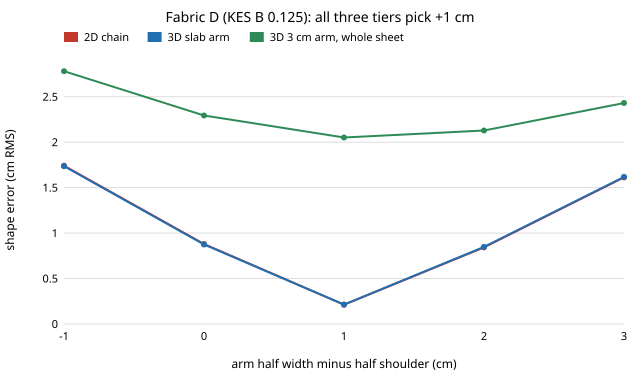

## Milestone 4d: an edge-midpoint membrane removes the locking, and a fifth of the over-drape goes with it

**Question.** Milestone 4c showed the conforming triangle locks (stretch energy ∝ EA^−0.06 to
EA^−0.31 at a fixed fold count, where locking-free is EA^−1). Does a membrane built not to lock
leave the drape coefficient (DC) flat in EA, and how much of 4a's over-drape goes with the
locking?

**Method** ([`experiments/m4d_nonconforming/cr.py`](experiments/m4d_nonconforming/cr.py),
[`run.py`](experiments/m4d_nonconforming/run.py)). The unknowns move to the edge midpoints of 3a's
lattice, the Crouzeix–Raviart space (Crouzeix and Raviart 1973,
doi:10.1051/m2an/197307R300331), as English and Bridson (2008, doi:10.1145/1360612.1360665) did
for inextensible cloth. A lattice has about three edges per node, so 9 degrees of freedom per node
face the same 4 warp/weft inextensibility constraints that lock the conforming element. Each
triangle keeps 3a's Saint Venant–Kirchhoff membrane. Bending is a discrete-shell hinge at each
interior edge between the two midpoint triangles that share its midpoint, with a weight calibrated
so that a cylinder stores B k²/2 per unit area (within 1.8% over axis angles 0 to 90°). DC and fold
count are measured on vertices rebuilt from the midpoints, which is exact for affine fields.
Without stabilisation the midpoint field has in-plane zero-energy modes at the free rim (39 on a
12 mm lattice) and Newton stalls. A penalty γG|PJ|² on the tangential jump J across each edge
removes them: this is the in-plane part of Hansbo and Larson's (2003, doi:10.1051/m2an:2003020)
stabilisation, scaled by the shear rigidity G because scaling it by EA re-locked the element in a
pilot. The rest of 4a's set-up is kept: FAST inputs, seed 0, its start, the ladder from 150 N/m
to the secant EA, and Newton. The runs cover γ = 0.01, 0.1 and 1 on the 5 and 3.75 mm lattices,
and the conforming element on 5 mm. Pilots on F1 at 7.5 mm, and one change of start made after the
first four 3.75 mm stages stalled, are disclosed in the docstring and in `LOG.md`.

**Results** ([`results.txt`](experiments/m4d_nonconforming/results.txt): 63 chains and 268
stages, about 7.3 core-hours.)

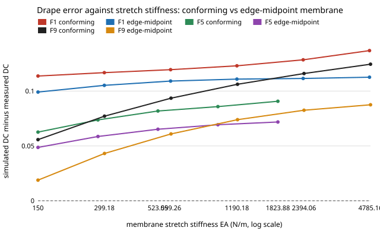

| 3.75 mm lattice, secant EA | bias | RMSE | Pearson r | Spearman |
|---|---|---|---|---|
| conforming (4c) | +0.133 | 0.137 | 0.975 | 0.967 |
| edge-midpoint, γ 0.01 | +0.070 | 0.078 | 0.970 | 0.967 |
| edge-midpoint, γ 0.1 | +0.102 | 0.107 | 0.974 | 0.967 |
| edge-midpoint, γ 1 | +0.118 | 0.123 | 0.967 | 0.967 |

- **D1 refuted:** 261 of 268 stages converge. The misses are γ 0.01 on 3.75 mm for F3 and F9,
  where every stage hits the cap.
- **D2 refuted (acceptance):** fitted from 150 N/m, p is −0.48 to −0.80 (registered: −0.8 or
  steeper on 7 of 9; 1 made it). The conforming element gave −0.06 to −0.31.
- **D3 refuted (acceptance):** from 150 N/m to the secant the DC still rises by +0.007 to +0.069
  (conforming: +0.022 to +0.069); it is under 0.01 on 1 of 9.
- **D4 refuted:** the bias falls by 0.030, not the 0.044 4c forecast.
- **D5 held, as scored:** the γ 1 minus γ 0.01 spread is smaller on 3.75 mm than on 5 mm on 7 of 9,
  with a mean of 0.059 on 5 mm and 0.048 on 3.75 mm. On the seven converged fabrics alone it is
  5 of 7, with means of 0.062 and 0.050.
- **D6 held:** Spearman 0.967. **D7 refuted:** RMSE 0.107. **D8 held:** the 5 to 3.75 mm change
  is under 0.02 on 7 of 9.

Post hoc (after part A's report): over the last step of each ladder, at the wovens' measured
stiffness, the conforming element's stretch energy has stopped falling (local exponent −0.10 to
+0.30), while the edge-midpoint element's still falls (−0.63 to −0.91), and the DC rise per doubling
there is 0.0005 to 0.0067 against 0.0047 to 0.0111. Its DC increments shrink geometrically up the
ladder (F9: 0.024, 0.018, 0.013, 0.009, 0.005); the conforming ones barely shrink.

**Reading.** At real woven stiffness (800 to 4,800 N/m) the locking is gone: there EA has nearly
stopped moving the DC, which is what lets a bending calibration be read as a bending correction.
The registered whole-ladder tests fail because from 150 N/m these fabrics are still stretching
(strain near 1%), which the 1/EA law does not cover. Removing the locking is worth 0.030 of the
+0.13 bias, a fifth of the error. The price is a numerical weight: the jump penalty moves the DC
by about 0.05 between γ 0.01 and 1, as much as locking did, and the spread shrinks only about as
fast as the mesh spacing (0.059 to 0.048 for h from 5 to 3.75 mm). On this tier an absolute DC is
therefore uncertain by about ±0.025 at 3.75 mm, and the remaining +0.07 to +0.12 bias (by γ) is
not membrane locking.

**Limits.** Seed 0 only. Two lattices, both coarser than 4a's 2.5 mm. γ has no physical value.
F3 and F9 at γ 0.01 on 3.75 mm are unconverged. The penalty uses the mean tangent plane, one of
several choices. 4a's bending factor has not yet been refitted on this element.

**Next.** (a) 2.5 mm at two γ values, or a weight-free (consistent discontinuous Galerkin)
stabilisation; (b) refit the bending factor on this element; (c) a measured node count;
(d) milestone 1's hanger choice on the calibrated tier.

## Milestone 4c: the triangle element locks, and the stretch input carries a third of the over-drape

**Question.** Milestone 4b ruled out anisotropy and named membrane locking at the fabrics' secant
stretch stiffness (EA 830 to 4,800 N/m) as the leading suspect for 4a's over-drape. Locking has a
signature that can be read off the element as it stands: once real stretch is negligible, raising
EA should not change the shape, the membrane strain should fall as 1/EA and the stretch energy
with it. A constant-strain triangle that cannot fold without stretching instead keeps its strain
and stiffens its shape. Does this element do that, and how much of the bias does it buy?

**Method** ([`experiments/m4c_locking/run.py`](experiments/m4c_locking/run.py)). 4a's code path
unchanged (seed 0, FAST inputs, nine Petrak et al. 2021 wovens) on the 2.5 mm and 3.75 mm
lattices: each chain rebuilds 4a's upward EA ladder (150 N/m to the secant, steps of at most ×2)
and adds a downward branch from the 150 N/m state to 75, 37.5 and 18.75 N/m. Every stage records
the drape coefficient (DC), the fold count, the energy split (gravity, membrane stretch, membrane
shear, bending) and the Green strain of the free triangles. The locking exponent p is the slope of
ln(stretch energy) on ln(EA) along the upward ladder at the 150 N/m fold count: −1 is locking-free.
Predictions C0 to C6 were committed and pushed before any solve; reading the first 30 lines of
4a's log (F9 and F1 rising with EA at a fixed fold count) while planning is disclosed in them.

**Results** ([`results.txt`](experiments/m4c_locking/results.txt), 18 chains, 150 stages, all
converged, 2.3 core-hours):

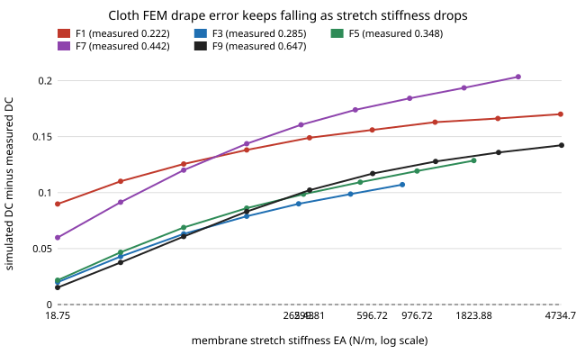

| 2.5 mm, seed 0, against measured DC (n = 9) | Pearson r | bias | RMSE |
|---|---|---|---|
| EA 18.75 N/m | 0.970 | +0.045 | 0.057 |
| EA 37.5 N/m | 0.969 | +0.070 | 0.078 |
| EA 75 N/m | 0.969 | +0.092 | 0.098 |
| EA 150 N/m | 0.969 | +0.110 | 0.115 |
| secant EA (4a's input) | 0.966 | +0.154 | 0.159 |

- **C0 held:** all 96 of 4a's logged seed-0 stages reproduce in fold count and DC.
- **C1 held:** at a fixed fold count the DC rises with EA in 39 of 39 steps.
- **C2 held (locking is present):** p is −0.06 to −0.31 on all nine fabrics (registered bar: above
  −0.5), and every fabric keeps its fold count from 18.75 N/m to its secant EA.
- **C3 held, with a caveat:** p is less negative on the coarser lattice on 8 of 9, as locking
  predicts, but the DC's rise per doubling of EA is larger on the coarser lattice on only 3 of 9
  (F2, F8, F9; F6 ties): refining 3.75 to 2.5 mm does not reduce the climb.
- **C4 refuted:** at 150 N/m the 99th-percentile strain is 0.50% to 1.17% (under 1% on 5 of 9);
  at 18.75 N/m it is 2.0% to 3.4%.
- **C5 refuted, on its second clause:** the DC falls on 9 of 9 going down to 18.75 N/m, and the bias
  there is +0.045, under the registered +0.05.
- **C6 held:** from 150 N/m to the secant EA the DC rises by +0.044 on average, 29% of the seed-0 bias.

Post hoc (after the predictions were scored): along the upward ladder the membrane shear energy
grows 1.4 to 2.9 times on seven fabrics while the stretch energy falls by only 18% to 63%, so the
membrane's share of the elastic energy stays at 9% to 17% instead of vanishing. Fitting the DC
linearly in ln EA through all of each fabric's stages and extrapolating to the measured DC, the
matching EA runs from 0.01 N/m (F1) to 23 N/m (F8), more than three decades and, for F1 and F2,
far below any woven's stiffness.

**Reading.** The element locks. With strains under about 1% at 150 N/m and a fold count that never
changes, a locking-free membrane would leave the DC flat as EA grows 12 to 32 times; this one
climbs 0.004 to 0.015 per doubling with no sign of a plateau anywhere from 18.75 N/m to the secant,
and its stretch energy decays at 6% to 31% of the locking-free rate. Refinement does not
cure it, which is what the constraint count says it should not: on this lattice there are two
triangles per node, so holding warp and weft strain at zero is four constraints per node against
three degrees of freedom at every mesh size (English and Bridson 2008's argument for nonconforming
elements). Two consequences for the programme. First, the 100 gf/cm secant EA that 4a used is not
a neutral input on this tier: it is worth about +0.044 DC over 150 N/m, a third of the bias.
Second, the bias can be absorbed by bending (4a's single factor 0.485) or by stretch (EA near
18.75 N/m, RMSE 0.057), but no single EA fits all nine, so one drape coefficient per fabric
cannot tell the two errors apart; H3's calibration needs either a locking-free membrane, after
which EA should stop mattering, or a second measured quantity such as the node count.

**Limits.** Seed 0 only; two lattices; one lattice orientation; G is held at FAST's value along
every ladder; the matching-EA extrapolation is linear in ln EA beyond the solved range; the
1/EA locking-free rate assumes a fixed tension field, which this run did not measure separately.

## Milestone 4b: an orthotropic element does not explain the over-drape

**Question.** Milestone 4a's isotropic element, given geometric-mean inputs, over-drapes all nine
measured wovens by about 0.14, and one factor of 0.485 on bending removes the bias. Is the factor
the warp/weft anisotropy the element averages away?

**Method** ([`experiments/m4b_orthotropic/ortho.py`](experiments/m4b_orthotropic/ortho.py)).
Stretch EA1 and EA2 act on the warp and weft Green strains. The discrete-shell hinges get one
weight per lattice edge family, calibrated on the lattice itself so that a cylinder along the warp
stores exactly B1 k²/2 and one along the weft B2 k²/2. By mirror symmetry the two diagonal
families share a weight, so this is the only orthotropic form of the hinge element on this
lattice. Between the axes the lattice decides: at B1/B2 = 4, B(φ)/B2 is 4.0, 4.31, 4.38, 4.0,
2.88, 2.19 and 1.0 at 0, 22.5, 30, 45, 60, 67.5 and 90°. Inputs come from Petrak et al. (2021)
Table 2 (FAST warp and weft B, 98.07 N/m / E100 for each direction) with nothing fitted. Every
other setting is 4a's. Runs: B and EA orthotropic at seeds 0 to 2 (lowest energy, registered);
B only and EA only at seed 0; and the isotropic case through the new code at 3.75 mm (F1, F2).
Predictions O1 to O9 were committed and pushed before any 2.5 mm solve. A 7.5 mm pilot on two
fabrics ran after they were written and before they were committed, and is disclosed in the log.

**Results** ([`results.txt`](experiments/m4b_orthotropic/results.txt), 47 chains, every stage converged):

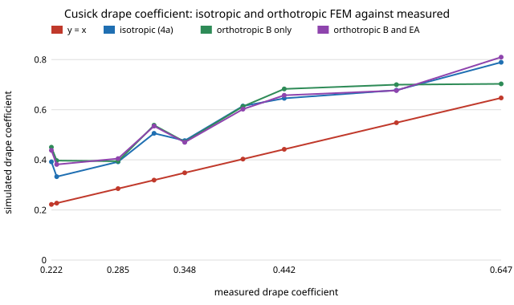

| against measured DC (n = 9) | Pearson r | bias | RMSE |
|---|---|---|---|
| 4a isotropic, lowest of 3 | 0.965 | +0.143 | 0.148 |
| 4b orthotropic B and EA, lowest of 3 (registered) | 0.919 | +0.152 | 0.161 |
| seed 0: isotropic / B only / EA only / both | 0.966 / 0.900 / 0.945 / 0.958 | +0.154 / +0.168 / +0.150 / +0.170 | 0.159 / 0.178 / 0.158 / 0.175 |

- **O1 held** (all stages converge). **O2 refuted:** the isotropic case through the new code
  lands 0.003 (F1) and 0.009 (F2, 9 folds against 10) from 4a. On the same state the energy and
  Hessian are identical and the gradients agree to 4e-16, so this is 3d's path sensitivity and not
  a code difference. It sets the noise floor for any one-seed comparison.
- **O3 refuted (acceptance failed), O4 held, O9 refuted:** RMSE 0.161, bias +0.152, r 0.919.
- **O5, O6 refuted:** bending orthotropy raises the DC on F1 (+0.058), F2 (+0.064), F4
  (+0.032) and F8 (+0.022), four of the five fabrics with B1/B2 ≥ 1.9. F9 drops by 0.086 into a
  4-fold state. The Spearman with |ln B1/B2| is −0.08.
- **O7, O8 refuted:** stretch orthotropy alone moves the DC by 0.01 or more on 4 of 9, and the two
  effects add within 0.01 on only 1 of 9 (F9's residual is +0.108).
- Post hoc: averaged over 0 to 90°, the lattice's B(φ) is 1.02 to 1.63 times the geometric mean
  (harmonic mean 1.02 to 1.29), so on this element orthotropy stiffens bending off the axes.

**Reading.** The 0.485 factor is not the anisotropy. Put back in the only form the hinge element
allows, orthotropy pushes the drape coefficient up, not down, and the bias grows by 0.009. The
remaining suspects are the mesh trend 4a found (the DC rises with refinement), membrane locking at
2,000 to 9,000 N/m, and the gap between FAST's cantilever bending and the bending a drape uses.
For method: on this tier a one-seed difference between two models means nothing below about 0.01,
and a fold-count jump moves the DC by up to 0.1. Model comparisons need 3e to 3g's pooled or
interval rules.

**Limits.** The off-axis profile is fixed by the lattice, and no bias-bending measurement was
available to check it. Bend-only, stretch-only and the additivity test use seed 0 only. One
lattice orientation was run (warp along the rows). All nine fabrics come from one laboratory.

## Milestone 4a: the uncalibrated cloth FEM against nine measured Cusick drape coefficients

**Question.** Every drape coefficient (DC) in milestones 2 to 3g was simulated. Is the top tier
(3a's triangle element, 3d's local Newton) right about real fabric when it is given only measured
inputs and no fitted parameter?

**Data.** Petrak, Mahnić Naglić, Rogale and Geršak (2021), "Analysis of polygonal computer model
parameters and influence on fabric drape simulation", *Materials* 14(21), 6259,
doi:10.3390/ma14216259, CC BY 4.0, read from Europe PMC (PMC8584912) after milestones 2, 3f and
3g found every journal host refused. Nine woven fabrics, 84 to 367 g/m², with FAST and KES-FB
bending, shear and tensile extension, and a Cusick DC (0.222 to 0.647) measured on our geometry
(30 cm specimen, 18 cm disc, mean of five). The numbers are copied into
[`experiments/m4a_measured_drape/fabrics.py`](experiments/m4a_measured_drape/fabrics.py) with
their table numbers. Two checks on how the columns read: KES shear and FAST shear agree after
unit conversion (F1: 0.41 cN/cm/° = 23.5 N/m, FAST 23 N/m; ratio 1.0 to 1.65 over the nine), and
KES bending is 0.29 to 0.42 of FAST bending on seven fabrics but 1.3 to 1.4 on F6 and F7, whose
printed KES weft values (0.398, 0.444) look like a decimal slip. Recomputing the paper's Table 5
correlations from its Table 6 reproduces the FAST columns within 0.01 but not the KES columns
(0.92 to 0.94 against the printed 0.90 to 0.91), a small inconsistency in the source.

**Method.** Inputs, all from the paper: B = geometric mean of FAST warp and weft bending
rigidity (Peirce 1930, doi:10.1080/19447023008661529); W; G = FAST shear rigidity; EA = geometric
mean of the warp and weft secant stiffnesses at 100 gf/cm (831 to 4,785 N/m), reached by
continuation from 150 N/m in steps of at most ×2. Main run: 2.5 mm lattice, seeds 0 to 2, the DC
of the lowest-energy seed. Mesh check: 3.75 mm, seed 0. Input check: KES bending, seed 0.
Baseline: the paper's own Optitex simulations of the same nine fabrics (eight columns: FAST or
KES inputs, four polygon sizes). Predictions M1 to M7 were committed and pushed before the first
solve (`run.py`'s docstring); K1 to K3 and V1 to V2 were added during the run, each with what had
been seen when it was written.

**Results** ([`results.txt`](experiments/m4a_measured_drape/results.txt), 45 + 18 + 9 chains, every stage converged; about 8 core-hours on 4 cores):

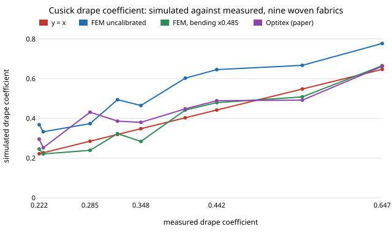

| simulation, against measured DC (n = 9) | Pearson r | Spearman ρ | bias | RMSE |
|---|---|---|---|---|
| triangle FEM, FAST inputs, 2.5 mm, lowest of 3 (registered) | 0.965 | 0.967 | +0.143 | 0.148 |
| triangle FEM, same, 3.75 mm, seed 0 | 0.975 | 0.967 | +0.133 | 0.137 |
| triangle FEM, KES bending, 2.5 mm, seed 0 | 0.666 | 0.800 | +0.004 | 0.152 |
| triangle FEM, KES bending, 2.5 mm, lowest of 3 (K1 to K3) | 0.651 | 0.800 | +0.003 | 0.152 |
| post hoc: FAST bending × one shared factor, leave-one-out (interpolated) | 0.934 | 0.883 | +0.004 | 0.050 |
| post hoc: FAST bending × 0.485, solved (V1, in-sample, one parameter) | 0.969 | 0.933 | −0.004 | 0.036 |
| Optitex (paper), best column: KES inputs, 0.6 cm polygons | 0.933 | 0.917 | +0.044 | 0.067 |
| Optitex (paper), FAST inputs, 0.4 cm | 0.853 | 0.833 | +0.006 | 0.079 |
| Optitex (paper), median of eight columns | | | | 0.123 |

- **M1 held:** every stage of the 27 main chains converged; one end state (F5 seed 0) has a
  negative smallest Hessian eigenvalue (−3.8e-7), not the lowest-energy seed.
- **M2 and M3 held:** the FEM orders the nine fabrics almost exactly as measured (Spearman 0.967,
  Pearson 0.965), better than any of the paper's Optitex columns (0.853 to 0.942).
- **M4 refuted (acceptance failed), and M5:** it over-drapes every fabric, by +0.089 (F3) to
  +0.204 (F7), mean +0.143, so RMSE is 0.148 against a bar of 0.08.
- **M6 refuted:** from 3.75 to 2.5 mm the DC rises on seven fabrics, by 0.027 to 0.038 on six of
  them and 0.018 on F9; F2 and F8 move under 0.005 (3 of 9 under the 0.02 bar). At these stiffnesses (1,800 to 4,800 N/m, against the 369 and 1,896 N/m of
  milestones 3b to 3g) the element is not mesh-flat, and refining makes the over-drape worse,
  the direction membrane locking predicts.
- **M7 refuted, narrowly:** KES bending lowers the DC on all seven fabrics it should (by 0.13 to
  0.33), and removes the bias (+0.004), but its RMSE (0.152) is not larger than FAST's seed-0
  RMSE (0.159): F6 and F7, the suspect KES values, over-drape by +0.26 and +0.28, and F8 under-drapes
  by −0.20.
- **K1 to K3 refuted** (written mid-run after three of nine KES results, all three within 0.04):
  with KES bending and three seeds the RMSE is 0.152, r 0.651. The three fabrics seen first were
  not representative, which is the reason predictions go in before the data.
- **Post hoc (not registered):** interpolating each fabric's seed-0 DC linearly in log B between
  its two solved bending values, the factor on FAST bending that matches the measured DC is 0.32
  to 0.61 on all nine fabrics (median 0.47); one shared factor of 0.485 fitted to eight
  fabrics predicts the ninth with RMSE 0.050 (leave-one-out), below every Optitex column.
- **V1 and V2 held** (registered after that analysis): solved at FAST bending × 0.485 (seed 0,
  2.5 mm), the FEM's DC is within 0.064 of the measured value on every fabric (RMSE 0.036,
  bias −0.004, r 0.969), and within 0.03 of the interpolated value on 8 of 9. This is an in-sample
  fit of one parameter to nine points, not a prediction.

**Reading.** The uncalibrated top tier ranks real fabrics by drape better than the commercial CAD
system the measurements came with, but it is biased high by about 0.14, so it fails as an absolute
predictor. The bias is close to a single factor on bending rigidity, and one factor learned from
eight fabrics predicts the ninth to 0.05 (interpolated; 0.036 solved, in-sample). That bears on H3: on this tier calibration is not
optional, and a one-parameter calibration is enough at the level of these nine wovens. The factor
is a calibration knob, not a measurement: it stands in for whatever the isotropic element misses
(the warp/weft anisotropy of B, up to 4:1 on F9, and of EA, up to 11:1 on F2), for the mesh
trend (M6, which would push the factor lower on a finer lattice), and for any difference between
FAST's cantilever bending and the bending a drape uses. FAST and KES disagree on B by a factor of
about 2.6 on these same fabrics, so "measured bending" is itself uncertain by more than the
calibration factor.

**Limits.** Nine fabrics from one laboratory, all woven; each measured DC is a mean of five with no
spread printed, and no node counts were extracted; isotropic element; seed 0 only for the mesh,
KES and calibration checks; the interpolation is in log B through two points per fabric (and an
extrapolation for F6 and F7); the factor was fitted on the same nine fabrics V1 checks, so V1 is
an in-sample check; the 2.5 mm lattice is not mesh-converged at these stiffnesses.

**Next.** (a) the nonconforming membrane (or an orthotropic element) for EA above about 2,000 N/m,
since M6 shows the conforming element is not mesh-flat there; (b) an orthotropic B and EA, to see
how much of the factor the anisotropy carries; (c) hold out a second data set (another open DC
table) to test the 0.485 factor out of sample; (d) repeat milestone 1's hanger choice on the
calibrated tier (H1, H3).

## Milestone 3g: report the drape coefficient as an interval over near-degenerate states

`experiments/m3g_band/` (`run.py` with predictions Q1 to Q8 in its docstring, committed and pushed
before its first run; `results.txt`, `results.json`, `band_jersey.svg`, `band_suiting.svg`; 4 tests in
`tests/test_m3g.py`). No new solves: it reads every distinct converged garment-load end state of 3e
(own seeds; the suiting's transfers) and 3f (the jersey's affine transfers). Seconds, stdlib only.

**Question.** 3e and 3f report one state per lattice, the lowest in energy. 3f found that on the jersey
the states one lattice holds lie within about 1e-5 J of each other, and that which is lowest changes with
the transfer start. A measured Cusick test cannot be expected to pick one state out of a band that
narrow. So: report the DC as [min, max] over every distinct state within dE of the pooled lowest
(registered dE = 1e-5 J), and ask whether that interval is mesh-converged. A sweep from 1e-6 to 3e-4 J
checks how much the answer depends on dE. In the specimen's own terms, 1e-5 J is the work of lowering the
whole overhang by 0.18 mm (jersey) or 0.09 mm (suiting).

| prediction | outcome |
|---|---|
| Q1 jersey band (1e-5 J) holds ≥ 3 states on every lattice | held: 9, 12, 11 |
| Q2 suiting band holds only 7-fold states at 2.5 and 1.875 mm | **refuted:** 7 and 8 folds at 2.5 mm (an 8-fold state 8.4e-6 J up); 7 only at 1.875 mm |
| Q3 (acceptance) 2.5 and 1.875 mm intervals overlap, both fabrics | held |
| Q4 (acceptance) band midpoint moves < 0.01 from 2.5 to 1.875 mm | held: jersey +0.0034, suiting −0.0028 |
| Q5 widths ≤ 0.015 (jersey) and ≤ 0.005 (suiting, two finest) | **refuted:** jersey 0.017, 0.015, 0.016; suiting 0.016 and 0.0001 |
| Q6 r(E, DC) > 0 in ≥ 4 of 6 cells (1e-4 J band) | held: 6 of 6, +0.51 to +0.98 |
| Q7 suiting band reaches a second fold count by 1e-4 J | held: 7 to 10 folds on both |
| Q8 1e-5 J is under 0.5 mm of overhang drop | held: 0.18 and 0.09 mm |

At the registered band the jersey's DC is 0.156 to 0.171 (midpoint 0.163) at 2.5 mm and 0.159 to 0.174
(0.166) at 1.875 mm; the suiting's is 0.580 to 0.596 (0.588) and 0.5848. The rule's mesh change holds
under 0.007 for every dE from 1e-5 to 3e-4 J on both fabrics (midpoint change at most +0.0066), while
below 1e-5 J, where the band is the lowest state or two, the intervals stop overlapping (jersey +0.0072,
suiting +0.0045 at 1e-6 J). From 3.75 to 2.5 mm the suiting's midpoint still moves +0.019 to +0.028, so
3.75 mm is not converged on the suiting under any band.

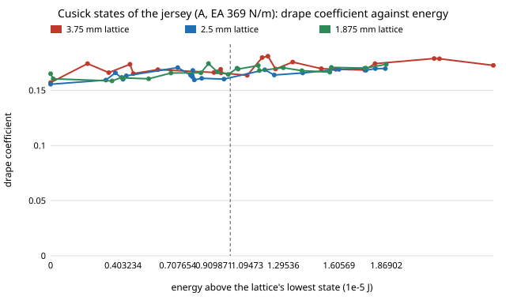

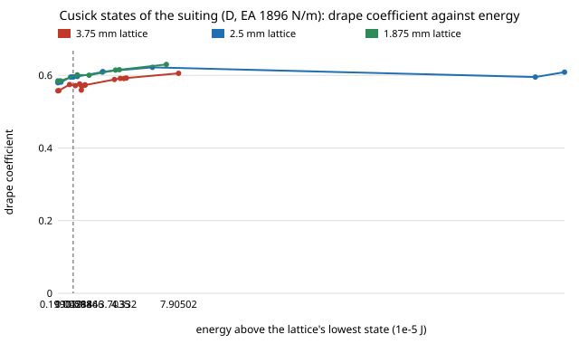

**Reading.** The jersey has no preferred state: all 20 to 21 distinct states on each lattice, 10 to 13
folds, lie within 3e-5 J (0.54 mm of overhang drop), and the band at 1e-5 J already spans 0.015 to 0.017
of DC on every lattice. That width, about ±0.008, is the jersey's intrinsic spread on this model, larger
than any mesh change the interval shows, so a calibration should treat the simulated jersey DC as an
interval, not a number. The suiting does have a preferred pattern, 7 folds, but the next one (8 folds,
DC about 0.016 higher) sits only 0.8e-5 to 1.3e-5 J above it, right at the registered band edge: the
2.5 mm band takes it in and the 1.875 mm band does not, which is why Q2 and Q5 failed. On both fabrics
lower energy goes with lower DC (Q6), so a measured DC below the band's midpoint points at the fewer-fold,
lower-energy states and a measured node count can confirm it. The interval passes the mesh test at every
band from 1e-5 J up, which a single lowest state does not.

**Limits.** No new solves; each interval is only as wide as the states the search found, so it is a lower
bound on the band's true extent (the suiting's 1.875 mm lattice has 7 distinct states from 3 own seeds and
its transfers); the suiting's transfers are still 3e's nearest-fill ones; one EA per fabric; the band is an
energy threshold, not a model of how a real specimen settles (friction on the disc and the lowering speed
decide that).

**Next.** (a) milestone 4, a measured DC and node count, now to be compared against an interval; (b) more
starts on the suiting's 1.875 mm lattice, which bounds its interval; (c) the affine transfer on the
suiting; (d) the nonconforming membrane for high EA.

## Milestone 3f: the jersey's high-energy transfers were the rim fill, not the fold patterns

`experiments/m3f_transfer/` (`run.py` with predictions P1 to P7 in its docstring, committed and pushed
before any transfer solve; `chains.py`; `results.txt`, `results.json`, `starts.json`, `run_log.txt`,
`transfer_excess_energy.svg`; 3 tests in `tests/test_m3f.py`). About 11.6 core-hours on 4 cores.

**Question.** Milestone 3e's pooled rule passed its mesh test, but 19 of its 42 jersey transfers ended
well above the target lattice's own seeds (up to 6.4e-4 J, against a seed band of about 2e-5 J) or hit
the step cap. Was that the cross-lattice transfer, or real high-energy fold patterns? Each lattice is cut
at R_SPEC + a/2, so a coarser target reaches past a finer source, and 3e filled those rim nodes with the
nearest source node's displacement, about a/2 horizontally out from a rim that hangs nearly vertical.

**Method.** The jersey's 21 garment-load end states were rebuilt with 3e's code (bit-identical energies).
Each of 3e's 42 jersey transfers was rerun with one change, the affine transfer: a target node inside a
source element is interpolated as before; any other node takes the affine extension of the best source
element at its nearest source node, so the rim continues in the cloth's own deformed tangent plane.

**Results.**

| prediction | result |
|---|---|
| P1 rebuilt states match 3e | held, 21 of 21, energy difference 0 |
| P2 (acceptance) no transfer at the 400-step cap (3e: 7 of 42) | **refuted narrowly:** 1 of 42, residual 1.13e-5 against a 1e-5 tolerance, energy already inside the band |
| P3 (acceptance) ≥ 15 of 3e's 19 flagged transfers land in the target's own band + 1e-5 J | held, 18 of 19 (the 19th is the capped one) |
| P4 affine start energy lower in all 28 transfers from 2.5 and 1.875 mm | held, 28 of 28 (+2.5e-3 to +1.4e-2 J down to −1.0e-3 to +3.6e-4 J) |
| P5 ≥ 12 of 14 transfers from 3.75 mm unchanged | refuted, 9 of 14 |
| P6 pooled DC within 0.005 of 3e, still < 0.01 from 2.5 to 1.875 mm | held: moves −0.002, −0.002, 0; mesh change +0.0095 (3e: +0.0074) |
| P7 median Newton steps fall ≥ 20% | refuted, −16% (−37% from the finer sources) |

The worst affine end state is 2.3e-5 J above the target's lowest own seed, against 6.4e-4 J in 3e, and
37 of 42 keep their source fold count (3e: 30).

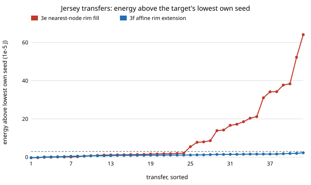

**Reading.** 3e's suspicion holds: the nearest-node rim fill, not real fold patterns, made the high-energy
and capped transfers. The pooled rule's answer barely moves, so 3e's acceptance was not an artefact of bad
transfers, but its jersey margin shrinks from 0.0026 to 0.0005 under the 0.01 bar. Which near-degenerate
state is lowest (spread about 1e-5 J) still shifts with the start, and moves the DC by about 0.002; that is
the floor on how precisely a single lowest-energy state reports the jersey's DC.

**Limits.** Jersey only; one transfer rule; the capped transfer was left capped (registered cap); each
band comes from seven seeds.

## Milestone 3e: a pooled cross-mesh lowest-energy rule passes the registered mesh test on both fabrics

`experiments/m3e_pooled/` (`run.py` with predictions T1 to T7 in its docstring, committed and pushed
before the full run; `results.txt`, `results.json`, `run_log.txt`, `dc_pooled_vs_mesh.svg`). About 22
core-hours on 4 cores: 8.6 for 38 seed chains, 13.1 for 70 cross-lattice transfers.

**The question.** Milestone 3d registered "the drape coefficient (DC) of the lowest-energy of seven
seeds" and it failed on the suiting, because no 1.875 mm seed found the 7-fold pattern. Is a
lowest-energy rule usable if each lattice's search also starts from the patterns every other lattice
found? And with one solver on every lattice (3d's 2.5 mm column was 3c's solver), do the mesh changes
still hold?

**Method.** 3c's chains (seeds 0 to 6, the fabric's sourced stretch stiffness reached by
continuation from 150 N/m) on 3.75, 2.5 and 1.875 mm with 3d's local-Hessian Newton. Then every
distinct end state at the garment-load stiffness (jersey A 369 N/m, suiting D 1896 N/m) is carried
to each other lattice and re-solved. The displacement is interpolated on the rest mesh, as in 3d's
post hoc. Rule, registered before any solve: on each lattice, the DC of the lowest-energy converged
state among its own seeds and every state transferred onto it.

| fabric, EA (N/m), lattice | seed mean DC (7) | lowest own seed: folds, DC | pooled candidates | pooled lowest: folds, DC, found on |
|---|---|---|---|---|
| A, 369, 3.75 mm | 0.1724 | 11, 0.1742 | 18 | 10, 0.1590, 1.875 mm seed 5 |
| A, 369, 2.5 mm | 0.1641 | 11, 0.1593 | 19 | 11, 0.1576, 1.875 mm seed 6 |
| A, 369, 1.875 mm | 0.1619 | 12, 0.1650 | 19 | 12, 0.1650, own seed 0 |
| D, 1896, 3.75 mm | 0.5664 | 7, 0.5575 | 15 | 7, 0.5575, own seed 0 |
| D, 1896, 2.5 mm | 0.6052 | 8, 0.5953 | 16 | 7, 0.5796, 3.75 mm seed 0 |
| D, 1896, 1.875 mm | 0.6110 | 8, 0.6011 | 18 | 7, 0.5848, 3.75 mm seed 0 |

| | prediction | outcome |
|---|---|---|
| T1 | rerun 3.75 and 1.875 mm chains reproduce 3d (all but one) | **held**: 24 of 24, identical energies (difference 0) |
| T2 | pooled DC moves under 0.01 from 2.5 to 1.875 mm at A 369 and D 1896 (acceptance) | **held**: A +0.0074, D +0.0053 |
| T3 | pooled DC moves under 0.01 from 3.75 to 2.5 mm at both | **refuted** on D: A −0.0014, D +0.0221 |
| T4 | D's pooled lowest has 7 folds on 2.5 and 1.875 mm (not blind) | **held**: 7, 7 |
| T5 | at least 75% of transfers keep their source fold count | **held**: 58 of 70 |
| T6 | pooled lowest is a transferred state in at least 2 of 6 cells | **held**: 4 of 6 |
| T7 | one-solver seed mean moves under 0.01 from 2.5 to 1.875 mm at both | **held**: A −0.0022, D +0.0058 |

- **Acceptance (T2) passed.** With pooled starts the lowest-energy DC is within 0.008 of the next
  refinement at 2.5 mm on both fabrics. On the suiting, the same 7-fold pattern is the lowest
  state found on all three lattices. It moves 0.5575, 0.5796, 0.5848 (changes +0.022, then
  +0.005): it converges inside one fold pattern, so the 3.75 mm lattice is still too coarse (T3).
- **The 2.5 mm seeds miss the lowest pattern too.** With the local solver none of the seven 2.5 mm
  suiting seeds finds a 7-fold state (fold counts 8 to 10). 3c's coloured solver had found one from
  seed 0. Of the six cells, four have a transferred state as their lowest. The lowest pattern is
  found by some lattice's seeds and missed by the others'.
- **One state, reached twice.** The 3.75 mm seed-0 suiting state carried onto 1.875 mm converges to
  DC 0.5848 with energy −1.70180269×10⁻³ J. That matches 3d's post hoc transfer to every printed
  digit, though that one started from 3c's 2.5 mm state, built by a different solver. Two
  starts from two lattices and two solvers end in the same minimum, which is some evidence that it
  is the bottom of this pattern on that lattice.
- **The one-solver seed mean converges as well (T7).** From 2.5 to 1.875 mm it moves −0.002 (A) and
  +0.006 (D). One step coarser, the suiting's mean moves +0.039. So both summaries settle at 2.5 mm,
  and both move a lot between 3.75 and 2.5 mm on the suiting.
- Unscored: 7 of 70 transfers stopped at the 400-step cap, all on the jersey. Many transferred
  jersey states converge to minima far above the seeds' (up to 6.4×10⁻⁴ J above the lowest own seed
  at 3.75 mm, against seed-to-seed spreads of about 2×10⁻⁵ J). The interpolated rim (139 nodes
  outside the coarser hull take the nearest node's displacement) is a likely cause, not yet checked.
  They do not affect the rule, which takes the minimum. One of 194 converged states has a slightly
  negative smallest eigenvalue (3d's flat 9-fold D state at 1341 N/m, reproduced).

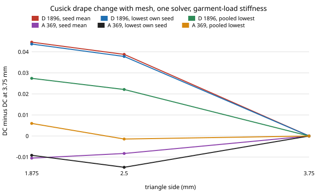

What it means: on one solver, two summaries of the Cusick drape are mesh-converged at 2.5 mm on both
fabrics, each to under 0.008. One is the seed mean of seven solves; the other is the lowest-energy
state of a search pooled across lattices. They differ in meaning. On the suiting the mean (0.605 at
2.5 mm) sits 0.026 above the lowest pattern (0.580), because most starts end in 8 to 10 folds. A
measured Cusick test reports the DC and node count of real specimens, so calibration (milestone 4)
can now ask which summary a real drape matches. The fold count separates them: the lowest pattern
has 7 nodes, the typical solve 8 to 10.

Limits: seven seeds and one start family per lattice; the 1.875 mm suiting reran seeds 0 to 2
only (3d's seeds 3 to 6 reach the same three states, with identical energies, and T1 reproduced
those three exactly); transfers only at the garment-load stiffness, not the half-load 254 and
1341 N/m; a pooled minimum over 15 to 19 candidates is still a sample, not a certified global
minimum; same element, isotropic stretch stiffness and sourced tangents as 3b.

## Milestone 3d: a Hessian 3 times cheaper, and a third lattice; the lowest-energy rule fails on the suiting because the seeds' fold patterns depend on the solver's rounding

`experiments/m3d_local_hessian/` (`localhess.py`; `run.py` with predictions R1, R2 and S1 to S4 in its
docstring, committed and pushed before the full run; `results.txt`, `results.json`, `run_log.txt`,
`dc_rule_vs_mesh.svg`; post hoc, not registered: `posthoc.py`, `posthoc.txt`). 95 min on 4 cores.

**The tool.** 3a's Newton solver built its sparse Hessian from 120 global gradient calls per step
(coloured central differences), 85% of a step's time. `localhess.py` sums element blocks instead: the
membrane block exactly (the directional derivative of P = F S for the orthotropic Saint
Venant-Kirchhoff triangle) and the hinge block by central differences of the 4-node hinge gradient
alone. It matches the coloured Hessian to 2×10⁻¹⁰ (7.5 mm) and 8×10⁻¹⁰ (2.5 mm) in relative Frobenius
norm and assembles in 1.1 s against 4.0 to 4.8 s at 2.5 mm. Whole Newton steps (LU and line search
included) are 2.98 times faster at 3.75 mm (median 0.66 s against 3c's 1.96 s), which made the
1.875 mm lattice (23,509 nodes; 13 to 22 min per cold solve on one core) a 95-minute job.

**The test.** Rule registered before any 1.875 mm solve: report the DC of the lowest-energy converged
seed of seven. 3c's chains, unchanged, on 1.875 mm; 3c's 3.75 mm chains rerun with the new Hessian.

| fabric, EA (N/m), lattice | seed mean DC | seed sd | fold counts | lowest-energy seed: folds, DC |
|---|---|---|---|---|
| A, 369, 3.75 mm (local Hessian) | 0.1724 | 0.0044 | 10, 11, 11, 12, 12, 12, 13 | 11, 0.1742 |
| A, 369, 2.5 mm (3c) | 0.1624 | 0.0023 | 10, 10, 11, 11, 11, 12, 12 | 10, 0.1586 |
| A, 369, 1.875 mm | 0.1619 | 0.0026 | 10, 10, 10, 11, 11, 12, 12 | 12, 0.1650 |
| D, 1896, 3.75 mm (local Hessian) | 0.5664 | 0.0078 | 7, 7, 7, 8, 8, 8, 8 | 7, 0.5575 |
| D, 1896, 2.5 mm (3c) | 0.6036 | 0.0136 | 7, 8, 8, 9, 9, 9, 10 | 7, 0.5807 |
| D, 1896, 1.875 mm | 0.6110 | 0.0068 | 8, 8, 9, 9, 9, 9, 9 | 8, 0.6011 |

| | prediction | outcome |
|---|---|---|
| R1 | Newton step at least 3× faster at 3.75 mm | **refuted, narrowly**: 2.98× |
| R2 | at least 12 of 14 chains reproduce 3c at every stage (same folds, DC within 0.002) | **refuted**: 1 of 14 |
| S1 | lowest-energy DC moves under 0.01 from 2.5 to 1.875 mm at all four sourced values (acceptance) | **refuted** on D: A +0.007, +0.006; D +0.021, +0.021 |
| S2 | D 1896: seed mean rises by more than 0.01, mean folds do not fall | **refuted**: +0.007 (folds 8.57 → 8.71) |
| S3 | seed-mean DC moves under 0.03 from 2.5 to 1.875 mm at all four | **held**: A +0.000, −0.001; D +0.008, +0.007 |
| S4 | every 1.875 mm stage converges | **held**: 49 of 49 |

- **Acceptance (S1) failed on the suiting.** The lowest-energy seed at 1.875 mm is an 8-fold state
  (DC 0.601); none of the seven seeds found a 7-fold state there, where 3c's lowest at 2.5 mm was
  7-fold (0.581). The jersey passes (+0.006, +0.007). The rule is not stable one step coarser either:
  with the new Hessian at 3.75 mm, the suiting's lowest-energy DC is 0.5575, so 3.75 to 2.5 mm moves it
  +0.023, where 3c's own 3.75 mm seeds gave +0.006 (3c's post hoc reading).
- **The solver changes the branch.** With a Hessian that differs by under 10⁻⁹ relative, 13 of 14
  chains at 3.75 mm end in a different state from 3c (DC differences up to 0.017; fold counts change),
  with the same start. So in this problem the seed does not pick a fold pattern; the seed and the
  solver's path do. The distributions are close (3.75 mm seed means A 0.1724 against 3c's 0.1727,
  D 0.5664 against 0.5711) but the individual states are not, and a lowest-of-seven rule is a
  statistic of a small sample from that distribution.
- **The seed mean converges.** From 2.5 to 1.875 mm the seed-mean DC moves under 0.008 on both
  fabrics (S3), against 3c's +0.030 to +0.033 for the suiting from 3.75 to 2.5 mm: the suiting's
  seed-mean change shrinks by a factor of four with the next refinement. Its seed spread halves
  (sd 0.007 against 0.014) as the 1.875 mm seeds collapse onto three states (seeds {0, 5}, {2, 4, 6}
  and {1, 3} reach identical energies).
- Three of 98 converged end states have a slightly negative smallest eigenvalue (−6×10⁻¹⁰ over the
  median diagonal, the same 9-fold D state at 1341 N/m reached from three seeds), a flat direction
  like 3c's seed 2.

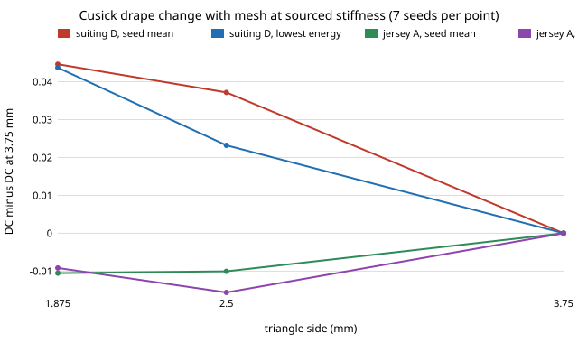

- **Post hoc, not registered: the missing 7-fold pattern exists on 1.875 mm and is the lowest found.**
  `posthoc.py` reruns 3c's seed-0 suiting chain at 2.5 mm with 3c's own solver (it reproduces 3c's
  row exactly: 7 folds, DC 0.5807, same energy), carries that state's displacements onto the 1.875 mm
  lattice and re-solves at 1,896 N/m. It stays 7-fold, converges to a minimum (smallest eigenvalue
  positive), has **DC 0.5848, +0.004 from 2.5 mm**, and is lower in energy than all seven 1.875 mm
  seeds, by 1.3×10⁻⁵ J below the 8-fold one the rule picked. On the jersey the same transfer (3c's
  lowest, seed 6, 10 folds) gives DC 0.1638 (+0.005) but ranks last in energy among eight; there the
  1.875 mm seeds found lower patterns. So the rule failed on the suiting because seven seeds did not
  sample its lowest pattern, not because that pattern moved: the lowest pattern found across both
  lattices' searches is mesh-flat to 0.004 on the suiting.

What it means: two summaries now converge at 2.5 mm on both fabrics: the seed mean of seven solves
(registered, within 0.008 of 1.875 mm) and the lowest-energy pattern when each lattice's search is
seeded with the other lattice's patterns too (post hoc, within 0.004 on the suiting). The plain
lowest of seven seeds per lattice does not, because which pattern a solve finds depends on the
solver's rounding. The seed mean is the quantity to compare with a multi-specimen measured DC; a
lowest-energy rule needs a pooled, cross-mesh search.

Limits: seven seeds; one start family; three lattices, the 2.5 mm one from 3c's solver and the 3.75
and 1.875 mm ones from the new Hessian, so the S1 to S3 changes mix a mesh step with a solver change
(R2 shows how large that is at 3.75 mm: seed means within 0.005); the run shared its 4 cores with
short test runs, so the step times are upper bounds; same element and sourced stiffnesses as 3b.

## Milestone 3c: seven seeds per case; the suiting's mesh change is which fold pattern a start finds, not where the lowest one sits

`experiments/m3c_branches/` (`run.py` with predictions B1 to B6 in its docstring, committed in an
earlier session before any run; `results.txt`, `results.json`, `run_log.txt`; post hoc, not
registered: `posthoc.py`, `posthoc.txt`). Milestone 3b's element, start and continuation, now from
seven seeded starts per case (seed 0 repeats 3b exactly) on the 3.75 and 2.5 mm lattices, up to
each fabric's sourced stiffness: 28 chains, 98 stages, **all converged**; plus 3b's four discordant
cases solved both ways and compared on energy. Each end state's smallest Hessian eigenvalue was
checked for a minimum. 129 min on 4 cores.

| fabric, EA (N/m), lattice | seed mean DC | seed sd | fold counts (count × seeds) | lowest-energy seed: folds, DC |
|---|---|---|---|---|
| A, 254, 3.75 mm | 0.1683 | 0.0050 | 11×3, 12×2, 13×2 | 11, 0.1642 |
| A, 254, 2.5 mm | 0.1608 | 0.0025 | 10×2, 11×3, 12×2 | 10, 0.1568 |
| A, 369, 3.75 mm | 0.1727 | 0.0052 | 11×3, 12×2, 13×2 | 11, 0.1679 |
| A, 369, 2.5 mm | 0.1624 | 0.0023 | 10×2, 11×3, 12×2 | 10, 0.1586 |
| D, 1341, 3.75 mm | 0.5678 | 0.0130 | 6×1, 8×5, 9×1 | 8, 0.5711 |
| D, 1341, 2.5 mm | 0.5976 | 0.0134 | 7×1, 8×2, 9×3, 10×1 | 7, 0.5754 |
| D, 1896, 3.75 mm | 0.5711 | 0.0132 | 6×1, 8×5, 9×1 | 8, 0.5745 |
| D, 1896, 2.5 mm | 0.6036 | 0.0136 | 7×1, 8×2, 9×3, 10×1 | 7, 0.5807 |

| | prediction | outcome |
|---|---|---|
| B1 | D at 1896 N/m, 2.5 mm: at least 2 fold counts | **held**: 7, 8, 9 and 10 |
| B2 | seed sd at most 0.010 on A, at least 0.015 on D somewhere | **refuted** on D: A 0.005 and 0.002, D 0.013 and 0.014 |
| B3 | seed-mean DC moves under 0.03 from 3.75 to 2.5 mm at all four sourced values | **refuted, narrowly**: A −0.008, −0.010; D +0.030 (1341), +0.033 (1896); Welch standard errors 0.002 (A), 0.007 (D) |
| B4 | fold count explains over half of D's DC variance at 1896 N/m | **held**: 0.81 |
| B5 | lower-DC branch lower in energy in at least 3 of 3b's 4 discordant cases | **held**: 4 of 4 (by 1.8×10⁻⁵ to 5.4×10⁻⁴ J) |
| B6 | every converged end state is a local minimum | **refuted**: 2 of 106 have a negative smallest eigenvalue |

- **Acceptance (B3) failed on the suiting**, by 0.0025 at 1,896 N/m; 1,341 N/m passes by 0.0002.
  Seed 0's 6-fold state at 3.75 mm, which 3b read as the cause of the miss, is the low outlier of its
  seven; without it the change would be +0.026 and +0.028 (post hoc), just under the bar, so the
  miss rests on one seed. But the shift is systematic, not that seed's: at every D stiffness from
  150 N/m up the mean rises by +0.020 to +0.033 (+0.018 to +0.028 without seed 0), and the fold counts
  shift up with refinement (mostly 8 at 3.75 mm, mostly 9 at 2.5 mm). The jersey passes again with seven seeds.
- **The lower-drape pattern is the lower-energy one.** In all four of 3b's discordant cases the
  continued solve (fewer, larger folds on the stiff cases) sits below the cold solve in energy, by up
  to 5.4×10⁻⁴ J on the jersey at 3200 N/m. Across seeds the same holds on three of four lattice and
  fabric combinations: energy and DC correlate at r = +0.67 to +0.95 (D at 3.75 mm, r ≈ −0.1, is the
  exception, where seed 0's 6-fold state is high in energy).
- **Post hoc, not registered: the lowest-energy seed's DC is flat in mesh.** Taking, per case, the
  seed whose end state has the lowest energy (energies compared within one lattice), its DC moves
  −0.001 to −0.009 on the jersey and **+0.001 to +0.006 on the suiting** from 3.75 to 2.5 mm, at every
  EA from 150 to 1,896 N/m, against +0.020 to +0.033 for the seed mean and +0.016 to +0.036 for seed 0.
  So the suiting's mesh dependence is not a drift of the minimum: a finer mesh traps more of the same
  starts in stiffer, higher-energy fold patterns (9 and 10 folds), while the lowest pattern found
  stays put. Seven seeds do not establish a global minimum; a lowest-of-k rule needs its own test.
- **The two flagged states** (both D at 3.75 mm; post hoc): the eigenvalue sign is the same at
  finite-difference steps of 1e-6, 1e-7 and 1e-8 m. Seed 3 at 150 N/m is a genuine saddle: a 0.5 mm
  push either way along the eigenvector descends, by 3.8×10⁻⁵ J to an 8-fold state (DC 0.520 from
  0.534) or by 6.5×10⁻⁶ J. Seed 2 at 1,341 N/m is a flat direction: both pushes fall 1.6×10⁻⁸ J and
  return to the same DC (to 0.0001) and fold count. A gradient test alone does not certify a minimum
  in this problem; continuing that chain to 1,896 N/m left a minimum.

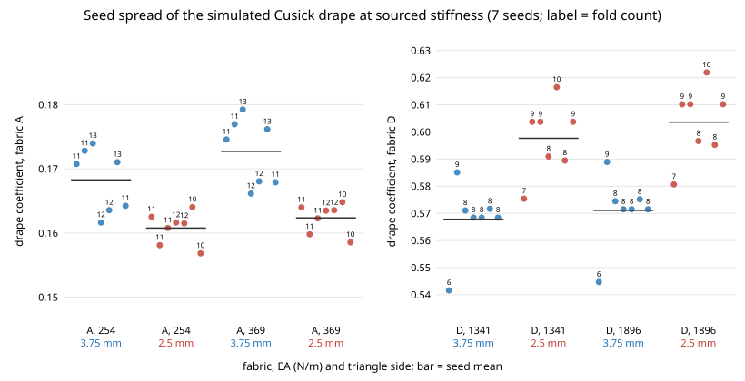

What it means: a static Cusick solve has a population of answers, and how it is summarised decides
whether the element passes. As a seed mean, the suiting's DC is not mesh-converged at 2.5 mm; as the
lowest-energy pattern found, both fabrics are within 0.009. A measured Cusick test reports DC and
node count over a few specimens, so the simulated population (DC and fold-count distribution) is
what to compare it with, and the result here says the comparison will depend on the mesh unless
the simulated drop is selective about energy (a dynamic drop with damping, or a lowest-of-k rule).

Limits: seven seeds per case, one start family (tilt plus 2 mm noise) and one continuation path; two
lattices; the lowest-energy reading is post hoc; same element, isotropic EA and sourced tangent
stiffnesses as 3b (at shoulder load, not Cusick load); the 0.5 mm push probes one eigenvector each.

## Milestone 3b: at the fabric's own stretch stiffness, the triangle element passes on the jersey; fold branches remain

`experiments/m3b_continuation/` (numpy and scipy; predictions G1 to G7 in `run.py`'s docstring and
LOG.md, committed before the run). Milestone 3a's element, specimen, start and Newton settings,
unchanged; the only change is the path. Per fabric and lattice, one chain: a cold solve at EA 150 N/m,
then each stiffer EA started from the previous equilibrium, through each fabric's sourced tangent
stiffness (milestone 1d, from the KES-FB tensile LT, WT and EMT: 254 and 369 N/m for the cotton
jersey A, 1,341 and 1,896 N/m for the suiting D). All 40 stages converged (3a: 9 of 32 cold solves
capped), most in 14 to 50 Newton steps. Drape coefficient by lattice side:

| fabric, EA (N/m) | 7.5 mm | 5 mm | 3.75 mm | 2.5 mm | 3a cold, 2.5 mm |
|---|---|---|---|---|---|
| A, 150 | 0.220 | 0.184 | 0.166 | 0.161 | 0.161 |
| **A, 254 (sourced, half load)** | 0.231 | 0.192 | 0.171 | 0.163 | – |
| **A, 369 (sourced)** | 0.241 | 0.203 | 0.175 | 0.164 | – |
| A, 800 | 0.273 | 0.230 | 0.185 | 0.168 | 0.175* |
| A, 3200 | 0.351 | 0.296 | 0.216 | 0.178 | 0.230* |
| D, 800 | 0.457 | 0.546 | 0.537 | 0.566 | 0.581 |
| **D, 1341 (sourced, half load)** | 0.468 | 0.550 | 0.542 | 0.575 | – |
| **D, 1896 (sourced)** | 0.476 | 0.552 | 0.545 | 0.581 | – |
| D, 3200 | 0.490 | 0.555 | 0.547 | 0.589 | 0.618* |

`*` 3a's solve hit the Newton cap (not an equilibrium).

- **The jersey passes at its own stiffness** (G1 to G5 held): from 3.75 to 2.5 mm DC moves −0.008
  (254 N/m) and −0.011 (369 N/m), and at 2.5 mm the whole range 150 to 3200 N/m moves it +0.018.
  Coarse lattices still lock at high EA (A at 3200: 0.351 down to 0.178), but not at A's stiffness.
- **The suiting misses by a fold** (G7 refuted): +0.034 and +0.036 from 3.75 to 2.5 mm at its sourced
  stiffness, against a 0.03 bar; the step is a change from 6 to 7 folds, and DC is not monotone in
  mesh (0.552, 0.545, 0.581 from 5 to 2.5 mm).
- **Several equilibria** (G6 refuted): in 4 of 19 cases where 3a's cold solve and the continued
  solve both converged, they differ by 0.03 or more, up to 0.32 (A at 3200 N/m on 5 mm: 0.614 cold,
  0.296 continued). Statics does not pick the branch; a calibration against a real Cusick test
  needs its node count, or a dynamic drop from a fixed start.

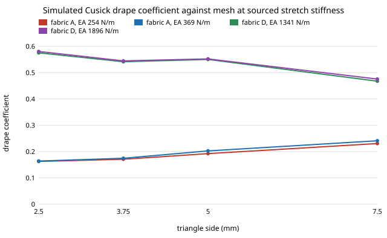

Limits: one seed and one start; the continuation path selects the soft solve's fold pattern; the
competing branches' energies were not compared; the sourced EA values are tangents at the garment's
shoulder load, not at the Cusick specimen's own load.

## Milestone 3a: a triangle finite-element tier, checked against the exact cantilever and the Cusick acceptance test

`experiments/m3_fem_tier/` (numpy and scipy). The proposal's top tier is ARCSim or C-IPC, both C++
builds. This step writes ARCSim's element model in numpy (`fem.py`, without its adaptive
remeshing): constant-strain triangles with a Saint Venant-Kirchhoff energy, stretch stiffness EA and
in-plane shear G as separate parameters (G from the same KES table as B and W: 26 N/m per radian
for the cotton jersey A, 89 for the suiting D), and the discrete-shell hinge bending energy
(Grinspun, Hirani, Desbrun and Schröder 2003, "Discrete shells", SCA; Bridson, Marino and Fedkiw
2003, "Simulation of clothing with folds and wrinkles", SCA, whose dihedral-angle gradient `fem.py`
uses; identifiers not looked up this run) on an equilateral lattice. Two calibration facts, both
in `tests/test_m3.py`: on a piecewise-flat equilateral lattice a cylinder also folds the edges
parallel to its curvature, so the hinge constant is B θ²|e|² / (2(A1 + A2)), half the textbook form,
and with it a cylinder's energy is B k²/2 per area to 0.4% at every axis angle. The solver is a damped
Newton method with a sparse Hessian from coloured central differences (`newton.py`), because chunked
L-BFGS, the stopping rule of milestones 1b to 2b, stops 9% of the overhang short on a cantilever.
Predictions were committed before the first run; a hinge-gradient sign bug and the solver change
came before any prediction was evaluated (LOG.md).

**Part 1, the exact case.** Peirce's cantilever (ASTM D1388) against the exact heavy elastica
(`elastica.py`, which reproduces the standard's 41.5° chord at an overhang of 2.000 bending lengths):

| | 8 elements | 16 | 32 | first-order extrapolation |
|---|---|---|---|---|
| tip-drop error, % of l (12 cases) | 4.8 to 9.6 | 2.9 to 5.5 | 1.6 to 3.2 | +0.26 to +0.89 |

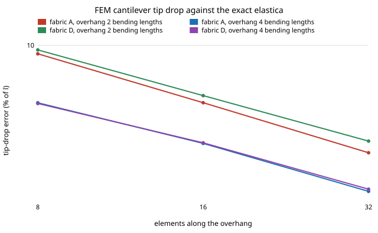

**Part 2, the acceptance test.** Milestone 2a's simulated Cusick test (30 cm specimen, 18 cm disc),
measured G, drape coefficient by lattice side a; `*` marks a solve that hit the 400-step Newton cap
(residual 8 to 830 node weights), so not an equilibrium:

| fabric, EA (N/m) | 7.5 mm | 5 mm | 3.75 mm | 2.5 mm | spring sheet, 2.5 mm (2b) |
|---|---|---|---|---|---|
| A, 150 | 0.220 | 0.184 | 0.166 | 0.161 | 0.155 |
| A, 800 | 0.507 | 0.356* | 0.193 | 0.175* | 0.226 |
| A, 3200 | 0.567 | 0.614 | 0.388* | 0.230* | 0.367 |
| D, 150 | 0.425 | 0.513 | 0.509 | 0.525 | 0.492 |
| D, 800 | 0.455 | 0.550 | 0.565 | 0.581 | 0.571 |
| D, 3200 | 0.463 | 0.582 | 0.599 | 0.618* | 0.632 |

| | prediction | outcome |
|---|---|---|
| F1 | 32-element cantilever within 1% of l of the elastica | **refuted**: 1.6 to 3.2%, first-order convergence; extrapolated within 0.9% (post hoc) |
| F2 | EA 150 to 3200 moves the cantilever under 0.5% of l | held: at most 0.31% |
| F3 | Cusick, EA 3200: 3.75 to 2.5 mm moves DC under 0.03 on both fabrics | **refuted**: A −0.158 (unconverged), D +0.019 |
| F4 | Cusick, 2.5 mm: DC(3200) − DC(800) under 0.03 on both | **refuted**: A +0.055, D +0.037 (spring sheet +0.141, +0.061) |
| F5 | with shear tied to 0.1 EA, A's 5 to 2.5 mm change at EA 3200 under half the spring sheet's | **refuted**: the 2.5 mm solve stalled (DC 0.93, residual 1e4 node weights) |
| F6 | A < D at every EA and mesh | **refuted**: on the 7.5 mm lattice at EA 800 and 3200 |
| F7 | (part 3) milestone 2b's L-BFGS DC within 0.03 of a Newton solve of the same spring sheet | **refuted** on A at 5 mm (+0.055, a different fold pattern); D within 0.008 |

**Reading.** The element is calibrated and converges on a pure bend, and the cantilever is blind to
stretch stiffness, as a near-isometric bend should be. The acceptance test fails, and the failure
is informative. On the suiting (D) every solve up to EA 800 N/m converges; DC still climbs about
0.016 per refinement after the coarsest grid, and EA 800 to 3200 still adds 0.034 at 3.75 mm, though
the element cuts the spring sheet's EA dependence by about 40%, and the shear coupling that
dominated the spring sheet barely moves it here (0.581 with measured G against 0.578 tied). On the
soft jersey (A) the element converges only at EA 150 N/m, where the mesh sequence settles (0.220,
0.184, 0.166, 0.161). That is close to the tangent stiffness milestone 1d estimated for this jersey
at garment load (250 to 370 N/m). At 800 N/m and above the drape depends on the mesh and Newton
stalls: constant-strain triangles still lock when the cloth is soft in bending and stiff in stretch, the
problem English and Bridson (2008, "Animating developable surfaces using nonconforming elements",
*ACM TOG* 27(3); not looked up this run) built edge-midpoint elements to avoid.
Re-solving milestone 2b's spring sheet by Newton keeps its mesh dependence (A at EA 3200: 0.62 at
5 mm, 0.52 at 3.75 mm), so that finding was not a stopping-rule artefact. This element is not the top tier.

**Limits.** One seed; lattice aligned with the warp; the same EA in both directions; no clamp-edge
contact or friction; Newton capped at 400 steps; two solvers or two meshes can settle into different
fold patterns, so a DC difference mixes convergence with branch selection.

## Milestone 5b: a regret bound that keeps the cheap tier's penalty, and a screen-and-verify loop

`experiments/m5b_penalty_bound/run.py` (stdlib only; no new simulation, it reuses milestone 5's 50
instances). Predictions were committed before the first run, but after milestone 5's table was
public, so Q2 to Q5 are not blind.

**The bound.** Milestone 5's pair bound drops the term s_t(d*) − s_t(d^) ≥ 0 from the exact identity,
and that term is large where the cheap tier is sharp, which is the 2D chain. Keeping it and taking
the maximum over the unknown d*:

    r = max_d [ e(d^) − e(d) − Dt(d) ] ≤ R(K) = max(0, max_{d ≠ d^} [ K |d − d^| − Dt(d) ]),   Dt(d) = s_t(d) − s_t(d^),

for any K with |e(d) − e(d^)| ≤ K |d − d^|. R needs the cheap scores and K only, not d*. The smallest
valid K is the star constant around the choice, K*, which is never above milestone 5's neighbour
slope L. R(K) = 0 is the cone certificate. In practice K is estimated: K3 from the reference tier at
d^ and its two grid neighbours. **Screen and verify (SV, κ):** run those three, estimate K from every
reference run so far, run every design with Dt(d) ≤ κ K |d − d^|, repeat until nothing is added, and
return the best design the reference tier has seen. Baselines: trusting the cheap choice (1 run),
local-3 (the three runs, best of them) and exhaustive search (7 runs).

| family | instances | regret > 0 | median r / pair bound | median r / R(K*) | R(K3) ≥ r | mean regret (cm): cheap, local-3, SV(1) | mean reference runs: local-3, SV(1), SV(2) |
|---|---|---|---|---|---|---|---|
| 2D chain → 3D sheet | 28 | 16 | 0.12 | 0.34 | 25 | 0.030, 0.0039, 0.0017 | 3.0, 3.9, 7.0 |
| 3000 iterations → converged | 4 | 4 | 0.49 | 0.72 | 4 | 0.029, 0, 0 | 3.0, 3.5, 5.0 |
| mesh change | 4 | 0 | – | – | 4 | 0, 0, 0 | 3.0, 3.0, 3.75 |
| guessed EA or default → KES-sourced | 14 | 7 | 0.68 | 0.68 | 14 | 0.031, 0, 0 | 3.0, 4.3, 5.7 |
| all | 50 | 27 | 0.29 | 0.53 | 47 | 0.028, 0.0022, 0.0010 | 3.0, 3.9, 6.2 |

| | prediction | outcome |
|---|---|---|
| P1, P2 | r ≤ R(K*) ≤ R(L) and r ≤ (osc − margin)₊ ≤ osc (theorems) | held, all 50, and on 3,000 random instances (`tests/test_m5b.py`) |
| Q1 | R(K*) ≤ K* abs(d^ − d*) in every instance | **refuted**, 24 of 50: in 20 the cheap choice is right (d^ = d*, so the oracle quantity is 0 while R is not), in 4 R is 1.0 to 1.35 times it |
| Q2 | on 2D → 3D, median r / R(K*) at least twice median r / pair | held: 0.34 against 0.12 (2.8 times) |
| Q3 | R(K3) ≥ r in at least 45 of 50, R(2 K3) ≥ r in all | held: 47 and 50 |
| Q4 | SV(1): zero regret in at least 45, at most 4.5 runs on average, mean regret no worse than local-3 | held: 48, 3.92 runs, 0.0010 against 0.0022 cm |
| Q5 | on 2D → 3D, SV(1) needs at least one more run than local-3 at the median | held: 4 against 3 |

**Reading.** Keeping the penalty term turns milestone 5's certificate into a usable number: on the
2D chain the realised regret is a median third of R(K*), against an eighth of the pair bound. With
K estimated from three runs the bound still covers the realised regret in 47 of 50 instances, and
doubling the estimate covers all 50. The three it misses, and the two instances SV(1) gets wrong
(regret 0.036 and 0.012 cm, fabric A at EA 40 N/m in 1c and 1d), are the softest cloth: the
reference optimum sits two grid steps (1 cm) from the cheap choice and the paired error is curved,
so the slope near the choice understates the slope further out. SV(2) runs all seven candidates on
the 2D chain, so it buys its zero regret at exhaustive cost there. SV(1) is the useful setting:
on a 7-width study it cuts the 2D choice's mean regret from 0.030 cm to 0.0017 cm for 3.9
reference runs instead of 7, and on the parameter families (where the cheap tier is the same model
at a nearby parameter) it never misses.

**Limits.** The same 50 instances as milestone 5, which share 2D scores and overlap, so no interval
is claimed; one design variable on a grid of 7, so the run counts are small integers and the saving
from SV grows only if the candidate set does; the reference tier is our converged sheet, not a
validated solver; κ was swept at three values, not tuned.

## Milestone 5: the decision-margin bound, and what paired designs can certify

`experiments/m5_margin_bound/run.py` (stdlib only; no new simulation, it reads the shape errors
milestones 1b, 1c and 1d committed). Predictions were committed before the first run.

**The bound.** A cheap tier t and a reference tier T score the same candidates (here the arm-width
offsets) with s_t and s_T. Let d^ be the cheap tier's choice, d* the reference's, and
e(d) = s_T(d) − s_t(d) the tier error at design d. Because s_t(d^) ≤ s_t(d*), the reference-tier
regret of the cheap choice obeys

    r = s_T(d^) − s_T(d*) = e(d^) − e(d*) − [s_t(d*) − s_t(d^)]  ≤  e(d^) − e(d*)  ≤  max e − min e = osc(e).

Only the *variation* of the tier error across designs costs regret; a constant error costs none.
Two certificates follow. **C1:** if the cheap tier's margin (runner-up minus best) exceeds osc(e),
the cheap choice is the reference choice. **C2 (cone):** on a 1D design grid with L the largest
neighbour slope of e, if s_t(d) − s_t(d^) > L |d − d^| for every other d, the choice is certified,
and in general r ≤ L |d^ − d*|. Both are checked on 3,000 random instances (`tests/test_m5.py`).

**The data.** 50 instances in four families: the 2D chain against the converged 3D sheet (28, from
1c and 1d), the 3000-iteration 3D solve against the converged one (4, from 1b), a mesh change (4,
from 1c), and a guessed stretch stiffness or the default sheet against the KES-sourced one (14,
from 1c and 1d: H3's "uncalibrated against calibrated").

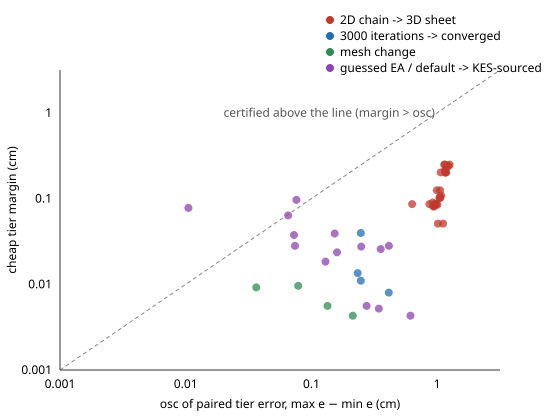

| family | instances | regret > 0 | mean / max regret (cm) | C1 | C2 | median osc / 2 max abs(e) | median candidates left (osc, cone) |
|---|---|---|---|---|---|---|---|
| 2D chain → 3D sheet | 28 | 16 | 0.030 / 0.198 | 0 | 0 | 0.30 | 5, 4 of 7 |
| 3000 iterations → converged | 4 | 4 | 0.029 / 0.070 | 0 | 0 | 0.65 | 5, 3.5 of 7 |
| mesh change | 4 | 0 | 0 / 0 | 0 | 0 | 0.64 | 4, 4 of 7 |
| guessed EA or default → KES-sourced | 14 | 7 | 0.031 / 0.085 | 2 | 3 | 0.72 | 4, 4.5 of 7 |

| | prediction | outcome |
|---|---|---|
| M1 | the inequalities hold and every certificate implies zero regret | held, all 50 |
| M2 | median osc / (2 max abs(e)) over 2D → 3D at most 0.35 | held: 0.30 |
| M3 | C1 certifies no 2D → 3D and at most 1 of 4 capped → converged | held: none of either |
| M4 | the cone C2 certifies more than C1, including a 2D → 3D instance | **refuted**: 3 against 2, but no 2D → 3D |
| M5 | median 2D → 3D leaves at least 4 of 7 candidates; EA 3200 → KES at most 2 | held: 5, and 1.5 |
| M6 | the 2D choice costs under 0.05 cm on the 3D sheet at EA 800 and up | held: at most 0.035 cm |
| M7 | L from three reference evaluations is at least half the true L in 75% | held: 45 of 50 |

**Reading.** The 2D chain's error against the 3D sheet reaches 1.6 to 2.0 cm in every instance, yet its
spread across widths is a third of that, and the bound charges only the spread. That is still 0.6
to 1.3 cm, ten times the chain's own margins (0.05 to 0.25 cm), so no 2D choice can be certified from the
bound, although its realised regret is small (mean 0.03 cm, at most 0.20 cm or 7.6% of the shape
error, at EA 40 N/m; at most 0.035 cm from 800 N/m up). The bound is loose for a structural reason:
it drops the cheap tier's own penalty at the reference optimum, and the 2D chain's error curve is
sharp (0.2 cm per half centimetre) where the 3D sheet's is flat. The realised regret is 1 to 49% of
the pair bound on 2D → 3D, against 43 to 94% on the parameter family. The cone does not rescue
cross-model certification: the steepest slope of e is 0.47 to 0.78 cm per cm of width, against the 0.1 to 0.5 cm
per cm the chain's margins could absorb. Certification works only where the two tiers are the same
model with nearby parameters: 2 (C1) or 3 (C2) of the 4 EA 3200 → KES instances, and none of the
rest. For the design loop (H4) this says the cheap tier is a screen, not a judge: it rules out the
far widths (a median 3 of 7 under the cone, 0 to 4) and the reference tier must still evaluate the rest. Three reference runs
around the cheap choice estimate the slope L well (within a factor 2 in 45 of 50 instances), so a
loop can tell cheaply whether it is in the certifiable regime.

**Limits.** The reference tier here is our own converged 3D sheet, not a validated solver (that is
milestone 3), so this measures the bound's behaviour, not fidelity. One design variable on a 0.5 cm
grid with 7 candidates; scores carry solver error of up to 0.002 cm per chunk, which the "tol"
columns add (four times the largest last-chunk change) without changing any certificate. The
instances overlap (1c's EA 150 base and 1d share 2D scores), so they are not independent samples.

## Milestone 1d: the shallow-arm width with shear from measured KES G

`experiments/m1d_measured_shear/run.py`. Milestone 1c's converged 3 cm arm, with the sheet's shear
spring set to each fabric's measured KES shear rigidity G (26, 27, 29, 89 N/m; in this sheet the
in-plane shear stiffness is exactly the diagonal-spring setting, `tests/test_m1d.py`) and the
stretch stiffness EA swept on its own: fabrics A to D at EA 150, 800, 3200 N/m and at EA_kes, plus
EA 40 on A and D. 126 cases, all converged under milestone 1b's rule; predictions committed first.

EA_kes is new data, not a sweep value: Ramaiah et al.'s Table 3 also lists KES-FB1 tensile
linearity LT and energy WT, and with the standard 500 gf/cm maximum load (assumed; the paper does
not state it) the strain at that load is EMT = 2 WT / (LT Fm), giving a secant stiffness of 2,360
(A), 15,490 (B), 7,380 (C) and 7,790 N/m (D). Because LT < 1, the curve stiffens with load, so this
is an upper bracket on the stiffness under a garment's own weight.

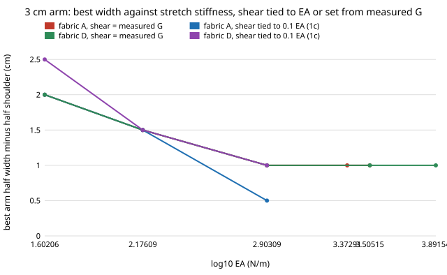

| best offset (cm) | EA 40 | 150 | 800 | 3200 | EA_kes | 2D chain at EA_kes |
|---|---|---|---|---|---|---|
| A, cotton jersey | +2.0 | +1.5 | +1.0 | +1.0 | +1.0 (2,360) | +1.0 |
| B, elastane jersey | | +1.5 | +1.0 | +1.0 | +1.0 (15,490) | +1.0 |
| C, shirting | | +1.5 | +1.5 | +1.0 | +1.0 (7,380) | +1.0 |
| D, suiting | +2.0 | +1.5 | +1.0 | +1.0 | +1.0 (7,790) | +1.0 |
| A, shear tied to EA (1c) | +2.0 | +1.5 | +0.5 | | | |
| D, shear tied to EA (1c) | +2.5 | +1.5 | +1.0 | | | |

| | prediction | outcome |
|---|---|---|
| S1 | with measured G, EA 40 to 800 moves the best by at most 0.5 cm (A, D) | **refuted**: 1.0 cm on both; shear was a third of 1c's 1.5 cm |
| S2 | EA 800, 3200 and EA_kes move the best by at most 0.5 cm, every fabric | held: +1.0 everywhere except C at EA 800 (+1.5) |
| S3 | at EA_kes, 3D best within 0.5 cm of the 2D chain's | held, exactly: +1.0 on all four |
| S4 | at EA 150, measured G narrows D's best to +1.0 or less | **refuted**: D stays at +1.5 |
| S5 | at EA_kes every margin exceeds twice the last-chunk change | held: margins 0.021 to 0.078 cm against at most 0.0076 cm |

**Post hoc: the stiffness at the garment's own load** (`posthoc_tangent.py`, not predicted). The
relevant stiffness is the tangent at the shoulder load (3.7 to 7.3 N/m: each model garment's
weight over the sheet's 20 cm depth), not the secant at 490 N/m. A power law F = Fm (e/EMT)^n with
n = 2/LT − 1 matches both LT and WT. Its tangent at that load is 369 (A), 6,194 (B), 1,046 (C) and
1,896 N/m (D), and 254, 5,164, 702 and 1,341 at half the load. The suiting and the elastane jersey sit in the
regime where the choice is settled at +1.0 cm; the cotton jersey and the shirting sit where it
flips between +1.0 and +1.5. Their answer needs the toe of the tensile curve at a few N/m, which
the KES summary numbers do not give. A real curve with a linear toe would be stiffer at low load
than this power law, so the estimate leans soft.

## Milestone 2b: refining the drape test's grid, and the shear spring hidden in EA

`experiments/m2b_locking/run.py`. Milestone 2a's simulated Cusick test and stopping rule, unchanged,
on fabrics A (soft jersey, bending length 0.81 cm) and D (suiting, 1.72 cm) at EA 150, 800 and 3200
N/m on grids of 7.5, 5, 3.75 and 2.5 mm (11,513 nodes), seed 0, plus seed 1 at EA 3200 on 3.75 mm:
26 cases, all met the rule. Predictions were committed before the run. The question: is 2a's climb
of DC with EA membrane locking, which a finer grid should remove, or something else?

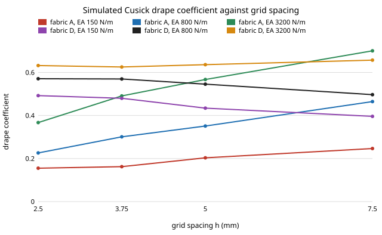

| DC | 7.5 mm | 5 mm | 3.75 mm | 2.5 mm |
|---|---|---|---|---|
| A, EA 150 | 0.247 | 0.203 | 0.162 | 0.155 |
| A, EA 800 | 0.465 | 0.351 | 0.301 | 0.226 |
| A, EA 3200 | 0.701 | 0.567 | 0.491 | 0.367 |
| D, EA 150 | 0.396 | 0.434 | 0.480 | 0.492 |
| D, EA 800 | 0.497 | 0.546 | 0.570 | 0.571 |
| D, EA 3200 | 0.657 | 0.636 | 0.625 | 0.632 |

(3.75 mm at EA 3200 is the mean of two seeds; they differ by 0.015 on A and 0.006 on D.)

| | prediction | outcome |
|---|---|---|
| L1 | at EA 3200, DC falls monotonically with refinement, by at least 0.05, both fabrics | **refuted**: A falls 0.33 and has not levelled off; D moves 0.03 and turns up at the last step |
| L2 | DC(3200) − DC(800) at 2.5 mm under half its 5 mm value | **refuted**: it shrinks by a third (A 0.216 to 0.141, D 0.091 to 0.061) |
| L3 | the mesh moves DC more at EA 3200 than at 150, both fabrics | **refuted** on D, where DC *rises* with refinement at low EA |
| L4 | soft-membrane compression over 1% at EA 150, under 0.3% at 3200 | **refuted**: under 0.15% everywhere; the overhang folds, it does not compress |
| L5 | at 2.5 mm, EA 800 and 3200 still differ by more than 0.03 somewhere | held: 0.14 (A), 0.06 (D) |

**Post hoc: the shear spring hidden in EA** (`posthoc_shear.py`, not predicted). The sheet's
diagonal springs are 0.1 of EA, so every EA sweep in this programme also swept the shear stiffness.
Swapping them separates the two:

| DC | EA 800, shear 80 N/m | EA 3200, shear 80 | EA 800, shear 320 | EA 3200, shear 320 |
|---|---|---|---|---|
| D, 2.5 mm | 0.571 | 0.598 | 0.617 | 0.632 |
| D, 3.75 mm | 0.570 | 0.578 | 0.614 | 0.622 |
| A, 3.75 mm | 0.301 | 0.314 | 0.440 | 0.484 |

On fabric D, shear alone moves DC two to five times as much as stretch alone, and on A ten times as
much. The shear stiffness is also measurable: the paper that gave `hanger-kes` its B and W
(Ramaiah et al., Table 3) lists KES-FB1 shear rigidity G of 0.47, 0.48, 0.52 and 1.58 gf/cm/deg
for A to D, or 26, 27, 29 and 89 N/m per radian. In the spring sheet the in-plane shear stiffness
is exactly the diagonal spring constant (`experiments/m2b_locking/kes_shear.py` derives it, and a
test confirms it on a sheared specimen to 3%). So the programme's base runs (EA 150, shear 15 N/m)
were softer in shear than any of the four fabrics, and EA 800 (80 N/m) sits near the suiting's
measured 89.

What it means. On the 2.5 mm grid the suiting's drape is converged and the soft jersey's is not
(except at EA 150), so a Cusick test on a light knit needs a finer grid or a different element.
Where the grid is converged, most of what milestones 2a and 1c read as stretch dependence comes
from the shear spring tied to EA, and shear rigidity is in the same KES table as B and W, so it can
be set from data and does not need a sweep. Milestone 1c's shallow-arm width shift uses a sheet
with the same coupling. Whether it is a shear effect is the next test, not a result yet.

## Milestone 1c: the tier disagreement across stretch stiffness and mesh

`experiments/m1c_ea_mesh/run.py`. Milestone 1b's converged solve and stopping rule, reused
unchanged, on the 3 cm arm for fabrics A (softest) and D (stiffest), offsets 0 to +3 cm in half-cm
steps, at five configurations: EA 40, 150 and 800 N/m on the base mesh (5 mm rows, 9 columns
across the depth), and at EA 150 a coarser row spacing (7.5 mm) and a finer depth mesh (13
columns). The 2D chain runs at the same EA and row spacing. All 70 cases met the stopping rule
(6,000 to 33,000 iterations). Predictions were committed before the run.

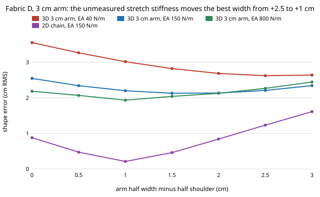

| | prediction | outcome |
|---|---|---|
| R1 | base configuration still picks +1.5 cm (reproduces 1b) | held, every base number identical to 1b |
| R2 | EA 40 to 800 moves the 3D best by at most 0.5 cm | **refuted**: +2.0 / +2.5 cm (A / D) at EA 40, +1.5 at 150, +0.5 / +1.0 at 800 |
| R3 | each mesh change moves the 3D best by at most 0.5 cm | held: +1.5 on both fabrics for both meshes |
| R4 | 3D best never narrower than the 2D best, strictly wider in 8 of 10 | **refuted**: 3D minus 2D is +1.0 at EA 40, +0.5 at 150, −0.5 / 0.0 at 800 |
| R5 | error at the best moves over 0.05 cm across EA | held: 0.22 cm (A), 0.69 cm (D) |

What it means. The 0.5 cm disagreement of milestone 1b is not a mesh artefact at EA 150, but it is
not a fixed property of the tiers either: its sign follows the stretch stiffness, which the
KES-FB2 table behind these fabrics does not give. On a shallow arm, a softer cloth stretches under
its own weight as its front and back panels fall away, and a wider arm makes up for it; the 2D
chain barely sees this (it picks +1.0 cm everywhere except fabric D at EA 40, +1.5). So on the 3D
tier bending rigidity and weight do not pick a shallow-arm hanger, which is early evidence against
H2 there, and a measured EA (KES-FB1 tensile) is needed before milestone 4. The base choice is
also thin: +1.5 beats +1.0 by 0.004 to 0.006 cm, against a last-chunk change of up to 0.0013 cm.

## Milestone 2a: a simulated Cusick drape test, and why it cannot calibrate this sheet

`experiments/m2_cusick/`. The Cusick tester clamps a 30 cm circle of fabric on an 18 cm disc and
reads the drape coefficient DC = (shadow area − disc area) / (specimen area − disc area). The
plan (milestone 2) was to compare the sheet's DC with a published table of DC, B and W for the
same fabrics. This session's network reached only GitHub, and every host with a candidate table
refused (LOG.md), so this step builds the test and asks the question that decides whether such a
table can be used at all: on this model, does DC move with bending rigidity more than with
everything else?

Model: `hanger-3d`'s spring sheet (stretch springs on a square grid, diagonal shear springs,
turning-angle bending, gravity) cut to the specimen circle on a 5 mm grid, with bending charged on
both diagonals as well so that a cylindrical bend costs B&kappa;&sup2;/2 in every direction
(`tests/test_m2.py` checks the 45-degree case to 5%). Nodes inside the clamp are fixed. The shadow
is rasterised at 1 mm and DC is normalised by the flat mesh's own area. Each case is solved until
DC moves under 0.001 per 2000 L-BFGS iterations (all 140 cases did, none at the cap). Fabrics A
to D of `hanger-kes` (measured B and W), EA 150 N/m unless stated, 5 seeds for the base cases
and 3 for the sweeps. Predictions were written before the run.

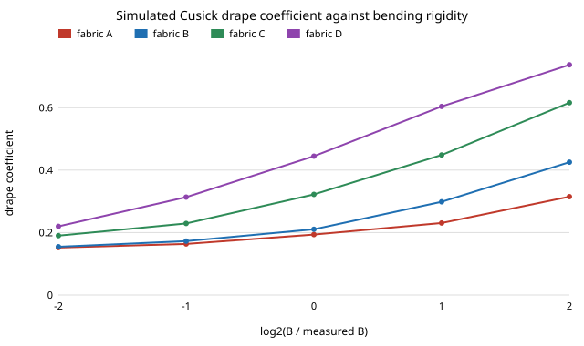

| | prediction | outcome |
|---|---|---|
| C1 | DC orders the fabrics by bending length, A < B < C < D | held: 0.194, 0.213, 0.321, 0.446 (c = 0.81, 1.01, 1.29, 1.72 cm) |
| C2 | seed sd at most 0.02 | held: 0.003 to 0.008, with 8 to 14 folds |
| C3 | DC rises with B, each doubling by at least 3 seed sd | **refuted** on A: monotone on all four, but A's first doubling moves DC by 0.012 against 3 sd = 0.020 |
| C4 | B and W both ×4 (same bending length) moves DC under 0.02 | **refuted**: it drops DC by 0.04 to 0.06 |
| C5 | EA 40 against 800 N/m moves DC under 0.03 | **refuted**: by 0.15 to 0.23 |
| C6 | shear spring 0.03 against 0.3 of EA moves DC at least 0.03 somewhere | held: 0.08 to 0.11 on every fabric |
| C7 | 7.5 mm against 5 mm grid under 0.03 | **refuted** on A, B and D (0.044 to 0.047) |

Post hoc (`posthoc_ea.py`, not predicted): stiffening the stretch springs does not approach a
limit. Mean DC on fabric A goes 0.19, 0.36, 0.57, 0.78 at EA 150, 800, 3200 and 12,800 N/m, and
on fabric D 0.44, 0.54, 0.63, 0.77, so at the stiff end two fabrics whose B differs 19-fold
drape alike; at EA 3200 the 7.5 mm grid reads 0.70 against 0.57 on A. That is membrane locking,
the known failure of a regular spring grid: the folds a fabric makes are nearly isometric, a
coarse grid cannot form them without stretching its springs, and the stiffer the springs the
more the sheet behaves like a stiff plate. C4's refutation is the same effect: at fixed EA, a
heavier sheet stretches more, so it folds more easily.

What this means for the programme. On this tier the drape coefficient is governed by the
unmeasured stretch and shear stiffness and by the mesh as much as by B: on fabric A, the EA range
40 to 800 N/m spans more DC than B from ×1/4 to ×4 does. A measured DC would not pin B on this
sheet, so milestone 4 cannot calibrate the cheap tiers by drape and must take B from KES-FB
directly (as milestones 1 and 1b did) or calibrate on the top tier. The Cusick comparison moves
to the validated solver of milestone 3, and the top tier's first job is to show it does not lock
(DC flat in EA and mesh). It also qualifies the hanger results: `hanger-kes` found the width rule
insensitive to EA on the 2D chain, but the 3D sheet's shallow-arm cases (milestone 1b) run at EA
150 N/m on a spring grid that, by this test, is not locking-free, so the 0.5 cm tier
disagreement should be rechecked against EA and mesh before it is read as physics.

## Milestone 1b: the 3 cm arm, solved to convergence

`experiments/m1b_converged/run.py`. Same models and fabrics as milestone 1; wood-shaped profile on
the 3 cm half-depth arm, offsets -1 to +3 cm with +0.5 and +1.5 added; L-BFGS in 3000-iteration
chunks until the whole-sheet error moves under 0.002 cm over a chunk (12,000 to 24,000 iterations;
all 28 cases met it). The first chunk reproduces milestone 1. Predictions were written before the run.

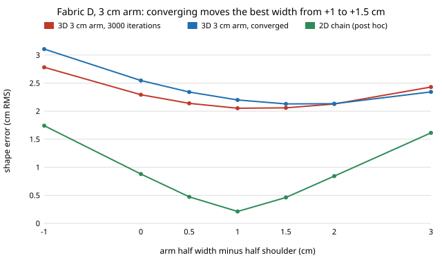

| | prediction | outcome |
|---|---|---|
| Q1 | converged best integer offset still +1 cm | **refuted** on fabric D (+2 cm, by 0.066 cm); A to C keep +1 by only 0.020 to 0.033 cm |
| Q2 | margin more than twice the solver residual | held (8 to 25 times) |
| Q3 | 3000 iterations underestimate every case | **refuted**: the bias depends on width, +0.22 cm at -1 cm, +0.13 at +1, -0.07 at +3 |
| Q4 | converged half-cm best in [+0.5, +1.5] | held: +1.5 cm on all four fabrics |

Post hoc, the 2D chain on the same grid picks +1.0 cm on every fabric (`posthoc_2d.txt`), sharply.
So the converged shallow arm and the 2D chain disagree by half a centimetre of arm width. The
3000-iteration solves agreed with the 2D chain only because stopping early favours narrow arms. A
tier comparison is only as good as its stopping rule, so the programme now judges convergence
against the decision margin, not against a fixed iteration count.

## The programme

[`PROPOSAL.md`](PROPOSAL.md) has the question, 19 related works, the gap, four hypotheses
(rank robustness across solver tiers, which fabric tests are enough, whether calibration changes
the choice, whether a multi-fidelity loop pays), the method, the evaluation and the milestones.
Target: *IEEE Robotics and Automation Letters*. [`LOG.md`](LOG.md) records each step's
predictions before its run, then the outcome.

## Builds on

This repository's track 18 projects, reused unchanged: [`hanger-fit`](../hanger-fit) (2D chain,
stock hangers, worn-shape score), [`hanger-3d`](../hanger-3d) (3D sheet over an arm of finite
depth) and [`hanger-kes`](../hanger-kes) (four fabrics with B and W from Ramaiah, Radhalakshmi
and Nachane, Table 3, a fibre2fashion.com PDF). Cloth model: Baraff and Witkin (1998,
doi:10.1145/280814.280821) springs and Bergou et al. (2008, doi:10.1145/1360612.1360662)
bending. Drape test: Cusick (1968, *J. Textile Institute* 59, T253) and, for the shear
dependence that C6 tests, Cusick (1965), "The dependence of fabric drape on bending and shear
stiffness", *J. Textile Institute* 56, T596 (title confirmed by web search; pages from memory,
not read this run). Membrane locking of regular cloth meshes: English and Bridson (2008),
"Animating developable surfaces using nonconforming elements", *ACM TOG* 27(3) (from memory, not
looked up this run). The rest of the literature is in the proposal. **Lab tags:** none.

## Milestone 1: do the cheap tiers agree on measured fabrics?

`experiments/m1_kes_fidelity/run.py`. Size M, stretch stiffness EA 150 N/m (assumed; not in the
source table), fabrics A to D of `hanger-kes` (B 0.0066 to 0.1249 gf·cm²/cm, W 12.5 to 24.6
mg/cm²). Three tiers: the 2D chain at 5 mm rows, the 3D sheet on a slab arm (centre column), and
the 3D sheet on a 3 cm half-depth arm scored over the whole sheet. Predictions were written
before the run (docstring and `LOG.md`).

Results (`experiments/m1_kes_fidelity/results.txt`):

| | prediction | outcome |
|---|---|---|
| P1 | same stock-hanger ranking in all tiers on all fabrics | **refuted, on a tie**: wood-shaped is best everywhere; on fabric D the 2D chain scores wire and plastic both 3.201 cm |
| P2 | best width offset the same in 2D and 3D slab | held: +1 cm on all four fabrics |
| P3 | 3 cm arm's best offset within 1 cm of 2D | held: +1 cm on all four |
| P4 | wood-shaped 3D slab within 0.10 cm of 2D | held: at most 0.004 cm |

- Wood-shaped hanger: 0.38 to 0.47 cm RMS from the worn shape on the slab arm, 1.97 to 2.14 cm
  over the whole sheet on the 3 cm arm. Wire and plastic: 3.1 to 3.4 cm and 4.4 to 4.7 cm.
- Convergence (3000 against 6000 L-BFGS iterations, wood-shaped): 0.0004 cm on the slab arm,
  0.110 cm (A) and 0.049 cm (D) on the 3 cm arm. The 3 cm arm's margin between the best and the
  next width is 0.126, 0.111, 0.115 and 0.077 cm on A to D.

What it means: the cheap tiers do not disagree, but that is weak evidence. On a deep arm the 3D
sheet reduces to the 2D chain, and where it adds physics its answer is not converged tightly
enough to separate the width choices with margin. Testing H1 needs the validated top tier
(milestones 3 and 4) and a stopping rule tied to the decision margin, not an iteration cap.

## Limitations

EA swept, and bracketed only since milestone 1d (a secant from KES LT and WT at an assumed 500 gf/cm load, and a power-law tangent at the garment load), and, until milestone 2b, shear tied to it at 0.1 EA (2b finds the shear spring, now sourced from KES G, carries most of the "EA" effect on drape; milestone 1c shows it moves the shallow-arm width choice by 1.5 cm across 40 to 800 N/m, and milestone 2a shows the 3D sheet's drape depends on it strongly, through
membrane locking); the simulated Cusick test has no measured drape to compare with yet; one garment size and one 20 cm strip, not a shirt; one hanger profile for
the width sweep; no friction; the four fabrics are unfinished and come from a trade-site PDF;
no validated solver yet (the continued triangle element passes the Cusick acceptance test on the jersey at its sourced stiffness with one seed or seven; on the suiting the seed mean fails by 0.0025 from 3.75 to 2.5 mm but is within 0.008 from 2.5 to 1.875 mm, and the lowest-energy seed is not mesh-stable, milestones 3c and 3d; a lowest-energy rule pooled across lattices is, to 0.008 from 2.5 to 1.875 mm on both fabrics, milestone 3e); no real garment.

## Next steps

1. Milestone 3: on one solver, both the seed-mean DC and the pooled cross-mesh lowest-energy DC are
   within 0.008 of the next refinement at 2.5 mm on both fabrics (3e, registered); the plain lowest of
   seven seeds is not (3d). Next: calibrate against a measured DC and node count (milestone 4), using
   the fold count to tell the two summaries apart (suiting: 7 nodes for the lowest pattern, 8 to 10
   for the typical solve); done in 3f: they were the rim fill, and an affine rim transfer lands 41 of 42 in the target's own band; carry that transfer to the suiting's transfers, and report the pooled DC as an interval over states inside the seed band (the jersey's near-degenerate states move it by about 0.002); a randomised-solver ensemble to put an interval on the mean; a damped dynamic drop as
   the other selection rule; a nonconforming (edge-midpoint) membrane for the high-EA regime.
2. Place the cotton jersey and the shirting: a published low-load load-extension curve for a
   comparable cotton jersey and shirting, or an owner measurement (a strip, a spring scale, a
   ruler), to find whether their stiffness at a few N/m is above or below the ~800 N/m where the
   shallow-arm choice settles (milestone 1d). For the soft jersey's drape test, a 1.5 to 2 mm
   grid or a nonconforming element, since 2.5 mm is not converged above EA 150.
3. Recheck the shallow arm's mesh at EA 3200 and above (milestone 1d ran one mesh, and locking
   should be worst at high EA); and give the sheet separate warp and weft stiffness, since woven
   fabrics differ by direction (the source table gives one mean per property).
4. Milestone 6 (H4) with milestone 5's finding built in: use the cheap tier as a screen (drop the
   candidates outside the cone set), estimate the slope L from three reference runs around its
   choice, and spend reference runs only on what is left; compare against single-tier CMA-ES.
   Milestone 5b did the sharper bound and the loop on a 7-candidate grid (SV(1): 48 of 50 at 3.9
   runs); next is SV inside a design loop over a continuous profile, where the candidate set is
   large enough for the saving to matter, and a curvature-aware K for soft cloth, where SV(1) misses.
5. After milestone 4c: a nonconforming (edge-midpoint) membrane on the nine wovens, registered to
   make the DC flat in EA above about 150 N/m; then re-run 4a's comparison, whose bias should drop
   by about 0.044 if the locking share is right. Separately, a measured node count or a low-load
   tensile toe for the same fabrics, so bending and stretch errors can be told apart.
6. Source a table of drape coefficient with B and W for the same fabrics (the Autex paper
   doi:10.2478/aut-2019-0034 with 63 woven fabrics is the first to read) once a session can
   reach it.

## Reproduce

```bash
cd research/hanger-codesign
python3 -m unittest discover -s tests              # 79 tests, about a minute; needs numpy (and scipy for test_m3)
python3 experiments/m1_kes_fidelity/run.py         # about 4 min on 4 cores
python3 experiments/m1_kes_fidelity/figure.py      # the SVG above, stdlib only
python3 experiments/m1c_ea_mesh/run.py           # milestone 1c, 70 cases, about 15 min on 4 cores
python3 experiments/m1c_ea_mesh/figure.py        # stdlib only
python3 experiments/m2_cusick/run.py               # milestone 2a, 140 cases, about 25 min on 4 cores
python3 experiments/m2_cusick/posthoc_ea.py        # post hoc EA sweep, about 6 min
python3 experiments/m2_cusick/figure.py            # stdlib only
python3 experiments/m2b_locking/run.py             # milestone 2b, 26 cases, about 20 min on 4 cores
python3 experiments/m2b_locking/posthoc_shear.py   # post hoc shear/stretch swap, about 10 min
python3 experiments/m2b_locking/figure.py          # stdlib only
python3 experiments/m1d_measured_shear/run.py      # milestone 1d, 126 cases, about 40 min on 4 cores
python3 experiments/m1d_measured_shear/posthoc_tangent.py  # stdlib only, instant
python3 experiments/m1d_measured_shear/figure.py   # stdlib only
python3 experiments/m3_fem_tier/run.py --part cantilever   # milestone 3a, a few minutes; needs scipy
python3 experiments/m3_fem_tier/run.py --part spring       # 2b's sheet re-solved by Newton, about 10 min
python3 experiments/m3_fem_tier/run.py --part cusick       # 32 cases, about 95 min on 4 cores
python3 experiments/m3_fem_tier/posthoc_richardson.py      # stdlib only
python3 experiments/m3b_continuation/run.py    # milestone 3b, 8 chains of 5 EA stages, about 31 min on 4 cores
python3 experiments/m3b_continuation/figure.py # stdlib only
python3 experiments/m3c_branches/run.py        # milestone 3c, 28 seed chains + 8 branch solves, about 130 min on 4 cores
python3 experiments/m3c_branches/posthoc.py    # post hoc saddle check and lowest-energy table, about 10 min
python3 experiments/m3c_branches/figure.py     # stdlib only
python3 experiments/m3d_local_hessian/run.py      # milestone 3d, 28 seed chains, about 95 min on 4 cores
python3 experiments/m3d_local_hessian/posthoc.py  # post hoc pattern transfer, about 40 min
python3 experiments/m3d_local_hessian/figure.py   # stdlib only
python3 experiments/m3e_pooled/run.py --phase chains    # milestone 3e, 38 seed chains, about 8.6 core-hours (resumable)
python3 experiments/m3e_pooled/run.py --phase transfer  # 70 cross-lattice transfers, about 13 core-hours (resumable)
python3 experiments/m3e_pooled/run.py --phase report    # seconds
python3 experiments/m3e_pooled/figure.py                # stdlib only
python3 experiments/m3f_transfer/chains.py              # milestone 3f, the jersey's 21 source states, about 5.5 core-hours (resumable)
python3 experiments/m3f_transfer/run.py --phase starts  # start energies, both transfers, seconds
python3 experiments/m3f_transfer/run.py --phase transfer # 42 affine transfers, about 6 core-hours (resumable)
python3 experiments/m3f_transfer/run.py --phase report  # seconds
python3 experiments/m3f_transfer/figure.py              # stdlib only
python3 experiments/m4c_locking/run.py --phase solve    # milestone 4c, 18 chains, about 2.3 core-hours (resumable)
python3 experiments/m4c_locking/run.py --phase report   # seconds
python3 experiments/m4c_locking/figure.py               # stdlib only
python3 experiments/m3_fem_tier/figure.py                  # stdlib only
```
