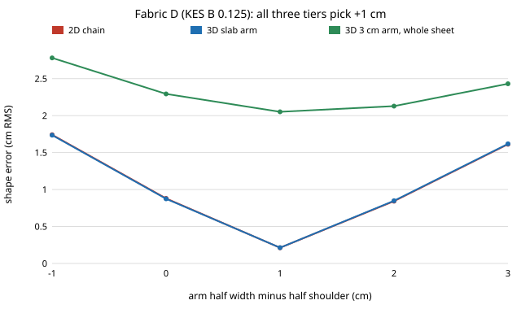
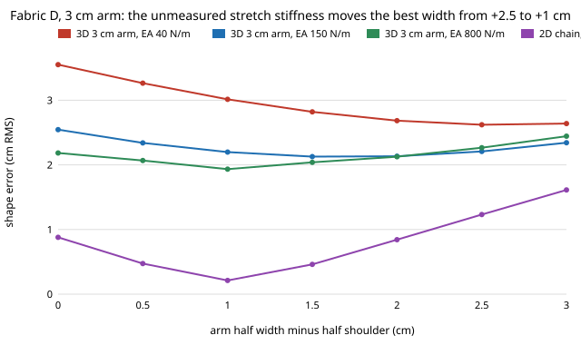
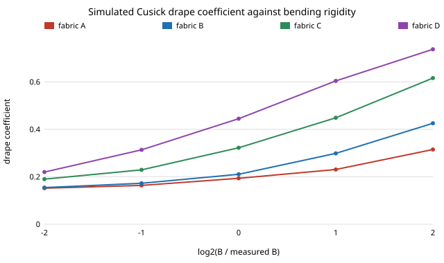
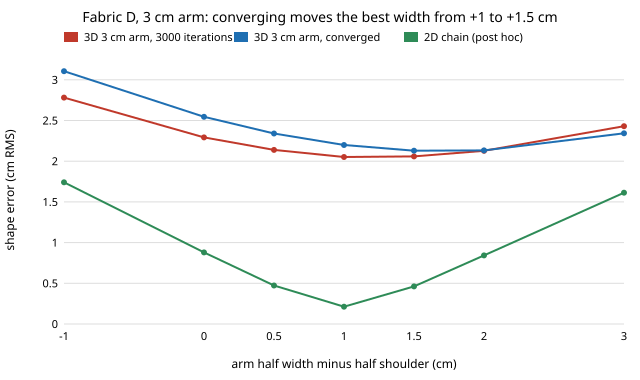

# hanger-codesign: how good does a cloth simulator have to be before the laundry-robot hanger it designs is the right one?

A research programme (opened 2026-11-10) on designing a laundry robot's hangers in a cloth
simulation: how much simulator fidelity and how much measured fabric data the design loop needs
before the hanger it picks is still the best one on a validated, calibrated cloth solver. **First
result (milestone 1): on four fabrics with published KES-FB bending rigidity and weight, our 2D
chain and 3D sheet agree on every hanger decision (the wood-shaped hanger, with an arm 1 cm wider
than the half shoulder), but on a deep arm they agree to 0.004 cm because they are the same
model, so the agreement says nothing about fidelity; and on a 3 cm deep arm the solver's own
convergence error (0.05 to 0.11 cm) is as large as the margin that decides the arm width (0.08
to 0.13 cm). Milestone 1b solves those cases to convergence. The 3 cm arm's best width then moves
to +1.5 cm on all four fabrics, while the 2D chain stays at +1.0 cm: the tiers disagree by 0.5 cm,
and the iteration cap had hidden it by flattering narrow arms (bias +0.22 cm at -1 cm, -0.07 cm at
+3 cm). Milestone 2a builds a simulated Cusick drape test on the same 3D sheet and finds its drape
coefficient cannot calibrate bending rigidity: it orders the four fabrics by bending length
(0.19, 0.21, 0.32, 0.45), but the unmeasured stretch stiffness moves it by 0.15 to 0.23 (more than
a 16-fold change in B does on the softest fabric), and as stretch stiffness rises towards an
inextensible cloth every fabric's drape coefficient climbs to about 0.77 and the fabrics stop
being told apart, and the mesh moves it by up to 0.05 (0.12 with stiffer springs): the square
spring grid locks. Milestone 1c reruns the 3 cm arm across stretch stiffness and mesh: the mesh
does not move the width choice, but the unmeasured stretch stiffness does, from +2.0 to +2.5 cm at
EA 40 N/m to +0.5 to +1.0 cm at 800 N/m, while the 2D chain stays near +1.0 cm, so the 3D-against-2D
disagreement changes sign with a fabric property no table here supplies, and a shallow-arm hanger
cannot be designed from bending rigidity and weight alone.** Produced with AI assistance (Claude). Research track 18 (`hanger`,
`research/PROJECTS.md`). Simulation only; nothing here is a measurement of real garments.

**Live page:** https://marisstella.app/research/hanger-codesign/



## Milestone 1c: the tier disagreement across stretch stiffness and mesh

`experiments/m1c_ea_mesh/run.py`. Milestone 1b's converged solve and stopping rule, reused
unchanged, on the 3 cm arm for fabrics A (softest) and D (stiffest), offsets 0 to +3 cm in half-cm
steps, at five configurations: EA 40, 150 and 800 N/m on the base mesh (5 mm rows, 9 columns
across the depth), and at EA 150 a coarser row spacing (7.5 mm) and a finer depth mesh (13
columns). The 2D chain runs at the same EA and row spacing. All 70 cases met the stopping rule
(6,000 to 33,000 iterations). Predictions were committed before the run.



| | prediction | outcome |
|---|---|---|
| R1 | base configuration still picks +1.5 cm (reproduces 1b) | held, every base number identical to 1b |
| R2 | EA 40 to 800 moves the 3D best by at most 0.5 cm | **refuted**: +2.0 / +2.5 cm (A / D) at EA 40, +1.5 at 150, +0.5 / +1.0 at 800 |
| R3 | each mesh change moves the 3D best by at most 0.5 cm | held: +1.5 on both fabrics for both meshes |
| R4 | 3D best never narrower than the 2D best, strictly wider in 8 of 10 | **refuted**: 3D minus 2D is +1.0 at EA 40, +0.5 at 150, −0.5 / 0.0 at 800 |
| R5 | error at the best moves over 0.05 cm across EA | held: 0.22 cm (A), 0.69 cm (D) |

What it means. The 0.5 cm disagreement of milestone 1b is not a mesh artefact at EA 150, but it is
not a fixed property of the tiers either: its sign follows the stretch stiffness, which the
KES-FB2 table behind these fabrics does not give. On a shallow arm, a softer cloth stretches under
its own weight as its front and back panels fall away, and a wider arm makes up for it; the 2D
chain barely sees this (it picks +1.0 cm everywhere except fabric D at EA 40, +1.5). So on the 3D
tier bending rigidity and weight do not pick a shallow-arm hanger, which is early evidence against
H2 there, and a measured EA (KES-FB1 tensile) is needed before milestone 4. The base choice is
also thin: +1.5 beats +1.0 by 0.004 to 0.006 cm, against a last-chunk change of up to 0.0013 cm.

## Milestone 2a: a simulated Cusick drape test, and why it cannot calibrate this sheet

`experiments/m2_cusick/`. The Cusick tester clamps a 30 cm circle of fabric on an 18 cm disc and
reads the drape coefficient DC = (shadow area − disc area) / (specimen area − disc area). The
plan (milestone 2) was to compare the sheet's DC with a published table of DC, B and W for the
same fabrics. This session's network reached only GitHub, and every host with a candidate table
refused (LOG.md), so this step builds the test and asks the question that decides whether such a
table can be used at all: on this model, does DC move with bending rigidity more than with
everything else?

Model: `hanger-3d`'s spring sheet (stretch springs on a square grid, diagonal shear springs,
turning-angle bending, gravity) cut to the specimen circle on a 5 mm grid, with bending charged on
both diagonals as well so that a cylindrical bend costs B&kappa;&sup2;/2 in every direction
(`tests/test_m2.py` checks the 45-degree case to 5%). Nodes inside the clamp are fixed. The shadow
is rasterised at 1 mm and DC is normalised by the flat mesh's own area. Each case is solved until
DC moves under 0.001 per 2000 L-BFGS iterations (all 140 cases did, none at the cap). Fabrics A
to D of `hanger-kes` (measured B and W), EA 150 N/m unless stated, 5 seeds for the base cases
and 3 for the sweeps. Predictions were written before the run.



| | prediction | outcome |
|---|---|---|
| C1 | DC orders the fabrics by bending length, A < B < C < D | held: 0.194, 0.213, 0.321, 0.446 (c = 0.81, 1.01, 1.29, 1.72 cm) |
| C2 | seed sd at most 0.02 | held: 0.003 to 0.008, with 8 to 14 folds |
| C3 | DC rises with B, each doubling by at least 3 seed sd | **refuted** on A: monotone on all four, but A's first doubling moves DC by 0.012 against 3 sd = 0.020 |
| C4 | B and W both ×4 (same bending length) moves DC under 0.02 | **refuted**: it drops DC by 0.04 to 0.06 |
| C5 | EA 40 against 800 N/m moves DC under 0.03 | **refuted**: by 0.15 to 0.23 |
| C6 | shear spring 0.03 against 0.3 of EA moves DC at least 0.03 somewhere | held: 0.08 to 0.11 on every fabric |
| C7 | 7.5 mm against 5 mm grid under 0.03 | **refuted** on A, B and D (0.044 to 0.047) |

Post hoc (`posthoc_ea.py`, not predicted): stiffening the stretch springs does not approach a
limit. Mean DC on fabric A goes 0.19, 0.36, 0.57, 0.78 at EA 150, 800, 3200 and 12,800 N/m, and
on fabric D 0.44, 0.54, 0.63, 0.77, so at the stiff end two fabrics whose B differs 19-fold
drape alike; at EA 3200 the 7.5 mm grid reads 0.70 against 0.57 on A. That is membrane locking,
the known failure of a regular spring grid: the folds a fabric makes are nearly isometric, a
coarse grid cannot form them without stretching its springs, and the stiffer the springs the
more the sheet behaves like a stiff plate. C4's refutation is the same effect: at fixed EA, a
heavier sheet stretches more, so it folds more easily.

What this means for the programme. On this tier the drape coefficient is governed by the
unmeasured stretch and shear stiffness and by the mesh as much as by B: on fabric A, the EA range
40 to 800 N/m spans more DC than B from ×1/4 to ×4 does. A measured DC would not pin B on this
sheet, so milestone 4 cannot calibrate the cheap tiers by drape and must take B from KES-FB
directly (as milestones 1 and 1b did) or calibrate on the top tier. The Cusick comparison moves
to the validated solver of milestone 3, and the top tier's first job is to show it does not lock
(DC flat in EA and mesh). It also qualifies the hanger results: `hanger-kes` found the width rule
insensitive to EA on the 2D chain, but the 3D sheet's shallow-arm cases (milestone 1b) run at EA
150 N/m on a spring grid that, by this test, is not locking-free, so the 0.5 cm tier
disagreement should be rechecked against EA and mesh before it is read as physics.

## Milestone 1b: the 3 cm arm, solved to convergence

`experiments/m1b_converged/run.py`. Same models and fabrics as milestone 1; wood-shaped profile on
the 3 cm half-depth arm, offsets -1 to +3 cm with +0.5 and +1.5 added; L-BFGS in 3000-iteration
chunks until the whole-sheet error moves under 0.002 cm over a chunk (12,000 to 24,000 iterations;
all 28 cases met it). The first chunk reproduces milestone 1. Predictions were written before the run.



| | prediction | outcome |
|---|---|---|
| Q1 | converged best integer offset still +1 cm | **refuted** on fabric D (+2 cm, by 0.066 cm); A to C keep +1 by only 0.020 to 0.033 cm |
| Q2 | margin more than twice the solver residual | held (8 to 25 times) |
| Q3 | 3000 iterations underestimate every case | **refuted**: the bias depends on width, +0.22 cm at -1 cm, +0.13 at +1, -0.07 at +3 |
| Q4 | converged half-cm best in [+0.5, +1.5] | held: +1.5 cm on all four fabrics |

Post hoc, the 2D chain on the same grid picks +1.0 cm on every fabric (`posthoc_2d.txt`), sharply.
So the converged shallow arm and the 2D chain disagree by half a centimetre of arm width. The
3000-iteration solves agreed with the 2D chain only because stopping early favours narrow arms. A
tier comparison is only as good as its stopping rule, so the programme now judges convergence
against the decision margin, not against a fixed iteration count.

## The programme

[`PROPOSAL.md`](PROPOSAL.md) has the question, 19 related works, the gap, four hypotheses
(rank robustness across solver tiers, which fabric tests are enough, whether calibration changes
the choice, whether a multi-fidelity loop pays), the method, the evaluation and the milestones.
Target: *IEEE Robotics and Automation Letters*. [`LOG.md`](LOG.md) records each step's
predictions before its run, then the outcome.

## Builds on

This repository's track 18 projects, reused unchanged: [`hanger-fit`](../hanger-fit) (2D chain,
stock hangers, worn-shape score), [`hanger-3d`](../hanger-3d) (3D sheet over an arm of finite
depth) and [`hanger-kes`](../hanger-kes) (four fabrics with B and W from Ramaiah, Radhalakshmi
and Nachane, Table 3, a fibre2fashion.com PDF). Cloth model: Baraff and Witkin (1998,
doi:10.1145/280814.280821) springs and Bergou et al. (2008, doi:10.1145/1360612.1360662)
bending. Drape test: Cusick (1968, *J. Textile Institute* 59, T253) and, for the shear
dependence that C6 tests, Cusick (1965), "The dependence of fabric drape on bending and shear
stiffness", *J. Textile Institute* 56, T596 (title confirmed by web search; pages from memory,
not read this run). Membrane locking of regular cloth meshes: English and Bridson (2008),
"Animating developable surfaces using nonconforming elements", *ACM TOG* 27(3) (from memory, not
looked up this run). The rest of the literature is in the proposal. **Lab tags:** none.

## Milestone 1: do the cheap tiers agree on measured fabrics?

`experiments/m1_kes_fidelity/run.py`. Size M, stretch stiffness EA 150 N/m (assumed; not in the
source table), fabrics A to D of `hanger-kes` (B 0.0066 to 0.1249 gf·cm²/cm, W 12.5 to 24.6
mg/cm²). Three tiers: the 2D chain at 5 mm rows, the 3D sheet on a slab arm (centre column), and
the 3D sheet on a 3 cm half-depth arm scored over the whole sheet. Predictions were written
before the run (docstring and `LOG.md`).

Results (`experiments/m1_kes_fidelity/results.txt`):

| | prediction | outcome |
|---|---|---|
| P1 | same stock-hanger ranking in all tiers on all fabrics | **refuted, on a tie**: wood-shaped is best everywhere; on fabric D the 2D chain scores wire and plastic both 3.201 cm |
| P2 | best width offset the same in 2D and 3D slab | held: +1 cm on all four fabrics |
| P3 | 3 cm arm's best offset within 1 cm of 2D | held: +1 cm on all four |
| P4 | wood-shaped 3D slab within 0.10 cm of 2D | held: at most 0.004 cm |

- Wood-shaped hanger: 0.38 to 0.47 cm RMS from the worn shape on the slab arm, 1.97 to 2.14 cm
  over the whole sheet on the 3 cm arm. Wire and plastic: 3.1 to 3.4 cm and 4.4 to 4.7 cm.
- Convergence (3000 against 6000 L-BFGS iterations, wood-shaped): 0.0004 cm on the slab arm,
  0.110 cm (A) and 0.049 cm (D) on the 3 cm arm. The 3 cm arm's margin between the best and the
  next width is 0.126, 0.111, 0.115 and 0.077 cm on A to D.

What it means: the cheap tiers do not disagree, but that is weak evidence. On a deep arm the 3D
sheet reduces to the 2D chain, and where it adds physics its answer is not converged tightly
enough to separate the width choices with margin. Testing H1 needs the validated top tier
(milestones 3 and 4) and a stopping rule tied to the decision margin, not an iteration cap.

## Limitations

EA assumed (milestone 1c shows it moves the shallow-arm width choice by 1.5 cm across 40 to 800 N/m, and milestone 2a shows the 3D sheet's drape depends on it strongly, through
membrane locking); the simulated Cusick test has no measured drape to compare with yet; one garment size and one 20 cm strip, not a shirt; one hanger profile for
the width sweep; no friction; the four fabrics are unfinished and come from a trade-site PDF;
no validated solver yet; no real garment.

## Next steps

1. Milestone 3: build an open validated solver (ARCSim or C-IPC) as the top tier and run the
   same Cusick test on it; it passes only if DC is flat in stretch stiffness and mesh (the test
   this sheet fails).
2. Source EA for the KES fabrics (KES-FB1 tensile, or a published woven tensile table): milestone
   1c shows the shallow-arm width follows EA (+2.5 cm at 40 N/m to +1.0 at 800 on fabric D), and
   recheck the mesh at high EA, where locking should be worst.
3. Source a table of drape coefficient with B and W for the same fabrics (the Autex paper
   doi:10.2478/aut-2019-0034 with 63 woven fabrics is the first to read) once a session can
   reach it, and source EA for the KES fabrics (KES-FB1 tensile).

## Reproduce

```bash
cd research/hanger-codesign
python3 -m unittest discover -s tests              # 14 tests, under a minute; needs numpy
python3 experiments/m1_kes_fidelity/run.py         # about 4 min on 4 cores
python3 experiments/m1_kes_fidelity/figure.py      # the SVG above, stdlib only
python3 experiments/m1c_ea_mesh/run.py           # milestone 1c, 70 cases, about 30 min on 4 cores
python3 experiments/m1c_ea_mesh/figure.py        # stdlib only
python3 experiments/m2_cusick/run.py               # milestone 2a, 140 cases, about 25 min on 4 cores
python3 experiments/m2_cusick/posthoc_ea.py        # post hoc EA sweep, about 6 min
python3 experiments/m2_cusick/figure.py            # stdlib only
```
