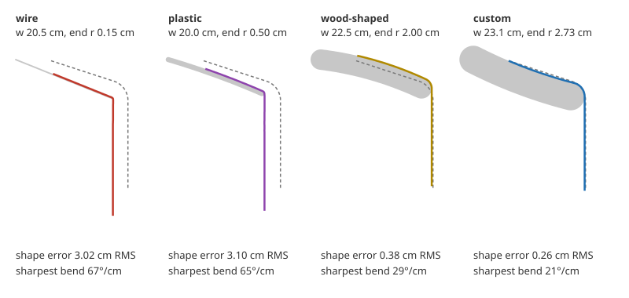
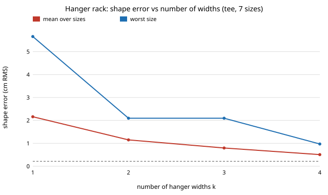

# hanger-fit: what hanger shape keeps a shirt in shape, and can one hanger fit every size?

What hanger should a laundry robot use if it is to hang every garment from the dryer, from a
child's tee to an XXL? In a 2D cloth-drape simulation, **no single fixed hanger works for every
size: the best one found leaves garments 2.1 cm RMS from their worn shape on average and 5.4 cm
for a child's tee. A hanger whose arm width the robot sets per garment (to 0.8 cm wider than the
half shoulder) holds all seven sizes within 0.22 cm, about 12 times better on average. A rack of
four fixed widths (16, 19, 22 and 25 cm) gets within 1 cm for every size. Thin-ended wire and
plastic hangers fold the cloth at the tip (about 65° per cm against 14° in the worn shape),
which is the cause of shoulder bumps. A round end of about 2–3 cm radius removes the fold. CMA-ES
finds these designs in 150 simulations, where random search stalls at about twice the error.**
Produced with AI assistance (Claude). First project of research track 18 (`hanger`,
`PROJECTS.md`, milestone 1). Every number is from a stylised simulation with assumed fabric
constants, not a measurement of real garments.

**Live page:** https://duncan-haywood.github.io/monorepo-projects/research/hanger-fit/

## Why this question

Track 18 is a robot that takes clothes out of a dryer, or from a loader, and puts every item
on a hanger, so laundry comes out hung and needs little or no pressing. "Every item" is the
hard part. A robot can only stock a few hanger types, garments span a 1.7× range of shoulder
widths, and a hanger that is too narrow, too wide or too thin at the end leaves the shoulders
drooping or bumped. So the hanger is designed with the robot, in a simulation feedback loop:
a cloth model scores a hanger, a proposer changes it, and the loop repeats. This project builds
that loop and asks the first design question: custom, universal, adjustable, or a rack of
sizes?

## Builds on

- Bergou, Wardetzky, Robinson, Audoly and Grinspun (2008), discrete elastic rods, *ACM TOG*
  27(3) (SIGGRAPH): the discrete bending energy (turning angle at each node) used here, in 2D.
- Baraff and Witkin (1998), large steps in cloth simulation, SIGGRAPH: cloth as stiff springs
  with penalty contact. This project solves for the static drape instead of time-stepping.
- Kawabata (1980), *The Standardization and Analysis of Hand Evaluation*, Textile Machinery
  Society of Japan: the KES-FB unit of bending rigidity (gf·cm²/cm) the fabric constants are
  stated in. The values used are assumptions, not KES measurements.
- Hansen (2016), *The CMA Evolution Strategy: A Tutorial*, arXiv:1604.00772: the proposer,
  with the tutorial's default settings.
- Nocedal (1980), *Mathematics of Computation* 35(151):773–782: L-BFGS, which solves each
  drape.

References are listed in `paper/whitepaper.md`; they were not re-checked online in this run.
This project reproduces none of them. **Lab tags:** none. It builds on no group listed in
`prompt.md`.

## Model

- **Garment.** A chain of nodes 2.5 mm apart in the frontal plane, from the neck point out
  along the shoulder line at an 18° slope to the shoulder point, then 20–25 cm of sleeve. Each
  segment is a stiff spring, each node a bending spring, and every node carries weight: half
  the body panel hangs from the shoulder line, the sleeve carries its own weight, and the rest
  of a long sleeve hangs from the last node. The neck point is pinned on the hanger.
- **Hanger.** One arm: a curved bar (a quadratic Bézier centreline with a *bow*) of
  half-thickness *r*, with a rounded end of the same radius, reaching half-width *w* at an arm
  slope. Contact is a penalty that pushes nodes out of the bar.
- **Drape.** Minimise stretch + bending + gravity + contact energy with L-BFGS, starting from
  the cloth lying along the arm and hanging straight down past the end.
- **Score.** *Shape error* is the RMS distance (cm) between each material point of the draped
  cloth and the same point of the garment's worn shape: the shoulder line at its slope, a 4 cm
  radius over the shoulder point, then a vertical sleeve. *Sharpest bend* is the most the cloth
  turns within any 1 cm (worn shape: about 14°/cm). *Peak strain* is the largest stretch.
- **Design loop.** The objective is shape error plus 0.05 cm per degree per cm of bend above
  30°/cm. Proposers are CMA-ES (Hansen's defaults) and uniform random search over w 12–30 cm,
  slope 0–40°, bow −2 to 3 cm and r 0.15–3 cm, at equal budgets.
- **Garments.** Seven sizes, with half shoulder widths of 15 cm (child) and 18, 21, 22, 23, 24
  and 25 cm (women's S to men's XXL), and three fabrics: a light knit tee, a woven shirt and a
  heavy, stretchy sweater. The stock hangers are assumed typical shapes: wire (w 20.5, r 0.15),
  plastic (w 20, r 0.5) and wood-shaped (w 22.5, r 2). They are not measured products.

## Results

Numbers are from `experiments/results.txt` (crease-penalised objective) and
`experiments/results_shape_only.txt` (shape error only), both written by `experiments/run.py`.

**A. Stock hangers fit one size at best.** Size-M tee: wire 3.02 cm shape error and 67°/cm
sharpest bend, plastic 3.10 cm and 65°/cm, wood-shaped 0.38 cm and 29°/cm. Wire and plastic
are 1.5–2 cm narrower than an M shoulder, so the shoulder point droops over the end and folds
there. They fit the women's S best (0.64 and 0.52 cm), and still fold it. The wood-shaped
hanger fits S and M (0.54 and 0.38 cm) and misses a child's tee by 5.3 cm and an XXL by 3.0 cm.



**B. A custom hanger per garment** (CMA-ES, 150 drapes, best of 3 seeds) reaches 0.13–0.29 cm
for every tee size, with a round end of r 2.0–3.0 cm, a bend of 19–29°/cm, and a width 0.6–1.2 cm
wider than the half shoulder. A size-M shirt reaches 0.24 cm. A sweater reaches only 1.31 cm,
and it stretches 17.5% at the shoulder on its best hanger and 14–31% on the stock hangers. On
these assumptions, a heavy knit should not be hung at all (milestone 2).

**C. One universal hanger cannot serve all sizes.** The best fixed hanger found (w 24.2, slope
24°, r 2.7; best of 3 CMA-ES seeds, 100 × 7 drapes each) averages 2.11 cm over the seven
sizes: 0.55 cm on M but 5.38 cm on a child's tee and 3.48 cm on a women's S.

**D. One adjustable-width hanger nearly matches custom.** A single shape (slope 15.9°, bow
0.6 cm, r 2.86 cm) whose half-width the robot sets to 0.8 cm more than the half shoulder averages
0.176 cm, worst 0.216 cm, across all seven sizes. That is 12 times better than the universal
hanger, and it beats the per-size custom searches of B (mean 0.218 cm). A pooled search of 700
drapes found a better shape than seven separate searches of 150, so B's custom figures are
limited by budget, not a floor.

**E. Or a rack of a few fixed widths.** With D's shape at fixed widths, the best rack of k
widths for the seven sizes is:

| k | widths (cm) | mean error (cm) | worst size (cm) |
|---|---|---|---|
| 1 | 23 | 2.16 | 5.66 |
| 2 | 18, 24 | 1.15 | 2.10 |
| 3 | 18, 22, 25 | 0.80 | 2.10 |
| 4 | 16, 19, 22, 25 | 0.51 | 0.97 |

Each 1 cm away from a garment's best width adds about 0.8 cm of shape error, in either direction,
so each fixed width serves about one size well. A robot that stocks four widths keeps every size within 1 cm. An
adjustable hanger reaches 0.2 cm with one part.



**F. CMA-ES against random search** (size-M tee, 5 seeds each, same budgets): median best error
0.287 against 0.462 cm at 100 drapes and 0.190 against 0.443 cm at 150. Worst seed: 0.318
against 0.634 cm at 150. At 25 drapes they tie (1.007 cm), and CMA-ES's worst seed is worse.

**G. A score that cannot see creases rewards wire-thin ends.** With shape error alone as the
objective (`results_shape_only.txt`), the adjustable hanger converged to r = 0.15 cm, the
thinnest end allowed. Its shape error was as good (mean 0.25 cm), but an end that thin folds
cloth as a wire hanger's does (about 65°/cm in A). The custom designs for S and XXL did the same (r 0.33 and 0.62 cm, 60 and
66°/cm). The design loop optimises what it is shown, so the crease term in the objective is
what gives the round end.

## What this does and does not show

- In this model, the width of the hanger arm against the garment's shoulder decides almost
  everything. The end radius decides whether the cloth folds. The arm slope and bow matter
  less: the best designs spread over 15–22° and −1.3 to 1 cm of bow. So a hanging robot should
  measure each garment's shoulder width and set the hanger to it, or pick from a rack of about
  four widths.
- It does not show that real garments hang this way. Fabric constants, garment weights, the 18°
  shoulder slope and the 4 cm worn-shape radius are assumptions. The model is a 2D section, so
  front and back panels, collars, side seams and friction are not in it. "Shape error" is a
  proxy for how pressed a garment looks, not a measurement of wrinkles.
- The 30°/cm crease allowance and its weight are choices. Section G shows what goes wrong
  without them, not what a real fabric's threshold is.

## Limitations

Stylised 2D section of one hanger arm; static drape, so no dynamics of hanging or of the robot's
insertion; no friction (the neck point is pinned); stock hanger dimensions and fabric constants
assumed, not measured; one 4-parameter hanger family; 3 seeds per search, so B and D are
budget-limited (D beats B); sweater stretch depends entirely on the assumed 40 N/m
stretch stiffness.

## Reproduce

```
cd research/hanger-fit
python3 -m unittest discover -s tests            # 14 tests, ~5 s
PYTHONPATH=src python3 experiments/run.py        # ~20 min on 4 cores, writes results.txt, drapes.json
PYTHONPATH=src python3 experiments/run.py shape  # shape-only objective -> results_shape_only.txt
python3 experiments/figure.py                    # drape.svg and rack.svg from those files
```

Python 3.9+ and NumPy. The L-BFGS and CMA-ES are implemented here, so SciPy is not needed.

## Next steps

1. `hanger-fold` (milestone 2, done: see [`hanger-fold`](../hanger-fold)): hang or fold, with a wrinkle and stretch-set model per fabric.
   The sweater result here (14–31% shoulder stretch on the stock hangers, 17.5% on its best custom one) is the first case.
2. `hanger-insert` (milestone 3, done: see [`hanger-insert`](../hanger-insert)): a hanger that collapses to a 10 cm half width for insertion needs 31 cm of loop against 43–61 cm for rigid ones.
3. Add friction and front and back panels, and check the width finding in a 3D cloth solver
   (milestone 4).
4. Export D's adjustable shape and E's four widths as printable parametric CAD (milestone 7).

## Outside dependencies

NumPy. Everything else, including the cloth solver, the optimisers and the figures, is in
this directory.
