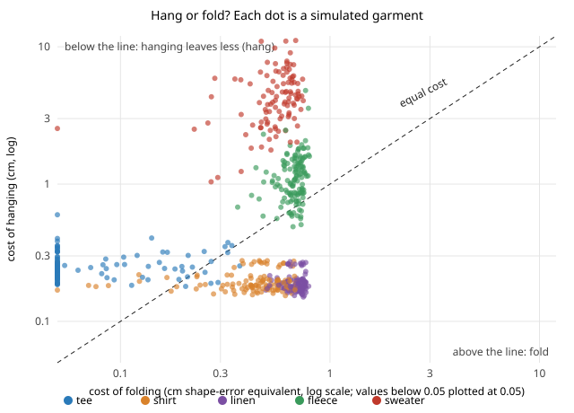

# hanger-fold: should a laundry robot hang a garment or fold it, and what can it sense to tell?

In a stylised model, **hanging wins for woven shirts and linen and folding wins for t-shirts,
fleece and heavy knits, and a robot can learn that rule from three things it can measure.**
Stretch when lifted, garment mass and shoulder width pick the better action for 89% to 91% of 600
simulated garments (5-fold cross-validation, noisy sensing), against 59% for "always fold" and
41% for "always hang". Mass and lift stretch carry the decision. Shoulder width adds almost
nothing (58% to 59% on its own). Knowing the fabric class as well lifts it to 94%. **But the
split between hang and fold is set mostly by how fast folds crease, not by how much hanging
stretches a knit:** moving the assumed time a stack sits from 48 h to 6 h moves the share of
garments better hung from 41% to 8%, while a hundredfold change in the stretch penalty (0.3 to 30)
moves it only from 48% to 37%. Produced with AI assistance (Claude). Every number is from assumed fabric
constants, not measurements of real garments.

**Live page:** https://duncan-haywood.github.io/monorepo-projects/research/hanger-fold/

Track 18 (`hanger`, `PROJECTS.md`), milestone 2. Why it seemed worth doing: milestone 1
([`hanger-fit`](../hanger-fit)) found that a heavy sweater stretches 14 to 31% at the shoulder
on any hanger, so "hang everything" is wrong, but it could only say so. The cell needs a
rule it can apply per item, and a choice between hanging and folding needs both sides priced.

## Builds on

- [`hanger-fit`](../hanger-fit): the 2D drape solver and the adjustable-width hanger (its
  result D) used for every hang here. Imported, not copied.
- Kawabata (1980), the KES-FB system, for the idea of describing fabrics by bending and
  tensile constants; the values here are assumptions in that spirit, not KES measurements.
- Garment folding in robotics (Maitin-Shepard et al. 2010; Avigal et al. 2022, SpeedFolding)
  is the motivation for a fold branch. This project does not model the folding motion, only
  what a finished fold leaves in the cloth.

No lab in `prompt.md` covers laundry; no lab tag. Citations were not re-checked online this run.

## Model (`src/hanger_fold/model.py`)

- **Hang.** Drape the garment on the adjustable hanger with `hanger-fit`. Shape error comes
  straight from it. *Stretch set* is the part of the shoulder-zone strain (the chain from the
  neck to 6 cm past the shoulder point) that stays after a long hang:
  `set = set_gain x strain x (1 - exp(-12 h / 24 h))`, summed over the zone as cm of permanent
  lengthening.
- **Fold.** A folded edge bends the cloth to a 2.5 mm radius, giving a bending strain of
  thickness / (2 r). The share above the fabric's crease yield strain `eps_y` fails to
  recover while the stack sits 48 h (`tau` 24 h): `crease = max(0, 1 - eps_y / bend) x (1 - exp(-48/24))`.
- **One scale.** Both are in cm of departure from the pressed shape. Hanging costs
  `shape error + lambda x set` with `lambda` = 3 (stretch is permanent, a crease can be steamed
  out); folding costs `1 cm x crease`. The better action is the lower cost.
- **Fabrics.** Five archetypes: tee, woven shirt, linen shirt, fleece, heavy sweater, each with
  weight, bending and stretch stiffness, `set_gain`, `eps_y` and thickness. Garment sizes are
  `hanger-fit`'s seven (half shoulder 15 to 25 cm).
- **Population.** 600 garments: a random archetype and size, every constant scaled by a
  lognormal factor (sd 0.25 on weight and stiffness, 0.35 on the set constants).
- **Sensing.** Shoulder width (sd 1 cm), mass (5%), and stretch when lifted (the drape's mean
  shoulder-zone strain, 10% plus 0.002). The fabric class is given only to the upper-bound row.
- **Learners.** A depth-limited CART tree and L2 logistic regression, both in this directory.
  Regret is the extra cost over the better action, in cm.

## Results (`experiments/results.txt`, deterministic)

**A. Archetypes, size M** (cost of hang / fold, cm): tee 0.21 / 0.00 (fold; a thin knit
springs back from a fold), shirt 0.17 / 0.49 (hang), linen 0.16 / 0.70 (hang), fleece 1.21 /
0.69 (fold), sweater 4.74 / 0.58 (fold; 17% shoulder strain, 0.56 cm of permanent stretch).

**B. Population.** Share better hung: shirt 93%, linen 100%, fleece 10%, tee 5%, sweater 0%;
41% overall. Always hanging costs 0.86 cm more than the better action on average, always
folding 0.15 cm.

**C. What the robot can sense** (5-fold CV, accuracy / regret in cm):

| Features | Best learner | Accuracy | Regret |
|---|---|---|---|
| none (always fold) | - | 0.59 | 0.151 |
| shoulder width | tree d3 | 0.60 | 0.147 |
| width + mass | tree d2 | 0.77 | 0.062 |
| width + mass + lift stretch | logistic | 0.91 | 0.017 |
| the same with a depth-3 tree | tree d3 | 0.89 | 0.024 |
| + fabric class | tree d3 | 0.94 | 0.011 |

A rule a robot can read: if the lifted garment barely stretches (under 0.65% at the shoulder)
and weighs more than about 135 g, hang it; otherwise fold it. That is, hang the stiff, heavy
wovens and fold the light knits and everything that stretches.

**D. What the decision depends on** (share better hung; baseline 41%): stretch penalty
`lambda` 0.3 to 30 gives 48% to 37%; hang time 4 to 48 h gives 46% to 39%; set gain x0.25 to
x4 gives 47% to 38%. Fold-side assumptions move it far more: crease depth x0.5 or x2 gives
33% or 58%; a 6 h stack gives 8%; a 1 cm fold radius (a loose stack) gives 11%. Up to 197 of
the 600 garments change best action.

**E. A rule learned at `lambda` = 3 and used where the true `lambda` differs** (train 400,
test 200): regret stays at 0.010 to 0.020 cm from `lambda` 0.3 to 30, against 0.14 to 0.17
for always folding and 0.49 to 4.1 for always hanging. The rule is robust to the stretch
penalty it was trained under. It is not tested against a different crease model.



## Limitations

- **Every fabric, set and crease constant is assumed.** The five archetypes and the
  population spread are invented to be plausible, so the 89% to 91% is accuracy on a synthetic
  population whose structure this project wrote, not on laundry. It shows that the three
  signals separate these archetypes, not that real garments separate that way.
- **The fold side is a one-line model** (bending strain against a yield strain, one crease
  depth, one stack time) and it dominates the decision (D). A measured crease-recovery
  test (an owner step) would fix more than any change to the hang side.
- **The two costs are put on one scale by assumption** (`lambda`, crease depth). The shirt and
  linen results hold across the tested ranges; fleece sits near the line and flips.
- **No motion.** Neither the robot's hanging nor its folding is simulated; insertion is
  milestone 3. Collars, buttons, trousers and dresses are not modelled. Heat from the dryer,
  which softens creases and speeds creep, is ignored.
- The stretch feature is computed from the same drape that scores the hang, so its link to
  the outcome is tighter than a real stretch-when-lifted measurement would give.

## Reproduce

```
cd research/hanger-fold
PYTHONPATH=src python3 -m pytest -q tests          # 13 tests, ~2 s
PYTHONPATH=src python3 experiments/run.py          # ~1 min on 4 cores; writes results.txt, population.json
python3 experiments/figure.py                      # hang_or_fold.svg
```

Python 3.9+ and NumPy (and `../hanger-fit`).

## Next steps

1. `hanger-insert` (milestone 3, done: see [`hanger-insert`](../hanger-insert)): buttoned shirt collars refuse every rigid hanger, so shirts go in at the hem.
2. Replace the crease model with a measured crease-recovery angle per fabric (an owner step),
   since it drives the decision.
3. Add trousers, dresses and a collar, which hang or fold differently from tops.

## Owner steps

Measuring crease recovery and stretch set of real fabrics (a few garments, a drawer, a
hanger, a ruler and a camera), and checking the rule against real laundry. No purchases are
needed to reproduce this project.

## Outside dependencies

NumPy and `hanger-fit`. All fabric constants are assumptions that only an owner measurement
can replace.

## References

- Kawabata, S. (1980). *The Standardization and Analysis of Hand Evaluation.* Textile Machinery Society of Japan.
- Maitin-Shepard, J., Cusumano-Towner, M., Lei, J., Abbeel, P. (2010). Cloth grasp point detection based on multiple-view geometric cues with application to robotic towel folding. ICRA.
- Avigal, Y. et al. (2022). SpeedFolding: learning efficient bimanual folding of garments. IROS.
- Breiman, L., Friedman, J., Olshen, R., Stone, C. (1984). *Classification and Regression Trees.* Wadsworth.
