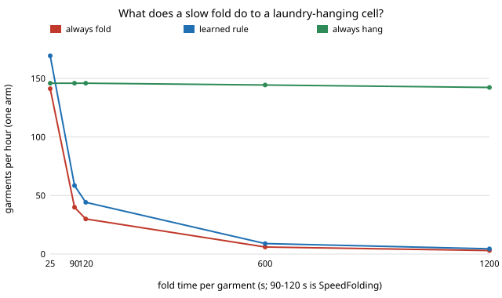

# hanger-foldrate: how many dryers can a laundry-hanging arm serve when folding takes as long as published robots take?

**Using a published robot folding rate instead of an assumed one turns `hanger-cell`'s conclusion over: with the fold at SpeedFolding's 90–120 s per garment, the one-arm cell with the learned hang-or-fold rule handles 58 to 44 garments an hour (1.8 to 1.3 dryers on a 45-minute cycle) instead of 169 (5.1 dryers), and the fold table is 98% busy while the arm idles 70–75% of the time. Always hanging holds 146 an hour whatever the fold time, 3.3 times the learned rule at 120 s, and beats always folding for any fold time above about 24 s.** Produced with AI assistance (Claude). Track 18 (`hanger`, `PROJECTS.md`), a follow-up to `hanger-cell` under the "run the numbers" rule in `research/CLAUDE.md`. Simulated; only the fold time is sourced.

**Live page:** https://duncan-haywood.github.io/oss-monorepo/research/hanger-foldrate/



## Why this question

`hanger-cell` found that the fold table and the pick, not the hanger, set the pace, but its 25 s per fold was an assumed placeholder. The fold is the one station with a published figure. Avigal et al. (2022), "SpeedFolding: Learning Efficient Bimanual Folding of Garments" (IROS), report 30–40 folds per hour, under 120 s per garment from a random start, 93% success, against 3–6 folds per hour for earlier work (read from the arXiv abstract, 2208.10552, this run). The assumed 25 s is 3.6 to 4.8 times faster than the best published system.

## Method

`hanger-cell`'s model, imported unchanged (`research/hanger-cell/src`); only `t_fold` changes. Fold times: 3600/40 = 90 s, 3600/30 = 120 s (SpeedFolding), 3600/6 = 600 s and 3600/3 = 1200 s (prior work), against the assumed 25 s. One arm, adjustable hanger, 25-item load, 200 seeded loads per cell, `experiments/run.py` (3 s, stdlib).

## Results (`experiments/results.txt`)

- **A.** Learned rule, one arm: 169.3 items/h at 25 s; 58.5 at 90 s; 44.2 at 120 s; 9.0 at 600 s. From 90 s on the bottleneck is the fold table (u 0.98), the arm is 0.24–0.31 busy.
- **B.** Always hanging is unaffected (145.9/h to 142.3 at 1200 s); always folding is 3600/t_fold. At 120 s: fold 30.0, learned 44.2, hang 145.9.
- **C.** At 120 s, parallel fold tables: 1 → 44, 2 → 85, 3 → 115 (one arm) or 122 (two), 4 → 137 or 153, 8 → 153 or 232.
- **D.** Always-hang beats always-fold above a fold time of 24.1 s (bisection), about the assumed 25 s: `hanger-cell`'s number sat at the crossover.

## Limitations

- SpeedFolding's time covers flattening and folding from a random state with two arms and is a lab prototype figure (self-reported); here it is the fold station's time per item, on a separate mechanism from the picking arm. If the same arms must fold, the arm is busy for the fold too and the result is worse for the learned rule.
- Hanging quality is not scored. `hanger-fold` says some garments (knits) are better folded; "always hang" is a speed bound only, and the hang success after insertion comes from `hanger-insert`'s geometry model.
- Pick, sense, feeder and rail times, load size and mix remain `hanger-cell`'s assumptions. The 93% fold success is not modelled (failed folds are not set aside).
- Citation figures were read from the abstract only; the paper body was not read.

## Next steps

Source the pick time (published bin-picking or garment-grasp cycle times), and model the shared-arm fold.

## Reproduce
```bash
cd research/hanger-foldrate
python3 -m unittest discover -s tests   # 4 tests
python3 experiments/run.py && python3 experiments/figure.py
```

## Outside dependencies
None built here; the fold figure is a published result for a robot this project does not have.
