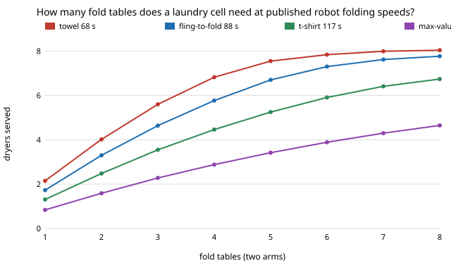

# hanger-foldsrc: how many dryers can a laundry-hanging cell serve when its fold station runs at published robot speeds?

**Timed from a published robot instead of a guess, the fold station, not the arm, limits the cell: with SpeedFolding's measured cycle times (68 to 167 s per garment, 80 to 93% fold success) one arm and one fold table serve 0.8 to 2.1 dryers, not the 5.1 that `hanger-cell` found with an assumed 25 s fold. With two arms, five dryers need 3 to 10 fold tables depending on the row (5 at the t-shirt time of 117 s); prior-art folders at 3 to 6 folds an hour would need more than 40.** Produced with AI assistance (Claude). The fold times and success rates come from one paper (one ABB YuMi, 15 trials per row); every other station time (pick, sense, rail, feeder) is still an assumed placeholder from `hanger-cell`, and nothing here is a measurement of our own robot.

**Live page:** https://duncan-haywood.github.io/oss-monorepo/research/hanger-foldsrc/

Track 18 (`hanger`, [`PROJECTS.md`](../PROJECTS.md)). `hanger-cell` and `hanger-cellpick` both found that pick and fold set the pace, and the fold time (25 s) was their largest unsourced input. This project replaces it with a figure from the literature, following the owner's 2026-10-21 rule to source parameters that drive a result (`research/CLAUDE.md`, "Run the numbers"). Built on none of the CU Boulder groups in `prompt.md`; no connection to them is claimed.



## Why this question

`hanger-cell` said "the stations that do matter are the ones this track has not yet built: the pick and the fold table", then used 25 s for the fold table. Published bimanual garment folders are an order of magnitude slower than that on crumpled laundry, so the earlier headline (about 5 dryers per arm) may not survive. This asks how much of it does, and what a builder must add to get it back.

## Sources

| Fold station | Cycle time (s) | Fold success | Source |
|---|---|---|---|
| assumed (`hanger-cell`) | 25 | 1.00 | assumption, not sourced |
| SpeedFolding, towel (unseen) | 68.1 | 0.87 | Avigal et al. 2022, Table I |
| SpeedFolding, fling-to-fold, t-shirt | 87.9 | 0.93 | same |
| SpeedFolding, instruction-based, t-shirt | 116.9 | 0.93 | same |
| Max-value-map baseline, t-shirt | 167.4 | 0.80 | same |
| Prior work, 6 folds/h | 600 | not given (1.0 used) | same paper's statement of prior work: 3 to 6 FPH |
| Prior work, 3 folds/h | 1200 | not given (1.0 used) | same |

Y. Avigal, L. Berscheid, T. Asfour, T. Kröger and K. Goldberg, "SpeedFolding: Learning Efficient Bimanual Folding of Garments", 2022 (read from the authors' PDF, <https://h2t.iar.kit.edu/pdf/Avigal2022.pdf>; the venue was not stated in the text I read, so none is claimed). Cycle time there includes smoothing a crumpled garment and is averaged over successful and failed folds; the start state is a random crumple, which matches a dryer pile. Rows are 15 trials each, on garments the system was trained on except the "unseen towel" row.

## Method

`hanger-cell` gained one parameter, `fold_tables` (default 1, so every earlier result is unchanged; a test here checks equality). `src/hanger_foldsrc/foldsrc.py` runs the cell with `t_fold` set from a source row and several fold tables in parallel (200 seeded loads of 25 garments, jitter U(0.8, 1.2), learned hang-or-fold rule, adjustable hanger). Output is *good* garments an hour: hung, plus folded times the fold success rate. Dryers served = good per hour / 33.3 (25 garments per 45 minutes, `hanger-cell`'s assumption).

## Results (all from `experiments/results.txt`)

- **A. One arm, one table.** 5.07 dryers at the assumed 25 s (the arm is the bottleneck); 2.11 (towel), 1.70 (fling-to-fold), 1.28 (t-shirt), 0.82 (max-value map), 0.27 and 0.13 for prior work. The fold table is 97 to 100% busy in every sourced row.
- **B/E. More tables, two arms.** At 117 s: 1.31 dryers with one table, 2.48 with two, 4.46 with four, 6.74 with eight. Output flattens near 8 dryers at the faster rows, where the two arms become the limit again.
- **C. Tables for five dryers (two arms).** 1 (assumed), 3 (towel), 4 (fling-to-fold), 5 (t-shirt), 10 (max-value map), more than 40 for prior work.
- **D. Hanging more.** At 117 s, two arms and four tables: fold everything 3.12 dryers, learned rule 4.46, hang everything 8.51. This only says folding is the throughput cost; whether a garment should hang is `hanger-fold`'s quality question, and failed insertions still fall back to folding.
- **Check.** Folds alone cannot exceed one garment per cycle per table: a test confirms the always-fold rate stays under 3600/116.9 = 30.8 per table-hour (plus jitter slack).

## Limitations

- One paper, one robot, a small garment set: the span 68 to 167 s is the spread of that paper's rows, not a population estimate. A folder that is not a YuMi will differ.
- Every other time (pick 8 s, sense, rail, feeder refill) is still the `hanger-cell` placeholder; `hanger-cellpick` showed the pick alone moves the one-arm result by 13%, so this paper's sourcing fixes the largest input, not all of them.
- Fold tables are modelled as independent identical stations. Each real one is a two-arm robot with its own cost, space and safety hazards; no price is used here because none in this repository has a source.
- Fold success is applied afterwards as a discount on folded garments; failed folds do not retry or occupy extra time.
- The hanging branch is unchanged and still unsourced, so the hang-everything row is an upper bound.

## Next steps

1. Source the pick, rail and feeder times the same way (hanger and rack hardware datasheets, pick-and-place papers).
2. Model fold retries and a person-assist fallback instead of discounting.
3. Add a sourced cost per fold station so "tables for five dryers" becomes a price (owner step for real quotes).

## Reproduce
```bash
cd research/hanger-foldsrc
python3 -m unittest discover -s tests      # 5 tests, <1 s
python3 experiments/run.py                 # writes results.txt, ~5 s
python3 experiments/figure.py              # writes experiments/tables.svg
```

## Outside dependencies
None beyond the Python standard library. Imports [`hanger-cell`](../hanger-cell). The fold times come from a published paper and are not reproduced by running anything here.
