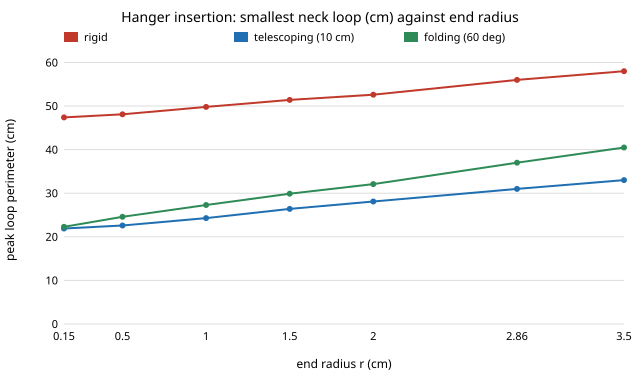

# hanger-insert: how does a laundry robot get a hanger into a garment, and what does it cost the neck?

Can a robot push a hanger through a T-shirt's neck without stretching it out? In a swept-section
geometry model, **a rigid hanger can only get in if the neck loop can be made to go round one
whole arm: 43–61 cm of loop for the hangers tried (a wire hanger 43 cm, hanger-fit's best
custom shape 61 cm at XXL). That stretches a tee's neck by up to 16% on a wood-shaped hanger
and 33% on the custom one (a child's tee, against an assumed 35% limit), and it is impossible
through a buttoned woven collar (3%), so every shirt must go in at the hem and have its hook threaded out
of the neck blind (about 10 s against 6 s). A telescoping hanger that collapses to a 10 cm half
width needs only 31 cm, which the necks of all three fabric archetypes allow with at most 7%
stretch, and which five of seven shirt sizes can use. Folding the arms down 60° instead needs 37–40 cm. The end radius that
hanger-fit needs for a crease-free shoulder (2–3 cm) costs only about 3 cm more loop and
0.1–0.6 s, so insertion does not argue against it; it argues for a hanger whose width changes.**
Produced with AI assistance (Claude). Third project of research track 18 (`hanger`,
`PROJECTS.md`, milestone 3). Every number comes from a stylised geometric model with assumed
fabric and robot constants, not from cloth or from a robot.

**Live page:** https://duncan-haywood.github.io/monorepo-projects/research/hanger-insert/

## Why this question

`hanger-fit` found that one fixed hanger cannot serve every size, and that a hanger whose width
the robot sets per garment (or a rack of four widths) can. It scored how the hanger *hangs*. A
robot also has to get it *in*: the hanger is wider than the neck opening it must pass, and the
neck is the one place the cloth can be stretched for good. `hanger-fold` already found that
shirts and linen are better hung than folded, and they are the garments with the stiffest collar.
This project asks which hanger designs can be inserted at all, at what cost to the neck and in
what time, and whether insertion changes the design `hanger-fit` chose.

## Builds on

- [`hanger-fit`](../hanger-fit): the hanger family (width, slope, round end) and the adjustable
  hanger (result D, slope 15.9°, end radius 2.86 cm, half width shoulder + 0.8 cm), and the shape
  error that [section E](#results) of this project reads back.
- [`hanger-fold`](../hanger-fold): which garments should be hung at all.
- Maitin-Shepard, Cusumano-Towner, Lei and Abbeel (2010), *Cloth grasp point detection based on
  multiple-view geometric cues with application to robotic towel folding*, ICRA: finding and
  holding a garment's corners and openings, which this model assumes the robot can do.

References were not re-checked online in this run. **Lab tags:** none. This project builds on no
group listed in `prompt.md`.

## Model

- **Hanger.** In its own plane: two arms from the apex, each a segment with a round end of radius
  *r* (the arm half-thickness), a hook stub 5 cm tall and 0.4 cm in radius, all in cm. Shapes: the
  three stock hangers of `hanger-fit`, a rigid hanger with the adjustable shape (width shoulder +
  0.8 cm), a **telescoping** one that insertion shortens to a 10 cm half width and that opens in
  1 s afterwards, and a **folding** one whose arms hinge down 60° (opens in 1.5 s).
- **Opening.** A closed loop of cloth. A loop that encloses a rigid body needs at least the
  perimeter of the hull of the body's cross-section. A plane cuts the hanger along a line; the
  cross-section is that chord of length *l* by the bar thickness *T* = 2*r*, a stadium of
  perimeter 2 max(*l*, *T*) + (π − 2) *T*. The loop is free to take any shape of that perimeter, so
  this is a lower bound on what a real neck needs.
- **Path.** The plane's offset along a direction *n*, and the tilt of *n* in the hanger's plane
  (0° = along the arm, 90° = along the hook), form a 0.5 cm × 2° grid. The loop starts 30 cm clear of
  the hanger and ends on the hook stub with *n* along the hook, never passing clear of the whole
  hanger and back (the garment body hangs behind the loop). A Dijkstra search gives the path of
  smallest peak perimeter (**min peak**) and, for a given allowance, the fastest path under it.
  Moves are four-neighbour and each cell takes the worst value of its neighbours: an earlier
  version slipped through gaps narrower than a cell, and the peak jumped between 23 and 54 cm
  with the third decimal of *r*.
- **Neck and hem.** Perimeter proportional to the half shoulder: neck 2.4× (tee), 1.8× (shirt,
  buttoned collar), 2.3× (sweater); hem 4.5–4.8×. Stretch before permanent set: 35%, 3%, 25% at
  the neck, 30% at the hem. Each of the two grippers holds 3 cm of the loop, unavailable to the
  hanger. All assumed.
- **Success and time.** The tip must land inside the opening (0.9 of the flat width with two
  grippers, 0.4 with one) within a 1.5 cm vision error, with up to 3 attempts. Through the hem the
  hook must then be threaded out of the neck from inside with a 2 cm error. Time is 2 s to grasp,
  1.5 s per approach attempt, 4 s per threading attempt, the path at 15 cm/s and 60°/s (one axis at
  a time), and the hanger's opening time.
- **Garments.** `hanger-fit`'s seven sizes (half shoulder 15–25 cm) in three archetypes: tee,
  woven shirt, sweater.

## Results

Numbers are from `experiments/results.txt`, written by `experiments/run.py`.

**A. Rigid hangers need a loop round a whole arm.** The smallest peak loop is 43 cm (wire), 43
(plastic), 53 (wood-shaped) and 62 cm for the custom shape at its largest size. A tee's neck
(2.4 × half shoulder, 35% stretch) allows the custom shape at every size, with the child's tee
worst at 33%, but the wood-shaped hanger only from size S up (the child's and women's S tees go in at the
hem; per-size routes are in section F). Small garments are the hard ones, because their
necks are small and the hanger is not. No rigid hanger passes a buttoned collar: all seven shirt sizes go in at the hem, where the blind
hook threading costs 4 s and nearly all of the (small) failure risk. The adjustable hanger
collapsed to a 10 cm half width needs 31 cm: tees stretch at most 2.9% and sweaters 7.3%, and shirts
S to XXL use the neck (the child's and women's S still go in at the hem).

| design | peak loop (cm) | tee, max neck stretch | shirts at the hem (of 7) | shirt time (s) |
|---|---|---|---|---|
| wire | 42.9 | 13.2% | 7 | 10.1 |
| wood-shaped | 52.6 | 16.2% | 7 | 10.2 |
| custom rigid | 61.5 | 33.4% | 7 | 10.1 |
| telescoping | 31.0 | 2.9% | 2 | 8.4 |
| folding (60°) | 39.5 | 1.5% | 6 | 11.1 |

**B. Collapsed width is the design variable; the end radius is a small term.** At 22.8 cm of
width the rigid peak grows from 47 to 58 cm as the end radius goes from 0.15 to 3.5 cm; for the
telescoping hanger it goes from 22 to 33 cm. The collapsed half width matters more: 20 → 50 cm of
peak between 4 and 20 cm (C). Folding the arms down needs 37–40 cm at the adjustable hanger's
2.86 cm radius, worse than telescoping to 10 cm, and the fold time is longer.



**D. Success is saturated; the unknowns are in the blind step.** Mean success over the seven
sizes is 0.997–1.000 for every design and fabric, and does not move when the vision error
doubles to 3 cm, with one gripper, or with 6 cm of gripped loop: the openings (10–20 cm wide) are far
wider than the tip. What moves it is the hem route's hook threading. At a 4 cm blind error, shirt
success falls to 0.93 (wood-shaped, custom rigid, folding) and 0.96 (telescoping). A hanger that
fits through the neck therefore also avoids the one step the robot cannot see.

**E. Feedback to hanger-fit.** Reading `hanger-fit`'s shape error back for the adjustable hanger
(slope 15.9°, bow 0.6 cm): going from *r* = 0.5 to 2.86 cm cuts the error on a size-M tee from
2.13 to 0.16 cm (child 2.00 to 0.22, XXL 2.20 to 0.20), and costs 8 cm of insertion loop (23 to 31) and 0.9 s on a
shirt (7.5 to 8.4 s). Insertion success is 0.997–1.000 at every radius. So the insertion model
does not move the round end, which `hanger-fit` set at 2–3 cm. It does change the *width* design: a rack
of four fixed widths (`hanger-fit` E) is a rigid hanger here, with the neck problems of A.

## What this does and does not show

- In this geometry, the width a hanger has *while it goes through the opening* decides whether it
  fits the neck. That favours a hanger that collapses, which `hanger-fit`'s adjustable width
  already suggested for another reason, and makes the collapsed width (about 10 cm) a number for a
  mechanism design to hold.
- It does not show that real necks behave like perimeters. Cloth is not rigid or frictionless,
  the loop is held by grippers at fixed points, and a neck deforms into shapes a perimeter bound
  does not capture, so every peak is a lower bound. The stretch limits, gripper loss, vision
  errors and speeds are assumed; D shows which results depend on which, and A and B do not depend
  on the success model at all.
- Success at about 1 is a result about this model's wide openings, not a claim that a robot
  inserts hangers reliably. The only soft spot found is the blind threading step.

## Limitations

A planar hanger moved in a plane against a loop (no 3D rotation of the hanger or loop out of the
plane, no sleeves, front and back panels or collar stand); a perimeter bound, not a cloth
solver; the body is only constrained to stay behind the loop; one grid (0.5 cm × 2°) and the
conservative smoothing described above, which overstates the peak by up to one cell (about 1 cm);
no friction or snagging on the hook; no robot kinematics, only two speeds; two grippers hold the
loop at fixed arc lengths; no real garment measured.

## Reproduce

```
cd research/hanger-insert
python3 -m unittest discover -s tests            # 20 tests, ~3 s
PYTHONPATH=src python3 experiments/run.py        # ~3 min, writes results.txt
python3 experiments/figure.py                    # peak_vs_radius.svg from results.txt
```

Python 3.9+ and NumPy; `hanger-fit` is imported from the sibling directory.

## Next steps

1. `hanger-3d` (milestone 4): the same insertion in 3D with an open cloth solver, which tests
   the perimeter bound directly.
2. Measure the real collapsed width and neck stretch limit with a printed hanger and a few
   garments (an owner step).
3. `hanger-print` (milestone 7): the telescoping hanger as printable CAD, with a 10 cm collapsed half
   width as the target.
4. Feed the insertion time into the `hanger-cell` discrete-event model (milestone 6).

## Outside dependencies

NumPy, and `hanger-fit` for the shape error in section E.
