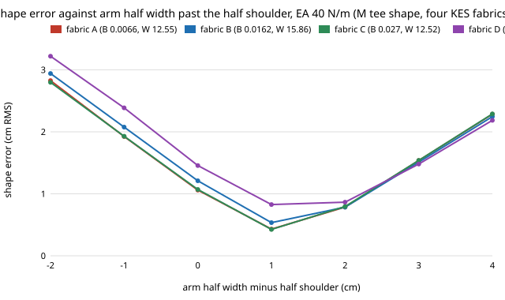

# hanger-kes: does the "arm 1 cm wider than the half shoulder" hanger rule hold on fabrics with published Kawabata bending rigidity and weight?

**Yes. On four fabrics whose bending rigidity B and weight are published KES-FB measurements (a cotton single jersey, an elastane single jersey, a cotton shirting and a heavy cotton suiting), the best arm half width of the stock hanger is the half shoulder + 1 cm in all 12 cases (4 fabrics × 3 stretch stiffnesses), with shape error 0.18 to 0.83 cm RMS. The one near-tie is the heavy suiting at stretch stiffness EA 40 N/m (0.83 cm at +1 cm against 0.87 cm at +2 cm).** The measured B values (0.0066 to 0.125 gf·cm²/cm) are 0.2 to 4 times `hanger-fit`'s assumed 0.03 for a tee, and the result does not move. Produced with AI assistance (Claude). Track 18 (`hanger`, `PROJECTS.md`). **Simulation only; EA is not in the source table and is swept, and the garment geometry is `hanger-fit`'s assumed M tee for every fabric.**

**Live page:** https://duncan-haywood.github.io/oss-monorepo/research/hanger-kes/



## Why this question

`hanger-sweep` tried to replace `hanger-fit`'s round-number fabric constants with published KES-FB values and could not find a table (its README says so); it swept instead. This run found one (Table 3 of the paper below, read from the PDF text) and re-scores the width finding on its four fabrics. It is the "source B, EA and weight per fabric" next step of `hanger-sweep` and `hanger-knit`, done for B and weight; EA is still open.

## Sourced inputs

Ramaiah, G., Radhalakshmi, Y.C. and Nachane, R.P., "Comparative Analysis of Low-Stress Mechanical Properties of Woven and Knitted Apparel Fabrics", fibre2fashion.com article (PDF, https://static.fibre2fashion.com/articleresources/PdfFiles/60/5963.pdf; no journal or year appears in the PDF text), Table 3. Each value is the mean of 10 tests on 5 specimens, on dyed, unfinished fabrics. Not peer-review-checked by this run.

| code | fabric | B gf·cm²/cm | W mg/cm² | mass in the model |
|---|---|---|---|---|
| A | single jersey, 100% cotton | 0.0066 | 12.55 | ×1.00 (reference: carries `hanger-fit`'s tee mass) |
| B | single jersey, 95% cotton / 5% polyurethane | 0.0162 | 15.86 | ×1.26 |
| C | plain woven shirting, 100% cotton | 0.0270 | 12.52 | ×1.00 |
| D | plain woven suiting, 100% cotton | 0.1249 | 24.60 | ×1.96 |

## Not sourced

- **EA** (stretch stiffness): the table gives tensile LT, WT and RT, not a stiffness, and converting WT needs the tester's maximum load and sample geometry, which the PDF does not state. EA is swept at 40, 150 and 800 N/m (the `hanger-sweep` range).
- **Mass scale.** `hanger-fit`'s tee body mass (55 g per side) is an assumption; fabric A is taken as that tee and the others scale by weight ratio. A garment's real mass also depends on its cut.
- **Geometry.** Every fabric is an M tee shape (`hanger-fit` sizes, 20 cm strip). A shirting or suiting garment (collar, shoulder seams, lining) is not that.
- The fabrics are unfinished, so their B is lower than the same cloth after finishing (the source says finishing raises B).

## Method

`src/hanger_kes/kes.py` builds each garment with `hanger_sweep.make_garment` (itself `hanger_fit`'s drape, unchanged) and scores the wood-shaped stock hanger with arm half width = half shoulder + offset for offsets −2 to +4 cm in 1 cm steps. `experiments/run.py` runs the 12 cases.

## Results (`experiments/results.txt`)

- Best offset +1 cm in all 12; best error 0.185 (A), 0.181 (B), 0.185 (C), 0.207 (D) cm at EA 150; 0.431, 0.535, 0.426, 0.827 at EA 40; 0.238, 0.234, 0.239, 0.223 at EA 800.
- EA 40 is the hard case, and more so for the heavy fabric: D at EA 40 scores 0.827 at +1 and 0.865 at +2, so a finer grid could put its optimum between them. This matches `hanger-sweep`, where +2 cm wins appeared only at EA 40.
- B within 0.0066 to 0.125 changes the EA 150 best error only from 0.181 to 0.207 cm, consistent with `hanger-sweep`'s "B alone moves it under 10%" (here up to 14% including the weight change in D).

## Limitations

Width grid of 1 cm; one hanger shape; no CMA-ES re-design (see `hanger-knit` for that); tee geometry only; the source is a trade-site PDF, not a standards table, and says nothing of finishing state beyond "unfinished". Real garments are not these fabrics' strips.

## Reproduce

```bash
cd research/hanger-kes
python3 -m unittest discover -s tests      # 4 tests, needs numpy
python3 experiments/run.py                 # about 5 s on 4 cores; writes results.txt
python3 experiments/figure.py              # writes experiments/err_vs_offset.svg
```

## Next steps

1. Source EA for the same fabrics (KES tensile LT, WT and the tester's load and gauge, or a tensile test) and drop the EA sweep.
2. Re-run the CMA-ES design of `hanger-knit` with B and weight from this table.
3. Measure the owner's own garments (`PROJECTS.md`, milestone 8) instead of trade-paper fabrics.

## Outside dependencies

NumPy. `hanger-fit` and `hanger-sweep` are used unchanged. The fabric table comes from a published PDF, not generated here.
