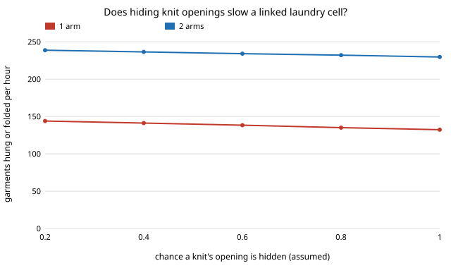

# hanger-kindlink: does it matter that the garment a robot picks is also the garment it decides to hang or fold?

**In the stylised model, linking the pile's garment kinds to the cell's archetypes moves a one-arm laundry cell from 147 to 141 garments hung or folded per hour (look-then-aim), but the size and even the sign of the change on two arms depend on an assumed kind-to-archetype map: from 141 to 250 per hour across five maps. The correlation the link adds (knits hide openings more often) is small by comparison: raising a knit's hidden-opening chance from 0.2 to 1.0 costs 144 to 132 per hour on one arm and 239 to 230 on two, and sets 0.23 knits per load aside for a person.** Produced with AI assistance (Claude). **Stylised: every station time and pile probability is an assumed placeholder from `hanger-cell` or `hanger-pick`, and the map from pile kinds (trousers, dress, kids) to the cell's five archetypes is a guess (swept in D); nothing here is a measurement of a robot, a dryer or a garment.**

**Live page:** https://duncan-haywood.github.io/monorepo-projects/research/hanger-kindlink/

Track 18 (`hanger`, [`PROJECTS.md`](../PROJECTS.md)). Takes the "Next steps" item of [`hanger-cellpick`](../hanger-cellpick): "link pile garment kinds to the cell's archetypes so a knit's hidden opening and its hang-or-fold decision come from the same garment". (Its other item, two arms sharing one pile, is not done.) Built on none of the CU Boulder groups in `prompt.md`; no connection to them is claimed.



## Why this question

`hanger-cellpick` drew the pile's garments and the cell's garments independently, so the garment that was hard to pick was not the one that was folded. A real garment is one thing. Does making it one thing change the cell's capacity, and what does the answer hinge on?

## Method

`src/hanger_kindlink/kindlink.py` (stdlib only) reuses `hanger-pick` and `hanger-cell`. Three small additive changes to them leave their results unchanged (their tests pass): `pick` also returns the kind it took, `make_pile` accepts a per-kind hidden-opening chance, and `run_once` accepts picks of the form `(seconds, ok, archetype)`; with that third field the cell uses the picked garment's archetype for its hang-or-fold share and insertion time instead of drawing its own.

- The map from the six pile kinds to the five archetypes is `KIND_TO_ARCH`: tee→tee, shirt→shirt, trousers→linen, dress→shirt, kids→tee, knit→sweater. The cell has no trousers, dress or kids archetype, so the map is an assumption (the same kind of borrowing `hanger-cell` does for linen and fleece).
- Hang shares and insertion times are parsed from `hanger-fold` and `hanger-insert` results, as in `hanger-cell`. Settings are `hanger-cell`'s defaults: adjustable hanger, learned rule, one feeder, one fold table, load 25.
- 200 loads per row, deterministic seeds. No intervals are given, since the claims rest on the swept assumptions, not on sampling noise; `hanger-cellpick` gives pick-sampling intervals of about ±2 per hour for one arm.

## Results (all from `experiments/results.txt`)

- **A. Linked vs unlinked (one arm, garments per hour).** pinch 104.3→100.1, see 146.8→141.2, sweep 126.1→119.8. The linked pile has more garments that get hung (about 12 of 25 against 7.6) because four of six pile kinds map to archetypes that are mostly hung, while the cell's own mix is 55% tee, fleece and sweater, mostly folded. Hanging takes the arm longer than setting down for folding.
- **B. Knits hide more often (one arm, see).** done per hour falls 143.9, 141.2, 138.4, 135.1, 132.3 as the knit's hidden chance goes 0.2 to 1.0; knits set aside rise from 0.04 to 0.23 per load. Hung and folded counts do not move: knits are folded anyway.
- **C. Two arms.** 238.8 to 229.7 over the same range, against 200.8 unlinked in `hanger-cellpick`: with two arms the fold table was the limit, and the link sends more garments to the rail and fewer to the table.
- **D. The map matters most.** One arm: 123 to 149 per hour across maps; two arms: 141 to 250. A map sending everything to a sweater (all folded) gives 138 and 141 for one and two arms, since the single fold table caps it; a fold-leaning map gives 149 and 173; a hang-leaning one 135 and 250.

## Limitations

- The map in D is the main uncertainty and it is not measured: the household mix, the share of each kind that should be hung, and the kinds themselves are all assumed. The headline is therefore which input to measure, not a capacity.
- Pile times and cell times are placeholders (see `hanger-pick`, `hanger-cell`). The pick does not depend on the kind except through the hidden-opening chance in B.
- Two or three arms still draw picks from one pre-computed sequence and do not block each other on the pile (`hanger-cellpick`'s limitation, unchanged).
- Only one fold table and one hanger design are tried here.

## Reproduce
```bash
cd research/hanger-kindlink
python3 -m unittest discover -s tests      # 5 tests
python3 experiments/run.py                 # writes results.txt (about 15 s)
python3 experiments/figure.py              # writes experiments/knithidden.svg
```

## Owner steps
Weigh and sort a few real household dryer loads by garment kind, and time a person finding the opening of each kind; not a run's to do.

## Next steps
Measure the kind mix and the hang share per kind, which settle D; let two arms share one pile so they block each other.

## Outside dependencies
None: Python standard library only. Inputs are the committed results of `hanger-fold` and `hanger-insert`.
