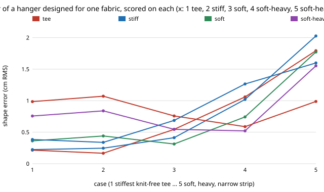

# hanger-knit: does the hanger that a sim loop designs change for stretchy, heavy knits?

**Partly. Across five fabric cases (size M tee) the CMA-ES loop of `hanger-fit` puts the best arm half-width 0.9 cm past the half shoulder for the base tee, 1.1 cm for a stiff one and 1.5 to 1.8 cm for stretchy ones (EA 40 N/m), but the slope, bow and end radius it finds scatter widely between seeds at nearly the same error, so only the width is pinned down at a 150-score budget.** A hanger designed for the base tee scores 0.22 cm RMS on it and 1.06 cm on a soft, double-weight knit; a hanger designed for that knit scores 0.52 cm there (about half) and 0.76 cm on the tee. On the narrowest, heaviest case (10 cm strip) every hanger is poor (best 0.99 cm) and the stock wood-shaped hanger (1.60) beats the tee-designed one (1.79). CMA-ES beat random search at equal budget in all five cases (best of 3 seeds). Produced with AI assistance (Claude). **Simulation only: fabric constants are the swept corners of `hanger-sweep`, not measurements; none of this says anything about real garments.**

**Live page:** https://duncan-haywood.github.io/monorepo-projects/research/hanger-knit/



## Why this question

[`hanger-sweep`](../hanger-sweep) re-scored only the arm width on one stock hanger shape and found the best width moves from half shoulder + 1 cm to + 2 cm for stretchy fabric under load. Its next step 2 asked whether the whole designed hanger changes there. This runs the design loop itself on those corners, and asks what a hanger designed for one fabric costs another, which is the question for a rack of hangers or one universal one.

## Builds on

[`hanger-fit`](../hanger-fit) (model, L-BFGS drape, CMA-ES and random-search proposers, imported unchanged; CMA-ES after Hansen, 2016, *The CMA Evolution Strategy: A Tutorial*, arXiv:1604.00772) and [`hanger-sweep`](../hanger-sweep) (garment override). Citations were not re-checked online in this run. **Lab tags:** none.

## Cases (all fabric inputs are assumed or swept, none measured)

| case | B gf·cm²/cm | weight | EA N/m | strip depth | source |
|---|---|---|---|---|---|
| tee | 0.03 | ×1 | 150 | 20 cm | `hanger-fit` `FABRICS["tee"]` (assumed) |
| stiff | 0.03 | ×1 | 800 | 20 cm | `hanger-sweep` range top |
| soft | 0.03 | ×1 | 40 | 20 cm | `hanger-sweep` range bottom |
| soft-heavy | 0.03 | ×2 | 40 | 20 cm | `hanger-sweep` corner where +2 cm won |
| soft-heavy-narrow | 0.03 | ×2 | 40 | 10 cm | `hanger-sweep` corner where +2 cm won most |

B is held at 0.03 because `hanger-sweep` found it moves the best error under 10%.

## Method

`src/hanger_knit/knit.py`. For each case: `hanger_fit`'s CMA-ES and uniform random search, 150 drape scores each, seeds 0 to 2, over the four design numbers (half width 12 to 30 cm, slope 0 to 40°, bow −2 to 3 cm, end radius 0.15 to 3 cm). The score is shape error in cm RMS with no crease charge (the `hanger-fit` "shape only" mode). The best CMA-ES hanger per case is then scored on every case, and the stock wood-shaped hanger is added as a reference.

## Results (from `experiments/results.txt`)

- **Width is pinned down.** Best CMA-ES half-width minus half shoulder (22 cm): tee +0.87, stiff +1.14, soft +1.76, soft-heavy +1.47, soft-heavy-narrow +1.75 cm.
- **Shape is not.** Across the 3 CMA-ES seeds of one case the slope spans, for example, 16.8 to 20.8° (tee) and 8.2 to 21.2° (soft-heavy-narrow), bow −0.8 to 0.8 cm and end radius 1.9 to 2.8 cm (tee), with errors of 0.22 to 0.33 cm. The landscape is flat in those directions at this budget, so "the soft-knit hanger has a steeper slope" is not supported.
- **CMA-ES vs random (best of 3 seeds):** tee 0.22 vs 0.52, stiff 0.25 vs 0.51, soft 0.31 vs 0.52, soft-heavy 0.52 vs 0.65, soft-heavy-narrow 0.99 vs 1.19 cm.
- **Cross-scoring (cm RMS; row = designed for, column = scored on):**

| designed for | tee | stiff | soft | soft-heavy | soft-heavy-narrow |
|---|---|---|---|---|---|
| tee | **0.215** | 0.166 | 0.545 | 1.060 | 1.793 |
| stiff | 0.224 | **0.246** | 0.413 | 1.020 | 2.027 |
| soft | 0.362 | 0.440 | **0.313** | 0.742 | 1.773 |
| soft-heavy | 0.757 | 0.839 | 0.545 | **0.521** | 1.553 |
| soft-heavy-narrow | 0.985 | 1.071 | 0.758 | 0.588 | **0.988** |
| stock wood-shaped | 0.384 | 0.338 | 0.687 | 1.265 | 1.599 |

  The tee-designed hanger beats the stock one on the first four cases (and on stiff it scores below its own design, 0.166 vs 0.246: that case's three seeds found a worse optimum than the tee hanger, so 150 scores is not a converged optimum). Designing for the soft-heavy knit halves its error but costs 0.54 cm on the tee. Soft and heavy fabrics want a wider arm, so a rack that serves them needs a wider size, not another shape.

## Limitations

- 150 scores and 3 seeds per case: the CMA-ES results are not converged (see the stiff row), and the shape numbers are noise-limited. No more seeds were run.
- 2D chain model, one size (M), tees only, shape error only (no crease charge, no insertion or print constraint).
- The five cases are corners picked from `hanger-sweep`, with B, EA, weight and depth varied independently; real knits tie them together.
- Fabric constants are unmeasured (an owner step). The model is not cloth.

## Reproduce

```bash
cd research/hanger-knit
python3 -m unittest discover -s tests          # 5 tests, ~8 s; needs numpy
python3 experiments/run.py                     # ~8 min on 4 cores; writes results.txt
python3 experiments/figure.py                  # writes experiments/cross.svg
```

## Next steps

1. More seeds and a bigger budget (or a restart schedule) to see whether the shape numbers converge at all; add the crease charge.
2. Source B, EA and weight per fabric (see `hanger-sweep`) so the cases are real garments.
3. Check the soft-heavy-narrow case in the 3D drape of `hanger-3d`/`hanger-wrap`, where a 10 cm strip is a modelling choice.

## Outside dependencies

NumPy. `hanger-fit` and `hanger-sweep` are used unchanged.
