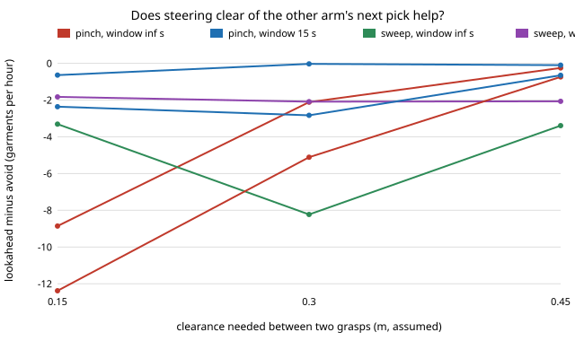

# hanger-lookahead — should a laundry-hanging arm also steer clear of the other arm's next pick? A paired test on 1000 loads

**Live page:** https://duncan-haywood.github.io/oss-monorepo/research/hanger-lookahead/

**Live page:** https://duncan-haywood.github.io/oss-monorepo/research/hanger-lookahead/

[`hanger-avoidpaired`](../hanger-avoidpaired) showed that picking a garment clear of the other arm's pick in progress gains a little (+1 to +10 garments an hour). Its first next step was to plan against the other arm's *next* move. **That does not help: lookahead is measurably worse than avoiding the current pick in 14 of 18 settings** (up to −11.3 an hour for aiming at 0.15 m), indistinguishable from it in the other 4, and better in none (best: pinching at 0.30 m, +0.40, interval −0.03 to 0.84). A negative result.

Track 18 (`hanger`, [`PROJECTS.md`](../PROJECTS.md)). Built on none of the CU Boulder groups in `prompt.md`; no connection is claimed. Produced with AI assistance.



## Method

`src/hanger_lookahead/look.py` (stdlib only) imports `hanger-avoid` unchanged and copies its two-arm loop. When an arm starts, it takes its own unrestricted choice on a copy of the pile (with a copy of the random stream), removes it, and predicts the other arm's target with the same policy on the rest. If its choice lies within `sep` of that prediction, and the other arm starts within `window` seconds, it picks among garments at least `sep` from the predicted target instead. The current-pick rule of hanger-avoid still applies first. The prediction is imperfect: the real stream differs after the pick.

Paired like hanger-avoidpaired: load *i* uses seed *i* in both runs, difference = done/h with lookahead − avoid, 95% percentile bootstrap (2000 resamples) over 1000 loads. Two arms, load 25, clearances 0.15 / 0.30 / 0.45 m, window 15 s or unlimited, policies see (aiming), sweep, pinch. Parameters are the `hanger-pick`/`hanger-cell` placeholders (nothing here measures a robot).

Tests (7): with lookahead off the pick sequence equals hanger-avoid's, loads equal its `replicate` per load, zero clearance or a negative window changes nothing, every garment is picked once, lookahead does redirect, and runs are deterministic.

## Results (`experiments/results.txt`, 4.6 minutes)

Mean paired difference in garments done per hour (95% interval); redirects per load by the lookahead rule in brackets.

| policy | sep (m) | window 15 s | window unlimited |
|---|---|---|---|
| see | 0.15 | −1.38 (−2.36 to −0.41) | −11.26 (−12.38 to −10.07) |
| see | 0.30 | −1.94 (−2.83 to −1.06) | −4.13 (−5.11 to −3.15) |
| see | 0.45 | −0.37 (−0.65 to −0.11) | −0.43 (−0.74 to −0.10) |
| sweep | 0.15 | −1.01 (−1.83 to −0.20) | −2.40 (−3.31 to −1.50) |
| sweep | 0.30 | −1.17 (−2.09 to −0.22) | −7.19 (−8.23 to −6.11) |
| sweep | 0.45 | −1.23 (−2.07 to −0.37) | −2.46 (−3.39 to −1.47) |
| pinch | 0.15 | −0.29 (−0.64 to 0.06) | −8.13 (−8.86 to −7.44) |
| pinch | 0.30 | +0.40 (−0.03 to 0.84) | −1.58 (−2.11 to −1.05) |
| pinch | 0.45 | −0.03 (−0.10 to 0.03) | −0.11 (−0.25 to 0.03) |

- A longer window means more redirects (up to 15 per 25-garment load) and a larger loss: the arm gives up its best garment to protect a prediction that is often wrong.
- A 15 s window limits the harm to about −1 an hour, never a measured gain except pinching at 0.30 m, where the interval touches zero.
- Why it fails (an interpretation, not tested here): the arm that yields pays its loss for certain, while the clash it avoids is already handled by the other arm's own avoidance when it starts.

## Limitations

- One predictor (the policy itself on a pile copy); a better one, or a rule that yields only when the clash would cost a wait, is not tried.
- Placeholders for clearance, station times and pile, as in hanger-avoid. 1000 loads, not 2000.
- Says nothing about a real dryer or robot.

## Reproduce
```bash
cd research/hanger-lookahead
python3 -m unittest discover -s tests      # 7 tests
python3 experiments/run.py                 # writes results.txt (about 5 min; argument = loads per cell)
python3 experiments/figure.py              # writes experiments/lookahead.svg
```

## Next steps
Yield only when the predicted clash would cost a wait longer than the garment is worth; link garment kinds to cell archetypes (`hanger-kindlink`); measure real two-gripper clearance (owner step).

## Outside dependencies
Real arm clearance and station times (owner step: measure); everything else runs here.
