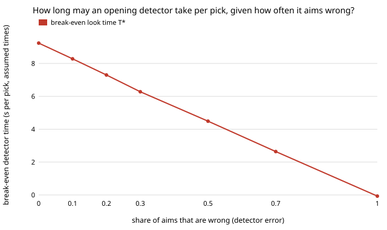

# hanger-misaim: how often may a laundry robot's opening detector aim wrong before blind pinching is faster?

**In the stylised `hanger-pick` model, every 10 points of detector error cost about 1 second of the look-time budget: a perfect detector may take 9.2 s per pick before blind pinching wins, one that aims wrong 30% of the time 6.3 s, 50% 4.5 s, and one that is always wrong none (T\* = −0.07 s, interval −0.32 to 0.17).** At the assumed 1 s look, aiming still beats blind pinching until the detector is wrong about 88% of the time; at a 5 s look the limit drops to 43%, at 9 s to 3%, and an 11 s look loses even with a perfect detector. `hanger-pickbreak` priced the detector's speed only; this prices its accuracy as well. A wrong aim costs one wasted grasp and then the same regrasp hunt a blind pinch does. Produced with AI assistance (Claude). **Stylised: every time and probability is an assumed placeholder from `hanger-pick`; nothing here is a measurement of a robot, a detector or a garment.**

**Live page:** https://duncan-haywood.github.io/oss-monorepo/research/hanger-misaim/

Track 18 (`hanger`, [`PROJECTS.md`](../PROJECTS.md)). Takes the first "Next steps" item of [`hanger-pickbreak`](../hanger-pickbreak). Built on none of the CU Boulder groups in `prompt.md`; no connection to them is claimed.



## Why this question

A builder choosing an opening detector trades speed against accuracy. `hanger-pickbreak` fixed accuracy at "right every time" (except the fixed 0.9 grasp success); a cheap detector is likely to be wrong sometimes. The output is a two-number spec: how slow and how often wrong.

## Method

`src/hanger_misaim/misaim.py` imports the pile model from `hanger-pick` unchanged (stdlib only) and adds one policy, `pick_err`: the `see` policy, except that when it aims at a visible opening the detector is wrong with probability `e`. A wrong aim spends the look and one `t_grasp`, then hunts for the opening on that garment by regrasping (`t_regrasp`, success `q_find`, at most `max_regrasp`) exactly as a blind pinch does. Garments whose openings are all hidden fall back to pinching as before.

- **Paired piles.** Pile `s` (seed `s`) is emptied by each policy; 300 piles of 18 garments; intervals are 95% percentile bootstraps (1,000 resamples).
- **Check.** At `e = 0` the policy matches `hanger-pick`'s `see` to 1e-12 on every tested pile (unit test).
- **T\*(e).** The look time at which the detector ties blind pinching (which pays no look): the mean paired gap `pinch(t_see=0) − pick_err(t_see=0, e)`; exact because time is linear in `t_see`, as `hanger-pickbreak` showed.
- **e\*.** Largest `e` at which the detector at a given `t_see` is no slower than blind pinching, by bisection on the mean over the 300 piles (12 steps; no interval is reported for e\*).

## Results (all from `experiments/results.txt`)

- **A.** T\*: 9.24 s (e = 0), 8.28, 7.30, 6.28, 4.49 (0.5), 2.64 (0.7), −0.07 (1.0). Close to linear in `e`.
- **B.** e\* by look time: 0.99 (0 s), 0.88 (1 s), 0.66 (3 s), 0.43 (5 s), 0.23 (7 s), 0.03 (9 s), none at 11 s. At zero look time e\* is 0.99 rather than 1 because an always-wrong aim is about as slow as pinching but not exactly: the interval on T\*(1) includes 0, so read this as "about 1".
- **C.** At 1 s look, e\* falls as regrasps get likelier to succeed: 0.93 (`q_find` 0.15), 0.88, 0.81, 0.73 (0.9). Easy blind regrasping makes a wrong aim cheaper but a good aim less valuable.
- **D.** e\* falls as more openings are hidden: 0.93 (none), 0.91, 0.88, 0.81, 0.71 (80% hidden); with fewer visible openings the detector has fewer chances to help.

## Limitations

- A wrong aim is one fixed event type (a wasted grasp, then a normal hunt). Detectors that miss visible openings, aim at the wrong garment, or are confidently wrong in correlated ways (the same cloth fold fools it every time) are not modelled; error here is independent per pick.
- Error is independent of the pile and the garment kind; a real detector is worse on exactly the hard heaps.
- The hunt after a wrong aim reuses `q_find` and the double-pick cost unchanged; a garment gripped in a bad place may be harder.
- Intervals cover pile sampling only. e\* has none, and sections C and D vary assumptions rather than sampling them.
- Thresholds are in assumed seconds; only the shape (each point of error buys back its fraction of the look budget) is the finding.

## Reproduce
```bash
cd research/hanger-misaim
python3 -m unittest discover -s tests      # 5 tests
python3 experiments/run.py                 # writes results.txt
python3 experiments/figure.py              # writes experiments/breakeven_vs_error.svg
```

## Owner steps
Measure a real detector's error rate and per-pick latency on real heaps, and the real cost of a bad grasp; not a run's to do.

## Next steps
Correlated error (the detector fails on a garment kind or fold, so a regrasp cannot help); rerun on `hanger-3d` piles once hiddenness comes from how cloth lands.

## Outside dependencies
None beyond the Python standard library. Imports the pile model from [`hanger-pick`](../hanger-pick).
