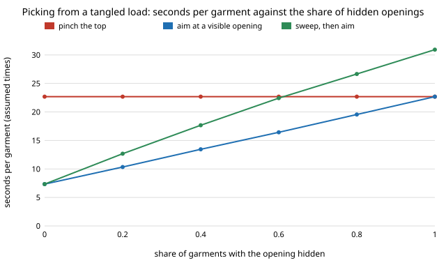

# hanger-pick: how should a laundry robot pick one garment out of a tangled dryer load?

**In a stylised pile model, knowing where a garment's opening is matters far more than how the pile is tangled: aiming at a visible neck or waistband cuts the pick from 22.7 to 13.4 assumed seconds per garment, and pushing garments aside first makes it slower, not faster.** The model is 2D: garments are overlapping discs, 40% of them have the opening hidden by the garment itself (face down or folded in), and three scripted policies empty an 18-garment pile. *Pinch the top* garment and regrasp until the opening turns up takes 22.7 s per garment. *Aim at a visible opening*, falling back to a pinch only when none is visible, takes 13.4 s (the direct share is 61%, close to the 60% of garments that are not hidden). *Sweep the top garments aside up to three times, then aim* takes 17.7 s, because it spends 1.55 sweeps per garment and does not raise the direct share (0.61 for both): in this model neighbours seldom hide every unhidden opening, the garments themselves do. Put into `hanger-cell`, the three policies give 110, 151 and 127 items an hour for one arm, against 169 for that project's placeholder (8 s). Produced with AI assistance (Claude). **Stylised: every time and probability is an assumed placeholder, the cloth is a stack of discs, and nothing here is a measurement of a robot or a garment.** The ranking depends on the hidden share and on the regrasp success rate, both swept below.

**Live page:** https://duncan-haywood.github.io/monorepo-projects/research/hanger-pick/

Track 18 (`hanger`, [`PROJECTS.md`](../PROJECTS.md)), milestone 5. Replaces the assumed pick station of [`hanger-cell`](../hanger-cell), whose sensitivity run said the pick was its second biggest swing. Built on none of the CU Boulder groups in `prompt.md`; no connection to them is claimed.



## Why this question

`hanger-cell` found that one arm's throughput hangs on two stations nobody had built, the pick and the fold. A dryer load is a heap: garments lie across each other, sleeves and legs tangle, and the thing a hanger needs, the neck or waistband, may be anywhere or inside. Published work on garment handling picks a garment up and then hunts for its opening by regrasping the lowest point (Doumanoglou et al. 2016, *IEEE T-RO*; the towel-folding PR2 of Maitin-Shepard et al., ICRA 2010, uses the same hold-and-regrasp idea for corners). This project asks the question that comes before that: should the robot pick whichever garment it can reach and search after, or look first for an opening it can grasp directly, and is it worth rearranging the pile to expose one? (Citations come from the track brief in `PROJECTS.md` and are not re-read in this run; I use them only as the idea of regrasp-to-find-the-opening.)

## Method

`src/hanger_pick/pile.py`, stdlib only.

- **Pile.** `n` garments in a 0.6 m square bin; each is a disc (radius 0.14 to 0.26 m by kind: tee, shirt, trousers, dress, kids, knit) with a random centre and a random height rank. Its opening is a 4 cm region at 0.7 of the radius from the centre, in a random direction. With probability `p_hidden` (0.4) the opening is hidden by the garment itself and is invisible. Otherwise its visible fraction is the share of 13 sample points in the region not under a higher garment's disc.
- **Policies.** `pinch`: grasp the top garment, then regrasp until the opening is found (each regrasp succeeds with `q_find` = 0.35, at most 6; if never, the garment is set aside unhung). `see`: grasp the garment with the largest visible opening if at least `theta` (0.5) is visible, with success 0.9 per grasp; otherwise fall back to `pinch`. `sweep`: as `see`, but before falling back push the highest, then second highest, then third highest garment 25 cm in a random direction (3 s each) and look again.
- **Second garments.** Lifting a garment drags one more along with probability 0.08 per lower garment whose disc overlaps (capped at 0.5), costing 3 s to return it.
- **Assumed times.** Look 1 s, grasp 4 s, regrasp 6 s, sweep 3 s. These are placeholders chosen to be round, not measured.
- **Experiment.** `experiments/run.py` empties 300 seeded piles per cell and writes `results.txt`. Section F reuses `hanger-cell`'s discrete-event model with its pick time replaced by each policy's mean (success 1, one try, because the pick time here already includes retries).

## Results (all from `experiments/results.txt`)

- **A. Pile size.** `pinch` costs 21.3 to 23.2 s per garment from 4 to 35 garments; `see` rises from 11.7 to 13.9 s; `sweep` from 14.0 to 18.8 s. The direct share is flat at about 0.61 for `see` and `sweep`.
- **The direct share equals 1 &minus; p_hidden (C2).** At `p_hidden` = 0 both aiming policies take 7.3 s and aim directly at every garment; at 1.0 `see` equals `pinch` (22.7 s) and `sweep` is slower (30.9 s). The crossover with `pinch` never happens: aiming never loses to pinching, and sweeping loses to aiming at every hidden share above zero.
- **Covering by neighbours barely matters here (C).** Moving `theta` from 0.2 to 0.95 changes `see` from 13.46 to 13.53 s. The direct share of 0.61 against 0.60 not-hidden suggests that whenever an unhidden garment is left, one of them has at least `theta` of its opening visible, so there was little for a sweep to uncover; I did not measure how often the best opening is fully clear. (`visible0`, the mean visible fraction over all garments of a fresh pile, is only 0.09 at n = 18 because 40% are hidden outright.)
- **Regrasp success sets the size of the prize (B).** With `q_find` from 0.15 to 0.9, `pinch` goes 31.8 to 13.7 s, `see` 17.2 to 9.8 s. `see` is best throughout; the gap shrinks from 14.7 to 3.9 s.
- **Where the time goes (D, n = 18).** `pinch`: 2.61 regrasps, 0.67 second garments and 0.08 set-asides per garment. `see`: 1.04 regrasps (from the hidden garments left at the end), 0.64 second garments, 0.03 set-asides. `sweep` adds 1.55 sweeps and saves nothing.
- **Second garments (E).** With no dragging at all `pinch` is 20.6 s and `see` 11.4 s, so dragging costs about 2 s and 2 s respectively and does not change the ranking.
- **Into the cell (F).** One arm, 25-item load, learned hang-or-fold rule: `hanger-cell`'s placeholder pick (8 s, 0.85, 3 tries) gives 8.93 min and 168.6 items an hour. With this project's means: `pinch` 23.0 s &rarr; 13.63 min, 110.1 items/h; `see` 13.7 s &rarr; 9.96 min, 150.9; `sweep` 18.5 s &rarr; 11.82 min, 127.0. The arm is the bottleneck in all three. So `hanger-cell`'s five-dryer figure needs a policy that finds openings without hunting; with a pinch policy the same cell serves about three.

## Limitations

- Garments are discs. Real cloth bunches, drapes over other cloth, knots sleeves and legs, and clings by static. A hidden opening here is a coin flip per garment, not a consequence of how the garment landed.
- Times, `q_find`, `p_direct` and the dragging rule are assumed. The ranking held over the swept ranges of `q_find` (B), `p_hidden` (C2), `theta` (C) and dragging (E) but I did not sweep the look, grasp or sweep times, nor `max_regrasp`.
- The sweep policy is blind and one specific design. A policy that knows which garment's opening is covered, or that digs, or that uses a singulation tray, could behave differently. This result is only that blind pushing does not pay in this model.
- The robot is assumed to see which openings are visible. Doing that on a real heap is a perception problem this project does not touch.
- One seed per pile, 300 piles per cell; no confidence intervals are reported.

## Reproduce
```bash
cd research/hanger-pick
python3 -m unittest discover -s tests      # 11 tests, under 1 s
python3 experiments/run.py                 # writes results.txt, under a minute
python3 experiments/figure.py              # writes experiments/hidden_vs_time.svg
```

## Owner steps
Measure real pick, regrasp and sweep times and the share of hidden openings on a real dryer load, with a real arm and real clothes; that is not a run's to do.

## Next steps
Give the pile a cloth solver (`hanger-3d`, milestone 4) so hiddenness comes from how a garment lands; add a policy that knows the covered openings (so sweeping can be tested fairly) and a singulation tray; sweep the assumed times; feed the resulting pick time back into `hanger-cell`.

## Outside dependencies
None beyond the Python standard library. `experiments/run.py` section F imports `hanger-cell` from this repository. Everything physical (cloth, a gripper, a camera that finds openings) is outside this project.
