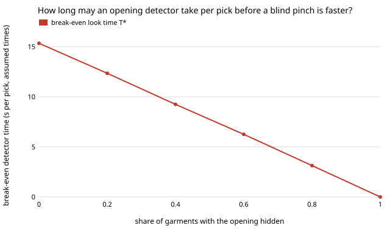

# hanger-pickbreak: how long may a laundry robot spend finding a garment's opening before blind pinching is faster?

**In the stylised `hanger-pick` model, aiming at a visible opening beats a blind pinch only if finding the opening costs less than about 9 seconds per pick (95% interval 8.9 to 9.6); the figure falls to 3.9 s if regrasps succeed 90% of the time and to 0 if every opening is hidden.** `hanger-pick` showed that aiming beats pinching but charged both the same 1 s look. A real opening detector is extra hardware and compute that a blind pinch does not need, so this project asks the question a builder would: how slow can the detector be? On paired piles (the same 300 seeded piles for both policies, 18 garments each) the break-even is `pinch − see` with no look time, 9.24 s per pick; it grows with the cost of a regrasp (2.9 s at 2 s per regrasp, 18.7 s at 12 s), shrinks as regrasps get likelier to succeed (14.7 s at 15%, 3.9 s at 90%) and as more openings are hidden (15.3 s with none, 3.1 s at 80%), and does not depend on pile size (9.2 to 9.6 s from 4 to 35 garments). Sweeping garments aside before aiming beats plain aiming only when a sweep costs under half a second: it wins by 0.40 s per garment (interval 0.17 to 0.65) at 0 s per sweep and loses at 0.5 s and above. Produced with AI assistance (Claude). **Stylised: every time and probability is an assumed placeholder from `hanger-pick`; nothing here is a measurement of a robot or a garment.**

**Live page:** https://duncan-haywood.github.io/monorepo-projects/research/hanger-pickbreak/

Track 18 (`hanger`, [`PROJECTS.md`](../PROJECTS.md)). A follow-up to [`hanger-pick`](../hanger-pick), taking its limitations (no confidence intervals, look and sweep times not swept) as the question. Built on none of the CU Boulder groups in `prompt.md`; no connection to them is claimed.



## Why this question

`hanger-pick` ranked three scripted policies, but its ranking rested on one choice: both policies pay the same look. If aiming needs a vision system that takes seconds per pick, that choice favours aiming. The useful output is a threshold the builder of a detector can be held to, and how that threshold moves with the assumptions nobody has measured.

## Method

`src/hanger_pickbreak/breakeven.py` imports the pile model from `hanger-pick` unchanged (stdlib only).

- **Paired piles.** Pile `s` (seed `s`) is emptied by each policy, so differences cancel pile-to-pile noise. Intervals are 95% percentile bootstraps (1,000 resamples) over 300 piles.
- **Break-even look time T\*.** The blind `pinch` policy needs no detector, so its look is set to 0 s. In the model every pick pays `t_see` once, whatever happens after, and no random draw depends on a time, so the time of `see` is exactly linear in `t_see` with slope 1 (checked in section A of `results.txt` to 2e-15 on every pile). T\* is therefore the mean per-pile gap `pinch(t_see=0) − see(t_see=0)`: a detector costing more than T\* per pick makes blind pinching faster.
- **Sweeps.** `see − sweep` per garment on the same piles, sweeping `t_sweep` from 0 to 3 s (the assumed value is 3 s).

## Results (all from `experiments/results.txt`)

- **B. Defaults.** T\* = 9.24 s per pick [8.93, 9.55]. With `hanger-pick`'s assumed 1 s look, aiming wins by about 8 s per garment.
- **C. Regrasp success.** T\*: 14.7 s (`q_find` 0.15), 11.5, 9.2, 6.9, 4.9, 3.9 s (0.9). The easier blind regrasping is, the less a detector may cost.
- **D. Hidden share.** T\*: 15.3 s (none hidden), 12.3, 9.2, 6.3, 3.1, and exactly 0 when all openings are hidden, since aiming then falls back to pinching on every pick.
- **E. Regrasp time.** T\* is close to proportional to it: 2.9, 6.1, 9.2, 14.0, 18.7 s for 2, 4, 6, 9, 12 s per regrasp.
- **F. Pile size.** 9.6, 9.4, 9.2, 9.3 s for 4, 8, 18, 35 garments; the intervals overlap, so no dependence is shown.
- **G. Sweeping.** Sweep beats aim by 0.40 s [0.17, 0.65] at 0 s per sweep; aim beats sweep by 0.37 s [0.13, 0.60] at 0.5 s, 1.9 s at 1.5 s and 4.2 s at 3 s. The break-even sweep time is between 0 and 0.5 s (not resolved further); it is positive only because a free push can occasionally uncover a better opening.

## Limitations

- The pile is `hanger-pick`'s stack of discs; everything it leaves out (cloth bunching, knots, static) is left out here. Hidden openings are coin flips.
- T\* is a per-pick additive cost. A detector that also fails or is unsure (so aims at a wrong point) is not modelled beyond `hanger-pick`'s fixed 0.9 grasp success.
- The look time is charged once per pick, including for `sweep`, which in `hanger-pick` does not pay again to look after each push; a detector that must rerun after each sweep makes sweeping worse than reported.
- Intervals cover pile sampling only, not uncertainty in the assumed parameters, which is what sections C to E vary.
- Thresholds are in assumed seconds. Only their dependence on the other assumptions (monotone in each) is the finding.

## Reproduce
```bash
cd research/hanger-pickbreak
python3 -m unittest discover -s tests      # 5 tests, under 1 s
python3 experiments/run.py                 # writes results.txt, about 15 s
python3 experiments/figure.py              # writes experiments/breakeven_vs_hidden.svg
```

## Owner steps
Time a real opening detector on real heaps and measure the real regrasp success rate and time; that is not a run's to do.

## Next steps
Give the detector an error model (a wrong aim costs a grasp and a regrasp) so the break-even includes detector accuracy, not only speed; rerun on `hanger-3d` piles once hiddenness comes from how cloth lands.

## Outside dependencies
None beyond the Python standard library. Imports the pile model from [`hanger-pick`](../hanger-pick).
