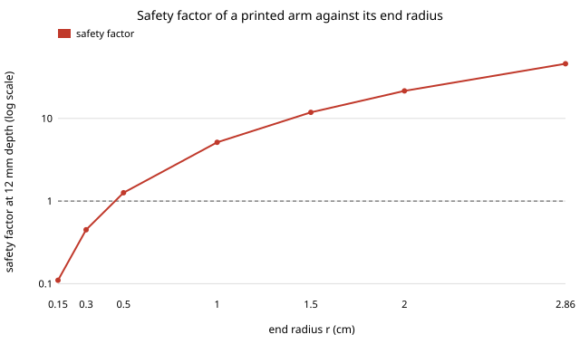
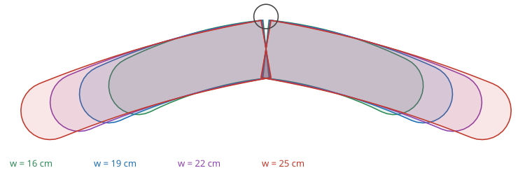

# hanger-print: can the hanger a cloth simulation designed be 3D-printed, and does it hold a garment?

Can the hanger shapes `hanger-fit` designed in simulation be made on a desktop 3D printer, and
do they hold a garment? **Yes, with two caveats. The round-ended design (end radius 2.86 cm) is
very stiff when printed flat in PLA: under the assumed 1.5 kg garment and a 2× motion factor its
arm has a safety factor of 40–70 at 12 mm depth and bends 0.04 mm at the tip at most, against a
1.6 mm shape error in the simulation, so strength never limits it. The thin-ended designs the
simulation rejects for creasing fail here too: a printed wire-like arm (end radius 1.5 mm) has a
safety factor of 0.13 at 12 mm depth and would need 278 mm of depth to reach 3. And no hanger
of a useful width fits a 220 mm printer bed in one piece (only the 16 cm and child widths fit a
256 mm bed, turned 45°): a hanger arm with its hub fits a 220 mm bed for every width up to 24.8
cm, so print the hanger in two halves.** Output: parametric STL and OpenSCAD files for the
four-width rack, and a stdlib Python generator and checker for any `hanger-fit` parameters.
Produced with AI assistance (Claude). Milestone 7 of research track 18 (`hanger`, `PROJECTS.md`).
The strength numbers rest on assumed material constants, and the OpenSCAD files were not
rendered in this run (no OpenSCAD in the image); the STL files come from the same outlines and
are checked as closed meshes in the tests.

**Live page:** https://duncan-haywood.github.io/oss-monorepo/research/hanger-print/

## Why this question

`hanger-fit` found that a hanger whose arm width the robot sets to the garment, or a rack of four
fixed widths, holds seven shirt sizes within 1 cm of their worn shape, with a round end of about
2.9 cm radius. That is a shape in a 2D simulation. The by-product `PROJECTS.md` asks for is
the printable part people can use today, with a strength check, so that a reader with a printer
can try the designs and the owner can see which ones are worth making.

## Builds on

- `research/hanger-fit` (this repository): the four design parameters (arm length *w*, slope,
  bow, end radius *r*), the adjustable shape (slope 15.92°, bow 0.59 cm, *r* 2.86 cm) and the
  rack of four widths (16, 19, 22 and 25 cm). The centreline is the same Bézier curve.
- Euler–Bernoulli beam theory for the cantilever checks (any strength-of-materials text).
- Lab tags: none. It builds on no group listed in `prompt.md`.

## Method

- **Geometry** (`src/hanger_print/geom.py`). Millimetres, frontal plane, hook at the origin.
  Each arm is the centreline offset by *r* each side with a round cap, as a flat outline
  extruded to a `depth` (front to back; `hanger-fit`'s 2D section does not say, so it is a free
  choice, default 12 mm). The hub is a disc of radius *r*, and a post and an 8 mm-wide loop
  (hole radius 5 mm) let a robot's rail pin or hook carry it. A part is five overlapping shells,
  merged by the slicer or by OpenSCAD's `union()`.
- **Meshes** (`mesh.py`). Each shell is triangulated from its stations, extruded, and written as
  ASCII STL; the same outlines go into an OpenSCAD file as `polygon()` and `linear_extrude`.
  Tests check that every shell is a closed, consistently oriented manifold and that its volume
  equals outline area × depth to 2%.
- **Strength** (`strength.py`). The arm is a cantilever, section 2*r* by *depth*, loaded at its
  tip by half of the garment's weight times a dynamic factor. Bending stress at the root is
  multiplied by a stress concentration, and compared with an allowable in-plane stress. Printed
  flat, the stress runs along the layers.
- **Assumptions** (all in `strength.py`; none measured): PLA with modulus 3500 MPa, allowable
  40 MPa in plane, stress concentration 2, dynamic factor 2, a 1.5 kg heaviest garment (a wet
  coat is heavier; this is a choice), density 1.24 g/cm³. Mass is estimated with two 0.8 mm
  perimeters, 0.8 mm skins and 15% infill, with a minimum depth of 6 mm.
- **Bed fit** (`geom.bbox_fits`). The outline is turned in 5° steps to find the smallest
  bounding square; a part fits if that square is within the bed.

## Results

From `experiments/results.txt`, written by `experiments/run.py` (under a second). Constants are
assumed, so read the ratios, not the digits.

**A. The rack and the adjustable design print stiffly and light.** At 12 mm depth the safety
factor is 70 (16 cm) to 42 (25 cm) for the four rack widths and 71 to 40 for the seven
adjustable widths; the depth that would give a safety factor of 3 is 0.5–0.9 mm, so a 6 mm arm
is limited by being printable, not by load. The tip bends 0.008–0.04 mm. Sliced mass at 6 mm
depth is about 63 to 96 g, solid arms are far heavier (each 25 cm arm is 150 cm³ before
slicing). The loop's ligaments carry 0.18 MPa.

**B. The round end is what makes the arm stiff.** At 23 cm, 12 mm deep:

| end radius *r* (cm) | safety factor | depth for SF 3 (mm) | mass (g) |
|---|---|---|---|
| 0.15 (wire-like) | 0.11 | 323 | 445 |
| 0.3 | 0.45 | 80 | 137 |
| 0.5 (plastic-like) | 1.26 | 29 | 65 |
| 1.0 | 5.1 | 7.0 | 36 |
| 2.0 (wood-like) | 21.5 | 1.7 | 62 |
| 2.86 (`hanger-fit`'s D) | 45.9 | 0.8 | 87 |



Printed at the thickness of a wire hanger, the arm would snap. `hanger-fit` found that thin ends
crease cloth, and this shows they are also not printable. Mass is lowest near *r* = 1 cm, where
the arm just meets the safety factor; the extra 26–51 g of a 2–2.9 cm radius buys the crease-free
end `hanger-fit` found, which this project did not re-test.

**C. Nothing fits the bed whole.** Whole hangers fit a 256 mm bed only at 15.8 and 16 cm
(turned 45°) and a 220 mm bed at no width. One arm with its hub fits a 220 mm bed for widths up
to 24.8 cm (turned 60°), but not for the 25.8 cm XXL. The generated files are the whole
hanger; splitting at the hub and a bolted joint is not designed.



**D. *w* is the length along the arm, not the reach.** `hanger-fit` defines *w* as the arm
length to the outer end and the arm slopes down at 16°, so the horizontal reach of the
adjustable hanger at *w* = 22.8 cm is 22.0 cm (the test checks the formula
(*w* − *r*) cos(slope) + *r*). A printed hanger measured across the shoulders is about 0.8 cm
narrower than *w* suggests, and `hanger-fit`'s "0.8 cm wider than the half shoulder" is in *w*.

## What this does and does not show

- It shows the arms are not the weak point, and that a printable hanger can follow the
  simulation's shape. It does not show the garment hangs as simulated: no cloth is involved.
- The arms are 57 mm thick in the frontal plane (2*r*), as `hanger-fit`'s section needs;
  front to back they are 6–12 mm. That is a chunky, boomerang-like part. A real shoulder wants
  a shaped front-to-back profile this project does not model.
- The stress, modulus, factor and load figures are textbook-style assumptions for FDM PLA. Real
  printed parts differ by print orientation, temperature, infill and humidity.
- Tip deflection is for a straight beam at the static load and is a lower bound on the arm's
  sag; the bow and the slope matter little at these stiffnesses.
- No adjustable-width mechanism is designed: the seven adjustable widths are fixed parts, one
  per width, like the rack. The telescoping and folding mechanisms of `hanger-insert` are not
  modelled in CAD.

## Safety

A hanger loaded near its strength limit can snap and leave sharp edges: the wire-like design
would. Print the designs with a safety factor above 3 and round the edges. A real rail,
loop or pin and the robot's gripper are owner decisions; no run builds or powers hardware.

## Owner steps

1. Print `experiments/cad/rack_w22.stl` flat (or turn it in the slicer: the best angle is in
   the results), with PLA or PETG, 3 perimeters, 15–20% infill, no supports.
2. Hang a real shirt (size M) on it and compare it with a stock hanger by eye, then try the other
   three widths. Photographs would give the first real check of `hanger-fit`.
3. Measure the real material: print and break a few arms with weights.
4. Bill of materials: a printer (any 220 mm bed), about 100 g of filament per hanger. No prices
   are given because none were checked.

## Limitations

Flat extrusion only, no front-to-back shaping; one hanger family; strength from a beam formula
with assumed constants and no fatigue, creep (PLA creeps under steady load) or layer-adhesion
check; the whole hanger does not fit a normal bed, and the two-piece version is not designed;
OpenSCAD files untested in a renderer; one load case.

## Reproduce

```
cd research/hanger-print
python3 -m unittest discover -s tests           # 11 tests, under a second
PYTHONPATH=src python3 experiments/run.py       # writes results.txt and experiments/cad/*.stl|scad
python3 experiments/figure.py                   # rack.svg and stiffness.svg
```

Python 3.9+. No dependencies.

## Next steps

1. A two-piece version with a bolted or dovetailed joint at the hub, so every width prints on a
   220 mm bed, and a front-to-back shoulder profile; test the shoulder shape against the 3D
   cloth drape of milestone 4 (`hanger-3d`).
2. Print the arms and break them, to replace the assumed material constants (owner step).
3. Lighter arms: a hollow or ribbed arm that keeps `hanger-fit`'s 2–3 cm end radius.

## Outside dependencies

None beyond Python's standard library. A 3D printer, filament, a slicer and OpenSCAD (to render
the `.scad` files) are the vitamins.
