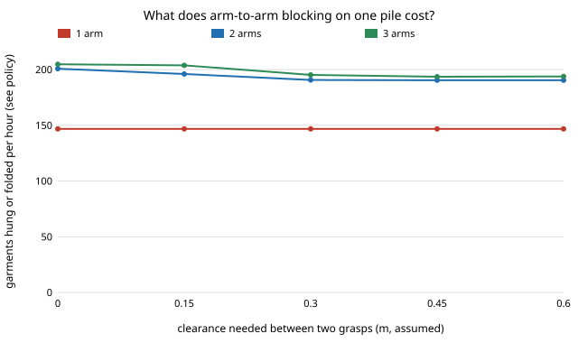

# hanger-sharedpile: what does it cost two laundry-hanging arms to empty the same dryer pile?

**In the stylised model, two arms working one pile and waiting for each other whenever their grasps are closer than a clearance `sep` lose little with look-then-aim picking (201 garments hung or folded per hour with no blocking, 191 at 0.30 m clearance, 5.7 dryers) but a lot with blind pinching (179 falling to 148, 5.4 to 4.5 dryers), because pinching keeps the arms busy so they meet more (about 18 blocked picks per 25-garment load against 10).** With three arms and aiming, a third arm adds only 3 to 5 garments an hour at any clearance: the fold table is the limit. `hanger-cellpick` flattered multi-arm cells by never letting arms meet; this puts the meeting in. Produced with AI assistance (Claude). **Stylised: the clearance, the downstream time that spaces the arms and every station time are assumed; nothing here is a measurement of a robot.**

**Live page:** https://duncan-haywood.github.io/monorepo-projects/research/hanger-sharedpile/

Track 18 (`hanger`, [`PROJECTS.md`](../PROJECTS.md)). Takes the first "Next steps" item of [`hanger-cellpick`](../hanger-cellpick) ("let two arms share one pile so they block each other"). Built on none of the CU Boulder groups in `prompt.md`; no connection to them is claimed.



## Method

`src/hanger_sharedpile/shared.py` (stdlib only) imports `hanger-cellpick`, `hanger-pick` and `hanger-cell` unchanged.

- One `hanger-pick` pile of 25 per load. Arms act on it in time order: the arm that frees first picks next, from the pile as the earlier picks left it.
- Blocking: an arm starting a pick while another arm is mid-pick waits until that pick ends if the two target garments' centres are closer than `sep`. The bin is 0.60 m square, so `sep` of 0.45 m and above blocks nearly every overlapping pair and the results stop changing.
- An arm's cycle is its pick plus `downstream` (14 s default, a stand-in for sensing and hand-off), which only spaces the arms in the pile model; the pick times (including waits) are then handed to `hanger-cell`'s discrete-event model, which re-times everything.
- 200 loads per cell, seeded; intervals are 95% percentile bootstraps over loads.

Checks: with `sep = 0` the result matches `hanger-cellpick` (179 pinch, 201 see on two arms); one arm matches its pick sequence exactly (test); blocking never raises output (test).

## Results (`experiments/results.txt`)

- **A. Policy and clearance, two arms.** Done per hour at sep 0 / 0.15 / 0.30 / 0.45: pinch 179 / 167 / 151 / 148; see 201 / 196 / 191 / 190; sweep 196 / 193 / 186 / 181. Blocked picks per load at 0.30 m: 15.8, 10.1, 7.4. Pinching's loss at 0.30 m is 28 per hour and see's about 10; in both the 95% intervals of sep 0 and sep 0.30 do not overlap.
- **B. Third arm.** See policy: 205 / 204 / 195 / 194 for three arms against 201 / 196 / 191 / 190 for two; one arm is 147.
- **C. Spacing.** At 0.30 m, a downstream time of 5 s gives 185 and 60 s gives 196: the shorter the time away from the pile, the more arms meet.

## Limitations

- Blocking is a centre-distance rule with an assumed clearance; real grippers have shape, reach and cable limits. Waiting is the only response; a planner that picks a free garment instead would lose less.
- Arms' cycles in the pile model use a fixed `downstream`, not the cell's real queues, so the timing of meetings is approximate (section C shows the size of that error).
- Sweeps move garments in the model but the blocking rule uses the target's position at pick time.
- The cell stations, pick times and pile are `hanger-cell` and `hanger-pick` placeholders.

## Reproduce
```bash
cd research/hanger-sharedpile
python3 -m unittest discover -s tests      # 5 tests
python3 experiments/run.py                 # writes results.txt (about 20 s)
python3 experiments/figure.py              # writes experiments/arms.svg
```

## Owner steps
Measure the real clearance two grippers need over one bin; not a run's to do.

## Next steps
Let the second arm choose a non-conflicting garment instead of waiting; link pile garment kinds to the cell's archetypes.

## Outside dependencies
None beyond the Python standard library. Imports [`hanger-cellpick`](../hanger-cellpick), [`hanger-pick`](../hanger-pick) and [`hanger-cell`](../hanger-cell).
