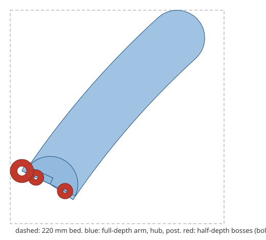

# hanger-split: can a laundry hanger be printed in two halves on a 220 mm bed, and is the joint strong enough?

Can the `hanger-fit` hanger be 3D-printed on a normal 220 mm bed in two halves that bolt
together, and does the joint hold a garment? **Yes, by a margin of about 4 rather than 40: one
half-lap joint with two M4 bolts lets every width up to the 25.8 cm XXL print on a 220 mm bed
(best turn 65°; the XXL half is 219.8 mm on the diagonal, so it needs a bigger bed in practice),
and the joint, not the arm, becomes the weak point: its safety factor is 3.7–13 against 40–70 for
the arm, set by the bearing stress of the bolt on the printed boss. A joint made of printed pegs
instead of bolts fails (safety factor 0.9–1.8 for 4 mm pegs), and the depth the joint needs
(4–9 mm) is 5–10 times what the arm needs (0.8 mm).** Output: a parametric half-hanger
(STL and OpenSCAD for five widths, one assembled STL) and a stdlib Python checker. Produced with
AI assistance (Claude). Follow-up to `hanger-print` (milestone 7 of research track 18, `hanger`,
`PROJECTS.md`), taking its first "next step". All strengths rest on assumed material constants and
a beam model; no cloth, no printed part and no bolt was tested.

**Live page:** https://duncan-haywood.github.io/oss-monorepo/research/hanger-split/



## Why this question

`hanger-print` found that no useful hanger width fits a 220 mm bed in one piece, but that one arm
with its hub does, and left the two-piece design as a next step. A split adds a joint at the
point where the load is highest (the hub carries the root bending moment of both arms). Before
anyone prints it, the question is whether the joint is the new weakest link.

## Builds on

- `research/hanger-print` (this repository): the geometry, the beam checks and every material
  constant. Imported, not copied.
- `research/hanger-fit`: the shape (slope 15.92°, bow 0.59 cm, end radius 2.86 cm) and the
  rack widths.
- Bolted-joint design practice (bearing, tear-out and net-section checks; any machine-design text).
- Lab tags: none.

## Method

- **Geometry** (`src/hanger_split/split.py`). The right half is the right arm, a half-disc hub
  with its flat face on the hook line, half the post, and three round bosses centred on that
  line: two bolt bosses (at y = −17 and +16 mm, 33 mm apart) and the rail-loop boss. The bosses are half the
  depth and sit on the back face. The left half is the same part turned 180° about the vertical
  axis, so its bosses sit on the front face and lie against the right half's. **One part prints
  twice.** Two bolts through the stacked bosses clamp the lap.
- **Load path** (`src/hanger_split/joint.py`). The arm root moment M = F · lever (`hanger-print`'s
  F = 14.7 N per arm for a 1.5 kg garment with a ×2 motion factor, lever ≈ 22 cm) is carried
  across the lap by a couple of horizontal bolt forces Fb = M / 33 mm ≈ 85 N for the M size.
  Contact between the flat hub faces would help and is ignored, so this is a bolts-only check.
- **Checks.** Bolt bearing on the boss (Fb / (d · t), t = depth/2); tear-out of the boss at the
  free edge (two shear planes); net-section tension with a hole stress concentration; bolt shear.
  The governing safety factor is the smallest. A `creep` factor multiplies every PLA allowable,
  because PLA creeps under steady load.
- **Assumptions** (all in `joint.py`; none measured): bearing 30 MPa, in-plane shear 15 MPa,
  tension 40 MPa, hole Kt 2.5, steel class 8.8 bolt 150 MPa in single shear, printed peg 12 MPa
  in shear along its layers, creep factor 0.5 as the cautious case.
- **Bed fit.** One half, turned in 5° steps to the smallest bounding square.

## Results

From `experiments/results.txt`, written by `experiments/run.py` (under a second).

**A. Every width fits a 220 mm bed as a half.** Sizes 15.8 cm (child) to 25.8 cm (XXL) fit with the
half turned 65–70°. Hanger-print's one-arm figure stopped at 24.8 cm; the lap bosses add little
because they sit on the hook line. With a 10 mm brim and skirt allowance only widths up to
22.8 cm fit (rack 25 and XXL do not).

| design | w (cm) | longer side (mm) | Fb (N) | joint SF, creep 1 | creep 0.5 | arm SF |
|---|---|---|---|---|---|---|
| child | 15.8 | 147 | 55 | 13.0 | 6.5 | 71 |
| rack 22 | 22.0 | 195 | 82 | 8.8 | 4.4 | 48 |
| M adjustable | 22.8 | 200 | 86 | 8.4 | 4.2 | 46 |
| XXL adjustable | 25.8 | 220 | 98 | 7.3 | 3.7 | 40 |

**B. Bearing governs, and spacing helps most.** At the M size with creep 0.5, bearing is the
smallest margin for every bolt size and spacing tried (M3–M5, 20–40 mm). M3 at 20 mm spacing has
a safety factor of 1.9 (too low); M4 at 30 mm gives 3.8; M5 at 40 mm gives 6.4. Doubling the spacing
doubles the margin; going from M3 to M5 raises it by 1.7×.

**C. Printed pegs instead of bolts do not work.** A 4 mm peg shears along its layers at a safety
factor of 0.9 (creep 0.5) or 1.8 (no creep); 6 mm pegs reach 2.0. Depth does not help a peg, only
its diameter does. A hardware-free hanger needs a different joint (a dovetail or a snap lock),
which this project does not design.

**D. The joint sets the depth.** The arm alone needs 0.8 mm of front-to-back depth for a safety
factor of 3 (`hanger-print`), so a 6 mm arm is printability-limited. The joint needs 4.3 mm
(no creep) or 8.6 mm (creep 0.5), because the boss is half the depth. A 12 mm hanger passes; a 6 mm one
would not, in the cautious case. Two bolt bosses add 5.5 g of plastic.

## What this does and does not show

- It shows that a two-piece hanger is feasible on a 220 mm bed and that the joint, not the
  arm, limits it, with bolts in the 4–6 mm range and 12 mm depth. It does not show the joint
  holds a garment: no joint was printed or tested.
- The arm's root moment is carried by bolts only. A real joint has friction and contact between
  hub faces; that would add margin and was not modelled. Fit tolerances of the printed holes would
  take it away (a loose bolt hole concentrates the load).
- One load case in the frontal plane. Torsion from the half-depth lap (the bosses are off the arm's
  mid-plane by a quarter of the depth), a garment pulled front-to-back, a drop and PLA fatigue are
  not checked.
- Every material constant is a textbook-style assumption for FDM PLA. Only ratios and rankings
  are worth reading, not the digits.

## Limitations

Beam statics only; no finite-element or printed test. OpenSCAD files were not rendered (no
OpenSCAD in the image); the STL files come from the same outlines and are checked as closed
manifolds in the tests. The bolt holes are 4.4 mm for an M4 bolt; real printed holes are
usually undersized and need reaming. The loop boss's own strength (the rail pin) is not
checked. One hanger family.

## Safety

A hanger that fails at the joint drops the garment and leaves a sharp PLA edge; print with the
safety factor above 3 under the cautious assumptions (M4 or larger, 30 mm or more apart, 12 mm
depth), put a washer under each bolt head and round the edges. No run builds or powers hardware.

## Owner steps

1. Print `experiments/cad/half_w22.stl` twice, flat, in PLA or PETG at 3 perimeters, 20% infill. Ream the
   bolt holes to 4.4 mm; clamp with two M4 × 25 bolts, washers and nylon-insert nuts. Turn the second
   half 180° about the vertical axis. Check that the bosses lie flat.
2. Load the assembled hanger with a known weight (start at 1 kg) hung on both arm tips, and
   watch the joint for creep over a day. Photograph any crack.
3. Break a few joints on a scale to replace the assumed bearing and tear-out stresses.
4. Bill of materials: two M4 bolts, two nuts, four washers per hanger, about 100 g of filament.
   No prices are given because none were checked.

## Next steps

1. A joint that needs no hardware (a dovetail slide with a snap lock) and the same checks.
2. Model the flat hub contact, to see how much margin the bolts-only check gives away.
3. Front-to-back shoulder shaping, tested against the 3D cloth drape of `hanger-3d`.

## Reproduce

```
cd research/hanger-split
python3 -m unittest discover -s tests           # 13 tests, under a second
python3 experiments/run.py                      # writes results.txt and experiments/cad/*.stl|scad
python3 experiments/figure.py                   # writes experiments/split.svg
```

Python 3.9+. No dependencies beyond `research/hanger-print` (imported by path).
