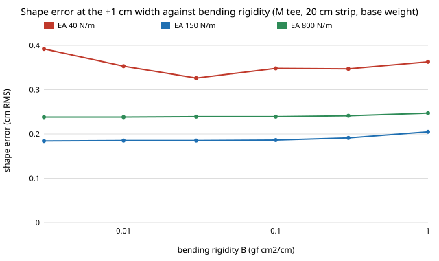

# hanger-sweep: does `hanger-fit`'s "arm 1 cm wider than the half shoulder" survive when its assumed fabric constants are swept two orders of magnitude?

**Yes for bending rigidity, weight and strip depth; no for very stretchy fabric under load. In 162 garments (size M tee: bending rigidity B 0.003 to 1 gf·cm²/cm, weight ×0.5 to ×2, stretch stiffness EA 40 to 800 N/m, strip depth 10 to 30 cm) the best arm half-width is the half shoulder + 1 cm in 151 and + 2 cm in 11; all 11 have EA = 40 N/m (a knit-like stretch; 10 of them at double weight, 1 at base weight), where the best error is 0.9 to 1.7 cm instead of about 0.2 cm. For child and XXL tees, varying one constant at a time never moves the best width off + 1 cm.** B alone changes the best error by under 10% (median 0.23 to 0.25 cm over a 330-fold range). Produced with AI assistance (Claude). Track 18 (`hanger`, `PROJECTS.md`), a robustness check on milestones 1 and 4. The sweep is the result; the constants it varies are still unmeasured.

**Live page:** https://duncan-haywood.github.io/oss-monorepo/research/hanger-sweep/



## Why this question

The owner's rule for research here (2026-10-21, `research/CLAUDE.md`, "Run the numbers") is to source each parameter that drives a result, or sweep the plausible range and report whether the conclusion survives. `hanger-fit` and `hanger-3d` use round-number fabric constants (`FABRICS`, `DEPTH` in `hanger_fit/model.py`) and say so. This run tried to replace them with published Kawabata (KES-FB) values and could not: outbound access in the run container reached only a search tool, and no search result showed a table of B and weight per fabric that could be assigned to a garment type. So it takes the second route and sweeps.

## What is sourced

- **B range.** A US patent on cotton fabric (US 5,427,156, "Cotton fabric made from spun yarns of high fiber length and fineness") gives the average KES-FB2 bending rigidity of knit cotton as 0.002 to 0.050 gf·cm²/cm. This came from a search-result excerpt; the patent was not opened in this run. The sweep (0.003 to 1.0) spans that and extends 20× above it to cover wovens and a knitted sweater, whose values are *not* sourced.
- **EA, weight, strip depth.** Not sourced. The ranges (EA 40 to 800 N/m, weight ×0.5 to ×2, depth 10 to 30 cm) bracket `hanger-fit`'s three fabrics' stretch values and a plausible torso strip; they are wide on purpose, not measured.
- Next step for the sourcing: `Kawabata (1980)` and the KES-FB reference tables in a library with full text, or a measured `B`/`EA` from the owner's fabrics ("Owner steps" in `PROJECTS.md`, milestone 8).

## Builds on

`hanger-fit` (this repository): garments, hangers, worn shape, score and L-BFGS solver, imported unchanged; only a garment's `B`, `EA` and weights and the module's `DEPTH` are overridden. Kawabata (1980), KES-FB, is the source of the unit for B. Citations were not re-checked online in this run. **Lab tags:** none.

## Method

`src/hanger_sweep/sweep.py`. The hanger is `hanger-fit`'s wood-shaped stock hanger (slope 16°, bow 0.8 cm, r 2 cm) with its half width replaced by the garment's half shoulder + an offset in {−2, −1, 0, +1, +2, +3, +4} cm. The score is the shape error (cm RMS) with no crease charge, so the offset grid is the only design variable. Section A is a full factorial on the size M tee: 6 B × 3 weight × 3 EA × 3 depth = 162 garments × 7 offsets. Section B varies one constant at a time for the child and XXL tees (the extreme sizes of `hanger-fit`).

## Results (all from `experiments/results.txt`; headline counts by `experiments/analyse.py`)

- **A. Best offset.** +1 cm in 151 of 162 garments; +2 cm in 11. All 11 have EA = 40 N/m. By B the +2 cases split 2/3/2/1/2/1 across the six values (lowest B first): B does not drive them. By weight: 0 of 54 at ×0.5, 1 of 54 at ×1 and 10 of 54 at ×2. By depth: 7 at 10 cm, 4 at 20 cm, 0 at 30 cm. So the shift needs a soft fabric that is heavy or on a narrow strip: it stretches under its own weight and hangs lower, and a wider arm holds it.
- **A. Error at the best offset.** 0.18 to 1.68 cm over the 162; median 0.23 cm for each B except 0.25 at B = 1. Median by EA: 0.39 (40), 0.21 (150), 0.24 (800). Using +1 cm where +2 is best costs up to 0.69 cm.
- **B. Child and XXL.** The best offset is +1 cm in every one-at-a-time run (12 each). The best error stays 0.19 to 0.49 cm; the largest is XXL at EA = 40 (0.49 cm).

What this does not change: the design finding (custom or adjustable-width hangers beat a universal one) in `hanger-fit` depends on width mismatch of several cm, far above the 0 to 0.7 cm shifts seen here.

## Limitations

- Only the width finding of `hanger-fit` is re-scored, on one hanger shape, in the 2D chain model, for tees only. The sweep does not re-run the CMA-ES design loop, the stock-hanger ranking, the shirt or sweater fabrics, or the `hanger-3d` strip.
- The ranges are not drawn from measured garments; B, EA, weight and depth vary independently, although real fabrics tie them together (a heavy knit is usually also soft). The corners of the grid may not exist.
- The width grid is 1 cm: the true optimum can lie between points.
- One start per drape (L-BFGS), as in `hanger-fit`.

## Reproduce

```bash
cd research/hanger-sweep
python3 -m unittest discover -s tests          # 4 tests, ~4 s; needs numpy
python3 experiments/run.py                     # writes results.txt, ~8 min on 4 cores
python3 experiments/analyse.py                 # headline counts quoted above
python3 experiments/figure.py                  # writes experiments/err_vs_B.svg
```

## Next steps

1. Source B, EA and weight per fabric from KES-FB tables with full text, and rerun with measured combinations instead of a factorial.
2. Re-run the `hanger-fit` CMA-ES loop with the EA = 40 corner, to see whether the best hanger shape (not only width) changes.
3. Add friction and the `hanger-3d` strip.

## Outside dependencies

NumPy. `hanger-fit`'s model and solver are used unchanged.
