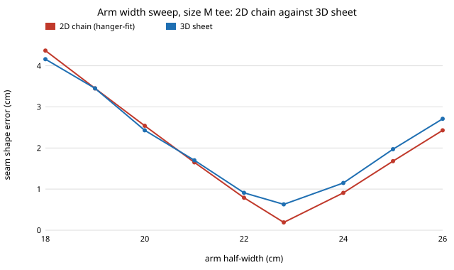

# hanger-wrap: does a second, independent 3D cloth model wrapped over the hanger arm agree with the 2D hanger drape?

Does the 2D hanger drape of [`hanger-fit`](../hanger-fit) survive a 3D cloth model with front and back panels? **On the cases both can run, yes for the design question and partly for the numbers. A 3D mass-spring sheet picks the same best arm half-width as the 2D chain (22.8 cm for a size M tee) and its error follows the 2D error across a width sweep (correlation 0.994), though it reads 0.1 to 0.4 cm higher near the optimum. It also shows what 2D cannot: the cloth bends across the arm, 119 deg/cm over a 0.5 cm arm against 34 deg/cm over a 2 cm one. It disagrees on a heavy knit over a thin arm (17.8 cm error against 5.6 cm), and the result moves with grid spacing (1.19 cm at 1 cm spacing, 0.62 cm at 0.5 cm), so it is not grid-converged.** Produced with AI assistance (Claude). Track 18 (`hanger`, `PROJECTS.md`). Milestone 4 (the 3D drape) was landed by [`hanger-3d`](../hanger-3d) while this was being built; this is a second, independently written model, kept as a cross-check, which differs in one way: the sheet is wrapped over a round arm (so it bends across the arm) rather than hung from a line of given depth. Every number is from a stylised simulation with assumed fabric constants, not a measurement of real garments.

**Live page:** https://duncan-haywood.github.io/oss-monorepo/research/hanger-wrap/



## Why this question

Milestone 1 (`hanger-fit`) designed hangers with a 2D chain along the shoulder seam that stands for a strip 0.20 m wide. Its conclusions (an arm width set per garment, a round end of 2 to 3 cm) rest on that reduction. Milestone 4 asks whether they survive when the front and back panels are real cloth. [`hanger-3d`](../hanger-3d) answers it with a sheet whose arm depth is a parameter. Two independent solvers agreeing is stronger than one, so this one wraps the sheet over a round bar instead, and asks the same question. Where the two overlap they agree on the main point (the 2D design result holds); `hanger-3d` reports 3D matching 2D to within 0.05 cm on a deep arm, while this model reads 0.1 to 0.4 cm higher near the optimum, a gap not explained here.

## Builds on

- [`hanger-fit`](../hanger-fit): the 2D model, the fabric constants, the hanger shapes, the worn-shape target and the L-BFGS solver are imported unchanged.
- Baraff and Witkin (1998), large steps in cloth simulation, SIGGRAPH: cloth as stretch, shear and bend springs with penalty contact. Here the static drape is solved, not time-stepped.
- Kawabata (1980), KES-FB: the unit of the (assumed) bending rigidity.

Citations were not re-checked online in this run. **Lab tags:** none; it builds on no group in `prompt.md`.

## Method

- **Sheet.** A grid of nodes at 0.5 cm spacing: `s` along the shoulder seam and sleeve, `t` across it from -10 to +10 cm, so the two halves are the front and back panels (a flat sheet, not a tailored garment). Stretch springs along both directions, diagonal shear springs at 0.25 of the stretch stiffness (assumed), and a bending energy `kb (1 - cos angle)` along both grid directions. Spring and bending constants come from the same `EA` and `B` as hanger-fit.
- **Same load.** Total mass equals the 2D chain's (within 0.4% on the 0.5 cm grid, tested), spread across the width.
- **Hanger.** The same arm as hanger-fit, now a bar of circular section with a rounded end; contact is a penalty (stiffness scaled to the node area).
- **Neck.** The whole neck row is pinned where it first sits on the arm. A single pinned node, which stands for the whole strip in 2D, overstretched the cloth in 3D (27% strain), so it was replaced.
- **Drape.** L-BFGS from a start in which the sheet is wrapped over the arm and hangs down; 1,500 iterations, then 500 more. `drift` in the results is how much the seam error moved over those last 500, a measure of how far from converged it still is.
- **Scores.** *err* is the seam row's RMS distance from the worn shape, computed as in hanger-fit, so it compares directly with the 2D number. *crease* is the sharpest bend along the seam, *cross* the sharpest bend across the arm, both in deg/cm.

## Results (all from `experiments/results.txt`)

- **A. Stock hangers (size M).** Wood-shaped arm: tee 0.62 cm against 0.38 cm in 2D, shirt 0.43 against 0.36, sweater 6.2 against 3.1. Plastic arm (r = 0.5 cm): tee 3.4 against 3.1, shirt 3.5 against 3.2, **sweater 17.8 against 5.6**, and its seam crease is 7 deg/cm in 3D against 65 in 2D. The wire hanger (r = 0.15 cm) is not run: the grid cannot resolve it.
- **B. Width sweep (size M tee, r = 2 cm).** Both models have their minimum at 22.8 cm, and 2D and 3D errors correlate at 0.994 across nine widths. 3D differs by under 0.5 cm everywhere, and by up to 0.44 cm at the optimum (0.63 against 0.19).
- **C. Arm radius (w = 22.8 cm).** Seam crease agrees for round arms (r 1.5 cm and up: 38.5, 30.1 and 20.0 in 3D against 38.4, 28.8 and 19.2) and is lower in 3D for thin ones (46 against 63 at r = 0.5 cm). The new quantity is across the arm: 119, 59, 42, 34 and 35 deg/cm for r = 0.5, 1, 1.5, 2 and 3 cm.
- **D. Sizes (wood-shaped, tee).** Child 5.6 against 5.3, S 1.0 against 0.5, M 0.6 against 0.4, XXL 2.9 against 3.0.
- **E. Resolution.** At 1 cm spacing the same case gives err 1.19 cm, crease 16 and cross 29, against 0.62, 29 and 49 at 0.5 cm.

## Reading it

The design conclusions of hanger-fit (the width that matches the garment, round ends) hold in 3D. The absolute errors do not transfer to better than a few tenths of a centimetre, and a 2D value should not be quoted as a 3D one. The across-arm bend is a real addition: thin arms crease the panels in the other direction as well, which supports hanger-fit's case for a round end of 2 cm or more (across-arm bend levels off near 34 deg/cm from r = 2 cm).

## Limitations

- **Not grid-converged** (section E): the quantities change with spacing, so cross-bend values are only indicative. A finer grid was not run.
- **Not fully solved.** `drift` reaches 0.15 cm (wood-shaped sweater), and an earlier check on the tee showed seam error wandering between 0.63 and 0.76 cm across 500-iteration chunks. Treat differences below about 0.2 cm as noise.
- **Disagreements not investigated.** The plastic-arm sweater (17.8 against 5.6 cm) and the thin-arm seam crease are unexplained; a frictionless sheet sliding or a contact artefact on a 0.5 cm arm on a 0.5 cm grid are candidates, not findings. Section C's r = 0.5 cm and the plastic hanger sit at the grid's resolution limit.
- The panels are a flat rectangle, with no collar, tailored shape or body, only a seam row is scored against the worn shape, and the across-arm bend has no worn-shape reference. Friction is zero. The pin and shear constants are assumptions.
- One seed-free deterministic drape per case, so there are no intervals.

## Owner steps

None for this model. Measuring real fabrics (milestone 8 of the track) would replace the assumed constants.

## Reproduce

```bash
cd research/hanger-wrap
PYTHONPATH=src python3 -m unittest discover -s tests   # 5 tests
PYTHONPATH=src python3 experiments/run.py              # over 30 min on 4 cores, writes results.txt
python3 experiments/figure.py                          # writes experiments/width_sweep.svg
```

Needs NumPy.

## Outside dependencies

NumPy only. The 2D model, constants and solver come from `hanger-fit` in this repository.
