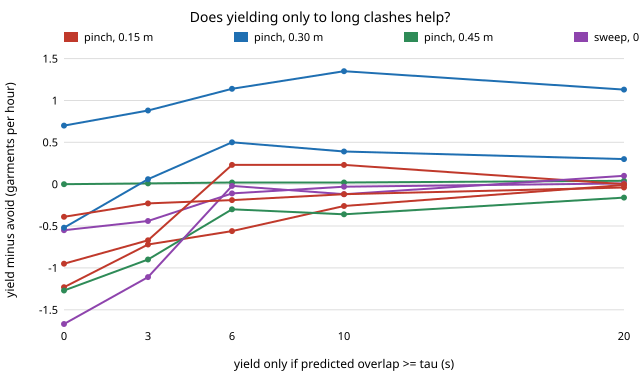

# hanger-yieldcost — should a laundry-hanging arm yield to the other arm's next pick only when the clash would be long? Gating lookahead by predicted overlap, paired on 1000 loads

**Live page:** https://duncan-haywood.github.io/oss-monorepo/research/hanger-yieldcost/

**Live page:** https://duncan-haywood.github.io/monorepo-projects/research/hanger-yieldcost/

[`hanger-lookahead`](../hanger-lookahead) found that steering clear of the other arm's *predicted next* pick loses garments an hour in 14 of 18 settings. Its first next step: yield only when the predicted clash would cost a wait longer than the garment is worth. **Gating the yield by predicted overlap removes most of the loss** (aiming at 0.15 m: −11.3 an hour ungated, −0.2 at a 20 s threshold) **and turns up one real gain: pinching with 0.30 m clearance gains +0.7 to +1.35 garments an hour over avoiding only the current pick, at every threshold from 0 to 20 s (best +1.35, interval 0.93 to 1.80).** In the other 8 settings no threshold gives a gain whose interval excludes zero except hairline cases noted below. Simulated, placeholder inputs.

Track 18 (`hanger`, [`PROJECTS.md`](../PROJECTS.md)). Built on none of the CU Boulder groups in `prompt.md`; no connection is claimed. Produced with AI assistance.



## Method

`src/hanger_yieldcost/yieldcost.py` (stdlib only) imports `hanger-avoid` unchanged and copies the `hanger-lookahead` loop with one change. When an arm starts, it plans its unrestricted pick on a copy of the pile and gets that pick's duration `t0`. The other arm becomes free at `free[o]`, so the overlap the pick would cause is `start + t0 − free[o]`. The lookahead rule (skip garments within `sep` of the other arm's predicted next target) applies only if that overlap is at least `tau` seconds. `tau = −∞` is hanger-lookahead's rule and `tau = ∞` is hanger-avoid; both are tests.

Paired as in hanger-avoidpaired: load *i* uses seed *i* for every `tau`; difference = done/h yielding − done/h avoiding the current pick only; 95% percentile bootstrap (2000 resamples) over 1000 loads. Two arms, load 25, clearances 0.15 / 0.30 / 0.45 m, thresholds −∞, 0, 3, 6, 10, 20 s, unlimited window, policies see (aiming), sweep, pinch. Pick times, clearance and pile are the `hanger-pick`/`hanger-cell` placeholders (nothing here measures a robot).

Tests (5): `tau = −∞` equals hanger-lookahead's pick sequence, `tau = ∞` equals hanger-avoid's with zero lookahead redirects, redirects never rise as `tau` rises, every garment is picked once, runs are deterministic.

## Results (`experiments/results.txt`, about 10 minutes)

Mean paired difference in garments done per hour against avoiding only the current pick (95% interval). Redirects per load by the lookahead rule fall from 4 to 15 (ungated) to 0.01 to 1.9 at 20 s.

| policy | sep (m) | tau −∞ | tau 0 | tau 3 | tau 6 | tau 10 | tau 20 |
|---|---|---|---|---|---|---|---|
| see | 0.15 | −11.26 | −1.27 | −0.90 | −0.30 | −0.36 | −0.16 |
| see | 0.30 | −4.13 | −1.67 | −1.11 | −0.02 | −0.12 | +0.10 |
| see | 0.45 | −0.43 | −0.39 | −0.23 | −0.19 | −0.12 | −0.04 |
| sweep | 0.15 | −2.40 | −0.55 | −0.44 | −0.11 | −0.03 | +0.01 |
| sweep | 0.30 | −7.19 | −0.95 | −0.67 | +0.23 | +0.23 | 0.00 |
| sweep | 0.45 | −2.46 | −0.52 | +0.06 | +0.50 | +0.39 | +0.30 |
| pinch | 0.15 | −8.13 | −1.23 | −0.72 | −0.56 | −0.26 | −0.01 |
| pinch | **0.30** | −1.58 | **+0.70** (0.25 to 1.18) | **+0.88** (0.41 to 1.35) | **+1.14** (0.68 to 1.60) | **+1.35** (0.93 to 1.80) | **+1.13** (0.77 to 1.50) |
| pinch | 0.45 | −0.11 | 0.00 | +0.01 | +0.02 | +0.02 | +0.04 |

- A higher threshold monotonically cuts the redirects and the loss; the ungated rule is the worst column everywhere.
- Only pinching at 0.30 m has a positive interval at five thresholds. Sweeping at 0.30 to 0.45 m shows +0.2 to +0.5 whose intervals include zero (best: 0.45 m, tau 6, +0.50, −0.15 to 1.20). With 54 intervals, a few would exclude zero by chance; the pinch row is the only one that does so consistently and at neighbouring thresholds, but treat it as one setting out of nine, not a general rule.
- The threshold is a tuned parameter swept after seeing the earlier negative result; the pinch gain does not depend on one value (it holds from 0 to 20 s).
- Why (interpretation, not tested): pinching has the longest and most variable picks, so a clash overlaps for long and the other arm's own avoidance costs more than the yielder's detour; short picks (aiming) rarely overlap enough to be worth a detour.

## Limitations

- Placeholder clearance, station times and pile (as hanger-avoid); one predictor (the policy on a copy of the pile). Unlimited window only.
- The overlap estimate uses the arm's own pick time; a real wait would also depend on the other arm's actual choice.
- Says nothing about a real dryer or robot; clearance of a real two-gripper cell is an owner measurement.

## Reproduce
```bash
cd research/hanger-yieldcost
python3 -m unittest discover -s tests      # 5 tests
python3 experiments/run.py                 # writes results.txt (about 10 min; argument = loads per cell)
python3 experiments/figure.py              # writes experiments/yieldcost.svg
```

## Next steps
Replace the placeholder pick times with measured ones and repeat the pinch 0.30 m case; learn the threshold per policy from a held-out set of loads rather than sweeping it; measure real two-gripper clearance (owner step).

## Outside dependencies
Real arm clearance and station times (owner step: measure); everything else runs here.
