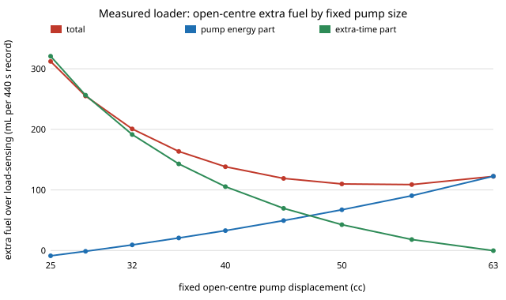
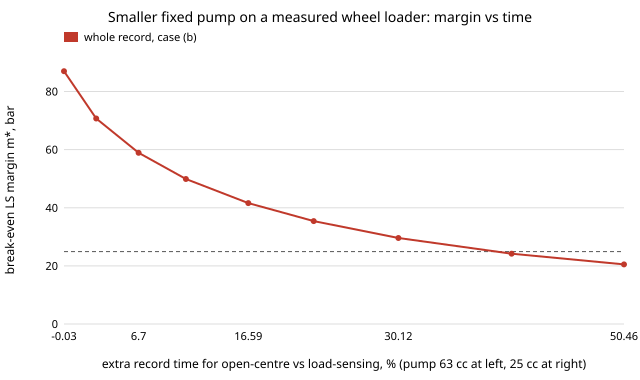

# Which open hydraulic circuit gets a small excavator closest to stock energy use for the least money?

**Status: open research programme. Milestones 1 to 5 have landed in steps (2a to 5x); a measured excavator pressure trace (5y) and a flow trace from joint motion (5z) now exist, but no excavator fuel record, so H4 is still open; the paper draft (milestone 6, [`paper/draft.md`](paper/draft.md)) is current to 6b.** The first step was a stdlib energy model
of three excavator hydraulic circuits (fixed open-centre, load-sensing, ideal independent
metering) over a work cycle (`src/heavy_hydraulics/`, 6 tests) and a first sweep of 2,916 cases
on an illustrative cycle: load-sensing uses a median **47%** of open-centre pump-shaft energy
(range 22 to 81%), and ideal independent metering a median 80% of load-sensing. The ordering
holds in every case, but only because each rung removes a loss term; the cycle and margins are
not sourced, so this is a first-order calculation, not a measurement of any machine.
See [`PROPOSAL.md`](PROPOSAL.md) and [`LOG.md`](LOG.md).

**Paper (milestone 6, 2026-11-12):** the draft now leads with the measured loader: no fixed open-centre pump from 25 to 63 cc matches load-sensing fuel per unit of work (best 53.5 cc, 11.5% more), and the break-even margin is the volume ratio times the surplus-flow pressure (99.5 bar), not the working pressure. Rerun from the Zenodo record, 5t to 5x reproduce their committed results byte for byte. Sections 3.7 and 3.7b add the two excavator results (5y pressure, 5z volume ratio), which together put the break-even margin near 139 bar, and `python3 paper/check_numbers.py` checks every quoted number (183) against the results file it cites. Since 2026-11-12 `python3 paper/build_tex.py --pdf` builds the draft as a 10-page two-column LaTeX paper with numbered references from [`paper/refs.bib`](paper/refs.bib) with all 21 sources the draft names (theses, valve and pump manuals, the XCMG brochure, Reece) as numbered references (the 10 non-DOI ones noting whether each was opened), and each of the four figures numbered once with its own caption (the journal's own template and the author line are still to do; [`LOG.md`](LOG.md)).

**Latest (6a, 2026-11-12): can a smaller fixed pump close the gap on an excavator? On pump energy, yes, for about 11% more cycle time.** On 5z's derived demand of the 7.5 t class XCMG excavator, a fixed open-centre pump matches load-sensing pump energy (break-even margin equal to a 20 bar margin sold, at 130 bar) at **108 L/min, half the stock 219 L/min pump**, and the machine then takes **1.114 times** load-sensing's time (1.069 to 1.191 over margins of 14 to 25 bar and pressures of 100 to 174 bar; 1.05 to 1.69 across 384 lever, bucket-sign and swing assumptions). The same trade cost the measured loader 39%: the excavator's demand is peaky (median 90, p99 240 L/min), so a half-size pump slows only the peaks. Predictions A1, A5 and A6 held; A2, A3 and A4 (more than 1.25 times, more than the loader, above 1.10 everywhere) were refuted. Fuel is still untested: these files carry no fuel or engine signal, and on the loader the fuel price of extra time is what kept open-centre behind. Script: [`experiments/measured_excavator_pump_size.py`](experiments/measured_excavator_pump_size.py), output: [`experiments/measured_excavator_pump_size_results.txt`](experiments/measured_excavator_pump_size_results.txt), detail in [`LOG.md`](LOG.md) and paper section 3.7c.

**5z (2026-11-12): how much more flow does a fixed pump push than an excavator uses? About 2.4 times.** On ten truck-loading recordings (16 min) of a 7.5 t class XCMG excavator from the same Hugging Face dataset (folder `75`, joint angles and speeds), turned into cylinder flow with the XE80E's published cylinder sizes (shared with the XE75U), a fixed pump sized for the machine's p99 demand delivers **2.38 times** the volume the work needs (95% bootstrap over files 2.34 to 2.42; 1.95 to 3.08 across lever, bucket-sign and swing assumptions), against 1.79 on the measured loader and 1.43 on the synthetic cycles. Without swing, the p99 cylinder demand comes out at 218.8 L/min, the machine's published 219 L/min pump maximum, with no fitting. With 5y's pressure, the break-even load-sensing margin is **70 to 140 bar**, several times the 14 to 25 bar margins sold. Two of three cylinder signs come from the dataset's own kinematics script; the flow and pressure halves come from different machines, and fuel (H4) is still untested. Predictions Z2 and Z5 held; Z1 (narrowly), Z3 and Z4 were refuted. Script: [`experiments/measured_excavator_flow.py`](experiments/measured_excavator_flow.py), output: [`experiments/measured_excavator_flow_results.txt`](experiments/measured_excavator_flow_results.txt), detail in [`LOG.md`](LOG.md).

**5y (2026-11-12): how hard does a real excavator work its hydraulics? About five times the force model's pressure.** On ten truck-loading recordings (76.7 min) of a large excavator from the Hugging Face dataset [`fuxi-robot/excavator-motion`](https://huggingface.co/datasets/fuxi-robot/excavator-motion) (CC BY-NC-SA 4.0; read by HTTP range requests, nothing redistributed), the highest of seven live pressure channels has a median of **174 bar while the arm moves** (95% bootstrap over files 167 to 180 bar), **5.3 times** the 33 bar of this programme's force model and 1.3 times the measured loader's 134 bar. The reading holds within 4 bar across motion thresholds and row pairings. The channels are unlabelled, so this is an upper reading of the highest load pressure. As a share of the machine's own top pressure it is 0.39 to 0.43, against 0.18 for the force model, which puts a 180 bar small machine at 71 to 78 bar. Fed into the programme's break-even rule at the synthetic volume ratio, the margin a load-sensing pump may carry and still win rises from about 11 bar to 24 to 59 bar, so the synthetic break-evens understated load-sensing's case. Predictions: Y1, Y2 and Y4 held; Y3 (one channel acts as the pump) and Y5 (within 30% of the loader; it came out at 1.30 times) were refuted. The files carry no flow, so the volume ratio on an excavator is untested. Script: [`experiments/measured_excavator.py`](experiments/measured_excavator.py), output: [`experiments/measured_excavator_results.txt`](experiments/measured_excavator_results.txt), detail in [`LOG.md`](LOG.md) and paper section 3.7.

**Earlier (5o, 2026-11-11): load-sensing vs open-centre on a measured machine, with the motion threshold measured.** On a public 440 s trace of a 6 t load-sensing wheel loader loading gravel (Linjama et al., Zenodo [10.5281/zenodo.10639199](https://doi.org/10.5281/zenodo.10639199), CC BY 4.0), the measured load-sensing margin is a median **24.9 bar** and the model's load-sensing rung reproduces measured pump energy to **2.3%** (5n). A fixed-pump open-centre circuit on the same motion needs at least **1.37 times** the load-sensing pump energy whatever its bypass closing law, and **1.54 times** (per-cycle 1.46 to 1.63) with a 10 bar spool drop, adding **14.7%** to fuel, now that the small-flow threshold 5n chose is measured from the data (0.80 L/min lift, 1.76 L/min tilt). See "Milestone 5o" below. **5p (same day):** the 6 bar open-centre spool drop used in the force-model cycles since 2d sits just above the least drop any Danfoss PVG 32 section could have at those flows (4.8 to 5.3 bar), so the earlier ranking stands (load-sensing ahead at a 14 bar margin; break-even 26.5 to 27.2 bar instead of 28.0); see "Milestone 5p". **5q (same day):** sized once per function, as real valves are, the floor drops to 2.3 bar and the break-even to **23.0 bar**; with no open-centre drop at all it is **20.6 bar**, so a 14 bar load-sensing margin beats any open-centre valve here, while 25 bar margins (thesis model; the measured loader's 24.9) sit where the real partial-lever drop decides; see "Milestone 5q". **5r (same day):** on the measured loader the PVG 32 floor moves open-centre only from 1.40 to **1.42 times** load-sensing pump energy (11.3% more fuel), so there the penalty is structural, not the spool; the bracket is 1.42 to 1.54 (11 to 15% fuel); see "Milestone 5p". **5t (same day):** the measured loader's own **break-even load-sensing margin is 87 bar** (per Y-cycle 59 to 143 bar, median 81), against 20 to 30 bar on the synthetic excavator cycles, so its 24.9 bar margin uses under a third of the headroom; about 90% of it is surplus flow from a fixed pump sized for peaky demand; see "Milestone 5t". **5u (same day):** the break-even margin splits exactly into a pump-to-demand **volume ratio r** times a **load pressure**: m* = beta [(r &minus; 1) p + covariance + r d] + idle. On the synthetic cycles r = 1.43 and the demand-weighted load pressure only 33 bar, so (r &minus; 1) p is 12 bar; idle bleed adds 8, so dropping it (a "two-number rule") reads 31% low. r ranks cycles (Spearman 0.77), the load pressure does not (0.12). It also says why the synthetic and measured break-evens differ fourfold: r 1.43 against 1.78, and load pressures that would need to be about three times higher on the loader; see "Milestone 5u". **5v (2026-11-12):** on the measured loader that "working pressure near 100 bar" turns out not to be the working pressure: the demand-weighted load pressure is **134 bar**, and the pressure-flow covariance is **&minus;27 bar**, because the fixed pump's surplus flow comes when demand, and pressure, are low. The exact form uses the pressure the surplus is pushed at, p<sub>s</sub> = **99.5 bar**: m* = beta [(r &minus; 1) p<sub>s</sub> + r d] + idle. Plugging the working pressure in instead overstates the loader's break-even by about 30%; r alone ranks its 18 cycles (Spearman 0.92); see "Milestone 5v". **5w (2026-11-12):** a smaller fixed open-centre pump is the obvious counter, and on the measured loader it does not come cheap: to bring the break-even down to the machine's own 24.9 bar margin the pump must shrink from 63 to about **28.5 cc**, and open-centre then needs about **39% more cycle time** than load-sensing (per Y-cycle 27 to 54%); any pump of 40 cc or more still loses on energy, already 17% slower; see "Milestone 5w". **5x (2026-11-12):** priced in fuel from the record's own ECU fuel rate, that trade has no winning pump size: with the extra time charged at the rest of the machine's measured 5.15 L/h, open-centre burns **11.5% more fuel** than load-sensing for the same work at its best fixed pump (**53.5 cc**), 13.0% at the stock 63 cc and **26%** at the 28.5 cc energy-parity pump; no size from 25 to 63 cc, no efficiency from 0.75 to 0.95 and none of the 18 Y-cycles breaks even; see "Milestone 5x".

**Live page:** https://marisstella.app/research/heavy-hydraulics/

**Programme.** Track 25 (`heavy`, open-source construction, mining and heavy equipment) in
[`../PROJECTS.md`](../PROJECTS.md), milestone 2. Related labs: the repository's robotics and
autonomy groups (ARPG, RECUV, HIRO) for the later autonomy milestones; no lab has reviewed this.

**Safety.** Heavy machines kill. This is simulation and arithmetic, not a design, a
certified machine or a safety system. Nothing here was run on a real machine.

## Reproduce

```bash
cd research/heavy-hydraulics
PYTHONPATH=src python3 -m pytest tests -q                      # 49 tests (numpy-free)
python3 experiments/run.py > experiments/results.txt           # 2,916 cases, under 5 s
python3 experiments/envelope.py > experiments/envelope_results.txt  # 20,000 random cycles
python3 experiments/idle_sensitivity.py > experiments/idle_sensitivity_results.txt  # milestone 2f, ~20 s
python3 experiments/idle_models.py > experiments/idle_models_results.txt  # milestone 2g, ~60 s
PYTHONPATH=src python3 experiments/regen_bound.py > experiments/regen_bound_results.txt  # milestone 5a, ~10 s
python3 experiments/regen_peaky.py > experiments/regen_peaky_results.txt  # milestone 5e, under 1 s
python3 experiments/spool_floor_synthetic.py                 # milestone 5p, 14 s
python3 experiments/spool_function_sizing.py                 # milestone 5q, 32 s
python3 experiments/spool_floor.py <Short_Y_cycle_data.mat>  # milestone 5r, 3 s (numpy, scipy; Zenodo 10639199)
python3 experiments/measured_breakeven.py <Short_Y_cycle_data.mat>  # milestone 5t, 3 s (numpy, scipy)
python3 experiments/breakeven_volume_ratio.py                # milestone 5u, 2 s (stdlib)
python3 experiments/measured_volume_ratio.py <Short_Y_cycle_data.mat>  # milestone 5v, 3 s (numpy, scipy)
python3 experiments/measured_pump_size.py <Short_Y_cycle_data.mat>  # milestone 5w (numpy, scipy)
python3 experiments/measured_fuel_time.py <Short_Y_cycle_data.mat>  # milestone 5x, 20 s (numpy, scipy)
python3 experiments/fuel_time_figure.py                      # figure for 5x
python3 paper/check_numbers.py                               # milestone 6: every number in paper/draft.md against its results file
python3 paper/build_tex.py --pdf                             # milestone 6: draft.md as a two-column LaTeX paper with BibTeX (paper/build/main.pdf)
python3 experiments/measured_excavator_flow.py [cache dir]           # milestone 5z, 6 s from cache (numpy, h5py; Hugging Face range reads)
python3 experiments/measured_excavator_pump_size.py [cache dir]      # milestone 6a, 24 s on first run (numpy, h5py; Hugging Face range reads)
python3 experiments/regen_measured.py <dir of the CC BY PATU 655 crane data, doi 10.17632/rn5j42rpyr.1>  # milestone 5g, needs numpy
```

## Method

Each phase of the cycle lists actuator load pressure (bar) and demanded flow (L/min). Hydraulic power
is `p * Q / 0.6` W. Open-centre: the pump delivers full flow at the highest load pressure plus a
spool drop. Load-sensing: summed demand at the highest load pressure plus a margin. Metered: each
actuator at its own pressure plus a small drop. Shaft energy divides by pump efficiency.

## Results

See [`experiments/results.txt`](experiments/results.txt) and the log. Swept: flow demand,
pressure spread, pump size, load-sensing margin (14 to 30 bar), spool drop, metering drop,
pump efficiency (0.75 to 0.92). None is sourced yet.

**Milestone 5c, the electric rung (preliminary).** Against a vendor runtime claim (Volvo ECR25 Electric: 20 kWh for up to 4 h, a 5 kW mean draw; [product page](https://www.volvoce.com/europe/en/products/electric-machines/ecr25-electric/)), the modelled duty cycle (load factor 0.346) needs only 2.5 to 4.3 kW at the battery for a chain efficiency of 0.80 to 0.92, so 20 kWh would last 4.7 to 8.0 h. The model sits 1.2 to 2x below the vendor's mean draw; what it omits (travel, auxiliaries, heavier duty) or vendor conservatism cannot be separated with this data. The circuit ranking is unchanged by electrification because the chain efficiency is common to both circuits. Table: [`experiments/electric_rung_results.txt`](experiments/electric_rung_results.txt); detail in [`LOG.md`](LOG.md).

## Limitations and next steps

Illustrative cycle written from memory; no dynamics, leakage, line losses or energy recovery;
no parts cost; references web-searched, not cite_check-ed. Next: a sourced duty cycle (earthmoving equation or a
public measured cycle), then parts cost with [`heavy-market`](../heavy-market/) (step 1a, used-price depreciation and size scaling from real auction data, landed 2026-11-10).

## Milestone 6b: a smaller fixed pump beats load-sensing on excavator fuel only if the rest of the machine burns under about 2.5 L/h

6a found that on measured excavator motion (Hugging Face `fuxi-robot/excavator-motion`, folder 75, CC BY-NC-SA 4.0, derived statistics only) a fixed open-centre pump of 108 L/min matches load-sensing pump energy for 11% more time. The files carry no fuel signal, so instead of pricing that time with a borrowed rate, 6b asks for the **break-even rate**: how much fuel the rest of the machine may burn per hour of extra working time before load-sensing wins again ([`experiments/excavator_fuel_breakeven.py`](experiments/excavator_fuel_breakeven.py), [results](experiments/excavator_fuel_breakeven_results.txt), 2 s, stdlib; C1 to C5 registered first in [`LOG.md`](LOG.md), four held).

It needs no raw data, because of an identity: a fixed pump runs flat out over the stretched time, so its pumped volume is pump flow times open-centre moving time, and the time ratio is a function of the volume ratio alone, tau = (phi + r mu / q<sub>p</sub>) / (phi + r<sub>LS</sub> mu / 219). It reproduces all 20 of 6a's committed time ratios within 0.0012 ([`measured.time_ratio_from_r`](src/heavy_hydraulics/measured.py), tested against the direct sum). Between 6a's pump sizes the volume ratio is bracketed by convexity.

| Fixed pump (L/min) | 60 | 70 | 80 | 87.6 | 95 | 102 | 107 |
|---|---|---|---|---|---|---|---|
| break-even rest-of-machine rate (L/h) | 0.92 to 1.41 | 1.25 to 2.18 | 1.78 to 2.41 | 2.46 | 2.19 | 1.37 to 1.38 | 0.28 |

At a 20 bar margin and 130 bar working pressure the threshold peaks at **2.46 L/h**, with a pump of 0.40 of stock. Over margins of 14 to 25 bar, pressures of 100 to 174 bar, and the loader's fuel slope and pump efficiency swept (0.20 to 0.26 L/kWh, 0.75 to 0.95), it runs from 1.16 to 5.24 L/h. On the loader the same threshold is 0.14 L/h, under a tenth of the loader's lowest measured fuel rate (1.48 L/h), which is why 5x found no winning pump there. At the loader's rest-of-machine rate (5.15 L/h, which includes driving and so overstates an excavator's) the best excavator pump is 100.4 L/min and still burns 0.515 L more per hour than load-sensing.

For a builder: on a peaky excavator duty, whether a cheap fixed pump at about 40% of stock flow beats load-sensing on fuel comes down to one number from the engine maker, the no-load fuel rate at working speed. Below about 2.5 L/h the fixed pump wins; above it, load-sensing does. Limits: fuel slope, efficiency and the break-even rule are the loader's; flow and pressure come from different machines; time is priced in fuel only, and charging operator hours would favour load-sensing.

## Milestone 5x: open-centre fuel per unit of work on the measured loader is 11 to 13% above load-sensing whatever the pump size

5w priced a smaller fixed open-centre pump in cycle time. Here both sides of the trade go into litres from the record's own ECU fuel signal (Zenodo [10.5281/zenodo.10639199](https://doi.org/10.5281/zenodo.10639199), CC BY 4.0): extra fuel = b (E<sub>OC</sub> &minus; E<sub>LS</sub>) / eta + f<sub>t</sub> (T<sub>OC</sub> &minus; T<sub>LS</sub>), with b = 0.2332 L/kWh the record's Willans slope (5n), eta = 0.818 the measured pump hydraulic over the authors' shaft-power estimate, load-sensing at the measured 24.9 bar margin, and f<sub>t</sub> the fuel rate of the rest of the machine over the extra time, read from the record three ways: 5.15 L/h (average less the work pump's share, central), 5.99 L/h (while the work hydraulics are still) and 1.48 L/h (5th percentile, near idle) ([`experiments/measured_fuel_time.py`](experiments/measured_fuel_time.py), [results](experiments/measured_fuel_time_results.txt), 20 s; [`measured.extra_fuel`](src/heavy_hydraulics/measured.py), 1 test). The same motion is the same work, so this is fuel per unit of work. X1 to X5 were registered before the code ([`LOG.md`](LOG.md)); four held.

| Fixed pump (cc) | 63 | 56 | 50 | 45 | 40 | 36 | 32 | 28.5 | 25 |
|---|---|---|---|---|---|---|---|---|---|
| pump-energy part (mL per record) | 122.6 | 90.5 | 67.2 | 49.4 | 32.9 | 20.7 | 9.3 | 0.0 | &minus;8.7 |
| extra-time part (mL per record) | &minus;0.2 | 18.2 | 42.6 | 69.6 | 105.4 | 142.9 | 191.4 | 246.9 | 320.7 |
| open-centre / load-sensing fuel | 1.130 | 1.115 | 1.117 | 1.126 | 1.147 | 1.174 | 1.213 | 1.262 | 1.331 |



The best fixed pump is **53.5 cc** (central), still **11.5%** above load-sensing (10.2 to 12.7% across eta 0.75 to 0.95 and the two higher time rates; 6.2 to 6.8% even if the extra time cost only near-idle fuel). No pump size, efficiency or rate makes open-centre win, and none of the 18 Y-cycles has a winning size (per-cycle best a median 54.5 cc, penalty 1.07 to 1.16). One surprise (X5 refuted): the loader burns more fuel while its bucket is still (5.99 L/h) than its rest-of-machine average, because on a Y-cycle it drives while the bucket waits.

For a builder: on a loader-like duty the open-centre fuel penalty is a property of the circuit, not of the pump choice. A smaller pump moves the loss from surplus flow to a longer working day; the curve is flat from about 50 to 63 cc and climbs steeply below 45 cc, and the 28.5 cc pump that matches load-sensing's pump energy costs 26% more fuel per unit of work. Limits: the extra time is charged at a constant measured rate, not simulated; one eta for both pumps (a fixed pump at full stroke is likely more efficient, which favours open-centre; eta 0.95 gives 10.2%); time costs only fuel here, not operator or machine hours; no payload in the record, so no litres per tonne; one machine, one 440 s record.

## Milestone 5w: a smaller fixed pump on the measured loader buys parity only with 39% more cycle time

5t to 5v kept the loader's own 63 cc pump in the open-centre counterfactual. Here the fixed pump is swept from 63 to 25 cc at the measured engine speed, on the measured 6 t wheel loader (Zenodo [10.5281/zenodo.10639199](https://doi.org/10.5281/zenodo.10639199), CC BY 4.0), in 5t's case (b) (PVG 32 orifice floor). Where the demand exceeds the smaller pump, the actuators slow until the pump delivers the demanded volume; the slowed sample's hydraulic energy is unchanged, so only time is added ([`experiments/measured_pump_size.py`](experiments/measured_pump_size.py), [results](experiments/measured_pump_size_results.txt), 3 s; [`measured.slowed_time`](src/heavy_hydraulics/measured.py), 1 test). Load-sensing is charged its own 63 cc limit, so the time ratio isolates the smaller pump. W1 to W5 were registered before the code ([`LOG.md`](LOG.md)); all five held.

| Fixed pump (cc) | 63 | 56 | 50 | 45 | 40 | 36 | 32 | 28.5 | 25 |
|---|---|---|---|---|---|---|---|---|---|
| break-even LS margin m* (bar) | 87.0 | 70.7 | 58.9 | 49.9 | 41.6 | 35.4 | 29.6 | 24.9 | 20.5 |
| r, pump / demand volume while moving | 1.79 | 1.66 | 1.56 | 1.48 | 1.40 | 1.34 | 1.29 | 1.24 | 1.20 |
| surplus-flow pressure p<sub>s</sub> (bar) | 99.5 | 96.1 | 93.2 | 90.7 | 87.9 | 85.4 | 82.7 | 80.0 | 76.7 |
| open-centre / load-sensing record time | 1.000 | 1.029 | 1.067 | 1.110 | 1.166 | 1.225 | 1.301 | 1.389 | 1.505 |



The trade worsens at every step: the first 7 cc buy 5.6 bar of break-even per percent of time, the last steps under 0.5. Cycles with more spare flow at 63 cc lose less time at 28.5 cc (Spearman -0.69). One data finding on the way: the velocity-derived demand exceeds the 63 cc pump's geometric flow in 16% of moving samples, where the authors' own angle estimate is above full stroke (median 1.055), so the excess is in the derived flows; charging load-sensing the same limit cancels it.

For a builder: on a loader-like duty, an open-centre circuit pays either in energy (a 63 cc pump breaks even only at an 87 bar load-sensing margin) or in productivity (about 39% slower to match the measured margin), not neither. Limits: hydraulic energy only (the engine's losses over the extra time are not charged, which flatters open-centre); slowing by demand share, with no engine speed-up; one machine, one 440 s record.

## Milestone 5v: on the measured loader, the break-even margin needs the surplus-flow pressure, not the working pressure

5u's split, m* = beta [(r &minus; 1) p_q + r (p_Q &minus; p_q) + r d_bar] + I / B, run on the measured 6 t wheel loader (Zenodo [10.5281/zenodo.10639199](https://doi.org/10.5281/zenodo.10639199), CC BY 4.0) in 5t's three open-centre cases ([`experiments/measured_volume_ratio.py`](experiments/measured_volume_ratio.py), [results](experiments/measured_volume_ratio_results.txt), 3 s). V6 was registered in 5u and V7 to V10 at the start of this step, all before the code ([`LOG.md`](LOG.md)).

| Whole record, PVG 32 orifice floor (5t case b) | Loader | Synthetic cycles (5u, median, d = 0) |
|---|---|---|
| r, pump volume / demand volume while moving | 1.793 | 1.433 |
| p_q, demand-weighted load pressure (bar) | 133.9 | 33 |
| p_Q, pump-flow-weighted load pressure (bar) | 118.7 | about p_q |
| covariance term beta r (p_Q &minus; p_q) (bar) | &minus;27.1 | 0.09 |
| p<sub>s</sub> = (r p_Q &minus; p_q) / (r &minus; 1), surplus-flow pressure (bar) | 99.5 | about p_q |
| idle term (bar) | 4.4 | 8.1 |
| exact m* (bar) | 87.0 | 20.5 |
| two-number rule (r &minus; 1) p_q + r d against exact | 30.5% high (median cycle) | 31% low (median) |

V6 is refuted on both counts (p_q 134 bar, not 90 to 115; covariance negative, not positive), and with it V7 (dropping the covariance leaves the moving rule 31% high) and V10 (the two-number rule is 30.5% high per cycle). V8 holds: r ranks the loader's 18 Y-cycles (Spearman **0.92**) and p_q hardly does (0.24), as on the synthetic cycles. V9 holds: beta is 0.995, so idle barely matters on this record.

The repair is exact. With p<sub>s</sub> as defined above, m* = beta [(r &minus; 1) p<sub>s</sub> + r d_bar] + I / B, and when every section load-sensing counts is also moving for open-centre, p<sub>s</sub> is the load pressure averaged over the pump's surplus flow (pump flow minus demand), checked on random traces ([`trace_breakeven`](src/heavy_hydraulics/breakeven.py) `p_s`, 1 new test, 44 in all). On the loader the surplus is largest when demand is low, and low demand comes at lower pressure, so p<sub>s</sub> (99.5 bar) sits 34 bar under the working pressure. 5u's back-inferred "working pressure near 100 bar" was p<sub>s</sub>. For a builder: load-sensing beats a fixed open-centre pump at any margin below about (r &minus; 1) p<sub>s</sub> + r d + idle; using the working pressure for p<sub>s</sub> overstates that on a loader-like cycle, where big flows come at high pressure, by about 30%.

Limits: one machine and one 440 s record; open-centre is the 5o/5r counterfactual on the same motion with the measured 63 cc pump; p<sub>s</sub> depends on 5o's noise-floor motion masks; hydraulic energy only.

## Milestone 5u: the break-even margin is a volume ratio times a load pressure

5s's m* = (S + D + I) / B has an exact split in two numbers a builder knows. Let V be the volume load-sensing delivers while open-centre moves, r the fixed pump's volume over V, p_Q the time-weighted (pump-flow-weighted) highest load pressure while moving, p_q the demand-weighted one and beta = V / B. Then S = V (r p_Q &minus; p_q), so

    m* = beta [ (r - 1) p_q  +  r (p_Q - p_q)  +  r d_bar ]  +  I / B

with no approximation ([`breakeven.decompose`](src/heavy_hydraulics/breakeven.py) and new fields on `trace_breakeven`, 3 tests; [`experiments/breakeven_volume_ratio.py`](experiments/breakeven_volume_ratio.py), [results](experiments/breakeven_volume_ratio_results.txt), 2 s, same 3,000 cycles as 5s). Predictions V1 to V6 were committed before the code ([`LOG.md`](LOG.md)).

| Term of m* at zero spool drop (bar) | Median | 5 to 95% |
|---|---|---|
| beta (r &minus; 1) p_q, surplus flow at the typical load pressure | 12.2 | 6.0 to 23.5 |
| beta r (p_Q &minus; p_q), pressure-flow covariance | 0.09 | &minus;4.2 to 4.5 |
| I / B, idle bleed net of LS idle work | 8.1 | 2.1 to 14.0 |
| exact m* | 20.5 | 10.7 to 34.1 |

r has median **1.43** (V1 held: 1.35 to 1.55) and p_q median **33 bar**. The covariance term averages out but not per cycle (median |term| 11% of the surplus part, V2 refuted narrowly at 10%). The two-number rule R2 = (r &minus; 1) p_q + r d, which leaves out idle bleed and beta, reads **31% low** at zero drop and 18% low at 6 bar (V3 refuted at 25%); with the idle term put back (everything but the covariance) it is within a median **6.4%** of the exact margin. R2 ranks cycles well (Spearman 0.74 and 0.81, V4 held), but it calls the winner at a 25 bar margin right in only 68% of cycles at a 6 bar drop (96% at 14 bar; V5 refuted), because the 8 bar idle term is the size of the gap being judged. r alone ranks cycles as well as R2 (Spearman 0.77) and p_q hardly at all (0.12): in this force model load pressures vary only from 24 to 46 bar, so the cycle's flow profile sets the answer.

Why the synthetic and measured break-evens differ (20.5 against 82.9 bar at no drop): the loader's r is 1.78 (5t), so (r &minus; 1) is 1.8 times the synthetic 0.43, and its surplus term (78 bar, 5t) then implies a typical load pressure near 100 bar, about three times the force model's 33. That inference is V6, registered for the next run that reaches Zenodo (it was refused by the proxy in this one). For a builder: load-sensing beats a fixed open-centre pump at any margin below about beta (r &minus; 1) p + r d + idle, where r is pump volume over the volume the work needs while moving and p the working pressure; on a peaky machine at 100 bar that is far above any LS margin sold, on a light, smooth cycle at 30 bar it is near 20.

## Milestone 5t: the measured loader's own break-even margin

5s's formula m* = (S + D + I) / B, run on the measured wheel loader's 440 s trace with load-sensing as 5n's constant-margin model on the measured demand and open-centre as 5o/5r's counterfactual on the same motion with the same 63 cc pump ([`experiments/measured_breakeven.py`](experiments/measured_breakeven.py), [results](experiments/measured_breakeven_results.txt); [`breakeven.trace_breakeven`](src/heavy_hydraulics/breakeven.py), 2 tests).

| Open-centre counterfactual | Whole record m* | Per Y-cycle median (min to max) | Surplus-flow share |
|---|---|---|---|
| (a) no spool drop, 5 bar neutral | 82.9 bar | 76.9 (54.9 to 139.4) | 94% |
| (b) PVG 32 full-travel orifice floor, 5 bar neutral | 87.0 | 81.2 (59.0 to 143.0) | 90% |
| (c) 10 bar spool drop, 10 bar neutral | 105.5 | 99.0 (75.3 to 168.9) | 74% |

The machine runs at a measured 24.9 bar median margin (21.3 bar as the constant margin that costs what it spent), so load-sensing wins every cycle with 34 bar or more to spare. One bar of open-centre spool drop is worth 1.78 bar of margin here (1.235 on the synthetic cycles): the ratio of the fixed pump's mean flow (93.8 L/min) to the mean demand while moving (52.7 L/min). Demand still exceeds the fixed pump in 23% of moving samples, so the loader's flow is peaky and a fixed pump sized for it wastes most of its flow. Registered: T1 (50 to 80 bar) refuted at 87.0; T2, T3, T5 held; T4 (standby flow) held vacuously, because the flow channels' noise floor means load-sensing never sees a still sample. The comparison keeps the loader's own pump size; a smaller open-centre pump would lower m* at a cycle-time cost, the next step.

## Milestone 5s: the break-even margin in closed form

In this model load-sensing energy is affine in its margin and open-centre energy does not depend on it, so each cycle has an exact break-even margin

    m* = (S + D + I) / B

with S the surplus pump flow dropped at the highest load pressure while moving, D the pump flow times the open-centre spool drop while moving, I the neutral bleed at idle less load-sensing's idle work, and B the volume load-sensing delivers (moving plus idle and standby). Load-sensing beats open-centre in a cycle exactly when its margin is below m*, so the margin at which the median LS/OC is 1 is the median of m*. [`src/heavy_hydraulics/breakeven.py`](src/heavy_hydraulics/breakeven.py) implements it (5 tests); [`experiments/breakeven_closed_form.py`](experiments/breakeven_closed_form.py) runs it on the programme's 3,000 cycles ([results](experiments/breakeven_closed_form_results.txt)).

| Setting | Grid break-even | Closed form |
|---|---|---|
| constant 6 bar spool drop (2n) | 28.0 bar | 27.97 bar |
| PVG 32 floor, per-phase sizing (5p) | 26.5 | 26.55 |
| PVG 32 floor, per-function envelope sizing (5q) | 23.0 | 23.00 |
| zero spool drop (5q) | 20.6 | 20.53 |

Every grid answer is reproduced within 0.075 bar and every LS-worse share within 0.03 points. The slopes the programme read off its sweeps are exact ratios: 1.235 bar of margin per bar of spool drop (pump volume while moving over LS volume) and 0.916 per bar of neutral pressure (pump volume at idle over LS volume). At zero spool drop the per-cycle break-even spans 10.7 to 34.1 bar (5 to 95%), and surplus flow carries about 61% of it, idle bleed 39% (the registered guess that idle dominates was refuted). A builder can evaluate the formula on their own cycle from phase times, flows and peak pressures, without the simulator.

## Milestone 5q: size the open-centre sections per function

5p sized a spool for each actuator in each phase; a machine picks one section per function for the largest flow it must pass. Mapping dig to arm + bucket, lift/lower to boom, dump to bucket and the swings to swing (our reading), the envelope rule gives arm spool B and boom, bucket and swing D. On the same 3,000 force-model cycles:

| Open-centre drop while moving | Energy-weighted drop | Break-even LS margin | LS/OC at 14 bar | LS/OC at 25 bar |
|---|---|---|---|---|
| constant 6 bar (2n) | 6.00 bar | 28.0 bar | 0.759 | 0.949 |
| PVG 32 floor, per phase (5p) | 4.77 bar | 26.5 bar | 0.778 | 0.972 |
| PVG 32 floor, per function, per cycle | 4.11 bar | 25.6 bar | 0.792 | 0.990 |
| PVG 32 floor, per function, envelope | 2.33 bar | 23.0 bar | 0.830 | 1.037 |
| zero (no spool drop) | 0 | 20.6 bar | | |

All five predictions (F1 to F5) held. The break-even rises 1.24 bar per bar of drop, and a 25 bar margin breaks even at a 3.6 bar drop. Source: [`experiments/spool_function_sizing_results.txt`](experiments/spool_function_sizing_results.txt).

## Milestone 5p: the least spool drop any PVG 32 open-centre section can have

**Question.** Since 2d the open-centre spool drop in the force-model cycles has been a constant 6 bar,
measured on Juza and Hermanek's block (a different machine and valve from the Danfoss PVG 32 that sets the
neutral drop since 2n). A spool passing flow q cannot drop less than it does fully open at q, so the PVG 32
manual's full-travel P-to-A flows (read in 3j) give a floor, `src/heavy_hydraulics/spool_floor.py`.
`experiments/spool_floor_synthetic.py` puts it into 2n's setup, each actuator on the smallest spool covering
its demand. Predictions S1 to S3 were registered in [`LOG.md`](LOG.md) before the run; all held.

| open-centre spool drop while moving (2n setup) | extra drop, energy-weighted | break-even dp_ls | LS/OC at 14 / 25 bar |
|---|---|---|---|
| constant 6 bar (2d to 2n) | 6.00 bar | 28.0 bar | 0.759 / 0.949 |
| PVG 32 floor, orifice law | 4.77 bar | 26.5 bar | 0.778 / 0.972 |
| PVG 32 floor, two-point power law | 5.26 bar | 27.2 bar | 0.768 / 0.961 |
| floor, spools one size up, orifice | 1.64 bar | 22.6 bar | 0.837 / 1.046 |

Reading: the measured 6 bar was close to the physical floor, so 2n's ranking stands: load-sensing wins at the
Rexroth 14 bar margin in every row; at a 25 bar margin it depends on how tightly open-centre spools are sized.
**On the measured loader (5r).** `experiments/spool_floor.py` ran once Zenodo was reachable again; all five
registered predictions (R1 to R5) held. With the full-travel floor, open-centre needs **1.424 times** the
measured load-sensing pump hydraulic energy (11.3% more fuel), against 1.40 with no spool drop (5o), per cycle
1.35 to 1.51 (95% bootstrap), minimum 1.22. R4 (sizing makes little difference) held only because every rule
picks spool E, the largest PVG 32 spool: the lift section passes more than its 100 L/min rating in 11.2% of
moving samples, 30.2% of its moving hydraulic energy, so there the floor is extrapolated. Source:
[`experiments/spool_floor_results.txt`](experiments/spool_floor_results.txt).
Reproduce: `python3 experiments/spool_floor_synthetic.py` (stdlib, 14 s); `python3 experiments/spool_floor.py <Short_Y_cycle_data.mat>` (numpy, scipy, 3 s).

## Milestone 5o: what counts as motion, measured, and an open-centre floor

**Question.** 5n's open-centre answer moved most with `q_min`, a small-flow threshold chosen after its first
run. The authors' flows come from 5 Hz filtered piston velocity, so a held boom shows small spurious flows.
`experiments/measured_motion.py` measures that floor as the 99th percentile of |P-port flow| in 1 s windows
where the piston moves less than 0.5 mm, checks it against a motion rule from piston position alone, and adds a
floor that holds for any open-centre bypass law: to feed a chamber at p the pump must exceed p, and the fixed
pump then delivers all its flow at that pressure, so the spool drop is set to 0. Predictions Q1 to Q4 were
registered in [`LOG.md`](LOG.md) before the run; all four held.

| quantity (same 440 s record) | value | 95% bootstrap over 18 cycles |
|---|---|---|
| flow noise floor, lift / tilt (p99 in still windows) | 0.80 / 1.76 L/min | (window rule sweep 0.31 to 4.0 / 1.47 to 4.46) |
| open-centre / LS hydraulic, q_min at floor, spool drop 10 bar | 1.54 | 1.46 to 1.63 |
| open-centre extra fuel, same | 14.7% | 12.9 to 16.2% |
| open-centre floor (spool drop 0), neutral 0 / 5 / 10 bar | 1.37 / 1.40 / 1.43 | (5 bar: 1.32 to 1.48) |
| position-based motion rule, travel > 0.5 / 1 / 2 mm in 0.5 s | 1.67 / 1.51 / 1.46 | |

Reading: on this cycle load-sensing uses at most 73% of what any open-centre valve on a 63 cc fixed pump would,
and about 65% at a 10 bar spool drop; the fuel saving is about 10 to 18% of measured fuel. The bypass closing
law does not matter for the floor; the spool drop and the motion rule set the spread. Limits as in 5n (a wheel
loader, one record, a simulated open-centre machine); the position rule shares the sensor the velocity came
from. Reproduce: `python3 experiments/measured_motion.py <path to Short_Y_cycle_data.mat>` (numpy and scipy,
about 60 s).

## Milestone 5n: a measured load-sensing wheel loader (pressures, flows and fuel)

**Question.** Does the circuit model hold up on a real machine? `experiments/measured_loader.py` reads
Linjama, Huova, Tammisto, Tervonen and Ahola, "6-ton wheel loader short Y-cycle data for 440 seconds
loading of gravel" (Zenodo, 2024, doi:10.5281/zenodo.10639199, CC BY 4.0; Tampere University, measured
2017). It has 2 ms samples of lift and tilt cylinder pressures and positions, work-pump outlet pressure,
engine speed and ECU fuel rate on a 63 cc variable pump and an 83 kW diesel. Predictions were registered in
[`LOG.md`](LOG.md) before the first run.

| quantity (18 Y-cycles, mean 21.2 s) | value | 95% bootstrap over cycles |
|---|---|---|
| measured LS margin, median during motion | 24.9 bar | (p25 17.6, p75 29.6) |
| standby pressure with no flow | 30.8 bar | |
| actuator useful / measured pump hydraulic energy | 0.733 | 0.720 to 0.745 |
| LS model (constant margin) / measured | 1.023 | 1.013 to 1.034 |
| ideal metered / measured | 0.765 | |
| open-centre / LS, hydraulic (central; sweep 1.24 to 1.79) | 1.46 | 1.39 to 1.53 |
| open-centre / LS, pump shaft | 1.38 | 1.32 to 1.43 |
| open-centre extra fuel, share of measured (sweep 6.2 to 21.7%) | 12.3% | 10.7 to 13.6% |

P1 (margin in 14 to 30 bar) and P2 (model within 15%) hold. P3 (open-centre 1.5 to 3 times) and P4 (10 to
30% more fuel) are refuted over the sweep. The first run had a bug: it counted every small filtered flow as
motion and gave 2.29 and +35.5%. The fix brought in a threshold `q_min` below which the open-centre bypass is
taken as open, and that threshold (0.5 to 5 L/min) moves the answer more than either valve drop. The
counterfactual open-centre machine runs the same pump and the same motion; the valve drops are swept, not
sourced; it is a wheel loader, not an excavator. Reproduce: download `Short_Y_cycle_data.mat` from the Zenodo
record, then `python3 experiments/measured_loader.py <path>` (needs numpy and scipy, about 30 s).

## Milestone 2a: random cycles inside a machine envelope

20,000 random four-phase cycles (pump 45 L/min, section flows 17.3/17.3/10.4 L/min, 20 to 180 bar;
envelope from an unopened search summary of a Kubota KX018-4 listing) give load-sensing a median
**0.44** of open-centre shaft energy (5 to 95%: 0.26 to 0.64) and metering a median 0.72 of
load-sensing (0.87 when actuators in a phase share one pressure). H3 ("metering saves under 15%
at zero spread") holds on the median but fails in about a third of equal-pressure cycles. The
cycles are random, not measured, so H4 is still untested. Details: [`LOG.md`](LOG.md),
`experiments/envelope_results.txt`.


## Milestone 2b: the measured cycle times and pump curve of one machine

Juza and Heřmánek (2023, [doi:10.17221/77/2021-RAE](https://doi.org/10.17221/77/2021-RAE)) measured a
25 s mean cycle (six phases) and a pump half's flow against pressure on a UDS 214 telescopic
excavator (a much larger machine than the mini-excavator above). With those sourced, and the
open-centre flow taken from the measured curve instead of held constant, load-sensing's median
shaft energy is **0.67** of open-centre (5 to 95%: 0.48 to 0.86), up from 0.44, and metering is
0.87 of load-sensing (0.78 to 0.93). The ordering open-centre >= load-sensing >= metered fails in
0.14% of cycles, where demand nearly fills the pump and load-sensing's margin costs more than
the sourced 6 bar block loss. Pressures and demands are still random (the paper has no pressure
trace), so this is a sensitivity result. Details: [`LOG.md`](LOG.md),
`experiments/measured_cycle_results.txt`.

## Milestone 2c: pressures from a force model

Tying each phase's pressure to a load (Reece-form cutting force, bucket weight, swing inertia; all
parameters assumed typical ranges, not sourced) changes the picture: load-sensing's median shaft
energy is **0.84** of open-centre (0.63 to 1.12), and it uses more than open-centre in 17% of
cycles, because most phases are low-pressure and its 14 to 30 bar margin is then a large share of
the load. Metering is 0.70 of load-sensing (0.58 to 0.83). So the 2a and 2b ratios depend on random
high pressures; a measured pressure trace is what settles it. Details: [`LOG.md`](LOG.md),
`experiments/physics_cycle_results.txt`.

## Milestone 2d: the same force model with sourced margins

Pinning the margins to opened sources (load-sensing differential limiter 25 bar from a simulated
midi-excavator thesis, Briganti 2022; open-centre block drop 6 bar and pump efficiency 0.883 from
Juza and Hermanek 2023) reverses the picture: load-sensing uses a median **1.04** of open-centre
energy (0.83 to 1.26) and loses in 61% of cycles; the break-even margin is near 23 bar. Metering
stays below load-sensing in every cycle (median 0.66). The two margins come from different machines
and the pressures are still the assumed force model, so this is a sensitivity result, not an energy
figure. Run `python3 experiments/physics_cycle.py --sourced`; output in
`experiments/physics_cycle_sourced_results.txt`; reasoning in [`LOG.md`](LOG.md).

## Milestone 2e: is the assumed cycle's load shape like a measured excavator's?

A public electrical power profile for an electric excavator (a computed 75 t reference profile scaled to 100 kW, per the draft CWA; Zenodo 18862594, CC-BY-4.0; copied to
`experiments/data/`) has a load factor (mean over peak) of 0.346 and spends 52% of the time below
30% of its peak. The force-model cycles have a median load factor of 0.606 (5 to 95%: 0.41 to 0.78)
and a median 14% of time below 30% of peak, so the model has *less* low-load time than the machine,
and the 2d finding is not an artefact of too many idle phases. The trace is electrical input to a
different, larger machine, so this is a shape check only; it says nothing about which circuit wins.
Run `python3 experiments/trace_shape.py`; output in `experiments/trace_shape_results.txt`; reasoning
in [`LOG.md`](LOG.md).

## Milestone 2f: idle time decides whether load-sensing beats open-centre

With sourced margins (6 bar spool, 25 bar load-sensing, 0.883 pump efficiency) and a force-model cycle with no idle time, load-sensing used a median 104% of open-centre energy (2d). Adding idle time until the cycle's load factor matches the measured electric-excavator traces (0.346 to 0.375, Zenodo 18862594) turns that to 79 to 82%, with load-sensing losing in 8 to 12% of cycles. The break-even load factor is near 0.5 to 0.55. Idle demand is assumed and the load factor comes from a different machine's electrical power, so this is a sensitivity result, not a measurement. Table: [`experiments/idle_sensitivity_results.txt`](experiments/idle_sensitivity_results.txt); detail in [`LOG.md`](LOG.md).

## Milestone 2g: the idle-time ranking depends on the open-centre neutral pressure
2f's 21% load-sensing advantage at the measured load factor (0.346) is a mid-range point. Charging idle physically (open-centre through its bypass at a neutral pressure p_n; load-sensing with a standby flow) gives a load-sensing/open-centre energy ratio of 0.64 at p_n = 40 bar, 0.82 at 20 bar and 0.98 to 1.04 at 8 bar with 0 to 6 L/min standby. p_n and the standby flow are assumed, so the sign of the ranking at that load factor is not settled; a datasheet source is the next step. Table: [`experiments/idle_models_results.txt`](experiments/idle_models_results.txt); detail in [`LOG.md`](LOG.md).


## Milestone 2i: a sourced neutral pressure reverses 2f's idle ranking
Reading the open-centre neutral drop from a published sectional-valve catalogue (Salami VD8A, 75 L/min nominal, about 1 bar per section at nominal flow; Q^2 scaling) gives 1.1 to 3.2 bar at the model's 45 L/min for 3 to 8 sections, below 2h's 6.4 to 10.8 bar break-even. At the measured load factor 0.346 load-sensing then uses 8 to 12% more shaft energy than open-centre (median LS/OC 1.08 to 1.12; 1.02 to 1.03 even with an assumed extra 5 bar for return line and cooler), the opposite sign of 2f's 21% saving. One manufacturer, a 75 L/min-class valve, a reading off a figure; the load-sensing side is still unsourced. Table: [`experiments/neutral_sourced_results.txt`](experiments/neutral_sourced_results.txt); detail in [`LOG.md`](LOG.md).
## Milestone 4 (first pass): parts cost and payback (H5)
Priced from public retail listings (a 28 cc load-sensing piston pump $1,708 against a 28 cc gear pump about $147, an open-centre 3-section monoblock $343, no public load-sensing valve price) and fuelled at $6.28/US gal, load-sensing's extra parts cost repays in 2,566 h at best (high diesel price, 40 bar open-centre neutral pressure, valve priced like the monoblock) and in 7,000 to 14,000 h at a 20 bar neutral pressure; at 8 bar it never does in practice (more than 160,000 h). H5's 2,000 h limit is not met anywhere in the grid. Brand and quality classes differ between listings, the valve price is swept, fuel consumption is assumed and the energy side inherits 2g's assumptions. Table: [`experiments/payback_results.txt`](experiments/payback_results.txt); detail in [`LOG.md`](LOG.md).

## Milestone 5a: boom-lowering energy recovery is worth about 1 to 10% of cycle energy

Recoverable energy `(m_arm + m_load) g dh x eta_rt`, capped by the lift phase's shaft energy, over 5,000 force-model cycles
(`experiments/regen_bound.py`). Median share of pump-shaft energy: 3.3% (open-centre) and 3.2% (load-sensing) at 300 kg,
0.8 m, 70% round trip; 10.0% and 10.3% at 600 kg, 1.2 m, 92%. Arm mass, drop height and round-trip efficiency are swept, not
sourced; the model's lift phase does a median 5.6 times the work of lifting the bucket load alone, so the cap may be generous.
Details and the pre-registered predictions: `LOG.md`.

## Milestone 3l: pricing the larger pump (prediction refuted on energy)
A pump 1.2 x the peak demand removes the open-centre median time penalty (3k), but burns 14.1% more shaft energy per cycle (1.5 x: 34.8%) because the fixed pump's whole flow runs at load pressure in every work phase. Cycle time falls 2.6% and 4.7%. With the pump priced linearly in flow from one retail listing (assumed) and fuel at $6.28/gal, the extra fuel is $0.18 to $0.45 per hour, so the larger pump pays if an hour of the machine is worth more than about $8 to $12 (`experiments/pump_cost.py`). I had predicted an energy rise under 5% (1.2 x); that part was wrong, the break-even bound held. The 0.8 x row is not valid (most cycles exceed the pump flow). Details: `LOG.md`.

## Milestone 3n: how much of the pump-size penalty is the full-flow assumption?
With open-centre drawing `q_dem + f (Q_pump - q_dem)` at load pressure, the median load-sensing/open-centre break-even margin at a 1.2 x pump falls from 44.5 bar (f = 1, 3m) to 31.7 (f = 0.5) and 18.8 (f = 0, demand-matched), where it equals the 1.0 x value. My prediction (below 28 bar at f = 0.5, below 14 at f = 0) was refuted. f is swept, not sourced, so this brackets the answer rather than settling it. Run `python3 experiments/surplus_fraction.py`; output in `experiments/surplus_fraction_results.txt`; reasoning in [`LOG.md`](LOG.md).
