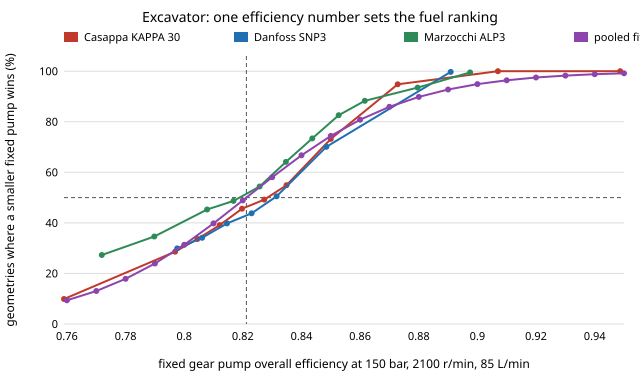
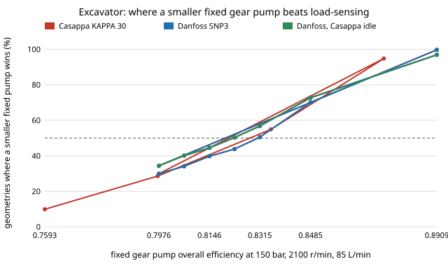
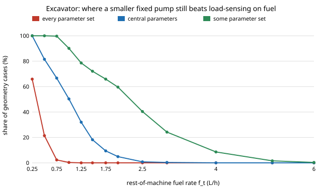
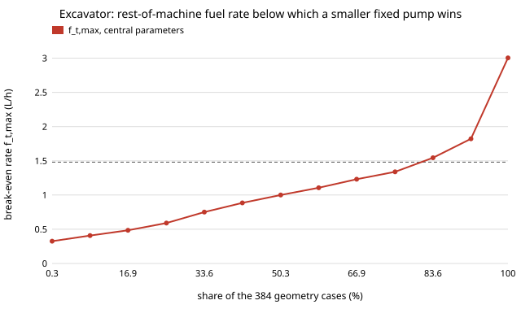
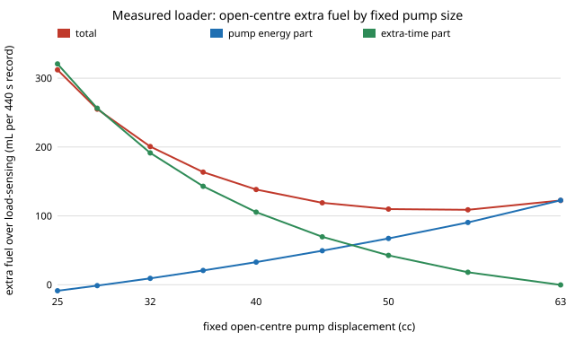
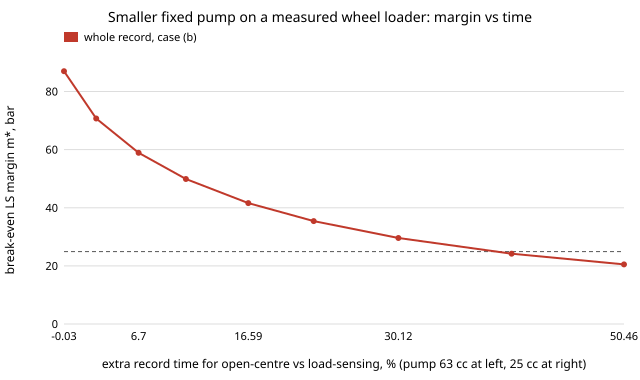

# Which open hydraulic circuit gets a small excavator closest to stock energy use for the least money?

**Status: open research programme. Milestones 1 to 5 have landed in steps (2a to 5x); a measured excavator pressure trace (5y) and a flow trace from joint motion (5z) now exist, but no excavator fuel record, so H4 is still open; the paper draft (milestone 6, [`paper/draft.md`](paper/draft.md)) is current to 6d.** The first step was a stdlib energy model
of three excavator hydraulic circuits (fixed open-centre, load-sensing, ideal independent
metering) over a work cycle (`src/heavy_hydraulics/`, 6 tests) and a first sweep of 2,916 cases
on an illustrative cycle: load-sensing uses a median **47%** of open-centre pump-shaft energy
(range 22 to 81%), and ideal independent metering a median 80% of load-sensing. The ordering
holds in every case, but only because each rung removes a loss term; the cycle and margins are
not sourced, so this is a first-order calculation, not a measurement of any machine.
See [`PROPOSAL.md`](PROPOSAL.md) and [`LOG.md`](LOG.md).

**Paper (milestone 6, 2026-11-12):** the draft now leads with the measured loader: no fixed open-centre pump from 25 to 63 cc matches load-sensing fuel per unit of work (best 53.5 cc, 11.5% more), and the break-even margin is the volume ratio times the surplus-flow pressure (99.5 bar), not the working pressure. Rerun from the Zenodo record, 5t to 5x reproduce their committed results byte for byte. Sections 3.7 and 3.7b add the two excavator results (5y pressure, 5z volume ratio), which together put the break-even margin near 139 bar, and `python3 paper/check_numbers.py` checks every quoted number (183) against the results file it cites. Since 2026-11-12 `python3 paper/build_tex.py --pdf` builds the draft as a 10-page two-column LaTeX paper with numbered references from [`paper/refs.bib`](paper/refs.bib) with all 21 sources the draft names (theses, valve and pump manuals, the XCMG brochure, Reece) as numbered references (the 10 non-DOI ones noting whether each was opened), and each of the four figures numbered once with its own caption (the journal's own template and the author line are still to do; [`LOG.md`](LOG.md)).

**Latest (7zc, 2026-11-25): keying the pick table on the relative bend r makes it worse (left-out RMS 0.0057 against 0.0052), and the half-idle-speed results since 7h read each gear pump off its working-speed curves.** 7zb proposed keying 7r's table on r = b/b<sub>0</sub> at the machine's idle setting ([`experiments/gear_pump_rkey.py`](experiments/gear_pump_rkey.py)); because the rows are built at the central setting, that sends 12 of 14 variants to the flattest row on the Salami readings, and the raw per-condition bend does slightly better (0.0050). On the way, a check of why 7zb's half-speed bends differ from the factorial's found that the factorial (7h to 7zc) builds every gear pump at n<sub>r</sub> = 1 and slows only the neutral pressure: read at its own 1050 r/min curves a gear pump absorbs 0.31 to 0.66 of that idle power at 85 L/min on the PVG 32 reading ([`experiments/gear_pump_halfspeed.py`](experiments/gear_pump_halfspeed.py)). Working-speed and central results are unaffected; the half-speed sentences carry a caveat in limitation 5 until the factorial is rebuilt (next step). See "Milestone 7zc" in [`LOG.md`](LOG.md).

**Previous (7zb, 2026-11-19): is Danfoss the only gear-pump family whose idle drag bends? At full idle speed yes, on every valve reading; at half idle speed, no: the Casappa KP30 bends as much.** A pump with no drag absorbs q p<sub>n</sub>/(600 &eta;), so the valve alone sets a bend b<sub>0</sub> = 79 p<sub>n</sub>(79)/(64 p<sub>n</sub>(64)): 1.318 on the PVG 32 reading, 1.881 on the Salami readings. Measured against it ([`experiments/gear_pump_floor.py`](experiments/gear_pump_floor.py), nine families, six idle settings), the seven other drag-carrying families sit at r = b/b<sub>0</sub> 0.966 to 1.042 and Danfoss at 1.352; Danfoss leads by 0.29 to 0.31 at full idle speed but at half speed KP30 reads 1.220 against 1.277 (PVG 32) and leads on the Salami readings (1.469 against 1.015). It also corrects 7za: 1.263 was not a floor. Supplement S5 and limitation 5 now say this. See "Milestone 7zb" in [`LOG.md`](LOG.md).

**Earlier (7za, 2026-11-19): a fourth maker's gear-pump datasheet, Argo-Hytos GP3, draws input power at 20, 50 and 100 bar, but its lines carry no idle drag: every line is P = V n p / (600000 &times; 0.81) through the origin, so it reads b = 1.263** (7za called this the drag-free floor; 7zb corrects that: the drag-free bend is 1.318, and GP3's slightly negative intercepts put it below). Read from its vector charts ([`experiments/digitise_argo_gp3.py`](experiments/digitise_argo_gp3.py)) and as the model reads every family ([`experiments/gear_pump_argo.py`](experiments/gear_pump_argo.py)), GP3's zero-pressure drag at 2100 r/min is &minus;0.27 to +0.10 kW against +0.39 to +1.26 kW for the eight other families. The seven flat families sit 0.01 to 0.11 above that floor and Danfoss 0.52 above it, so their b is mostly the valve's neutral-pressure rise, and Danfoss is still the only family whose drag bends. See "Milestone 7za" in [`LOG.md`](LOG.md).

**Earlier (7z, 2026-11-19): a second Casappa gear-pump family, the Polaris 30, read from its vector catalogue curves, does not bend: its idle drag ratio b = P<sub>idle</sub>(79)/P<sub>idle</sub>(64) is 1.272, the lowest of eight families.** 7y showed a catalogue needs low-pressure power curves to answer whether a pump family's idle drag bends; Casappa's 2024 Polaris catalogue draws them at 50 and 100 bar for 22 to 91 cm<sup>3</sup>/r ([`experiments/digitise_casappa_polaris30.py`](experiments/digitise_casappa_polaris30.py), flow slopes equal to the printed displacements within 0.1%). Read as the model reads every family ([`experiments/gear_pump_polaris.py`](experiments/gear_pump_polaris.py)), it draws 2.650 kW at a 64 L/min pump and 3.372 kW at 79 L/min, so seven families from three makers now sit at b 1.27 to 1.37 and Danfoss (1.781) is alone. See "Milestone 7z" in [`LOG.md`](LOG.md).

**Earlier (7y, 2026-11-19): a catalogue that draws pump input power only near rated pressure cannot tell whether a gear pump's idle drag bends.** The gear-pump results since 7q wait on a second measured family whose idle drag rises with size like Danfoss's (bend b = 1.781 against 1.29 to 1.37). A screen of the catalogues this container could reach found one new family in the excavator's range with input-power curves, Magister Hydraulics' GP3K, but it draws them only within 50 bar of each size's maximum. Cutting the seven readable families to that same top band ([`experiments/catalogue_screen.py`](experiments/catalogue_screen.py)) moves the idle drag at a 64 L/min pump by a median 29.5% (up to 96%) and flips three of seven families' bend class: Danfoss reads flat (b &minus;0.011, with a negative absorbed power at 79 L/min) and two Rexroth families read as bending more than Danfoss (2.620, 5.914). So a top-band catalogue cannot be the second family; the next step needs one that draws a 50 or 100 bar curve. See "Milestone 7y" in [`LOG.md`](LOG.md).

**7x (2026-11-19, paper step): which venue can take an agent-written paper.** 7w found both named venues forbid AI-generated content; 7x read the rules of the publishers that could replace them. Two more forbid it: Springer Nature's framework marks "writing results or discussion independently; generating scientific claims or interpretations" as not permitted, and Taylor & Francis "does not allow generative AI to create a first draft of a manuscript or sections of a manuscript". IEEE and arXiv allow it with disclosure; Elsevier and Wiley only under real human ownership of the analysis. Against the journals this paper's own references were published in (`refs.bib`: *Energies* 3, *IEEE Access* 1, *Automation in Construction* 1, *Proc. IMechE* 1, others 5), the honest routes today are an arXiv preprint and *IEEE Access*; *IEEE/ASME Transactions on Mechatronics* is "mixed" (co-sponsored by ASME, which prohibits); *Energies* (MDPI) is unread because mdpi.com refuses the proxy. [`paper/VENUE.md`](paper/VENUE.md) has the table; the portfolio register [`venue_policies.json`](../_shared/venue_policies.json) went from 6 to 21 entries and [`venue_policy.py`](../_shared/venue_policy.py) gained `--venue` to classify any candidate. Across the portfolio, 17 of 22 programmes now have a named venue that allows disclosed AI use, 4 are unread (ACM, SAGE, AIAA, MLCAD/ICCAD), and this one still names only prohibiting venues. The venue is the owner's choice. See "Milestone 7x" in [`LOG.md`](LOG.md).

**7w (2026-11-19, paper step): the named target venues forbid AI-generated papers.** Read against their own pages, both venues in [`PROPOSAL.md`](PROPOSAL.md) ask authors to confirm that generative AI did not create the content: the *International Journal of Fluid Power*'s submission checklist ("has not been generated by AI tools ... AI tools may be used to improve grammar, but not to generate 'original' content") and ASME's AI position statement ("ASME prohibits the use of generative AI in the creation of content for journal submissions"). This paper was generated by AI agents, so it cannot honestly go to either; IEEE, Elsevier and arXiv allow disclosed AI use. [`paper/VENUE.md`](paper/VENUE.md) quotes each rule with its source and sets out the owner's options. In the same step the manuscript gained what any venue asks for: the abstract cut from 356 to **248** words (IJFP asks 250; every number still checked, 181 claims, 0 missing), keywords and an "AI use" section saying plainly that the agents produced the code, analysis and text. [`paper/venue_check.py`](paper/venue_check.py) checks the mechanical requirements (title 164 of 80 characters, notation list and caption list still missing), and a new portfolio tool, [`research/_shared/venue_policy.py`](../_shared/venue_policy.py), checks every programme's venue against a sourced register: heavy-hydraulics was the only one of 22 whose venues all prohibit AI content. See "Milestone 7w" in [`LOG.md`](LOG.md).

**Previously (7v, 2026-11-19, paper step): the manuscript cut to journal length, with the gear-pump selection rules in a checked supplement.** [`paper/manuscript.md`](paper/manuscript.md) had grown from 4,573 words (6s) to 9,479, almost all of it in the five gear-pump subsections 7a to 7u had added. It is now about 7,000 words: those subsections move verbatim to a new [`paper/supplement.md`](paper/supplement.md) (Supplement S1 to S5), and the manuscript keeps two condensed sections in their place, 3.6 (drag as a second number, tested on four held-out Rexroth families: eight-family left-out RMS **0.0022** against **0.0113** for a constant; the recommended kW<sub>o</sub> rule for pumps spun or geared past their size range, **0.0056** on fourteen readings) and 3.7 (the two-price idle rule, **0.0056** over 308 held-out cases, the own-pick bounds 0.0042 and 0.0047, and what a builder can read in their place), plus Table 2 unchanged. The abstract is down from 493 to 356 words and now states the eight-family and idle results; the conclusions, discussion and limitations, which still stopped at seven families, are brought up to date. No result changed: `python3 paper/check_numbers.py --paper manuscript.md` now reads both files and checks 181 claims (14 new for the condensed text) with 0 orphan numbers, and two new tests keep the supplement building and the manuscript under 7,500 words. It builds as a 10-page two-column PDF (supplement 4 pages), and the build no longer prints subsection numbers twice. See "Milestone 7v" in [`LOG.md`](LOG.md).

**Earlier (7u, 2026-11-19, paper step): the gear-pump section of the manuscript, rebuilt to be read.** Twenty milestones (7a to 7t) had each appended sentences to one paragraph of [`paper/manuscript.md`](paper/manuscript.md) section 3.5, which had grown to 91 sentences and 21,000 characters. It is now six subsections (3.5 the one curve, 3.6 shape against drag, 3.7 the held-out families, 3.8 the recommended rule, 3.9 idle settings, 3.10 what a builder can read in place of the optimum's picks), with a new Table 2 that lists the sixteen selection rules in the order they were tested, what a builder must read for each, the panel it was scored on and its left-out RMS, from **0.0113** for one number to **0.0056** for the two-price rule and **0.0042** for the own-pick bound. The abstract now states the idle-setting rule. No result changed; `python3 paper/check_numbers.py --paper manuscript.md` now checks 167 claims (18 new for the table and abstract) with 0 orphans, and its orphan scan skips heading numbers. The manuscript is 9,479 words, long for the target journal: cutting it to length is the next paper step.

**Previously (7t, 2026-11-19): where does a steeper gear-pump idle drag curve hold its level? Read off the measured pumps, near 61 to 65 L/min, not 79.** 7s showed the synthetic bend table beats the two-price rule only if a pump that bends more keeps its drag level at 64 L/min (anchored at 79 it loses). 7t reads that anchor off the 13 measured donor pumps, per held-out family, without touching the pump being predicted. For the Danfoss family, the one the table exists to help, the pooled read puts the pivot at 65.4 L/min and the within-family read at 61.1, so 7s's failing anchor is not what the measured pumps show. With those anchors the table scores **0.0052** and **0.0050** in the left-out test against the two-price rule's 0.0056, and beats it at unseen half idle speed and idle shares too; with the within-family anchor its Danfoss error (0.0054) beats the two-price rule's (0.0061) for the first time. Seven of eight registered predictions held. The miss matters: Danfoss's drag at 64 L/min sits 29% above what the other pumps predict for its bend, so it is high everywhere, not only steep, and the within-family anchor rests on where two catalogues end rather than on bend physics. The two-price rule stays the builder's form until a measured second bending family tests the table. Code: [`experiments/gear_pump_anchor.py`](experiments/gear_pump_anchor.py); log: [`LOG.md`](LOG.md), 7t.

**Previous (7s, 2026-11-19): does 7r's gear-pump bend table survive a different synthetic bend shape? Its form, yes; its anchor, no.** 7r bent each donor pump's idle drag curve by a power of flow holding its level at 64 L/min. 7s rebuilds the rows with three other shapes that give the same bend (drag at 79 over 64 L/min). A hinge (bend only above 64 L/min) and an exponential in flow, both anchored at 64, score **0.0053** in the left-out test (7r 0.0052; two-price rule 0.0056) and beat the two-price rule at unseen half idle speed and idle shares too. A power law anchored at 79 L/min scores **0.0059**, worse than the two-price rule: it makes a steeper curve cheaper at small sizes, so the rows' picks stay near 72 L/min and Danfoss's error rises to 0.0110. Six of eight registered predictions held. The bend table's gain therefore rests on one modelling choice (a pump that bends more pays more drag above its lower quartile pick, not less below it), which only a measured second bending family can settle. The two-price rule stays the builder's form. Code: [`experiments/gear_pump_bendshape.py`](experiments/gear_pump_bendshape.py); log: [`LOG.md`](LOG.md), 7s.

**Previous (7r, 2026-11-18): can a published pick table carry the gear-pump own-pick gain if the publisher builds rows for bends no measured pump has? Partly: it beats the two-price rule, as a sensitivity.** 7q's table failed because no modelled pump bends like Danfoss. 7r prints a row for every bend from 1.2 to 1.9 (steps of 0.1): each donor pump's own idle drag curve is bent by a power of flow to that bend (drag at 79 over 64 L/min), the motion model picks sizes on it, and a builder reads the row nearest their pump's data-sheet bend. Scored as 7j to 7q, the bend table gives a left-out RMS of **0.0052** over 308 diagonals against the two-price rule's 0.0056 (0.0056 against 0.0059 at unseen half idle speed; 0.0055 against 0.0057 at unseen idle shares) and the pooled table's 0.0061, short of the leak-free own picks' 0.0047. Danfoss's error falls from 0.0122 under the pooled table to 0.0063 (two-price rule 0.0061), but its row still picks near 68 L/min against its own 58.5, so the table charges it 1.19 times the drag it pays: power-law bending moves the picks only part of the way. Five of eight registered predictions held. The bent curves are synthetic, so this is a sensitivity, not a result: a builder-side table becomes viable once it has rows for the bend class, and a measured second bending family is what would make it one. Code: [`experiments/gear_pump_bendtable.py`](experiments/gear_pump_bendtable.py); log: [`LOG.md`](LOG.md), 7r.

**Previous (7q, 2026-11-18): can a builder replace the model's own pump-size picks with a published pick table? Not with this set of pumps: the table makes the one-number idle rule worse.** A publisher who has run the model on the pumps it has could print their picks once; a builder would look up the row whose idle drag curve bends most like theirs (the ratio of drag at 79 and 64 L/min) and average their own curve over those sizes. Scored as 7j to 7p, the nearest-class table gives a left-out RMS of **0.0075** over 308 diagonals, the three nearest 0.0060 and the pooled table 0.0061, all above the two-price rule's 0.0056 and far from the leak-free own picks' 0.0047. The cause is one pump: Danfoss's idle curve bends far more than any other (1.78 against 1.28 to 1.50), the optimum sizes it down to 58.5 L/min, and every table row sits near 72 L/min, so the table charges it 1.47 times the drag it pays (its error 0.0198). Without Danfoss (post hoc) the three-nearest table scores 0.0051, half the own picks' margin. Three of seven registered predictions held. A table can only carry the own-pick gain with a row for the bending class, so a second bending family is now the condition for any builder-side form; the two-price rule stays the builder's form. Code: [`experiments/gear_pump_table.py`](experiments/gear_pump_table.py); log: [`LOG.md`](LOG.md), 7q.

**Previous (7p, 2026-11-18): does the own-pick oracle for gear-pump idle drag leak the answer? About a third of its gain, no more.** 7n's oracle read each pump's picks at the efficiency of its own break-even crossing E<sub>50</sub>, the number the held-out test predicts. Read the held-out pump's picks at the mean crossing of the other maker groups instead (within 0.0095 of its own on average), and the one-number idle rule's left-out RMS over 308 diagonals is **0.0047**: between the oracle's 0.0042 and the two-price rule's 0.0056, and 0.0049 against 0.0059 at unseen half idle speed. So two thirds of the oracle's gain is the drag the pump pays at its own sizes, not the leak. Reading the picks at the pump's catalogue efficiency (about 0.09 above E<sub>50</sub>) instead is far worse (0.0135): the sizes the optimum picks for a pump that already wins are not the sizes that decide its threshold. Three of six registered predictions held. The builder's form stays the two-price rule; the own-pick read still needs the model's picks. Code: [`experiments/gear_pump_leak.py`](experiments/gear_pump_leak.py); log: [`LOG.md`](LOG.md), 7p.

**Previous (7o, 2026-11-18): can a builder get the own-pick drag without running the model? Only a fifth of the way.** Tilting the published pick-size weight away from flows where a pump's idle drag exceeds the six families' mean, with one constant (2.15 per kW) calibrated on their own picks, gives the one-number idle rule a left-out RMS of 0.0053 over 308 diagonals: below the two-price rule's 0.0056, far above the oracle's 0.0042, and level with it at unseen half idle speed (0.0057 against 0.0059). Standby and drag still trade 0.98 for one. The constant is learned from one family: calibrated without Danfoss, whose idle curve bends, the best tilt is zero, so Danfoss never gets the correction out of sample. Three of seven registered predictions held. The two-price rule on the 85 L/min reading stays the builder's form. Code: [`experiments/gear_pump_tilt.py`](experiments/gear_pump_tilt.py); log: [`LOG.md`](LOG.md), 7o.

**Previous (7n, 2026-11-18): is the one-number idle rule for gear pumps wrong in form, or only in how the drag is read? Only the read.** Read each pump's idle drag at the sizes the fuel optimum picks for that pump itself, and the one-number rule (drag minus load-sensing standby, per idle hour, plus the efficiency shape) beats the two-price rule by a quarter out of sample: left-out RMS 0.0042 against 0.0056 over 308 diagonals, 0.0047 against 0.0059 at an unseen half idle speed, with standby and drag trading 0.98 for one. The earlier reads failed because the optimum sizes a pump with high or steep drag down (Danfoss's own picks: median 63.5 L/min against the pooled 72), so it pays 22% less drag than any fixed read says. All seven registered predictions held. This read is an oracle: it uses the model's own picks, which a builder does not have, so the two-price rule on the 85 L/min reading stays the builder's form. Code: [`experiments/gear_pump_ownpick.py`](experiments/gear_pump_ownpick.py); log: [`LOG.md`](LOG.md), 7n.

**Previous (7m, 2026-11-18): do two data-sheet reads of gear-pump idle drag fix the one-number rule? No: they match each pump's drag but not the rule's scale.** Read at the quartiles of the fuel optimum's pump-size picks (64 and 79 L/min), the two-point mean lands within 2% of the pick-weighted drag for 13 of 14 pump variants (Danfoss 7% high), and the standby-to-drag price ratio is 1.04. But the one-number rule's left-out RMS is 0.0066 over 308 diagonals, no better than one read (0.0065) and above the two-price rule (0.0056): across pumps the read carries 0.86 kW of the drag the optimum pays per kW, and the one bending family sets that slope. The 72 L/min read plus the drive extra scored 0.0070 as registered (it double-counts the AZPF's drive drag; corrected post hoc, 0.0071). Two of seven registered predictions held. The two-price rule on the 85 L/min reading stays the builder's form. Code: [`experiments/gear_pump_twopoint.py`](experiments/gear_pump_twopoint.py); log: [`LOG.md`](LOG.md), 7m.

**Previous (7l, 2026-11-18): can a builder price gear-pump idle drag with one number read off a data sheet at one flow? Not as well as the two-price rule.** 7k showed the excavator selection rule collapses to one price difference, drag minus load-sensing standby per idle hour, when the drag is averaged over the pump sizes the fuel optimum picks, but a builder does not have that pick distribution. Read instead at its median, 72 L/min, the drag still trades with standby near one for one (fitted ratio 1.06), yet the one-number rule's left-out RMS rises to 0.0065 over 308 diagonals (two-price rule on kW<sub>o</sub> 0.0056, pick-averaged 0.0056), and it doubles the Danfoss family's error (0.0142), whose idle curve bends. One point also misses a spun or geared pump's drive drag, which sits only above the family's largest size. Three of seven registered predictions held. The two-price rule on the 85 L/min reading stays the builder's form. Code: [`experiments/gear_pump_onepoint.py`](experiments/gear_pump_onepoint.py); log: [`LOG.md`](LOG.md), 7l.

**Previous (7k, 2026-11-17): why does a kW of load-sensing standby seem to be worth 1.22 kW of gear-pump drag? It is not; the drag was read at the wrong pump size.** The break-even model can only trade the two one for one (it charges idle as their difference). The rule's drag number kW<sub>o</sub> is read at 85 L/min, while the fuel optimum picks pumps nearer 72 L/min, where a kW of kW<sub>o</sub> carries 0.88 kW of drag. Read at the picks (kW<sub>w</sub>), the fitted price ratio is 1.02, and the rule collapses to one number per idle hour: E<sub>50</sub> = 0.8208 + 0.0359 H (kW<sub>w</sub> &minus; P<sub>LS</sub>) &minus; 0.435 k<sub>w</sub>, H = S/(1 &minus; S), left-out RMS 0.0056 over 308 diagonals, the same as 7j's two-price rule (7j's one-number form on kW<sub>o</sub>: 0.0068). Six of six registered predictions held; a registered numerical check was mis-specified and failed as written (disclosed in the log). For a builder with one catalogue pump the two-price rule on kW<sub>o</sub> stays the practical form, since kW<sub>w</sub> needs the optimum's pick distribution. Code: [`experiments/gear_pump_ratio.py`](experiments/gear_pump_ratio.py); log: [`LOG.md`](LOG.md), 7k.

**Previous (7j, 2026-11-17): does 7i's one-rule-for-every-idle-setting result replicate, and does it extrapolate to idle shares it never saw? Yes to both.** A parallel run registered the same question before 7i landed and built its own pipeline, with the idle hours per working hour H = S/(1 &minus; S) in place of 7i's S: E<sub>50</sub> = 0.8214 + H (0.0329 kW<sub>o</sub> &minus; 0.0402 P<sub>LS</sub>) &minus; 0.435 k<sub>w</sub> predicts each idle condition it never saw, maker family also left out, at RMS 0.0056 over 308 diagonals (7i's form 0.0057; setting-blind 0.0163). Trained without idle shares 0.20 and 0.50, it predicts both at 0.0057 (7i's form the same); trained at working idle speed only, the nine half-speed settings at 0.0059 (7i's form 0.0066). Forcing standby and drag kW to trade one for one costs 22% (refuted); the fit puts a standby kW at 1.22 drag kW. Six of seven registered predictions held. Code: [`experiments/gear_pump_onerule.py`](experiments/gear_pump_onerule.py); log: [`LOG.md`](LOG.md), 7j.

**Previous (7i, 2026-11-17): can one gear-pump selection rule cover every idle setting without refitting? Yes, if it carries the competitor's idle cost: E<sub>50</sub> &asymp; 0.823 &minus; 0.435 k<sub>w</sub> + S (0.052 kW<sub>o</sub> &minus; 0.066 P<sub>LS</sub>).** Pooled over 7h's 22 idle conditions (4312 cells) and asked about a setting and a maker family it never saw, the rule with both idle powers scaled by the idle share S predicts every condition within RMS 0.0051 to 0.0062, no worse than 7h's full per-setting refit (0.0047 to 0.0064); without a setting term the same rule misses half idle speed by 0.030, and with the load-sensing standby kW alone (no S) it misses idle shares 0.20 and 0.50 by 0.011 to 0.012. Trained on one idle speed and asked about the other, it stays within 0.0098. Four of six registered predictions held. Code: [`experiments/gear_pump_idlecost.py`](experiments/gear_pump_idlecost.py); log: [`LOG.md`](LOG.md), 7i.

**Earlier (7h, 2026-11-17): does the gear-pump selection rule hold away from the one idle setting it was fitted at? Its form does, its intercept does not.** Rebuilt at all 18 idle settings (three open-centre neutral curves, standby flow 0 to 5 L/min, idle at working or half speed) and idle shares 0.20 to 0.50, the 7g rule beats the drag-only rule in all 22 conditions, by 17% to 43% (out-of-sample RMS 0.0047 to 0.0064), with its drag slope +0.0175 to +0.0195 at every setting and its shape coefficient negative throughout. At half idle speed the crossing rises 0.02 to 0.03 because the load-sensing pump's standby power halves, and the frozen rule misses by up to 0.035; keeping the two slopes and refitting one number, the intercept, gives 0.0044 to 0.0076, within 1.25 times a full refit everywhere. Six of six registered predictions held. Code: [`experiments/gear_pump_settings.py`](experiments/gear_pump_settings.py); log: [`LOG.md`](LOG.md), 7h.

**Earlier (7g, 2026-11-17): can one gear-pump selection rule serve both a catalogue pump and one spun or geared past its largest size? Yes: read the idle drag at 85 L/min on the pump's own catalogue curve and add only the step-up drive's or overspeed's extra drag, weighted by the share of the fuel optimum's picks above the largest size. With the shape number k<sub>w</sub> this cuts the out-of-sample error by 34% (0.0056 against 0.0084), and, unlike 7f's rule, costs nothing on catalogue pumps (0.0017).** E<sub>50</sub> = 0.7562 + 0.0182 kW<sub>o</sub> &minus; 0.427 k<sub>w</sub>, scored with each maker family left out over 14 pump readings, beats every earlier rule on all three eight-family panels (held 0.0017, spun 0.0018, geared 0.0030). The geared AZPN still sits 0.0065 below it. Five of six registered predictions held. Code: [`experiments/gear_pump_holddrag.py`](experiments/gear_pump_holddrag.py); log: [`LOG.md`](LOG.md), 7g.

**Previous (7f, 2026-11-16): does reading the gear pump's idle drag at the sizes the excavator fuel optimum actually picks, instead of at 85 L/min, fix the selection rule? Pooled, yes: with the shape number k<sub>w</sub> it cuts the out-of-sample error by 29%, the first rule to clear the registered 20% bar. On real catalogue pumps alone, no: there it is worse than the 85 L/min reading (0.0034 against 0.0022).** The drag averaged over the picks is 0.74 to 0.87 of the drag at 85 L/min; spinning a pump past its largest size or gearing it up adds drag only above that size, which the 85 L/min reading charges in full and the pick-weighted reading mostly does not. With each maker family left out in turn over 14 pump readings, E<sub>50</sub> = 0.7598 + 0.0204 kW<sub>w</sub> &minus; 0.427 k<sub>w</sub> predicts the left-out crossings with an RMS of 0.0059, against 0.0084 for the two-number rule; reading each pick at its own outlet pressure (median 151 bar) adds nothing. The geared AZPN still sits 0.007 below every rule. So the two-number rule at 85 L/min stays the advice for a catalogue pump run in its size range, and the pick-weighted rule is the one for a pump spun or geared past it. Four of six registered predictions held. Code: [`experiments/gear_pump_pickdrag.py`](experiments/gear_pump_pickdrag.py); log: [`LOG.md`](LOG.md), 7f.

**Earlier (7e, 2026-11-16): which gear-pump sizes does the excavator fuel optimum actually pick, and does reading the pump's shape there fix the selection rule? The picks centre on 72 L/min (p10 58, p90 90.5), below the 85 L/min index point; a shape number averaged over them cuts the out-of-sample error by the same 18% as 7d's 57 L/min reading, short of the registered 20%, and gives the lowest error on real catalogue families yet (0.0017).** With each maker family left out in turn over 14 pump readings, E<sub>50</sub> = 0.8189 + 0.0172 (kW &minus; 3.57) &minus; 0.427 k<sub>w</sub> predicts the left-out crossings with an RMS of 0.0069, against 0.0084 for the two-number drag rule and 0.0068 for k<sub>lo</sub>. It fixes the Casappa and Danfoss misses but not the geared AZPN (&minus;0.0082), and the share of picks above a family's largest size does not help at all (0.0093). Two shape numbers chosen on different grounds reaching the same gain says the AZPN's residual is not in the shape at 150 bar; the next step reads the drag at the picks instead of at 85 L/min. Three of six registered predictions held. Code: [`experiments/gear_pump_chosen.py`](experiments/gear_pump_chosen.py); log: [`LOG.md`](LOG.md), 7e.

**Earlier (7d, 2026-11-16): can a third number fix the rule for gear pumps run outside their size range? Partly: the family's efficiency at 57 L/min relative to its index point (k<sub>lo</sub>) cuts the out-of-sample error by 18%, short of the registered 20%.** Pooling 14 pump readings (six families plus Rexroth's AZPF and AZPN each held, spun, geared and geared at 98%; 196 shape-by-drag cells) and leaving each maker family out with all its readings, E<sub>50</sub> = 0.8200 + 0.0172 (kW &minus; 3.57) &minus; 0.1819 k<sub>lo</sub> predicts the left-out crossings with an RMS of 0.0068 against 0.0084 for the two-number drag rule. It costs nothing on held families (0.0022 either way), helps the geared panel (0.0040 against 0.0051), and has the sign the 7c diagnosis predicts; the size slope above the index (6u's third number) is worse than two numbers on every panel. The geared AZPN still sits 0.0070 below the rule, so the two-number rule stays the headline. Four of six registered predictions held. Code: [`experiments/gear_pump_third.py`](experiments/gear_pump_third.py); log: [`LOG.md`](LOG.md), 7d.

**Previous (7c, 2026-11-16): does the step-up drive a spun gear pump needs change the answer? A little in cost, a lot for the rule: priced from NASA's measured spur-gear system loss (99.34% at full load, tare up to 65% of that), the drive adds only 0.14 kW of idle power to Rexroth's AZPF size 28 at 3000 r/min, but it moves the crossing the way the two-number rule does not expect.** The rule reads the added drag and predicts a later crossing; the drive also lowers the 85 L/min index point without touching the smaller pumps the fuel optimum picks, which pulls the crossing earlier. Rexroth's AZPN crosses at 0.7988 geared against 0.8031 lossless, and the rule misses it by 0.0101 (0.026 with a lossy 98% drive). With both families geared, the eight-family leave-one-family-out RMS is 0.0051 against 0.0121 for efficiency alone: the rule still wins, but a geared pump is its worst case. Three of six registered predictions held. Code: [`experiments/gear_pump_stepup.py`](experiments/gear_pump_stepup.py); log: [`LOG.md`](LOG.md), 7c.

**Earlier (7b, 2026-11-16): what if the builder spins the largest pump faster instead of buying a bigger one that does not exist? The crossing does not move, but the rule's error grows: Rexroth's AZPF size 28 driven to its rated 3000 r/min crosses at 0.8075, exactly as when held, while the two-number rule misses it by 0.0060 (held: 0.0008).** Read off the sheet's own curves at the solved speed, spinning lowers efficiency at the 85 L/min index point only from 0.910 to 0.904 but raises zero-pressure drag from 7.7 to 12.3 W per L/min, so idle power at 85 L/min rises from 2.61 to 2.99 kW. The rule reads the drag and expects a later crossing; the flatter map pulls it back, and the two cancel. With the AZPF and AZPN both spun, the eight-family refit is E<sub>50</sub> = 0.8230 + 0.0181 (kW &minus; 3.57) and the leave-one-family-out RMS is 0.0035 against 0.0115 for efficiency alone, so the rule still beats a constant three to one; its worst case is now a spun pump. Four of six registered predictions held. The step-up drive's own loss is not priced. Code: [`experiments/gear_pump_spin.py`](experiments/gear_pump_spin.py); log: [`LOG.md`](LOG.md), 7b.

**Previous (7a, 2026-11-16): does the two-number gear-pump rule still hold for a family whose largest pump is too small for the job, so every bigger pump has to be priced from its largest size? Yes: Bosch Rexroth's AZPF (RE 10089, sizes 4 to 28 cm<sup>3</sup>/r, largest 58.87 L/min) crosses at 0.8075 and the seven-family rule says 0.8067 (error 0.0008), where efficiency alone misses by 0.0060.** 77% of the pump sizes the fuel optimum can pick lie above the family's largest size and are priced on its size 28 held; read on size 25 instead, the error is 0.0010. Its index is 0.910 and its idle power at 85 L/min 2.61 kW, inside the range the earlier seven families span, so the open question of a family with much higher or lower drag stays open. Refitted on all 64 shape-by-drag cells, E<sub>50</sub> = 0.8238 + 0.0177 (kW &minus; 3.57); leaving each of eight families out in turn, the RMS error is 0.0022 against 0.0113 for one number (`experiments/gear_pump_eight.py`, `experiments/digitise_rexroth_azpf.py`; six predictions written before any number was computed, five held). See "Milestone 7a" in [`LOG.md`](LOG.md).

**Previous (6z): with the pump efficiency read on a size the maker actually builds, does the two-number gear-pump rule predict a seventh family? Yes: Bosch Rexroth's low-noise AZPU crosses at 0.8030 and the rule as committed two families earlier says 0.8041 (error 0.0011), where efficiency alone misses by 0.0142.** The index now holds a family's end-size efficiency instead of extrapolating past it (6y's diagnosis, fixed in code and registered before the new family was scored; it changes only the AZPN). The AZPU (RE 10 098, ten sizes, 22.5 to 63 cm<sup>3</sup>/r) was digitised from the vector curves of its data sheet; it reads 0.889 at 150 bar and 85 L/min, 0.023 below its sister AZPG, with the lowest no-load drag of seven families (2.45 kW). Refitted on all 49 shape-by-drag cells, E<sub>50</sub> = 0.8239 + 0.0179 (kW &minus; 3.57); leaving each of seven families out in turn, the RMS error is 0.0023 against 0.0120 for one number (`experiments/gear_pump_seven.py`, `experiments/digitise_rexroth_azpu.py`; six predictions written before any number was computed, five held). See "Milestone 6z" in [`LOG.md`](LOG.md).

**Previous (6y, 2026-11-15): does the two-number gear-pump rule predict a sixth family it never saw? Not as registered: Bosch Rexroth's AZPN misses it by +0.029, because its sizes stop at 75.6 L/min and its efficiency at the 85 L/min index point had to be extrapolated (0.959). Read where the model actually runs the pump (its largest size, 0.925), the rule as committed predicts the AZPN within 0.0001, and over six families left out in turn the RMS is 0.0023.** The AZPN (RE 10091, sizes 20 to 36 cm<sup>3</sup>/r) was digitised from the vector curves of its data sheet with 6w's method; its no-load drag, 2.49 kW at 85 L/min, is the lowest of six families. The index reading that rescues the rule was chosen after the registered test failed, so it is a diagnosis, not a confirmation; the lesson for a builder is to read the efficiency on a pump size the maker actually sells (`experiments/gear_pump_six.py`, `experiments/digitise_rexroth_azpn.py`; six predictions written before the digitising, two held). See "Milestone 6y" in [`LOG.md`](LOG.md).

**Earlier (6x, 2026-11-15): what decides whether a smaller fixed gear pump beats load-sensing on a small excavator, once every pump family has been held out in turn? Two numbers off the data sheet: efficiency at 150 bar and zero-pressure drag. Fitted without the family, E<sub>50</sub> = 0.824 + 0.018 (kW &minus; 3.57) predicts each of five families' 50% crossing within 0.0042 (RMS 0.0030), against 0.0119 for efficiency alone.** All five measured shapes (Casappa, Danfoss, Marzocchi catalogues, the bench KP30, Rexroth AZPG) were crossed with all five idle drags (25 cells, 0.8010 to 0.8300); drag moves the crossing twice as much as shape (0.0194 against 0.0096). A third number for shape (size slope) fits the cells better but predicts a left-out family worse (RMS 0.0046), so the rule stays at two (`experiments/gear_pump_five.py`; six predictions written before the sweep, three held). See "Milestone 6x" in [`LOG.md`](LOG.md).

**Earlier (6w, 2026-11-15): does the gear-pump efficiency rule hold for a maker it was never fitted on? Only with the second number: Bosch Rexroth's AZPG crosses at 0.804, which the two-number rule predicts within 0.005 and the single pooled 0.821 misses by 0.017.** Read from the vector curves of Rexroth's data sheet RE 10093 (ten sizes, 22.5 to 63 cm<sup>3</sup>/r), the AZPG runs at 0.912 overall efficiency at 150 bar and 85 L/min, above every family before it, with the lowest no-load drag yet (2.58 kW at 85 L/min, against 2.85 to 3.64). Swept in efficiency with its own curve shape and drag over the same 384 excavator geometries, a smaller fixed pump beats load-sensing on fuel in half of them at 0.8040. The rule E<sub>50</sub> = 0.8277 + 0.0187 (kW &minus; 3.57), as committed in 6v, says 0.8091; the one-number rule says 0.8212, outside the 0.015 band the four earlier families stayed inside. Swapping halves puts the miss in the drag, not the shape (AZPG shape with Casappa drag 0.8207; Casappa shape with AZPG drag 0.8108). The catalogue pump itself wins in all 384 geometries (`experiments/gear_pump_rexroth.py`, `experiments/digitise_rexroth_azpg.py`; six predictions written before the digitising, four held). See "Milestone 6w" in [`LOG.md`](LOG.md).

**Previously (6v, 2026-11-15): how much is a kilowatt of a gear pump's no-load drag worth? About 0.019 of efficiency at 150 bar, whatever the pump's map looks like.** Scaling the idle drag from zero to twice the Casappa catalogue's, on four measured moving-efficiency shapes, moves the 50% crossing from about 0.76 to about 0.89, nearly in a straight line with slopes of 0.0175 to 0.0187 per kW at 85 L/min. A two-number rule, E<sub>50</sub> = 0.8277 + 0.0187 (kW &minus; 3.57), predicts 6u's 16 measured cells with an RMS error of 0.0053 against 0.0066 for the single 0.8212; even a drag-free pump still needs about 0.76 (`experiments/gear_pump_drag.py`; five predictions written first, four held, the linearity one refuted by 0.0002). See "Milestone 6v" in [`LOG.md`](LOG.md).

**Earlier (6u):** crossing four gear-pump families' shapes with their idle drags puts every 50% crossing between 0.8069 and 0.8300; idle drag matters more than shape.

**Previously (6t, 2026-11-15): is the 0.82 gear-pump threshold an artefact of fitting a logistic curve? No: the crossing holds, the tails move by about 0.02.** The paper's headline curve maps a fixed gear pump's overall efficiency at 150 bar to the share of small-excavator geometries in which a smaller fixed pump beats load-sensing on fuel. Refitting the same 29 committed sweep points with probit, complementary log-log and log-log curves puts the 50% crossing at **0.8191 to 0.8229** (logistic 0.8212), a model-free isotonic fit at **0.8250**, and an exact maker-level bootstrap (all 27 draws of three makers) at **0.8128 to 0.8260**. The asymmetric complementary log-log fits better than the logistic (RMS 4.33 against 5.62 points, and better out of sample). The design rule's tails depend on the form: "a smaller fixed pump wins nine times in ten" starts at 0.8707 to 0.8914, and "load-sensing wins" below 0.7479 to 0.7730, so the manuscript now prints those ranges (`experiments/gear_pump_form.py`, stdlib, committed results only; six predictions written first, five held, the tail-span one refuted). See "Milestone 6t" in [`LOG.md`](LOG.md).

**Previously (6s, 2026-11-15): the paper at venue length.** [`paper/manuscript.md`](paper/manuscript.md) is the submission-shaped cut of the 14,600-word notebook draft: 4,573 words from abstract to conclusions, organised by claim (loader, break-even algebra, excavator, pump efficiency, the one curve) rather than by milestone, with four figures, one table of the five efficiency sources against the fitted curve, a discussion that states the design rule and a three-step procedure a builder can follow, and five limitations. It builds as a 7-page two-column PDF with 19 numbered references (`python3 paper/build_tex.py --source manuscript.md --pdf`). No new experiment and no new number: `python3 paper/check_numbers.py --paper manuscript.md` checks 29 headline claims against their results files and requires every decimal number in the manuscript to appear in the checked draft or a committed results file (0 orphans). `paper/draft.md` stays as the full technical report the manuscript cites as its supplement.

**Previously (6r, 2026-11-14): does one gear-pump efficiency number decide whether a smaller fixed pump beats load-sensing on a small excavator's fuel, whatever the maker? Yes: one logistic curve in efficiency alone fits three makers' sweeps (RMS 5.62 points), crosses 50% at 0.821, and, fitted on any two makers, places the third maker's crossing within 0.012.** All 29 scaled-sweep points of Casappa, Danfoss and Marzocchi, each at its overall efficiency at 150 bar and the 85 L/min size the fuel optimum picks, are fitted with one curve (`experiments/gear_pump_evidence.py`, stdlib, committed results only; five predictions written first, all held). It runs from 10% to 90% of cylinder-geometry readings between 0.762 and 0.881: a candidate gear pump measured above about 0.88 at 150 bar makes a smaller fixed pump the better choice in nine machines of ten; below about 0.76, load-sensing. The paper ([`paper/draft.md`](paper/draft.md)) now has a 272-word abstract built on this result, section 3.7r with Figure 7, and a conclusions section; the earlier 870-word abstract is kept as Appendix A. Limits: the sweeps scale each family uniformly, so the curve shows the effect of efficiency level, not curve shape; the logistic form undershoots Marzocchi's steeper rise (largest residual 13.4 points). Two multi-unit test papers that could tell a typical pump from the one bench unit were found but not read (SAE 2012-01-2041 is paywalled; a TU Darmstadt repository blocks automated access).



**Previously (6q, 2026-11-14): with a bench-measured gear pump as the fixed pump, does a smaller fixed pump beat load-sensing on a small excavator's fuel? Yes, in all 384 cylinder-geometry readings and all 18 idle settings, by a wide margin.** 6p bounded this from below (at least 94.8%); here the excavator break-even is rerun with a gear-pump family built from the bench-measured Casappa KP30's torque and flow (Frosina et al. 2017; overall 0.913 at 150 bar, zero-pressure drag 6.67 bar of 20 bar flow against the catalogue's 8.21). With idle hours at 38% of engine hours a smaller fixed pump wins in **100.0%** of geometries: the rest of the machine would have to burn a median **8.1 L/h** (central 8.82) before load-sensing caught up, against no-load rates of 3.99 to 5.06 L/h. The moving efficiency carries it, not the idle drag (bench moving with catalogue drag: 100%; catalogue moving with bench drag: 13.3%). A finer scan of Casappa's scaled curves puts its 50% crossing at 0.8283 (6n: 0.8281). All seven predictions held, but their bars were easy; the open question is now only whether typical units match this one. Details: [Milestone 6q](#milestone-6q-the-excavator-break-even-on-the-bench-measured-pump).

**Previously (6p, 2026-11-14): how efficient is a real gear pump of the size that matters, measured on a test bench rather than read from a catalogue? 0.91 overall at 150 bar, well above the 0.83 at which a smaller fixed pump starts beating load-sensing on a small excavator's fuel, and about 0.15 above the same maker's catalogue curves.** A Casappa KP30 of 44 cm<sup>3</sup>/r, tested on Casappa's bench and published with a CFD study (Frosina, Senatore and Rigosi 2017, *Energies* 10:1113, CC BY), was read by pixel from its torque and flow figures: at 150 bar it absorbs 109 to 113 Nm against an ideal 105 Nm, and delivers 0.967 to 0.981 of its ideal flow. At the excavator's 2100 r/min that is **0.913** overall (0.881 in the least favourable of six readings), against 0.764 from Casappa's own catalogue for the same size and against the three makers' crossings of 0.819 to 0.831. On this evidence a smaller fixed pump beats load-sensing on fuel in at least 94.8% of cylinder-geometry readings. One unit, on its maker's bench, in a paper about a CFD model: not yet an independent ISO 4409 report. Details: [Milestone 6p](#milestone-6p-a-bench-measured-gear-pump-against-the-crux-and-its-own-catalogue).

**Previously (6o, 2026-11-14): does the 0.83 gear-pump threshold hold for a manufacturer it was not fitted on? Yes: Marzocchi's ALP3 curves cross at 0.819, so three makers' crossings span 0.012.** 6n found that a smaller fixed pump starts beating load-sensing on a small excavator's fuel at a gear pump of about 0.83 overall efficiency at 150 bar and 85 L/min, fitted on Casappa and Danfoss. A third maker's catalogue, Marzocchi "Serie ALP" (eleven ALP3 sizes, 20 to 87 cm<sup>3</sup>/r, read from the PDF's vector paths), draws its pumps at **0.80 to 0.91** (median 0.882) at 150 bar and 2100 r/min. That is above the threshold and above the piston pump's 0.840, and with it a smaller fixed pump wins in **99.5%** of 384 cylinder-geometry readings (99.5 to 100% over 18 idle settings), the side the rule predicts. The sharper test is its scaled sweep: it crosses 50% at **0.8188** at 85 L/min, against 0.8281 (Casappa) and 0.8309 (Danfoss). The three catalogues put the same 85 L/min pump at 0.759, 0.849 and 0.898, a spread about twelve times that of the crossings. So the threshold is a property of the efficiency, not of one maker's curve shape, but which pump you buy decides the answer. Marzocchi's own sizing text (0.95 times 0.85, about 0.81) disagrees with its curves, as Casappa's 0.88 does with its own. Three of six predictions held. See "Milestone 6o" below.

**Previously (6n, 2026-11-14): at what gear-pump efficiency does a smaller fixed pump start beating load-sensing on a small excavator's fuel? About 0.83 overall at 150 bar, for both manufacturers' curves.** 6k (Casappa KAPPA 30) and 6m (Danfoss GearMe Group 3) gave opposite answers, 10% and 70% of cylinder-geometry readings. Put on one absolute efficiency axis, read at the pump size the fuel optimum picks (85 L/min of 20 bar flow), both makers' scaled curves cross 50% at **0.8281 and 0.8309**, a gap of 0.0028; on the family median the gap is 0.0147, because the median mixes in sizes the optimum never picks. Idle drag does not explain the residual (Casappa's drag on Danfoss's curves widens it). So the paper's crux is one number at one size: does a fixed gear pump of about 40 cm<sup>3</sup>/r reach about 0.83 at 150 bar and 2100 r/min? Three of five predictions held. Computed from the committed 6k and 6m results only (no simulation rerun). See "Milestone 6n" below and Figure 6 of [`paper/draft.md`](paper/draft.md).



**Previously (6m, 2026-11-13): is a gear pump efficient enough for a smaller fixed pump to beat load-sensing on a small excavator's fuel? It depends on whose gear pump: priced from Danfoss's GearMe Group 3 curves, a smaller fixed pump wins in 70% of cylinder-geometry readings; priced from Casappa's KAPPA 30 curves (6k), in 10%.** The two manufacturers' published curves, both read from the PDFs' vector paths at 50 C, differ by a median 0.068 in overall efficiency at 150 bar and 2100 r/min (Danfoss 0.75 to 0.86, median 0.839 over nine sizes; Casappa 0.71 to 0.80), and the fuel ranking flips between them, at about 0.98 times Danfoss's curves and 1.09 times Casappa's, a gear pump of about 0.82. With idle hours at 38% of engine hours the share of 384 geometries where a smaller fixed pump beats the 3.99 L/h tractor-standard no-load rate is **70.1%** with Danfoss (68.8 to 90.4% over 18 idle settings; 72.7% with Casappa's measured idle drag), against 9.9% with Casappa and 74.0% with a piston pump. So the paper's crux is now one measurable number: a fixed gear pump's overall efficiency at about 150 bar, above or below about 0.82. Four of six predictions were refuted. See "Milestone 6m" below.

**Previously (6j, 2026-11-13): does idle time rescue load-sensing on a small excavator? No: charged to both pumps, idle hours raise the share of cylinder-geometry readings where a smaller fixed pump wins on fuel from two thirds to about three quarters.** Every excavator break-even before this charged pump energy only while the machine moves. At idle the fixed pump pushes its flow through the open-centre valve's neutral passage, and the load-sensing pump destrokes to standby but still spins: the measured piston pump's zero-stroke loss puts it at **2.96 kW** at the XE80E's 219 L/min size, more than a fixed pump below **83 L/min** costs at idle (PVG 32 neutral curve; 91 to 93 L/min on two Salami VD8A readings). The best fixed pump in most geometries is about 75 L/min, so with the telematics idle share of **38%** of engine hours (Komatsu, about 75,000 machines) a smaller fixed pump beats the tractor-standard no-load rate (3.99 L/h) in **74.0%** of 384 geometries (6i: 66.7%; 71 to 91% over 18 neutral, standby-flow and idle-speed settings), while the stock 219 L/min open-centre pump loses by more than before. Prediction J4 (the share falls below 50%) was refuted in the other direction. See "Milestone 6j" below.

**Previously (6i, 2026-11-13): does a smaller fixed pump beat load-sensing on an excavator's fuel once the pump's part-stroke drag is charged? In two thirds of cylinder-geometry readings, up from one third, but only if the fixed pump is within about 5% of a piston pump's full-stroke efficiency.** With the measured pump's loss continued below its smallest measured stroke (12 of 45 cm<sup>3</sup>/r) instead of its efficiency held flat, and the stroke shortfall measured on the 7.5 t excavator's joint motion, a smaller fixed pump beats the tractor-standard no-load fuel rate (3.99 L/h) in **66.7%** of 384 geometries (6g: 32.8%) and the highest (5.06 L/h) in 44.3% (6g: 17.2%); the median break-even rest-of-machine rate rises from 3.32 to 4.63 L/h. The central geometry barely moves (5.50 to 5.64 L/h): it runs below 0.27 of stroke only 6.6% of the time, against a median 45% over the geometries. See "Milestone 6i" below.

**Previously (6h, 2026-11-13): how much did holding pump efficiency flat below 12 cm<sup>3</sup>/r flatter load-sensing? A lot: three quarters of the measured piston pump's loss at 150 bar does not shrink with stroke, so at 0.1 of stroke it runs at about 0.44, not 0.67, and 6g's excavator thresholds are lower bounds.** A stroke-linear loss model fitted to Kauranne's digitised curves (RMS residual 0.016; predicts the held-out 12 cm<sup>3</sup>/r curve within 0.004 at 150 bar, 0.046 at the pressure extremes) gives a closed-form bound: the flat hold understated the central geometry's break-even rest-of-machine fuel rate by at least 10.4 g L/h, g the mean stroke shortfall below 0.27 over moving time (1 L/h at g 0.10). g needs the motion trace, which this session could not reach. See "Milestone 6h" below. Previously (6g): with a measured efficiency-against-displacement curve a smaller fixed pump beats load-sensing on fuel in 17 to 33% of cylinder geometries, but only if it is within 3 to 4% of a piston pump's best full-stroke efficiency.

**Previously (6f, 2026-11-13): how much fuel does a small diesel burn at full throttle with no load? About 0.09 to 0.10 L/h per rated kW, from the tractor-test standard, so a 54.6 kW excavator engine at pump speed burns 4.0 to 5.1 L/h waiting, and load-sensing keeps the fuel lead in all 384 geometries at central parameters.** The ASABE D497 general model, fitted to over 500 Nebraska-tested tractors (Grisso et al. 2010, VCE 442-073), gives Q = (0.2203 X + 0.0965) P<sub>rated</sub> L/h at full throttle; the measured varying-power table of NTTL test 1725 (a 86.5 kW tractor) fits 7.71 + 0.2116 P L/h, 0.089 L/h per rated kW. Carried to the XCMG XE80E's Kubota V3307 at 2100 rpm that is **3.99 to 5.06 L/h**, 1.6 to 2.0 times 6e's floor. A smaller fixed pump then wins in **0%** of geometries at central parameters and in 1.6 to 9.4% under at least one of 108 parameter sets (11 to 24% if the engine slows to 1500 rpm while it waits). The marginal fuel slope is confirmed too: 0.212 to 0.220 L/kWh against the 0.233 borrowed since 6b. See "Milestone 6f" below.

**Previous (6e, 2026-11-13): how much fuel does an excavator engine burn with no hydraulic work, and does that settle the pump choice? At pump-rating speed, about 2.5 L/h or more, so load-sensing keeps the fuel lead in all but 3 of 384 geometries.** The measured loader's one clean no-load reading is low idle: **1.46 L/h at 800 rpm** (30.5 mm³ per revolution, pumps under 3 kW). Carried to the XE80E's 54.6 kW Kubota V3307 by rated power, and assuming zero-load fuel per revolution does not fall with speed (an assumption, not a measurement), the engine burns **at least 2.53 L/h at 2100 rpm**, above 6c's fuel threshold in 99.2% of geometries at central parameters (38.8% stay open under some parameter set). The registered method, a Willans line on the record's pump-side shaft power, failed: those estimates cover only 35% of engine power and the transmission pump's sign is wrong, giving an impossible 0.055 L/kWh slope (F1, F2 refuted; F4, F5 void). See "Milestone 6e" below.

**Earlier (6d, 2026-11-13): can a builder tell from their own machine whether a smaller fixed pump beats load-sensing on fuel? Roughly, from two numbers; exactly, not without the engine's own figures.** Over 6c's 384 geometry cases, the stock pump's oversupply r alone explains R² 0.60 of the (log) fuel threshold; with demand peakiness added, f<sub>t,max</sub> ≈ 15.6 (r − 1)<sup>−0.92</sup> (p99/mean)<sup>−2.37</sup> L/h predicts held-out geometries to a median 17% and makes the right call at 1.48 L/h in 88% of them (E2 and E3, set at 15% and 90%, were narrowly refuted). The decision curve below is the practical answer: at 1.48 L/h a fixed pump wins in 18% of geometries at central parameters, in 72% under at least one of the 108 parameter sets, and in none under all of them. The borrowed fuel slope and pump efficiency move the answer about as much as the cylinder geometry does (×5.9 against ×9.2). See "Milestone 6d" below.



**Previous (6c, 2026-11-13): across cylinder geometries, the excavator fuel threshold is about 1 L/h, not 2.5.** 6b found that a smaller fixed open-centre pump beats load-sensing on fuel only if the rest of the machine burns under 2.46 L/h over the extra working time, but it worked from the central geometry's committed numbers only. Rerun exactly from the raw folder-75 motion over all 384 lever, bucket-sign and swing assumptions, the threshold is a **median 1.00 L/h** (0.33 to 3.00); the central geometry's 2.46 (reproduced: 2.462) sits at the **99th percentile**. It passes the loader's lowest measured fuel rate (1.48 L/h) in 18% of cases and the loader's rest-of-machine rate (5.15 L/h) in none at central parameters, 0.1% of all 41,472 geometry-parameter combinations (max 6.67). So on most readings of the machine, load-sensing keeps the fuel lead unless the engine idles unusually lean. Predictions D1, D3, D6 held; D2, D4, D5 refuted. See "Milestone 6c" below.



**6a (2026-11-12): can a smaller fixed pump close the gap on an excavator? On pump energy, yes, for about 11% more cycle time.** On 5z's derived demand of the 7.5 t class XCMG excavator, a fixed open-centre pump matches load-sensing pump energy (break-even margin equal to a 20 bar margin sold, at 130 bar) at **108 L/min, half the stock 219 L/min pump**, and the machine then takes **1.114 times** load-sensing's time (1.069 to 1.191 over margins of 14 to 25 bar and pressures of 100 to 174 bar; 1.05 to 1.69 across 384 lever, bucket-sign and swing assumptions). The same trade cost the measured loader 39%: the excavator's demand is peaky (median 90, p99 240 L/min), so a half-size pump slows only the peaks. Predictions A1, A5 and A6 held; A2, A3 and A4 (more than 1.25 times, more than the loader, above 1.10 everywhere) were refuted. Fuel is still untested: these files carry no fuel or engine signal, and on the loader the fuel price of extra time is what kept open-centre behind. Script: [`experiments/measured_excavator_pump_size.py`](experiments/measured_excavator_pump_size.py), output: [`experiments/measured_excavator_pump_size_results.txt`](experiments/measured_excavator_pump_size_results.txt), detail in [`LOG.md`](LOG.md) and paper section 3.7c.

**5z (2026-11-12): how much more flow does a fixed pump push than an excavator uses? About 2.4 times.** On ten truck-loading recordings (16 min) of a 7.5 t class XCMG excavator from the same Hugging Face dataset (folder `75`, joint angles and speeds), turned into cylinder flow with the XE80E's published cylinder sizes (shared with the XE75U), a fixed pump sized for the machine's p99 demand delivers **2.38 times** the volume the work needs (95% bootstrap over files 2.34 to 2.42; 1.95 to 3.08 across lever, bucket-sign and swing assumptions), against 1.79 on the measured loader and 1.43 on the synthetic cycles. Without swing, the p99 cylinder demand comes out at 218.8 L/min, the machine's published 219 L/min pump maximum, with no fitting. With 5y's pressure, the break-even load-sensing margin is **70 to 140 bar**, several times the 14 to 25 bar margins sold. Two of three cylinder signs come from the dataset's own kinematics script; the flow and pressure halves come from different machines, and fuel (H4) is still untested. Predictions Z2 and Z5 held; Z1 (narrowly), Z3 and Z4 were refuted. Script: [`experiments/measured_excavator_flow.py`](experiments/measured_excavator_flow.py), output: [`experiments/measured_excavator_flow_results.txt`](experiments/measured_excavator_flow_results.txt), detail in [`LOG.md`](LOG.md).

**5y (2026-11-12): how hard does a real excavator work its hydraulics? About five times the force model's pressure.** On ten truck-loading recordings (76.7 min) of a large excavator from the Hugging Face dataset [`fuxi-robot/excavator-motion`](https://huggingface.co/datasets/fuxi-robot/excavator-motion) (CC BY-NC-SA 4.0; read by HTTP range requests, nothing redistributed), the highest of seven live pressure channels has a median of **174 bar while the arm moves** (95% bootstrap over files 167 to 180 bar), **5.3 times** the 33 bar of this programme's force model and 1.3 times the measured loader's 134 bar. The reading holds within 4 bar across motion thresholds and row pairings. The channels are unlabelled, so this is an upper reading of the highest load pressure. As a share of the machine's own top pressure it is 0.39 to 0.43, against 0.18 for the force model, which puts a 180 bar small machine at 71 to 78 bar. Fed into the programme's break-even rule at the synthetic volume ratio, the margin a load-sensing pump may carry and still win rises from about 11 bar to 24 to 59 bar, so the synthetic break-evens understated load-sensing's case. Predictions: Y1, Y2 and Y4 held; Y3 (one channel acts as the pump) and Y5 (within 30% of the loader; it came out at 1.30 times) were refuted. The files carry no flow, so the volume ratio on an excavator is untested. Script: [`experiments/measured_excavator.py`](experiments/measured_excavator.py), output: [`experiments/measured_excavator_results.txt`](experiments/measured_excavator_results.txt), detail in [`LOG.md`](LOG.md) and paper section 3.7.

**Earlier (5o, 2026-11-11): load-sensing vs open-centre on a measured machine, with the motion threshold measured.** On a public 440 s trace of a 6 t load-sensing wheel loader loading gravel (Linjama et al., Zenodo [10.5281/zenodo.10639199](https://doi.org/10.5281/zenodo.10639199), CC BY 4.0), the measured load-sensing margin is a median **24.9 bar** and the model's load-sensing rung reproduces measured pump energy to **2.3%** (5n). A fixed-pump open-centre circuit on the same motion needs at least **1.37 times** the load-sensing pump energy whatever its bypass closing law, and **1.54 times** (per-cycle 1.46 to 1.63) with a 10 bar spool drop, adding **14.7%** to fuel, now that the small-flow threshold 5n chose is measured from the data (0.80 L/min lift, 1.76 L/min tilt). See "Milestone 5o" below. **5p (same day):** the 6 bar open-centre spool drop used in the force-model cycles since 2d sits just above the least drop any Danfoss PVG 32 section could have at those flows (4.8 to 5.3 bar), so the earlier ranking stands (load-sensing ahead at a 14 bar margin; break-even 26.5 to 27.2 bar instead of 28.0); see "Milestone 5p". **5q (same day):** sized once per function, as real valves are, the floor drops to 2.3 bar and the break-even to **23.0 bar**; with no open-centre drop at all it is **20.6 bar**, so a 14 bar load-sensing margin beats any open-centre valve here, while 25 bar margins (thesis model; the measured loader's 24.9) sit where the real partial-lever drop decides; see "Milestone 5q". **5r (same day):** on the measured loader the PVG 32 floor moves open-centre only from 1.40 to **1.42 times** load-sensing pump energy (11.3% more fuel), so there the penalty is structural, not the spool; the bracket is 1.42 to 1.54 (11 to 15% fuel); see "Milestone 5p". **5t (same day):** the measured loader's own **break-even load-sensing margin is 87 bar** (per Y-cycle 59 to 143 bar, median 81), against 20 to 30 bar on the synthetic excavator cycles, so its 24.9 bar margin uses under a third of the headroom; about 90% of it is surplus flow from a fixed pump sized for peaky demand; see "Milestone 5t". **5u (same day):** the break-even margin splits exactly into a pump-to-demand **volume ratio r** times a **load pressure**: m* = beta [(r &minus; 1) p + covariance + r d] + idle. On the synthetic cycles r = 1.43 and the demand-weighted load pressure only 33 bar, so (r &minus; 1) p is 12 bar; idle bleed adds 8, so dropping it (a "two-number rule") reads 31% low. r ranks cycles (Spearman 0.77), the load pressure does not (0.12). It also says why the synthetic and measured break-evens differ fourfold: r 1.43 against 1.78, and load pressures that would need to be about three times higher on the loader; see "Milestone 5u". **5v (2026-11-12):** on the measured loader that "working pressure near 100 bar" turns out not to be the working pressure: the demand-weighted load pressure is **134 bar**, and the pressure-flow covariance is **&minus;27 bar**, because the fixed pump's surplus flow comes when demand, and pressure, are low. The exact form uses the pressure the surplus is pushed at, p<sub>s</sub> = **99.5 bar**: m* = beta [(r &minus; 1) p<sub>s</sub> + r d] + idle. Plugging the working pressure in instead overstates the loader's break-even by about 30%; r alone ranks its 18 cycles (Spearman 0.92); see "Milestone 5v". **5w (2026-11-12):** a smaller fixed open-centre pump is the obvious counter, and on the measured loader it does not come cheap: to bring the break-even down to the machine's own 24.9 bar margin the pump must shrink from 63 to about **28.5 cc**, and open-centre then needs about **39% more cycle time** than load-sensing (per Y-cycle 27 to 54%); any pump of 40 cc or more still loses on energy, already 17% slower; see "Milestone 5w". **5x (2026-11-12):** priced in fuel from the record's own ECU fuel rate, that trade has no winning pump size: with the extra time charged at the rest of the machine's measured 5.15 L/h, open-centre burns **11.5% more fuel** than load-sensing for the same work at its best fixed pump (**53.5 cc**), 13.0% at the stock 63 cc and **26%** at the 28.5 cc energy-parity pump; no size from 25 to 63 cc, no efficiency from 0.75 to 0.95 and none of the 18 Y-cycles breaks even; see "Milestone 5x".

**Live page:** https://marisstella.app/research/heavy-hydraulics/

**Programme.** Track 25 (`heavy`, open-source construction, mining and heavy equipment) in
[`../PROJECTS.md`](../PROJECTS.md), milestone 2. Related labs: the repository's robotics and
autonomy groups (ARPG, RECUV, HIRO) for the later autonomy milestones; no lab has reviewed this.

**Safety.** Heavy machines kill. This is simulation and arithmetic, not a design, a
certified machine or a safety system. Nothing here was run on a real machine.

## Reproduce

```bash
cd research/heavy-hydraulics
PYTHONPATH=src python3 -m pytest tests -q                      # 63 tests (numpy-free)
python3 experiments/run.py > experiments/results.txt           # 2,916 cases, under 5 s
python3 experiments/envelope.py > experiments/envelope_results.txt  # 20,000 random cycles
python3 experiments/idle_sensitivity.py > experiments/idle_sensitivity_results.txt  # milestone 2f, ~20 s
python3 experiments/idle_models.py > experiments/idle_models_results.txt  # milestone 2g, ~60 s
PYTHONPATH=src python3 experiments/regen_bound.py > experiments/regen_bound_results.txt  # milestone 5a, ~10 s
python3 experiments/regen_peaky.py > experiments/regen_peaky_results.txt  # milestone 5e, under 1 s
python3 experiments/spool_floor_synthetic.py                 # milestone 5p, 14 s
python3 experiments/spool_function_sizing.py                 # milestone 5q, 32 s
python3 experiments/spool_floor.py <Short_Y_cycle_data.mat>  # milestone 5r, 3 s (numpy, scipy; Zenodo 10639199)
python3 experiments/measured_breakeven.py <Short_Y_cycle_data.mat>  # milestone 5t, 3 s (numpy, scipy)
python3 experiments/breakeven_volume_ratio.py                # milestone 5u, 2 s (stdlib)
python3 experiments/measured_volume_ratio.py <Short_Y_cycle_data.mat>  # milestone 5v, 3 s (numpy, scipy)
python3 experiments/measured_pump_size.py <Short_Y_cycle_data.mat>  # milestone 5w (numpy, scipy)
python3 experiments/measured_fuel_time.py <Short_Y_cycle_data.mat>  # milestone 5x, 20 s (numpy, scipy)
python3 experiments/fuel_time_figure.py                      # figure for 5x
python3 experiments/pump_size_figure.py                      # figure for 5w (experiments/trade_pump_size.svg)
python3 experiments/breakeven_geometry_figure.py             # figure for 6c (experiments/breakeven_geometry.svg)
python3 experiments/threshold_screening_figure.py            # figure for 6d (experiments/threshold_decision_curve.svg)
python3 paper/check_numbers.py                               # milestone 6: every number in paper/draft.md against its results file
python3 paper/build_tex.py --pdf                             # milestone 6: draft.md as a two-column LaTeX paper with BibTeX (paper/build/main.pdf)
python3 paper/check_numbers.py --paper manuscript.md          # milestone 6s/7v: the manuscript's and supplement.md's claims, and no orphan numbers
python3 paper/build_tex.py --source manuscript.md --pdf      # milestone 6s: paper/build/manuscript.pdf (7 pages)
python3 experiments/measured_excavator_flow.py [cache dir]           # milestone 5z, 6 s from cache (numpy, h5py; Hugging Face range reads)
python3 experiments/measured_excavator_pump_size.py [cache dir]      # milestone 6a, 24 s on first run (numpy, h5py; Hugging Face range reads)
python3 experiments/excavator_part_stroke_eta.py [cache dir]         # milestone 6g, 52 s (numpy, h5py; reads data/kauranne2022_fig13_total_efficiency.csv)
python3 experiments/pump_loss_model.py                               # milestone 6h, under 1 s (stdlib; reads data/kauranne2022_fig13_total_efficiency.csv)
python3 experiments/excavator_loss_below_x0.py [cache dir]           # milestone 6i, 38 s (numpy, h5py; same motion cache as 6g)
python3 experiments/digitise_rexroth_azpg.py [RE10093.pdf]           # milestone 6w, 2 s (poppler-utils; writes data/rexroth_azpg_curves.csv)
python3 experiments/gear_pump_rexroth.py [cache dir] > experiments/gear_pump_rexroth_results.txt  # milestone 6w, 32 s (numpy, h5py)
python3 experiments/digitise_rexroth_azpn.py [RE10091.pdf]           # milestone 6y, 2 s (poppler-utils; writes data/rexroth_azpn_curves.csv)
python3 experiments/gear_pump_six.py [cache dir] > experiments/gear_pump_six_results.txt  # milestone 6y, 39 s (numpy, h5py)
python3 experiments/digitise_rexroth_azpu.py [RE10098.pdf]           # milestone 6z, 2 s (poppler-utils; writes data/rexroth_azpu_curves.csv)
python3 experiments/gear_pump_seven.py [cache dir] > experiments/gear_pump_seven_results.txt  # milestone 6z, 42 s (numpy, h5py)
python3 experiments/digitise_rexroth_azpf.py [RE10089.pdf]           # milestone 7a, 2 s (poppler-utils; writes data/rexroth_azpf_curves.csv)
python3 experiments/gear_pump_eight.py [cache dir] > experiments/gear_pump_eight_results.txt  # milestone 7a, 55 s (numpy, h5py)
python3 experiments/gear_pump_spin.py [cache dir] > experiments/gear_pump_spin_results.txt  # milestone 7b, 69 s (numpy, h5py)
python3 experiments/gear_pump_stepup.py [cache dir] > experiments/gear_pump_stepup_results.txt  # milestone 7c, about 2 min (numpy, h5py)
python3 experiments/gear_pump_third.py [cache dir] > experiments/gear_pump_third_results.txt  # milestone 7d, about 2 min (numpy, h5py)
python3 experiments/regen_measured.py <dir of the CC BY PATU 655 crane data, doi 10.17632/rn5j42rpyr.1>  # milestone 5g, needs numpy
```

## Method

Each phase of the cycle lists actuator load pressure (bar) and demanded flow (L/min). Hydraulic power
is `p * Q / 0.6` W. Open-centre: the pump delivers full flow at the highest load pressure plus a
spool drop. Load-sensing: summed demand at the highest load pressure plus a margin. Metered: each
actuator at its own pressure plus a small drop. Shaft energy divides by pump efficiency.

## Results

See [`experiments/results.txt`](experiments/results.txt) and the log. Swept: flow demand,
pressure spread, pump size, load-sensing margin (14 to 30 bar), spool drop, metering drop,
pump efficiency (0.75 to 0.92). None is sourced yet.

**Milestone 5c, the electric rung (preliminary).** Against a vendor runtime claim (Volvo ECR25 Electric: 20 kWh for up to 4 h, a 5 kW mean draw; [product page](https://www.volvoce.com/europe/en/products/electric-machines/ecr25-electric/)), the modelled duty cycle (load factor 0.346) needs only 2.5 to 4.3 kW at the battery for a chain efficiency of 0.80 to 0.92, so 20 kWh would last 4.7 to 8.0 h. The model sits 1.2 to 2x below the vendor's mean draw; what it omits (travel, auxiliaries, heavier duty) or vendor conservatism cannot be separated with this data. The circuit ranking is unchanged by electrification because the chain efficiency is common to both circuits. Table: [`experiments/electric_rung_results.txt`](experiments/electric_rung_results.txt); detail in [`LOG.md`](LOG.md).

## Limitations and next steps

Illustrative cycle written from memory; no dynamics, leakage, line losses or energy recovery;
no parts cost; references web-searched, not cite_check-ed. Next: a sourced duty cycle (earthmoving equation or a
public measured cycle), then parts cost with [`heavy-market`](../heavy-market/) (step 1a, used-price depreciation and size scaling from real auction data, landed 2026-11-10).

## Milestone 6q: the excavator break-even on the bench-measured pump

6p's Next (b). The bench-measured Casappa KP30 (6p) is turned into a gear-pump family in the catalogue schema: each Casappa KAPPA size carries the bench's measured torque at 50, 150 and 250 bar (Figure 11) scaled by displacement, and its flow from Figure 13's volumetric efficiency; the same interpolation and zero-pressure continuation as the catalogues. Then 6o's break-even over 384 cylinder geometries of the 7.5 t excavator's measured joint motion (`experiments/excavator_gear_pump_bench.py`, [results](experiments/excavator_gear_pump_bench_results.txt)).

| fixed pump (S = 0.38, central setting) | eta_t at 150 bar | drag, bar of 20 bar flow | share beating 3.99 L/h | central break-even L/h |
|---|---|---|---|---|
| Casappa catalogue (6k) | 0.764 | 8.21 | 9.9% | 1.88 |
| catalogue moving, bench idle drag | 0.764 | 6.67 | 13.3% | 2.26 |
| bench moving, catalogue idle drag | 0.913 | 8.21 | 100.0% | 8.17 |
| **bench (Figure 11)** | **0.913** | **6.67** | **100.0%** (all 18 settings) | **8.82** |
| bench, Figure 12 friction | 0.922 | 4.60 | 100.0% | 9.74 |
| Casappa catalogue x 1.195 | 0.907 | 8.21 | 100.0% | 9.03 |

On the finer c grid Casappa's crossing is c 1.0914, index 2 0.8283 (6n: 0.8281). All seven predictions (GQ1 to GQ7) held; they were set below where 6p's bound pointed, so they were weak tests. Limits: one unit; loss torque and leakage scaled with displacement for the other sizes (the optimum picks 85 to 108 L/min, near the tested 92 L/min); flow below 1500 r/min held at the 1500 r/min efficiency. Next: an independent ISO 4409 test or a second unit's measured map; the XE80E's own pump; the paper's rewrite around the threshold and the catalogue-versus-bench gap.

## Milestone 6p: a bench-measured gear pump against the crux and its own catalogue

Every efficiency the 0.83 crux had been tested against was a maker's selection curve. Frosina, Senatore and Rigosi (2017, [doi:10.3390/en10081113](https://doi.org/10.3390/en10081113), CC BY 4.0; one author at Casappa S.p.A.) tested a Casappa KP30 of 44 cm<sup>3</sup>/r on Casappa's bench at 1000, 1500 and 2500 r/min and 50, 150 and 250 bar, with a torque meter on the shaft. Their Figures 11 (torque), 12 (measured minus CFD torque) and 13 (normalised flow, 50 C) are raster images; [`experiments/digitise_frosina_kp30.py`](experiments/digitise_frosina_kp30.py) reads them by pixel (stdlib, gridline fits within 0.43 px) into [`experiments/data/frosina2017_kp30_bench.csv`](experiments/data/frosina2017_kp30_bench.csv), and [`experiments/kp30_bench.py`](experiments/kp30_bench.py) writes [`experiments/kp30_bench_results.txt`](experiments/kp30_bench_results.txt). Six predictions were registered first, after the figures had been seen by eye (LOG.md 6p says so).

| at 150 bar, 2100 r/min | bench (Frosina et al.) | Casappa catalogue, KP 30.43 |
|---|---|---|
| shaft torque | 112.2 Nm | 131.1 Nm |
| hydro-mechanical efficiency | 0.936 | 0.801 |
| volumetric efficiency | 0.976 | 0.989 |
| overall efficiency | **0.913** (0.881 at worst of six readings) | 0.764 (power curves) / 0.793 (torque curves) |

The three makers' crossings, where a smaller fixed pump starts beating load-sensing in half of the 384 excavator geometries, are 0.819 to 0.831, so the bench pump is 0.05 to 0.08 above the threshold. As a scale on Casappa's curves it is c = 1.195; the committed Casappa sweep at c = 1.15 already gives 94.8% of geometries, and the share only rises with c. Held: GB1 (above 0.83), GB2 (hydro-mechanical at least 0.10 above the catalogue's), GB5 (volumetric 0.981 at 2500 r/min). Refuted: GB3, GB4 and GB6, all on the paper's CFD model lines, which at 1500 and 2500 r/min sit 1.9% and 3.6% above the ideal torque and about 2 Nm off the paper's own Figure 12; the measured lines, which carry the result, agree with Figure 12 at 1000 r/min to 0.04 Nm.

Limits: one unit on its maker's bench, in a CFD validation paper, not an independent ISO 4409 report; Figure 11 states no oil temperature (50 C assumed from Figure 13); the paper's flowmeter range (to 80 L/min) is below its 2500 r/min flow (about 108 L/min), unexplained; the excavator sweep was bounded, not rerun.

Next: (a) an independent ISO 4409 test of a 30 to 50 cm<sup>3</sup>/r gear pump, or a second maker's bench data; (b) rerun the Casappa sweep at the bench efficiency so the share is computed, not bounded; (c) the XE80E's own pump make and auto-idle speed.

## Milestone 6o: a third gear-pump maker (Marzocchi ALP3) as an out-of-sample test

6n's 0.83 threshold was fitted on the two makers it describes. The fixed pump here is a third family the rule never saw: Marzocchi Pompe's ALP3, from the "Serie ALP" catalogue (marzocchipompe.com, PDF modified 2011), printed page 38 (displacements) and pages 43 to 46 (flow at 25 bar and at each size's maximum pressure; absorbed power and torque at 25 to 250 bar; "obtained at 50 C, using oil with viscosity 30 cSt"). `experiments/digitise_marzocchi_alp3.py` reads all eleven charts from the PDF's vector paths into [`experiments/data/marzocchi_alp3_curves.csv`](experiments/data/marzocchi_alp3_curves.csv). The tick labels are outlined glyphs; each axis's scale is fitted through its label rows and anchored at zero on the frame, because the glyph centres sit about 0.3 pt above their grid lines. `experiments/excavator_gear_pump_marzocchi.py` (output [`experiments/excavator_gear_pump_marzocchi_results.txt`](experiments/excavator_gear_pump_marzocchi_results.txt), six predictions registered in [`LOG.md`](LOG.md) before any curve was read, 12 s with numpy and h5py) reruns 6m's break-even with the ALP3 as the fixed pump. Its Casappa and piston variants reproduce 6k and 6j exactly.

| | Casappa KAPPA 30 | Danfoss SNP3 | Marzocchi ALP3 |
|---|---|---|---|
| overall efficiency at 150 bar, 2100 r/min | 0.71 to 0.80 | 0.75 to 0.86 | 0.80 to 0.91 (median 0.882) |
| index 2 (at 85 L/min) | 0.7593 | 0.8485 | 0.8975 |
| smaller fixed pump wins, S = 0.38 | 9.9% | 70.1% | 99.5% |
| 50% crossing on index 2 | 0.8281 | 0.8309 | 0.8188 |
| 50% crossing on index 1 (family median) | 0.8295 | 0.8147 | 0.8004 |

Held: GM1 (the share is on the side the 0.83 rule gives: 99.5%), GM2 (the index-2 crossing, 0.8188, within 0.02 of the other two makers' mean, 0.8295), GM5 (power and torque agree, median 0.9998, but trivially: the torque curves are the power curves redrawn, so they are no independent check, unlike Casappa's 0.977 to 1.037). Refuted: GM3 (index 2, 0.8975, is above Danfoss's, not between the two), GM4 (the drawn 25 bar flow is 0.950 to 0.996 of displacement times speed), GM6 (ALP3-60 runs 0.905, above 0.86). On the family median the three crossings spread 0.029, against 0.012 at 85 L/min, so 6n's reading (read the efficiency at the size the optimum picks) holds for the third maker too.

Limits: the ALP3 is far above the threshold, so GM1 is a weak test; the real out-of-sample check is the scaled sweep (GM2), which moves every size alike, as a real better or worse pump need not. All three makers' curves are "typical" selection data at 50 C (Marzocchi 30 cSt, Casappa 36 cSt at 40 C, Danfoss 28 mm<sup>2</sup>/s), not ISO 4409 test reports. Marzocchi's sizing text (PDF page 12) advises taking volumetric 0.95 and hydro-mechanical 0.85, about 0.81 overall, which sits under the threshold while its own curves sit above it. One ALP3 curve (size 30, 100 bar) starts 2.9 r/min late and is continued along its first segment; ALP3-135 is rated to 2000 r/min, so its flow line is extended to 2100 (outside 6n's index range).

Next: (a) a measured gear-pump efficiency near 40 cm<sup>3</sup>/r at 150 bar and 2100 r/min, now framed as above or below 0.82 to 0.83; with three catalogues spanning 0.76 to 0.90 at that size, a test report matters more than a fourth catalogue. (c) The XE80E's own pump make and auto-idle speed.

## Milestone 6n: both gear-pump makers flip at one efficiency

`experiments/gear_pump_crux.py` (stdlib; output [`experiments/gear_pump_crux_results.txt`](experiments/gear_pump_crux_results.txt), five predictions registered first in [`LOG.md`](LOG.md)) reads the c sweeps of 6k and 6m and places each point at an absolute efficiency: c times the maker's efficiency at 150 bar and 2100 r/min, either the median over the sizes both makers cover (index 1) or the value at 85 L/min of 20 bar flow (index 2).

| | Casappa KAPPA 30 | Danfoss SNP3 | Danfoss moving, Casappa idle |
|---|---|---|---|
| index 1 (median over shared sizes) | 0.7605 | 0.8320 | 0.8320 |
| 50% crossing on index 1 | 0.8295 | 0.8147 | 0.8066 |
| index 2 (at 85 L/min) | 0.7593 | 0.8485 | 0.8485 |
| 50% crossing on index 2 | 0.8281 | 0.8309 | 0.8226 |
| share at 0.840 on index 1 (piston pump 74.0%) | 58.5% | 75.8% | 77.4% |

Held: GX1 (index-1 gap under 0.02), GX2 (mean crossing 0.822 in 0.81 to 0.84), GX4 (index-2 gap under 0.02: 0.0028). Refuted: GX3 (the Casappa sweep is 15.5 points under the piston point at 0.840), GX5 (Casappa's idle drag widens the gap). Limits: no simulation was rerun (this session's proxy refused huggingface.co); crossings interpolate between sweep points about 0.04 apart on Casappa's grid; scaling by c moves every size alike.

## Milestone 6m: a second gear-pump maker (Danfoss GearMe Group 3)

6k priced the fixed pump from one manufacturer's curves (Casappa KAPPA 30, 0.71 to 0.80 at 150 bar) and found the ranking flips at about 1.09 times them. To check whether those curves are typical, the fixed pump here is Danfoss's GearMe Aluminum Group 3 (SNP3) family. The source is Technical Information BC319661777599en-000202 (February 2023), pages 6 and 19 to 21, fetched from assets.danfoss.com, with curves taken "using ISO VG46 ... at 50 C (viscosity = 28 mm2/s)". `experiments/digitise_danfoss_snp3.py` reads all ten charts (22.1 to 88.2 cm<sup>3</sup>/r) from the PDF's vector paths: 20 flow lines at 7 bar and a high pressure, and 29 power curves at 100, 150 and the rated pressure. The tick labels are outlined glyphs, so each axis is fitted through its label rows (largest residual 0.21 L/min and 0.03 kW). The data are in [`experiments/data/danfoss_snp3_curves.csv`](experiments/data/danfoss_snp3_curves.csv). `experiments/excavator_gear_pump_danfoss.py` (output [`experiments/excavator_gear_pump_danfoss_results.txt`](experiments/excavator_gear_pump_danfoss_results.txt), six predictions registered before any curve was read) reruns 6k with the Danfoss family. Its Casappa and piston variants reproduce 6k and 6j exactly.

| fixed pump (S = 0.38, PVG 32 neutral, 2 L/min standby) | piston, full stroke (6j) | Casappa KP 30 (6k) | Danfoss SNP3 | Danfoss moving, Casappa idle |
|---|---|---|---|---|
| overall efficiency at 150 bar, 2100 r/min | 0.840 | 0.71 to 0.80 | 0.75 to 0.86 (median 0.839) | as Danfoss |
| central break-even f<sub>t,max</sub> | 5.07 L/h (96 L/min) | 1.88 L/h (84.5) | 5.16 L/h (90.5) | 4.63 L/h (90.5) |
| median f<sub>t,max</sub> over 384 geometries | 4.79 L/h | 1.89 L/h | 4.73 L/h | 4.74 L/h |
| geometries where a fixed pump beats 3.99 / 5.06 L/h | 74.0% / 47.9% | 9.9% / 3.4% | 70.1% / 44.0% | 72.7% / 45.8% |

Over the flows both families cover, Danfoss is a median 0.068 above Casappa at 150 bar (ratio 1.089) and level with the piston pump. Over the 18 idle settings the Danfoss share is 68.8 to 90.4%. Scaling the Danfoss curves' efficiency by 0.94, 0.96, 0.98 and 1.05 gives 29.9%, 39.8%, 50.5% and 99.7%, so the ranking flips about 2% under Danfoss's curves, at a gear pump of about 0.82. Predictions: GD2 (Danfoss at least 0.03 above Casappa) and GD4 (044 drag below KP 30.43's) held. GD1 (044 and 048 within 0.80 to 0.90; 048 reads 0.751), GD3 (drawn flow within 3% of the displacement table; 048 is 6% under), GD5 (share stays below 50%) and GD6 (central within 1 L/h of 6k) were refuted. Reading: the two makers' curves sit on opposite sides of the flip, about 0.07 apart, which is several times either one's margin from it. Which gear pump the machine carries decides the ranking, more than whether it carries a gear pump at all. Limits: both are manufacturers' "typical" curves, not test reports. The Danfoss sheet is less self-consistent than Casappa's. Its 090 chart implies 0.50 (dropped; it covers only pumps above 153 L/min and changes no figure). Several sizes read more efficient at the rated pressure than at 150 bar, and its drag, continued from the 100 and 150 bar lines, ranges from 3.8 to 31 bar of 20 bar flow over sizes (hence the Casappa-idle cross-check). Oil and temperature differ (28 mm<sup>2</sup>/s against about 36 cSt, both at 50 C; the piston pump at 60 C). Sizes outside 44.8 to 182.6 L/min are held at the end sizes.

## Milestone 6k: a measured gear pump as the fixed pump

Every excavator break-even from 6g to 6j priced the open-centre pump as Kauranne's axial piston pump locked at full stroke. A small open-centre machine usually carries an external gear pump, so here the fixed pump is Casappa's KAPPA 30 family. The source is catalogue K 05 T A, pages 4 and 9 to 11, fetched from casappa.com, with curves "obtained at 50 C, using oil with viscosity 36 cSt at 40 C". `experiments/digitise_casappa_kappa30.py` reads the curves from the PDF's vector paths (no pixel tracing): 16 flow lines, 35 power curves and 35 torque curves, written to [`experiments/data/casappa_kp30_curves.csv`](experiments/data/casappa_kp30_curves.csv). The power curves agree with torque × speed to a median 1.005 (0.977 to 1.037). `experiments/excavator_gear_pump.py` (output [`experiments/excavator_gear_pump_results.txt`](experiments/excavator_gear_pump_results.txt), six predictions registered before any curve was read) reruns 6j with the gear pump for both the moving and the idle part. Its piston variant reproduces 6j exactly.

| fixed pump (S = 0.38, PVG 32 neutral, 2 L/min standby) | piston, full stroke (6j) | Casappa KP 30 curves | KP 30 at catalogue nominal 0.88 |
|---|---|---|---|
| efficiency at 150 bar | 0.840 | 0.71 to 0.80 (0.770 at 101 L/min, central) | 0.88 |
| central break-even f<sub>t,max</sub> | 5.07 L/h (96 L/min) | 1.88 L/h (84.5) | 6.55 L/h (101) |
| median f<sub>t,max</sub> over 384 geometries | 4.79 L/h | 1.89 L/h | 5.97 L/h |
| geometries where a fixed pump beats 3.99 / 5.06 L/h | 74.0% / 47.9% | 9.9% / 3.4% | 95.6% / 70.1% |

Gear-pump idle drag at zero pressure is 6.5 to 10.0 bar of its 20 bar flow (piston: 7.86), and its idle power equals load-sensing standby at 75.6 L/min (piston 83.4). Over the 18 neutral, standby-flow and idle-speed settings the share is 9.6 to 20.6%. Scaling the curves' efficiency by 1.05, 1.10 and 1.15 gives 28.6%, 54.9% and 94.8%. Predictions: GK2 (power and torque curves agree within 5%) held; GK1 (0.80 to 0.90), GK3 (within 0.04 of the piston pump), GK4 (lower drag), GK5 (share stays above 50%) and GK6 (central within 1 L/h) were refuted. Reading: 6i and 6j's reopened share rested on a fixed pump as efficient as a piston pump. The only measured gear-pump curves this session could reach take it back to about one geometry in ten. The catalogue's nominal 0.88 and its own curves (0.76 to 0.79) disagree by about 0.1, and the answer sits between them. Limits: one manufacturer's "approximate selection data" curves, possibly drawn conservative for drive sizing; 50 C and 36 cSt oil against the piston pump's 60 C; sizes outside 56 to 157 L/min held at the end sizes; idle power below 50 bar continued from the curves.

## Milestone 6j: idle and still time charged to both pumps

6b to 6i charged pump energy only on the moving samples. Here the no-function time is charged too (`experiments/excavator_idle_standby.py`, output [`experiments/excavator_idle_standby_results.txt`](experiments/excavator_idle_standby_results.txt), six predictions registered first; with idle power zeroed it reproduces 6i on every pump size and geometry). Open-centre at idle: the fixed pump circulates q<sub>p</sub> through the valve's neutral passage at p<sub>n</sub>(q<sub>p</sub>) and pays its own loss at full stroke. Load-sensing: zero stroke at standby pressure (the 20 bar margin), paying 6h's zero-stroke loss on 219 L/min plus a standby flow. The idle share S of machine hours is anchored on manufacturer telematics reported by Moore (*Construction Equipment*, 2020): Komatsu 38% over about 75,000 machines, a 36 t excavator about 40%, a Volvo CE fleet 28 to 30%, a managed target of 20%.

| reading (60 C, PVG 32 neutral, 2 L/min standby, working speed) | 6i (moving only) | S = 0.20 | S = 0.38 | S = 0.50 |
|---|---|---|---|---|
| central break-even f<sub>t,max</sub> (best fixed pump) | 5.64 L/h (101 L/min) | 5.37 (99) | 5.07 (96) | 4.84 (93) |
| median f<sub>t,max</sub> over 384 geometries | 4.63 L/h | 4.84 | 4.79 | 4.97 |
| geometries where a fixed pump beats 3.99 / 5.06 L/h | 66.7% / 44.3% | 69.5% / 44.3% | 74.0% / 47.9% | 78.4% / 48.4% |

Idle power: load-sensing 2.96 kW; the fixed pump 2.00 kW at 60 L/min, 3.70 at 100, 10.53 at the stock 219 (equal at 83.4 L/min; 93.2 and 90.8 on the Salami readings). The record's own still time (2.5%) moves the central threshold by only &minus;0.03 L/h. Across all 18 settings at S = 0.38 the share above 3.99 L/h is 71.4 to 91.1%. Predictions J1, J2, J3, J5 and J6 held; J4 (share below 50%) was refuted, in the other direction. Reading: idle hours penalise big fixed pumps and credit small ones, because a piston pump spinning at zero stroke is not free; the central geometry, whose best pump sits above the crossover, is again the exception. Limits: the idle share is trade-press reporting of manufacturer data; idle losses come from one piston pump's fit below its measured pressures, and the fixed pump is that same unit, not a gear pump; neutral curves are other valves'; idle engine speed bracketed (1.0 and 0.5), not sourced.

## Milestone 6i: the pump's drag charged below the smallest measured stroke, with g measured on the motion

6h bounded what 6g's flat efficiency hold below 12 cm<sup>3</sup>/r (x<sub>0</sub> = 0.27 of stroke) hid at 10.36 g L/h, g the mean stroke shortfall below x<sub>0</sub> over moving time, and could not measure g (the motion host was unreachable). Here it is measured, and 6g is rerun with the loss below x<sub>0</sub> continued from the measured 12 cm<sup>3</sup>/r point with the fitted stroke slope (`experiments/excavator_loss_below_x0.py`, six predictions registered first; the same code with the flat hold reproduces 6g exactly).

| reading (60 C, 149.6 bar outlet, b 0.2203) | 6g flat hold | 6i anchored loss |
|---|---|---|
| g, central geometry / median of 384 | | 0.014 / 0.129 |
| central break-even f<sub>t,max</sub> | 5.50 L/h | 5.64 L/h |
| median f<sub>t,max</sub> over 384 geometries | 3.32 L/h | 4.63 L/h |
| geometries where a fixed pump beats 3.99 / 5.06 L/h | 32.8% / 17.2% | 66.7% / 44.3% |
| fixed-pump efficiency (share of 0.840) at which load-sensing wins back, median | 0.968 | 0.950 |

Other continuation rules: the 4-term model everywhere below x<sub>0</sub> gives 70.3% at 3.99 L/h, a fit on the small strokes alone (post hoc) 88.8%; at 25 C 77.6%. At the stock 219 L/min pump open-centre still loses in every geometry. Predictions: I3 and I5 held; I1 (central g 0.05 to 0.20) refuted at 0.014, I2 (central rise at least 1 L/h) refuted at 0.14, I4 (rise within 20% above 6h's bound) refuted at 0.95 of it, I6 (win-back at 0.95 or below) refuted at 0.959. Reading: the central geometry that 6g and 6h quoted is unrepresentative (it seldom runs the pump below 0.27 of stroke); over the geometries, charging the pump's drag where it actually runs doubles the share in which a smaller fixed pump wins on fuel. Whether it wins on a real machine now rests on one unsourced number, the full-stroke efficiency of the fixed pump itself. Limits: one digitised pump; below x<sub>0</sub> a continuation, not a measurement; standby flow uncharged and zero-stroke samples charged drag at outlet pressure.

## Milestone 6h: a pump loss model below the smallest measured stroke, and how much the flat hold flattered load-sensing

6g held efficiency flat below 12 of 45 cm<sup>3</sup>/r. That treats the pump's loss as shrinking with flow towards zero stroke, which a piston pump's churning, leakage and friction do not do. Here the loss, in bar of full-stroke flow, L = x p (1/&eta; &minus; 1), is fitted to all 60 digitised cells per temperature as k<sub>0</sub> + k<sub>p</sub> p + k<sub>l</sub> p<sup>2</sup> + k<sub>c</sub> x p (`experiments/pump_loss_model.py`, five predictions registered first).

| reading (60 C, 150 bar) | 6g flat hold | loss model (6h) |
|---|---|---|
| efficiency at 0.10 of stroke | 0.672 | **0.440** |
| efficiency at 0.20 of stroke | 0.672 | 0.605 |
| stroke-independent share of full-stroke loss | (0 below 0.27) | **0.78** |
| fit quality | | RMS 0.016; held-out 12 cm<sup>3</sup>/r within 0.004 at 150 bar, 0.046 at 25 and 250 bar |
| understatement of the central break-even f<sub>t</sub>* | | **&ge; 10.4 g L/h** (1 L/h at g 0.10) |

For a loss linear in stroke, L = A + B x, the flat hold is short by A (1 &minus; x/x<sub>0</sub>) below x<sub>0</sub>, so per hour of load-sensing work the uncharged fuel is (b/600) Q<sub>max</sub> A g with g = E[(1 &minus; x/x<sub>0</sub>)<sup>+</sup>], and the break-even rises by that over (&tau; &minus; 1). Predictions: K1 (RMS &le; 0.015) refuted at 0.0156; K2 (holdout within 0.02 at 50 to 250 bar) refuted at 0.046, though within 0.022 at 100 to 200 bar; K3 (stroke-independent share 0.30 to 0.70) refuted at 0.78; K4 and K5 held. A fitted on the small strokes alone is larger (20 to 24 bar against 18.6), so the bound is conservative. Reading: 6g's 5.50 L/h central threshold and its 17 to 33% of geometries where a fixed pump wins are lower bounds; their size waits on g from the motion trace. Limits: one digitised pump; the linear-in-stroke model reads full stroke 0.02 high; standby flow and compensator losses still uncharged. Next: g per geometry and a 6g rerun with the model below x<sub>0</sub>; a sourced full-stroke gear-pump efficiency.

## Milestone 6g: part-stroke pump efficiency, measured, reopens the excavator's fuel ranking

Every fuel step since 5x priced both circuits with one pump efficiency, the loader's record-wide 0.818. A fixed pump runs at full stroke; a load-sensing pump follows demand, about 0.4 of stroke on this excavator. Kauranne, *Effect of Operating Parameters on Efficiency of Swash-Plate Type Axial Piston Pump*, Energies 15(11):4030 (2022), doi [10.3390/en15114030](https://doi.org/10.3390/en15114030), CC BY, measured a 45 cm<sup>3</sup>/r nine-piston pump to ISO 4409 with the swash plate locked at 45, 33, 23 and 12 cm<sup>3</sup>/r. Its Figure 13 (total efficiency against displacement, 1500 r/min, six pressures, 25 and 60 C) is digitised by colour ([`experiments/digitise_kauranne_eta.py`](experiments/digitise_kauranne_eta.py), [table](experiments/data/kauranne2022_fig13_total_efficiency.csv); read error about 0.5 to 1 point). Load-sensing is charged the flow-weighted efficiency at min(q, 219)/219 of stroke per sample, the fixed pump the full-stroke value, and the break-even rate becomes f<sub>t</sub>* = (b/600) Q<sub>LS</sub> [(p + m)/&eta;<sub>LS</sub> &minus; (p + m*)/&eta;<sub>OC</sub>] / (&tau; &minus; 1) ([`experiments/excavator_part_stroke_eta.py`](experiments/excavator_part_stroke_eta.py), [results](experiments/excavator_part_stroke_eta_results.txt), 52 s with numpy and h5py; G1 to G6 registered first in [`LOG.md`](LOG.md); with equal efficiencies it reproduces 6c to 1e-9).

| reading (60 C, m 20 bar, p 130 bar, b 0.2203) | one efficiency (6c, 6f) | part-stroke curve (6g) |
|---|---|---|
| load-sensing efficiency, central geometry | 0.818 | **0.769** (fixed pump 0.840) |
| f<sub>t,max</sub>, central geometry | 2.33 L/h | **5.50 L/h** (at a 101 L/min pump) |
| f<sub>t,max</sub> over 384 geometries | median 0.95, max 2.84 | **median 3.32**, 1.42 to 9.37 |
| geometries where a fixed pump beats 6f's no-load rate (3.99 / 5.06 L/h) | 0% / 0% | **32.8% / 17.2%** |
| same at 25 C | | 39.1% / 22.4% |
| stock 219 L/min fixed pump | loses everywhere | loses everywhere (by 3.1 to 7.9 L/h) |
| fixed-pump efficiency at which load-sensing wins back (central, 3.99 L/h) | | 0.808 (0.962 of 0.840) |

All six predictions held (G1 to G6). Reading: on this excavator, part stroke costs the load-sensing pump more than its margin does, so the ranking 6f closed reopens in a third of geometries. It reopens narrowly: across the geometries where a fixed pump wins, it loses again once its efficiency is 0.90 to 1.00 (median 0.968) of the piston pump's best, so a gear pump or a smaller, less efficient unit gives the ranking back to load-sensing. Limits: one pump of unnamed make, scaled from 45 to 104.3 cm<sup>3</sup>/r by displacement fraction and from 1500 to 2100 r/min not at all; efficiency below 0.27 of stroke held flat (flatters load-sensing); no standby flow or compensator loss charged to load-sensing; one load pressure sets every efficiency read. Next: the full-stroke efficiency of a fixed gear or bent-axis pump of the class at 150 bar, the number the ranking now hinges on.

## Milestone 6f: no-load fuel from the tractor-test standard replaces 6e's floor

6e's no-load floor rested on an unsourced assumption. The Nebraska Tractor Test Laboratory measures what was missing: every test runs the engine at full throttle from rated power down to no load and meters the fuel. The general model fitted to those tests (ASABE D497.6; Grisso, Perumpral, Vaughan, Roberson and Pitman, *Predicting Tractor Diesel Fuel Consumption*, Virginia Cooperative Extension 442-073, 2010, opened this run; after Grisso, Kocher and Vaughan 2004, doi [10.13031/2013.17455](https://doi.org/10.13031/2013.17455)) is Q<sub>F</sub> = (0.0434 X + 0.019) P<sub>PTO</sub> gal/h at full throttle and Q<sub>R</sub> = Q<sub>F</sub> [1 &minus; (N &minus; 1)(0.45 X &minus; 0.877)] at reduced throttle ([`experiments/asabe_no_load_fuel.py`](experiments/asabe_no_load_fuel.py), [results](experiments/asabe_no_load_fuel_results.txt), under 1 s, stdlib; H1 to H6 registered first in [`LOG.md`](LOG.md)).

| reading | value |
|---|---|
| general model in SI, full throttle | Q = 0.2203 X P + **0.0965 P** L/h (P rated kW) |
| NTTL 1725 (JD7610, 86.5 kW PTO), six measured rows | 7.714 + 0.2116 P L/h; **0.0892 L/h per rated kW** at no load |
| general model against those rows | 4 to 10% high on every row |
| XE80E no-load at 2100 rpm (k 0.85 to 1, high idle 2200 to 2400 rpm) | **3.99 to 5.06 L/h** (6e floor 2.53) |
| geometries where a fixed pump wins, central parameters | **0%** at every speed 1500 to 2200 rpm |
| same, under at least one of 108 parameter sets, at 2100 / 1500 rpm | 1.6 to 9.4% / 11.2 to 24.2% |
| eq. 3 extrapolated to the loader's low idle (800 rpm) | 2.27 to 2.42 times the measured 1.463 L/h |

Predictions: H1 (the tractor's fit), H2 (3.5 to 5.5 L/h), H3 (0% at central parameters) and H6 held; H4 (under 5% under some parameter set) and H5 (under 15% at 1500 rpm) were refuted: the parameter corners keep a fixed pump alive in more geometries than we expected. Reading: with a sourced no-load rate, the excavator's fuel ranking matches the loader's: load-sensing wins at central parameters everywhere. The model is a tractor population, not this engine; the PTO-to-engine power ratio k and the excavator's high-idle speed are swept, not sourced; and the reduced-throttle term over-predicts the loader's idle by 2.3 times, so slowed-engine rows are probably high.

## Milestone 6e: the engine's fuel with no hydraulic work, from the loader's low idle, carried to the XE80E

6b to 6d priced the extra working time of a smaller fixed pump at a borrowed "rest of machine" fuel rate f<sub>t</sub>, and found the answer turns on it. 6e looked for f<sub>t</sub> on the measured loader (Linjama et al., Zenodo [10.5281/zenodo.10639199](https://doi.org/10.5281/zenodo.10639199)), whose record carries the authors' shaft-power estimates of all four pumps, and carried it to the excavator's engine: the XCMG XE80E brochure (opened this run) gives a Kubota V3307CRTE5, 3.3 L, **54.6 kW at 2200 rpm**, main pump 219 L/min at 2100 rpm ([`experiments/no_load_fuel.py`](experiments/no_load_fuel.py), [results](experiments/no_load_fuel_results.txt), 2 s; F1 to F6 registered first in [`LOG.md`](LOG.md)).

| reading | value |
|---|---|
| registered Willans line, fuel on pump-side power and speed | slope 0.055 L/kWh (impossible for a diesel): **void** |
| pump-side estimates as a share of ECU engine power | 35% (13.1 of 36.8 kW); HST pump shaft −3.45 kW against hydraulic +6.36 kW |
| loader at low idle, pumps under 3 kW (28 s) | **1.463 L/h at 800 rpm**, 30.5 mm³/rev |
| floor at 2100 rpm, carried by rated power (×0.658) / unscaled | **2.53** / 3.84 L/h |
| geometries where a fixed pump beats the 2100 rpm floor, central parameters / under some of 108 parameter sets | **0.8%** / 38.8% (unscaled: 0.0% / 11.2%) |
| same at 1500 rpm (engine slowed while waiting), carried | 8.3% / 64.8% |

Reading: if the engine holds its pump-rating speed while the work waits on a smaller pump, load-sensing keeps the fuel lead on essentially every reading of the excavator's geometry; a fixed pump stays in play only if the engine slows well below working speed or at the parameter corners. The floor assumes zero-load fuel per revolution does not fall with speed (friction mean effective pressure and fan load rise with speed); it is not checked on either engine, and the loader's 83 kW engine is carried to a 54.6 kW one by rated power alone. The registered fit's failure is itself a finding for anyone reusing this dataset: its pump-side power estimates cannot stand in for engine load.

## Milestone 6d: a two-number screening rule for the excavator fuel threshold, and the decision curve

6c gave the break-even rest-of-machine fuel rate f<sub>t,max</sub> for each of 384 readings of the excavator's cylinder geometry. 6d asks whether a builder can get it without that computation, from two numbers they can read off one logged day of their own machine's flow: the stock pump's volume ratio r (pumped over used oil) and demand peakiness (p99 over mean). It fits ln f<sub>t,max</sub> by least squares and scores it with 16-fold cross-validation, each fold holding out one boom-and-arm lever pair ([`experiments/excavator_threshold_screening.py`](experiments/excavator_threshold_screening.py), [results](experiments/excavator_threshold_screening_results.txt), stdlib, under 1 s, input only 6c's committed [384-case table](experiments/excavator_breakeven_geometry_cases.csv); E1 to E5 registered first in [`LOG.md`](LOG.md)). huggingface.co and the PEMS paper hosts were unreachable from this session, so 6c's planned next steps waited.

| rule | in-sample R² | held-out median error (p90) | right call at 1.48 L/h |
|---|---|---|---|
| A: r only | 0.595 | 25.3% (52.1%) | 82.0% |
| B: r and p99/mean | 0.749 | 17.3% (41.0%) | 88.0% |
| C: B plus a no-swing flag (added after B, not registered) | 0.831 | 15.8% (35.5%) | 87.5% |

Rule B in a builder's units: f<sub>t,max</sub> ≈ 15.555 (r − 1)<sup>−0.916</sup> (p99/mean)<sup>−2.374</sup> L/h. It is worst at the most favourable geometry (1.72 L/h against an exact 2.462). E1, E4 and E5 held; E2 (median error under 15%) and E3 (at least 90% right calls) were refuted narrowly.

Parameters against geometry: at the central geometry the 108 sets of margin, pressure, fuel slope and pump efficiency move f<sub>t,max</sub> from 0.89 to 5.24 L/h (×5.90; per case ×5.13 to ×9.24); at central parameters the 384 geometries move it from 0.33 to 3.00 L/h (×9.21). The two sources of doubt are the same size. At 1.48 L/h the call is open in 72.1% of cases, closed for load-sensing in 27.9% and closed for a fixed pump in none.

Reading: below about 0.5 L/h of rest-of-machine fuel a smaller fixed pump wins on most readings; above about 2.5 L/h it loses on almost all; in between, a builder needs both their own linkage and their own engine and pump figures. Limits as 6c: all of this sits on one 7.5 t class machine's motion, the loader's break-even rule, fuel slope and pump efficiency, and pressure from another machine.

## Milestone 6c: over 384 cylinder geometries the excavator fuel threshold is a median 1.0 L/h

6b's threshold, 2.46 L/h, came from the central geometry of 5z (constant levers from the XE80E's strokes, bucket sign +1, swing charged half the pump in proportion to swing speed). 5z and 6a swept 384 such assumptions (lever factors 1 to 2.5 per joint, both bucket signs, swing share 0, 0.5 or 1) because the dataset gives joint motion, not cylinder flow. With huggingface.co answering again, 6c reads the motion and computes, per case, the exact volume ratio, time ratio and mean load-sensing demand on a 0.5 L/min grid of fixed pumps, then f<sub>t</sub>*(q<sub>p</sub>) and its maximum ([`experiments/excavator_breakeven_geometry.py`](experiments/excavator_breakeven_geometry.py), [results](experiments/excavator_breakeven_geometry_results.txt), [384-case table](experiments/excavator_breakeven_geometry_cases.csv), 11 s; D1 to D6 registered first in [`LOG.md`](LOG.md)). 6b's identity holds on every case to 1e-9.

| | central geometry | 384 cases, central parameters | 384 cases x 108 parameter sets |
|---|---|---|---|
| f<sub>t,max</sub> (L/h) | 2.462 (6b: 2.46) | median 1.00, p10 0.42, p90 1.71, range 0.33 to 3.00 | median 0.96, p99 3.69, max 6.67 |
| share above the loader's 1.48 L/h (lowest measured) | yes | 18.2% | |
| share above the loader's 5.15 L/h (rest of machine) | no | 0% | 0.1% |

What moves it: swing. With swing charged nothing the median threshold is 0.49 L/h; at half and full share 1.28 and 1.15. Longer levers (smaller cylinder flow per joint speed) lower it: the bucket factor 1 to 2.5 takes the median from 1.32 to 0.85. Across cases the threshold falls as the stock pump's oversupply rises (Spearman with r at 219 L/min &minus;0.73, with p99/mean demand &minus;0.59): we had predicted the opposite sign (D4), reasoning from 6b's loader comparison that peakier demand favours a small pump. Within one machine, peakier demand means the parity pump slows more samples, so the time it costs grows faster than the pump energy it saves. The best pump is 0.21 to 0.47 of the case's p99 demand (median 0.32).

Reading: 6b's "about 2.5 L/h" was the most favourable geometry for open-centre, not a typical one. For a builder, the question is still one engine number, but on most geometries the bar is about 1 L/h of fuel over the extra time, not 2.5. We have not yet found a sourced no-load fuel rate for a 40 to 50 kW excavator engine to set against it (6b's Next (a) is still open). Limits as 6b: fuel slope, pump efficiency and the break-even rule are borrowed from the loader; flow and pressure come from different machines; time is priced in fuel only.

## Milestone 6b: a smaller fixed pump beats load-sensing on excavator fuel only if the rest of the machine burns under about 2.5 L/h

6a found that on measured excavator motion (Hugging Face `fuxi-robot/excavator-motion`, folder 75, CC BY-NC-SA 4.0, derived statistics only) a fixed open-centre pump of 108 L/min matches load-sensing pump energy for 11% more time. The files carry no fuel signal, so instead of pricing that time with a borrowed rate, 6b asks for the **break-even rate**: how much fuel the rest of the machine may burn per hour of extra working time before load-sensing wins again ([`experiments/excavator_fuel_breakeven.py`](experiments/excavator_fuel_breakeven.py), [results](experiments/excavator_fuel_breakeven_results.txt), 2 s, stdlib; C1 to C5 registered first in [`LOG.md`](LOG.md), four held).

It needs no raw data, because of an identity: a fixed pump runs flat out over the stretched time, so its pumped volume is pump flow times open-centre moving time, and the time ratio is a function of the volume ratio alone, tau = (phi + r mu / q<sub>p</sub>) / (phi + r<sub>LS</sub> mu / 219). It reproduces all 20 of 6a's committed time ratios within 0.0012 ([`measured.time_ratio_from_r`](src/heavy_hydraulics/measured.py), tested against the direct sum). Between 6a's pump sizes the volume ratio is bracketed by convexity.

| Fixed pump (L/min) | 60 | 70 | 80 | 87.6 | 95 | 102 | 107 |
|---|---|---|---|---|---|---|---|
| break-even rest-of-machine rate (L/h) | 0.92 to 1.41 | 1.25 to 2.18 | 1.78 to 2.41 | 2.46 | 2.19 | 1.37 to 1.38 | 0.28 |

At a 20 bar margin and 130 bar working pressure the threshold peaks at **2.46 L/h**, with a pump of 0.40 of stock. Over margins of 14 to 25 bar, pressures of 100 to 174 bar, and the loader's fuel slope and pump efficiency swept (0.20 to 0.26 L/kWh, 0.75 to 0.95), it runs from 1.16 to 5.24 L/h. On the loader the same threshold is 0.14 L/h, under a tenth of the loader's lowest measured fuel rate (1.48 L/h), which is why 5x found no winning pump there. At the loader's rest-of-machine rate (5.15 L/h, which includes driving and so overstates an excavator's) the best excavator pump is 100.4 L/min and still burns 0.515 L more per hour than load-sensing.

For a builder: on a peaky excavator duty, whether a cheap fixed pump at about 40% of stock flow beats load-sensing on fuel comes down to one number from the engine maker, the no-load fuel rate at working speed. Below about 2.5 L/h the fixed pump wins; above it, load-sensing does. Limits: fuel slope, efficiency and the break-even rule are the loader's; flow and pressure come from different machines; time is priced in fuel only, and charging operator hours would favour load-sensing.

## Milestone 5x: open-centre fuel per unit of work on the measured loader is 11 to 13% above load-sensing whatever the pump size

5w priced a smaller fixed open-centre pump in cycle time. Here both sides of the trade go into litres from the record's own ECU fuel signal (Zenodo [10.5281/zenodo.10639199](https://doi.org/10.5281/zenodo.10639199), CC BY 4.0): extra fuel = b (E<sub>OC</sub> &minus; E<sub>LS</sub>) / eta + f<sub>t</sub> (T<sub>OC</sub> &minus; T<sub>LS</sub>), with b = 0.2332 L/kWh the record's Willans slope (5n), eta = 0.818 the measured pump hydraulic over the authors' shaft-power estimate, load-sensing at the measured 24.9 bar margin, and f<sub>t</sub> the fuel rate of the rest of the machine over the extra time, read from the record three ways: 5.15 L/h (average less the work pump's share, central), 5.99 L/h (while the work hydraulics are still) and 1.48 L/h (5th percentile, near idle) ([`experiments/measured_fuel_time.py`](experiments/measured_fuel_time.py), [results](experiments/measured_fuel_time_results.txt), 20 s; [`measured.extra_fuel`](src/heavy_hydraulics/measured.py), 1 test). The same motion is the same work, so this is fuel per unit of work. X1 to X5 were registered before the code ([`LOG.md`](LOG.md)); four held.

| Fixed pump (cc) | 63 | 56 | 50 | 45 | 40 | 36 | 32 | 28.5 | 25 |
|---|---|---|---|---|---|---|---|---|---|
| pump-energy part (mL per record) | 122.6 | 90.5 | 67.2 | 49.4 | 32.9 | 20.7 | 9.3 | 0.0 | &minus;8.7 |
| extra-time part (mL per record) | &minus;0.2 | 18.2 | 42.6 | 69.6 | 105.4 | 142.9 | 191.4 | 246.9 | 320.7 |
| open-centre / load-sensing fuel | 1.130 | 1.115 | 1.117 | 1.126 | 1.147 | 1.174 | 1.213 | 1.262 | 1.331 |



The best fixed pump is **53.5 cc** (central), still **11.5%** above load-sensing (10.2 to 12.7% across eta 0.75 to 0.95 and the two higher time rates; 6.2 to 6.8% even if the extra time cost only near-idle fuel). No pump size, efficiency or rate makes open-centre win, and none of the 18 Y-cycles has a winning size (per-cycle best a median 54.5 cc, penalty 1.07 to 1.16). One surprise (X5 refuted): the loader burns more fuel while its bucket is still (5.99 L/h) than its rest-of-machine average, because on a Y-cycle it drives while the bucket waits.

For a builder: on a loader-like duty the open-centre fuel penalty is a property of the circuit, not of the pump choice. A smaller pump moves the loss from surplus flow to a longer working day; the curve is flat from about 50 to 63 cc and climbs steeply below 45 cc, and the 28.5 cc pump that matches load-sensing's pump energy costs 26% more fuel per unit of work. Limits: the extra time is charged at a constant measured rate, not simulated; one eta for both pumps (a fixed pump at full stroke is likely more efficient, which favours open-centre; eta 0.95 gives 10.2%); time costs only fuel here, not operator or machine hours; no payload in the record, so no litres per tonne; one machine, one 440 s record.

## Milestone 5w: a smaller fixed pump on the measured loader buys parity only with 39% more cycle time

5t to 5v kept the loader's own 63 cc pump in the open-centre counterfactual. Here the fixed pump is swept from 63 to 25 cc at the measured engine speed, on the measured 6 t wheel loader (Zenodo [10.5281/zenodo.10639199](https://doi.org/10.5281/zenodo.10639199), CC BY 4.0), in 5t's case (b) (PVG 32 orifice floor). Where the demand exceeds the smaller pump, the actuators slow until the pump delivers the demanded volume; the slowed sample's hydraulic energy is unchanged, so only time is added ([`experiments/measured_pump_size.py`](experiments/measured_pump_size.py), [results](experiments/measured_pump_size_results.txt), 3 s; [`measured.slowed_time`](src/heavy_hydraulics/measured.py), 1 test). Load-sensing is charged its own 63 cc limit, so the time ratio isolates the smaller pump. W1 to W5 were registered before the code ([`LOG.md`](LOG.md)); all five held.

| Fixed pump (cc) | 63 | 56 | 50 | 45 | 40 | 36 | 32 | 28.5 | 25 |
|---|---|---|---|---|---|---|---|---|---|
| break-even LS margin m* (bar) | 87.0 | 70.7 | 58.9 | 49.9 | 41.6 | 35.4 | 29.6 | 24.9 | 20.5 |
| r, pump / demand volume while moving | 1.79 | 1.66 | 1.56 | 1.48 | 1.40 | 1.34 | 1.29 | 1.24 | 1.20 |
| surplus-flow pressure p<sub>s</sub> (bar) | 99.5 | 96.1 | 93.2 | 90.7 | 87.9 | 85.4 | 82.7 | 80.0 | 76.7 |
| open-centre / load-sensing record time | 1.000 | 1.029 | 1.067 | 1.110 | 1.166 | 1.225 | 1.301 | 1.389 | 1.505 |



The trade worsens at every step: the first 7 cc buy 5.6 bar of break-even per percent of time, the last steps under 0.5. Cycles with more spare flow at 63 cc lose less time at 28.5 cc (Spearman -0.69). One data finding on the way: the velocity-derived demand exceeds the 63 cc pump's geometric flow in 16% of moving samples, where the authors' own angle estimate is above full stroke (median 1.055), so the excess is in the derived flows; charging load-sensing the same limit cancels it.

For a builder: on a loader-like duty, an open-centre circuit pays either in energy (a 63 cc pump breaks even only at an 87 bar load-sensing margin) or in productivity (about 39% slower to match the measured margin), not neither. Limits: hydraulic energy only (the engine's losses over the extra time are not charged, which flatters open-centre); slowing by demand share, with no engine speed-up; one machine, one 440 s record.

## Milestone 5v: on the measured loader, the break-even margin needs the surplus-flow pressure, not the working pressure

5u's split, m* = beta [(r &minus; 1) p_q + r (p_Q &minus; p_q) + r d_bar] + I / B, run on the measured 6 t wheel loader (Zenodo [10.5281/zenodo.10639199](https://doi.org/10.5281/zenodo.10639199), CC BY 4.0) in 5t's three open-centre cases ([`experiments/measured_volume_ratio.py`](experiments/measured_volume_ratio.py), [results](experiments/measured_volume_ratio_results.txt), 3 s). V6 was registered in 5u and V7 to V10 at the start of this step, all before the code ([`LOG.md`](LOG.md)).

| Whole record, PVG 32 orifice floor (5t case b) | Loader | Synthetic cycles (5u, median, d = 0) |
|---|---|---|
| r, pump volume / demand volume while moving | 1.793 | 1.433 |
| p_q, demand-weighted load pressure (bar) | 133.9 | 33 |
| p_Q, pump-flow-weighted load pressure (bar) | 118.7 | about p_q |
| covariance term beta r (p_Q &minus; p_q) (bar) | &minus;27.1 | 0.09 |
| p<sub>s</sub> = (r p_Q &minus; p_q) / (r &minus; 1), surplus-flow pressure (bar) | 99.5 | about p_q |
| idle term (bar) | 4.4 | 8.1 |
| exact m* (bar) | 87.0 | 20.5 |
| two-number rule (r &minus; 1) p_q + r d against exact | 30.5% high (median cycle) | 31% low (median) |

V6 is refuted on both counts (p_q 134 bar, not 90 to 115; covariance negative, not positive), and with it V7 (dropping the covariance leaves the moving rule 31% high) and V10 (the two-number rule is 30.5% high per cycle). V8 holds: r ranks the loader's 18 Y-cycles (Spearman **0.92**) and p_q hardly does (0.24), as on the synthetic cycles. V9 holds: beta is 0.995, so idle barely matters on this record.

The repair is exact. With p<sub>s</sub> as defined above, m* = beta [(r &minus; 1) p<sub>s</sub> + r d_bar] + I / B, and when every section load-sensing counts is also moving for open-centre, p<sub>s</sub> is the load pressure averaged over the pump's surplus flow (pump flow minus demand), checked on random traces ([`trace_breakeven`](src/heavy_hydraulics/breakeven.py) `p_s`, 1 new test, 44 in all). On the loader the surplus is largest when demand is low, and low demand comes at lower pressure, so p<sub>s</sub> (99.5 bar) sits 34 bar under the working pressure. 5u's back-inferred "working pressure near 100 bar" was p<sub>s</sub>. For a builder: load-sensing beats a fixed open-centre pump at any margin below about (r &minus; 1) p<sub>s</sub> + r d + idle; using the working pressure for p<sub>s</sub> overstates that on a loader-like cycle, where big flows come at high pressure, by about 30%.

Limits: one machine and one 440 s record; open-centre is the 5o/5r counterfactual on the same motion with the measured 63 cc pump; p<sub>s</sub> depends on 5o's noise-floor motion masks; hydraulic energy only.

## Milestone 5u: the break-even margin is a volume ratio times a load pressure

5s's m* = (S + D + I) / B has an exact split in two numbers a builder knows. Let V be the volume load-sensing delivers while open-centre moves, r the fixed pump's volume over V, p_Q the time-weighted (pump-flow-weighted) highest load pressure while moving, p_q the demand-weighted one and beta = V / B. Then S = V (r p_Q &minus; p_q), so

    m* = beta [ (r - 1) p_q  +  r (p_Q - p_q)  +  r d_bar ]  +  I / B

with no approximation ([`breakeven.decompose`](src/heavy_hydraulics/breakeven.py) and new fields on `trace_breakeven`, 3 tests; [`experiments/breakeven_volume_ratio.py`](experiments/breakeven_volume_ratio.py), [results](experiments/breakeven_volume_ratio_results.txt), 2 s, same 3,000 cycles as 5s). Predictions V1 to V6 were committed before the code ([`LOG.md`](LOG.md)).

| Term of m* at zero spool drop (bar) | Median | 5 to 95% |
|---|---|---|
| beta (r &minus; 1) p_q, surplus flow at the typical load pressure | 12.2 | 6.0 to 23.5 |
| beta r (p_Q &minus; p_q), pressure-flow covariance | 0.09 | &minus;4.2 to 4.5 |
| I / B, idle bleed net of LS idle work | 8.1 | 2.1 to 14.0 |
| exact m* | 20.5 | 10.7 to 34.1 |

r has median **1.43** (V1 held: 1.35 to 1.55) and p_q median **33 bar**. The covariance term averages out but not per cycle (median |term| 11% of the surplus part, V2 refuted narrowly at 10%). The two-number rule R2 = (r &minus; 1) p_q + r d, which leaves out idle bleed and beta, reads **31% low** at zero drop and 18% low at 6 bar (V3 refuted at 25%); with the idle term put back (everything but the covariance) it is within a median **6.4%** of the exact margin. R2 ranks cycles well (Spearman 0.74 and 0.81, V4 held), but it calls the winner at a 25 bar margin right in only 68% of cycles at a 6 bar drop (96% at 14 bar; V5 refuted), because the 8 bar idle term is the size of the gap being judged. r alone ranks cycles as well as R2 (Spearman 0.77) and p_q hardly at all (0.12): in this force model load pressures vary only from 24 to 46 bar, so the cycle's flow profile sets the answer.

Why the synthetic and measured break-evens differ (20.5 against 82.9 bar at no drop): the loader's r is 1.78 (5t), so (r &minus; 1) is 1.8 times the synthetic 0.43, and its surplus term (78 bar, 5t) then implies a typical load pressure near 100 bar, about three times the force model's 33. That inference is V6, registered for the next run that reaches Zenodo (it was refused by the proxy in this one). For a builder: load-sensing beats a fixed open-centre pump at any margin below about beta (r &minus; 1) p + r d + idle, where r is pump volume over the volume the work needs while moving and p the working pressure; on a peaky machine at 100 bar that is far above any LS margin sold, on a light, smooth cycle at 30 bar it is near 20.

## Milestone 5t: the measured loader's own break-even margin

5s's formula m* = (S + D + I) / B, run on the measured wheel loader's 440 s trace with load-sensing as 5n's constant-margin model on the measured demand and open-centre as 5o/5r's counterfactual on the same motion with the same 63 cc pump ([`experiments/measured_breakeven.py`](experiments/measured_breakeven.py), [results](experiments/measured_breakeven_results.txt); [`breakeven.trace_breakeven`](src/heavy_hydraulics/breakeven.py), 2 tests).

| Open-centre counterfactual | Whole record m* | Per Y-cycle median (min to max) | Surplus-flow share |
|---|---|---|---|
| (a) no spool drop, 5 bar neutral | 82.9 bar | 76.9 (54.9 to 139.4) | 94% |
| (b) PVG 32 full-travel orifice floor, 5 bar neutral | 87.0 | 81.2 (59.0 to 143.0) | 90% |
| (c) 10 bar spool drop, 10 bar neutral | 105.5 | 99.0 (75.3 to 168.9) | 74% |

The machine runs at a measured 24.9 bar median margin (21.3 bar as the constant margin that costs what it spent), so load-sensing wins every cycle with 34 bar or more to spare. One bar of open-centre spool drop is worth 1.78 bar of margin here (1.235 on the synthetic cycles): the ratio of the fixed pump's mean flow (93.8 L/min) to the mean demand while moving (52.7 L/min). Demand still exceeds the fixed pump in 23% of moving samples, so the loader's flow is peaky and a fixed pump sized for it wastes most of its flow. Registered: T1 (50 to 80 bar) refuted at 87.0; T2, T3, T5 held; T4 (standby flow) held vacuously, because the flow channels' noise floor means load-sensing never sees a still sample. The comparison keeps the loader's own pump size; a smaller open-centre pump would lower m* at a cycle-time cost, the next step.

## Milestone 5s: the break-even margin in closed form

In this model load-sensing energy is affine in its margin and open-centre energy does not depend on it, so each cycle has an exact break-even margin

    m* = (S + D + I) / B

with S the surplus pump flow dropped at the highest load pressure while moving, D the pump flow times the open-centre spool drop while moving, I the neutral bleed at idle less load-sensing's idle work, and B the volume load-sensing delivers (moving plus idle and standby). Load-sensing beats open-centre in a cycle exactly when its margin is below m*, so the margin at which the median LS/OC is 1 is the median of m*. [`src/heavy_hydraulics/breakeven.py`](src/heavy_hydraulics/breakeven.py) implements it (5 tests); [`experiments/breakeven_closed_form.py`](experiments/breakeven_closed_form.py) runs it on the programme's 3,000 cycles ([results](experiments/breakeven_closed_form_results.txt)).

| Setting | Grid break-even | Closed form |
|---|---|---|
| constant 6 bar spool drop (2n) | 28.0 bar | 27.97 bar |
| PVG 32 floor, per-phase sizing (5p) | 26.5 | 26.55 |
| PVG 32 floor, per-function envelope sizing (5q) | 23.0 | 23.00 |
| zero spool drop (5q) | 20.6 | 20.53 |

Every grid answer is reproduced within 0.075 bar and every LS-worse share within 0.03 points. The slopes the programme read off its sweeps are exact ratios: 1.235 bar of margin per bar of spool drop (pump volume while moving over LS volume) and 0.916 per bar of neutral pressure (pump volume at idle over LS volume). At zero spool drop the per-cycle break-even spans 10.7 to 34.1 bar (5 to 95%), and surplus flow carries about 61% of it, idle bleed 39% (the registered guess that idle dominates was refuted). A builder can evaluate the formula on their own cycle from phase times, flows and peak pressures, without the simulator.

## Milestone 5q: size the open-centre sections per function

5p sized a spool for each actuator in each phase; a machine picks one section per function for the largest flow it must pass. Mapping dig to arm + bucket, lift/lower to boom, dump to bucket and the swings to swing (our reading), the envelope rule gives arm spool B and boom, bucket and swing D. On the same 3,000 force-model cycles:

| Open-centre drop while moving | Energy-weighted drop | Break-even LS margin | LS/OC at 14 bar | LS/OC at 25 bar |
|---|---|---|---|---|
| constant 6 bar (2n) | 6.00 bar | 28.0 bar | 0.759 | 0.949 |
| PVG 32 floor, per phase (5p) | 4.77 bar | 26.5 bar | 0.778 | 0.972 |
| PVG 32 floor, per function, per cycle | 4.11 bar | 25.6 bar | 0.792 | 0.990 |
| PVG 32 floor, per function, envelope | 2.33 bar | 23.0 bar | 0.830 | 1.037 |
| zero (no spool drop) | 0 | 20.6 bar | | |

All five predictions (F1 to F5) held. The break-even rises 1.24 bar per bar of drop, and a 25 bar margin breaks even at a 3.6 bar drop. Source: [`experiments/spool_function_sizing_results.txt`](experiments/spool_function_sizing_results.txt).

## Milestone 5p: the least spool drop any PVG 32 open-centre section can have

**Question.** Since 2d the open-centre spool drop in the force-model cycles has been a constant 6 bar,
measured on Juza and Hermanek's block (a different machine and valve from the Danfoss PVG 32 that sets the
neutral drop since 2n). A spool passing flow q cannot drop less than it does fully open at q, so the PVG 32
manual's full-travel P-to-A flows (read in 3j) give a floor, `src/heavy_hydraulics/spool_floor.py`.
`experiments/spool_floor_synthetic.py` puts it into 2n's setup, each actuator on the smallest spool covering
its demand. Predictions S1 to S3 were registered in [`LOG.md`](LOG.md) before the run; all held.

| open-centre spool drop while moving (2n setup) | extra drop, energy-weighted | break-even dp_ls | LS/OC at 14 / 25 bar |
|---|---|---|---|
| constant 6 bar (2d to 2n) | 6.00 bar | 28.0 bar | 0.759 / 0.949 |
| PVG 32 floor, orifice law | 4.77 bar | 26.5 bar | 0.778 / 0.972 |
| PVG 32 floor, two-point power law | 5.26 bar | 27.2 bar | 0.768 / 0.961 |
| floor, spools one size up, orifice | 1.64 bar | 22.6 bar | 0.837 / 1.046 |

Reading: the measured 6 bar was close to the physical floor, so 2n's ranking stands: load-sensing wins at the
Rexroth 14 bar margin in every row; at a 25 bar margin it depends on how tightly open-centre spools are sized.
**On the measured loader (5r).** `experiments/spool_floor.py` ran once Zenodo was reachable again; all five
registered predictions (R1 to R5) held. With the full-travel floor, open-centre needs **1.424 times** the
measured load-sensing pump hydraulic energy (11.3% more fuel), against 1.40 with no spool drop (5o), per cycle
1.35 to 1.51 (95% bootstrap), minimum 1.22. R4 (sizing makes little difference) held only because every rule
picks spool E, the largest PVG 32 spool: the lift section passes more than its 100 L/min rating in 11.2% of
moving samples, 30.2% of its moving hydraulic energy, so there the floor is extrapolated. Source:
[`experiments/spool_floor_results.txt`](experiments/spool_floor_results.txt).
Reproduce: `python3 experiments/spool_floor_synthetic.py` (stdlib, 14 s); `python3 experiments/spool_floor.py <Short_Y_cycle_data.mat>` (numpy, scipy, 3 s).

## Milestone 5o: what counts as motion, measured, and an open-centre floor

**Question.** 5n's open-centre answer moved most with `q_min`, a small-flow threshold chosen after its first
run. The authors' flows come from 5 Hz filtered piston velocity, so a held boom shows small spurious flows.
`experiments/measured_motion.py` measures that floor as the 99th percentile of |P-port flow| in 1 s windows
where the piston moves less than 0.5 mm, checks it against a motion rule from piston position alone, and adds a
floor that holds for any open-centre bypass law: to feed a chamber at p the pump must exceed p, and the fixed
pump then delivers all its flow at that pressure, so the spool drop is set to 0. Predictions Q1 to Q4 were
registered in [`LOG.md`](LOG.md) before the run; all four held.

| quantity (same 440 s record) | value | 95% bootstrap over 18 cycles |
|---|---|---|
| flow noise floor, lift / tilt (p99 in still windows) | 0.80 / 1.76 L/min | (window rule sweep 0.31 to 4.0 / 1.47 to 4.46) |
| open-centre / LS hydraulic, q_min at floor, spool drop 10 bar | 1.54 | 1.46 to 1.63 |
| open-centre extra fuel, same | 14.7% | 12.9 to 16.2% |
| open-centre floor (spool drop 0), neutral 0 / 5 / 10 bar | 1.37 / 1.40 / 1.43 | (5 bar: 1.32 to 1.48) |
| position-based motion rule, travel > 0.5 / 1 / 2 mm in 0.5 s | 1.67 / 1.51 / 1.46 | |

Reading: on this cycle load-sensing uses at most 73% of what any open-centre valve on a 63 cc fixed pump would,
and about 65% at a 10 bar spool drop; the fuel saving is about 10 to 18% of measured fuel. The bypass closing
law does not matter for the floor; the spool drop and the motion rule set the spread. Limits as in 5n (a wheel
loader, one record, a simulated open-centre machine); the position rule shares the sensor the velocity came
from. Reproduce: `python3 experiments/measured_motion.py <path to Short_Y_cycle_data.mat>` (numpy and scipy,
about 60 s).

## Milestone 5n: a measured load-sensing wheel loader (pressures, flows and fuel)

**Question.** Does the circuit model hold up on a real machine? `experiments/measured_loader.py` reads
Linjama, Huova, Tammisto, Tervonen and Ahola, "6-ton wheel loader short Y-cycle data for 440 seconds
loading of gravel" (Zenodo, 2024, doi:10.5281/zenodo.10639199, CC BY 4.0; Tampere University, measured
2017). It has 2 ms samples of lift and tilt cylinder pressures and positions, work-pump outlet pressure,
engine speed and ECU fuel rate on a 63 cc variable pump and an 83 kW diesel. Predictions were registered in
[`LOG.md`](LOG.md) before the first run.

| quantity (18 Y-cycles, mean 21.2 s) | value | 95% bootstrap over cycles |
|---|---|---|
| measured LS margin, median during motion | 24.9 bar | (p25 17.6, p75 29.6) |
| standby pressure with no flow | 30.8 bar | |
| actuator useful / measured pump hydraulic energy | 0.733 | 0.720 to 0.745 |
| LS model (constant margin) / measured | 1.023 | 1.013 to 1.034 |
| ideal metered / measured | 0.765 | |
| open-centre / LS, hydraulic (central; sweep 1.24 to 1.79) | 1.46 | 1.39 to 1.53 |
| open-centre / LS, pump shaft | 1.38 | 1.32 to 1.43 |
| open-centre extra fuel, share of measured (sweep 6.2 to 21.7%) | 12.3% | 10.7 to 13.6% |

P1 (margin in 14 to 30 bar) and P2 (model within 15%) hold. P3 (open-centre 1.5 to 3 times) and P4 (10 to
30% more fuel) are refuted over the sweep. The first run had a bug: it counted every small filtered flow as
motion and gave 2.29 and +35.5%. The fix brought in a threshold `q_min` below which the open-centre bypass is
taken as open, and that threshold (0.5 to 5 L/min) moves the answer more than either valve drop. The
counterfactual open-centre machine runs the same pump and the same motion; the valve drops are swept, not
sourced; it is a wheel loader, not an excavator. Reproduce: download `Short_Y_cycle_data.mat` from the Zenodo
record, then `python3 experiments/measured_loader.py <path>` (needs numpy and scipy, about 30 s).

## Milestone 2a: random cycles inside a machine envelope

20,000 random four-phase cycles (pump 45 L/min, section flows 17.3/17.3/10.4 L/min, 20 to 180 bar;
envelope from an unopened search summary of a Kubota KX018-4 listing) give load-sensing a median
**0.44** of open-centre shaft energy (5 to 95%: 0.26 to 0.64) and metering a median 0.72 of
load-sensing (0.87 when actuators in a phase share one pressure). H3 ("metering saves under 15%
at zero spread") holds on the median but fails in about a third of equal-pressure cycles. The
cycles are random, not measured, so H4 is still untested. Details: [`LOG.md`](LOG.md),
`experiments/envelope_results.txt`.


## Milestone 2b: the measured cycle times and pump curve of one machine

Juza and Heřmánek (2023, [doi:10.17221/77/2021-RAE](https://doi.org/10.17221/77/2021-RAE)) measured a
25 s mean cycle (six phases) and a pump half's flow against pressure on a UDS 214 telescopic
excavator (a much larger machine than the mini-excavator above). With those sourced, and the
open-centre flow taken from the measured curve instead of held constant, load-sensing's median
shaft energy is **0.67** of open-centre (5 to 95%: 0.48 to 0.86), up from 0.44, and metering is
0.87 of load-sensing (0.78 to 0.93). The ordering open-centre >= load-sensing >= metered fails in
0.14% of cycles, where demand nearly fills the pump and load-sensing's margin costs more than
the sourced 6 bar block loss. Pressures and demands are still random (the paper has no pressure
trace), so this is a sensitivity result. Details: [`LOG.md`](LOG.md),
`experiments/measured_cycle_results.txt`.

## Milestone 2c: pressures from a force model

Tying each phase's pressure to a load (Reece-form cutting force, bucket weight, swing inertia; all
parameters assumed typical ranges, not sourced) changes the picture: load-sensing's median shaft
energy is **0.84** of open-centre (0.63 to 1.12), and it uses more than open-centre in 17% of
cycles, because most phases are low-pressure and its 14 to 30 bar margin is then a large share of
the load. Metering is 0.70 of load-sensing (0.58 to 0.83). So the 2a and 2b ratios depend on random
high pressures; a measured pressure trace is what settles it. Details: [`LOG.md`](LOG.md),
`experiments/physics_cycle_results.txt`.

## Milestone 2d: the same force model with sourced margins

Pinning the margins to opened sources (load-sensing differential limiter 25 bar from a simulated
midi-excavator thesis, Briganti 2022; open-centre block drop 6 bar and pump efficiency 0.883 from
Juza and Hermanek 2023) reverses the picture: load-sensing uses a median **1.04** of open-centre
energy (0.83 to 1.26) and loses in 61% of cycles; the break-even margin is near 23 bar. Metering
stays below load-sensing in every cycle (median 0.66). The two margins come from different machines
and the pressures are still the assumed force model, so this is a sensitivity result, not an energy
figure. Run `python3 experiments/physics_cycle.py --sourced`; output in
`experiments/physics_cycle_sourced_results.txt`; reasoning in [`LOG.md`](LOG.md).

## Milestone 2e: is the assumed cycle's load shape like a measured excavator's?

A public electrical power profile for an electric excavator (a computed 75 t reference profile scaled to 100 kW, per the draft CWA; Zenodo 18862594, CC-BY-4.0; copied to
`experiments/data/`) has a load factor (mean over peak) of 0.346 and spends 52% of the time below
30% of its peak. The force-model cycles have a median load factor of 0.606 (5 to 95%: 0.41 to 0.78)
and a median 14% of time below 30% of peak, so the model has *less* low-load time than the machine,
and the 2d finding is not an artefact of too many idle phases. The trace is electrical input to a
different, larger machine, so this is a shape check only; it says nothing about which circuit wins.
Run `python3 experiments/trace_shape.py`; output in `experiments/trace_shape_results.txt`; reasoning
in [`LOG.md`](LOG.md).

## Milestone 2f: idle time decides whether load-sensing beats open-centre

With sourced margins (6 bar spool, 25 bar load-sensing, 0.883 pump efficiency) and a force-model cycle with no idle time, load-sensing used a median 104% of open-centre energy (2d). Adding idle time until the cycle's load factor matches the measured electric-excavator traces (0.346 to 0.375, Zenodo 18862594) turns that to 79 to 82%, with load-sensing losing in 8 to 12% of cycles. The break-even load factor is near 0.5 to 0.55. Idle demand is assumed and the load factor comes from a different machine's electrical power, so this is a sensitivity result, not a measurement. Table: [`experiments/idle_sensitivity_results.txt`](experiments/idle_sensitivity_results.txt); detail in [`LOG.md`](LOG.md).

## Milestone 2g: the idle-time ranking depends on the open-centre neutral pressure
2f's 21% load-sensing advantage at the measured load factor (0.346) is a mid-range point. Charging idle physically (open-centre through its bypass at a neutral pressure p_n; load-sensing with a standby flow) gives a load-sensing/open-centre energy ratio of 0.64 at p_n = 40 bar, 0.82 at 20 bar and 0.98 to 1.04 at 8 bar with 0 to 6 L/min standby. p_n and the standby flow are assumed, so the sign of the ranking at that load factor is not settled; a datasheet source is the next step. Table: [`experiments/idle_models_results.txt`](experiments/idle_models_results.txt); detail in [`LOG.md`](LOG.md).


## Milestone 2i: a sourced neutral pressure reverses 2f's idle ranking
Reading the open-centre neutral drop from a published sectional-valve catalogue (Salami VD8A, 75 L/min nominal, about 1 bar per section at nominal flow; Q^2 scaling) gives 1.1 to 3.2 bar at the model's 45 L/min for 3 to 8 sections, below 2h's 6.4 to 10.8 bar break-even. At the measured load factor 0.346 load-sensing then uses 8 to 12% more shaft energy than open-centre (median LS/OC 1.08 to 1.12; 1.02 to 1.03 even with an assumed extra 5 bar for return line and cooler), the opposite sign of 2f's 21% saving. One manufacturer, a 75 L/min-class valve, a reading off a figure; the load-sensing side is still unsourced. Table: [`experiments/neutral_sourced_results.txt`](experiments/neutral_sourced_results.txt); detail in [`LOG.md`](LOG.md).
## Milestone 4 (first pass): parts cost and payback (H5)
Priced from public retail listings (a 28 cc load-sensing piston pump $1,708 against a 28 cc gear pump about $147, an open-centre 3-section monoblock $343, no public load-sensing valve price) and fuelled at $6.28/US gal, load-sensing's extra parts cost repays in 2,566 h at best (high diesel price, 40 bar open-centre neutral pressure, valve priced like the monoblock) and in 7,000 to 14,000 h at a 20 bar neutral pressure; at 8 bar it never does in practice (more than 160,000 h). H5's 2,000 h limit is not met anywhere in the grid. Brand and quality classes differ between listings, the valve price is swept, fuel consumption is assumed and the energy side inherits 2g's assumptions. Table: [`experiments/payback_results.txt`](experiments/payback_results.txt); detail in [`LOG.md`](LOG.md).

## Milestone 5a: boom-lowering energy recovery is worth about 1 to 10% of cycle energy

Recoverable energy `(m_arm + m_load) g dh x eta_rt`, capped by the lift phase's shaft energy, over 5,000 force-model cycles
(`experiments/regen_bound.py`). Median share of pump-shaft energy: 3.3% (open-centre) and 3.2% (load-sensing) at 300 kg,
0.8 m, 70% round trip; 10.0% and 10.3% at 600 kg, 1.2 m, 92%. Arm mass, drop height and round-trip efficiency are swept, not
sourced; the model's lift phase does a median 5.6 times the work of lifting the bucket load alone, so the cap may be generous.
Details and the pre-registered predictions: `LOG.md`.

## Milestone 3l: pricing the larger pump (prediction refuted on energy)
A pump 1.2 x the peak demand removes the open-centre median time penalty (3k), but burns 14.1% more shaft energy per cycle (1.5 x: 34.8%) because the fixed pump's whole flow runs at load pressure in every work phase. Cycle time falls 2.6% and 4.7%. With the pump priced linearly in flow from one retail listing (assumed) and fuel at $6.28/gal, the extra fuel is $0.18 to $0.45 per hour, so the larger pump pays if an hour of the machine is worth more than about $8 to $12 (`experiments/pump_cost.py`). I had predicted an energy rise under 5% (1.2 x); that part was wrong, the break-even bound held. The 0.8 x row is not valid (most cycles exceed the pump flow). Details: `LOG.md`.

## Milestone 3n: how much of the pump-size penalty is the full-flow assumption?
With open-centre drawing `q_dem + f (Q_pump - q_dem)` at load pressure, the median load-sensing/open-centre break-even margin at a 1.2 x pump falls from 44.5 bar (f = 1, 3m) to 31.7 (f = 0.5) and 18.8 (f = 0, demand-matched), where it equals the 1.0 x value. My prediction (below 28 bar at f = 0.5, below 14 at f = 0) was refuted. f is swept, not sourced, so this brackets the answer rather than settling it. Run `python3 experiments/surplus_fraction.py`; output in `experiments/surplus_fraction_results.txt`; reasoning in [`LOG.md`](LOG.md).
