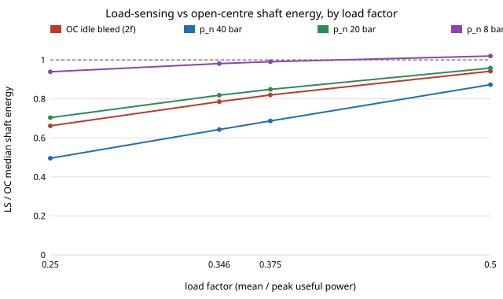
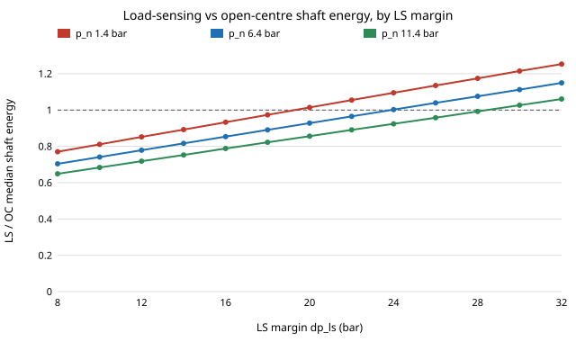
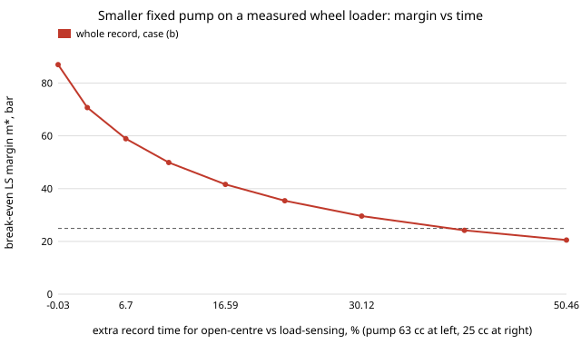
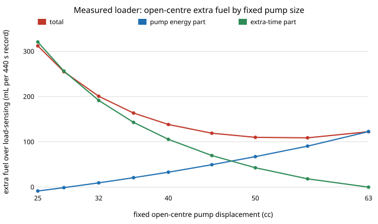

# Does load-sensing pay on a small earthmover? Margin, duty-cycle and pump-size sensitivity of open hydraulic circuits, on a force model, a measured wheel loader and measured excavator motion

*Draft (milestone 6, with 5y and 5z), written with AI assistance (Claude Code). Not submitted. Every number below is copied from a results file under `experiments/` and can be regenerated by the command beside it. Where an input is assumed rather than sourced, the text says so; the conclusions are stated only to the extent those inputs allow.*

Target venue: International Journal of Fluid Power, or the Bath/ASME Symposium on Fluid Power and Motion Control (short paper). An aim, not a claim of acceptance.

## Abstract

Small earthmovers are built with fixed-displacement open-centre hydraulics, load-sensing (LS) pumps, or, in research prototypes, independent metering. We ask which circuit a small shop can build from catalogue parts to come closest to stock energy use, and where the ranking flips. We build an open energy model of the three circuits and test it on two kinds of evidence. **On a measured machine the answer is load-sensing, whatever fixed pump open-centre is given.** On a public 440 s trace of a 6 t load-sensing wheel loader (18 Y-cycles of gravel, 2 ms pressures, positions and ECU fuel rate), the model's LS rung reproduces measured pump energy within 2.3%, and a fixed 63 cc open-centre pump on the same motion needs 1.42 to 1.54 times the LS pump energy. Its break-even LS margin is 87 bar against the measured 24.9 bar, and it splits exactly into the pump-to-demand volume ratio (1.79) and the pressure the surplus flow is pushed at (99.5 bar), not the 134 bar demand-weighted working pressure, which overstates it by 27%. A smaller fixed pump matches LS pump energy only at 28.5 cc and 39% more cycle time; priced at the record's own fuel rate, no fixed pump from 25 to 63 cc matches LS fuel per unit of work, and the best size (53.5 cc) still burns 11.5% more (10.2 to 12.7% over the swept pump efficiency and fuel-rate readings, 6.2 to 6.8% if the extra time ran near idle). **On a synthetic small-excavator cycle the ranking is not structural.** With a force model of a 1.5 to 3 t machine, sourced margins (25 bar LS differential limiter, 6 bar spool drop) make LS use more shaft energy than open-centre with no idle time (median ratio 1.04) and 21% less at a 0.35 load factor; the break-even is set by the pressure an open-centre block holds with its levers neutral (about 6 to 11 bar). Read from an excavator-class valve's bypass curve (about 11 bar at 45 L/min), LS wins for both sourced margins up to a break-even margin of 28 bar. The force model's working pressures (24 to 46 bar) are about a quarter of the loader's, which is why its break-evens are four times lower. At retail parts prices the extra cost of an LS pump does not repay in fuel within 2,000 h in any cell of the synthetic grid (shortest 2,566 h). Boom-lowering energy recovery returns roughly 1 to 12% of working-time shaft energy over a swept range of arm mass and drop height. Independent metering saves a median 34 to 36% of LS energy in the model but is an ideal bound. The open-centre loader is simulated on measured motion, not measured. On public excavator data, a pressure trace of a 49 t class machine (median 174.1 bar while moving) and cylinder flow derived from the joint motion of a 7.5 t class machine (a fixed pump at the p99 of demand delivers 2.38 times the oil used) put the break-even margin near 139 bar, far above any margin sold, but no excavator fuel record was found; we list what one would have to show to confirm or overturn each claim.

## 1. Introduction and related work

Vukovic, Leifeld and Murrenhoff (*Energies* 10(5), 687, 2017, doi:10.3390/en10050687) give a measured Willans-style fuel model of an 18 t excavator and show that hydraulic efficiency alone can mislead. Eriksson and Palmberg (*Proc. IMechE Part I* 225(2), 2011, doi:10.1243/09596518JSCE1111) review independent metering. Williamson (Purdue PhD thesis, 2010) reports measured fuel reductions on a displacement-controlled 5 t machine. Briganti (Politecnico di Torino MSc thesis, 2021/22) simulates a midi LS excavator and is our source for the 25 bar limiter, 0.92 volumetric and 0.96 hydraulic-mechanical efficiency. Juza and Hermanek (2023) measured an open-centre block (6 bar spool drop, efficiency 0.8834). The open-hardware literature (Pearce, *Science* 337, 2012; Open Source Ecology) publishes designs without energy accounting. What we add is narrow: an open, runnable comparison that reports **how the ranking depends on the unsourced inputs**, with a price and payback from public catalogue listings. Citation status (2026-11-12): every DOI in this draft (Vukovic et al., Eriksson and Palmberg, and the five data and measurement records cited below) resolves through `research/_shared/cite_check.py` to the title we cite (`paper/cite_check.json`), as do Pearce (doi:10.1126/science.1228183) and HEAP (arXiv:2106.05059) in the proposal. The theses (Williamson, Briganti) and the valve and pump catalogues have no DOI and were found by title; each is to be opened again before submission.

## 2. Model

Each cycle phase lists actuator load pressures and flows. Hydraulic power is p Q. Open-centre: full pump flow at the highest load pressure plus the spool drop. LS: summed demand at the highest load pressure plus the LS margin. Metered: each actuator at its own pressure plus a small drop. Shaft energy divides by pump efficiency. For a single actuator the LS energy is exactly useful x (1 + dp/p) / eta, which the test suite checks (`tests/test_circuits.py`, 6 tests). Idle phases (milestones 2f to 2h) charge open-centre a bleed through its centre bypass at a neutral pressure p_n and LS its idle demand at (p + margin) plus a standby flow.

Loads come from a force model (`experiments/physics_cycle.py`): dig force from Reece's earthmoving equation, lift from bucket-plus-soil weight on a lever, swing from inertia plus friction. Its soil parameters, lever ratios, 45 L/min pump and 180 bar relief are assumed typical ranges, not opened sources.

## 3. Results

All ratios are medians over 5,000 to 20,000 seeded model cycles.

**3.1a A sourced neutral pressure reverses the idle ranking (milestone 2i).** Reading the open-centre neutral drop from the Salami VD8A sectional-valve catalogue (about 1 bar per section at the 75 L/min nominal flow; 8-spool curve about 12.7 bar at 90 L/min; Q-squared scaling) gives 1.1 to 3.2 bar at our 45 L/min pump for 3 to 8 sections, below the 6 to 11 bar break-even. At load factor 0.346 the median LS/OC is then 1.08 to 1.12 (LS worse in 72 to 80% of cycles), and 1.02 to 1.03 with an assumed extra 5 bar for return line and cooler (`neutral_sourced_results.txt`). The abstract's "21% less" therefore holds only if the neutral path holds 6 to 8 bar or more; this is one valve family and the LS margin is still unsourced.

**3.1b The load-sensing margin reverses it again (milestone 2j).** The 25 bar margin is one thesis model of a midi excavator. Rexroth Canada's A10VO manual (Module 3A, s. 7.2) gives a factory standby setting of "usually 200 PSI" (13.8 bar), and reseller listings give a 14 bar LS differential for A10VO DFR units. With dp_ls 14 bar and the same sourced valve drop, the median LS/OC at load factor 0.346 is 0.893 (extra neutral drop 0) and 0.817 (extra 5 bar): load-sensing is ahead (`dpls_sourced_results.txt`). At 25 bar it is 1.115 and 1.021. The sign of the circuit gap therefore turns on a margin on which the two sources disagree by 11 bar; we found no excavator main-valve value and no standby flow.

**3.1c The boundary, not a point (milestone 2l).** Sweeping the LS margin from 8 to 32 bar against three open-centre neutral pressures (valve-only 1.44 bar from 2i, plus an assumed 5 and 10 bar) at load factor 0.346, the median LS/OC ratio rises monotonically with the margin and crosses 1.0 at a margin of 19.3 bar (neutral 1.44 bar), 23.9 bar (6.44 bar) and 28.4 bar (11.44 bar): about 0.92 bar of margin per bar of neutral pressure (`ranking_map_results.txt`). A machine whose LS margin is below the line favours load-sensing; above it, open-centre. The 14 bar Rexroth value sits below all three lines and the 25 bar thesis value above the first two, which is why 2i and 2j disagreed.

**3.1d An excavator-class valve's neutral drop puts the break-even at 28 bar (milestone 2n).** Danfoss's PVG 32 Technical Information (BC152886483664, rev. May 2021, p. 16) plots the open-centre input module's bypass pressure drop in neutral: about 8.5 bar near zero flow rising to about 16 bar at 140 L/min (figure reading, +-0.5 bar). At the model's 45 L/min pump that is 10.9 bar. With load factor 0.346 and an assumed 2 L/min LS standby flow, the median LS/OC ratio crosses 1.0 at a margin of 28.0 bar (27.5 to 28.4 over the reading band), so LS uses less shaft energy than open-centre for both sourced margins: median ratio 0.759 at 14 bar and 0.949 at 25 bar, with LS worse in 0.8% and 33.6% of cycles (`pvg_neutral_results.txt`). This was predicted before running from the 2l line (28.0) and reverses 2i, which used a 1.4 bar drop from a 75 L/min catalogue valve. The drop is the input module's bypass path only, from one manufacturer, paired with a Rexroth margin from a different machine; we have not shown which path a given excavator's neutral flow takes.

**3.1 The ranking depends on idle time and neutral pressure.**

| Condition (LS shaft energy / open-centre) | Median | Share of cycles LS > OC | Source file |
|---|---|---|---|
| Sourced margins, no idle time | 1.043 | 62.5% | `physics_cycle_sourced_results.txt` |
| Load factor 0.5 | 0.942 | 34.9% | `idle_sensitivity_results.txt` |
| Load factor 0.375 | 0.820 | 12.5% | same |
| Load factor 0.346 (measured trace) | 0.786 | 8.4% | same |
| LF 0.346, p_n 8 bar, no standby | 0.981 | 43.9% | `idle_models_results.txt` |
| LF 0.346, p_n 8 bar, 6 L/min standby | 1.035 | 61.1% | same |





*Figure 1 (`experiments/figure.py`, parsed from `idle_models_results.txt`; LS standby 0): the ranking moves with the open-centre neutral pressure; 8 bar is the only curve above 1, and only at load factor 0.5.*

The load factor 0.346 is mean over peak electrical input power of the CWA reference profile for electric excavators (Zenodo 18862594, CC-BY-4.0), a **computed** profile for a 75 t machine scaled to 100 kW, not a measurement; two real electric excavators in the same document have load factors of 0.49 and 0.53 (40 of 81 kW and 49 of 92 kW), and the ranking is insensitive to the choice (`ranking_map_lf_results.txt`, load factors 0.15 to 0.70); it fixes a shape, not a hydraulic load. The break-even neutral pressure above which LS wins is 6.4 to 10.8 bar at that load factor, depending on standby flow (`idle_breakeven_results.txt`). The only sourced neutral drops are a 1.4 bar sectional-valve catalogue figure and a 10.9 bar PVG 32 bypass-curve reading (3.1a, 3.1d); they differ by 9.5 bar and the ranking sign follows them.

**3.2 Independent metering.** The ideal-metering to LS ratio is 0.64 to 0.66 across all force-model conditions and below 0.85 in every cycle. It is a lower bound: no valve dynamics, no pump-controlled alternatives, no price.

**3.3 Payback (H5).** Retail listings read 2026-10-29: Kawasaki K3VL28 LS piston pump $1,707.99; a 28 cc gear pump GBP 113.40; a 3-section open-centre monoblock $342.99; diesel $6.276/gal (secondary summary). No public price exists for an LS sectional valve; its premium is swept at 1 to 5 times the monoblock. At load factor 0.346 and an assumed BSFC of 250 g/kWh, payback is 181,000 h (8 bar neutral), 7,400 h (20 bar) and 2,860 h (40 bar) with the pump premium alone; the best cell is 2,566 h (`payback_results.txt`). H5 (payback within 2,000 h) is refuted on these parts. The comparison is a piston LS pump against a gear pump, so it also prices non-energy differences.

**3.4 Energy recovery.** Boom-lowering recovery, E = (m_arm + m_load) g dh with a round-trip efficiency eta_rt, returns a median 3.3% (open-centre) and 3.2% (LS) of cycle pump-shaft energy at 300 kg, 0.8 m, 0.7, and 10.0% to 11.8% at 600 kg, 1.2 m, 0.92 (`regen_bound_results.txt`, `regen_uncapped_results.txt`). The cap on the lift phase binds in 0% of cycles at the central point and 75% at the upper corner. Arm mass, drop height and round-trip efficiency are swept, not sourced (the efficiencies are from abstracts only), and no idle time is added, so these are upper bounds on the working-time share.

**3.4a Recovery hardware: rating, electric rung and fuel payback (milestones 5c to 5f).** Boom lowering lasts about 2.5 s, so a device of rated power P takes at most P times the window. The median mean recovery power over 2.5 s is 823 W at the central point and 2,921 W at the upper corner (`regen_window_results.txt`); a rating of 1 kW or more leaves the central share at 3.33% / 3.21% (OC / LS), and 5 kW leaves the corner at 10.01% / 10.26%, while 0.5 kW cuts the central share to 2.02% / 1.96%. The predicted corner cut of over 1 point at 5 kW was refuted (0.00 points). For assumed lowering shapes (flat, trapezoid, half-sine, triangle; peak/mean 1.0 to 2.0) the rating that captures 95% of the energy is 0.95 to 1.55 times the mean power, so about 0.78 to 1.28 kW centrally and 2.77 to 4.54 kW at the corner (`regen_peaky_results.txt`); an earlier guess of "2x" applies only to capturing 100% on the worst shape. On the electric rung the modelled mean shaft power of 2.3 kW implies a battery draw of 2.5 to 4.3 kW for chain efficiencies 0.80 to 0.92, so 20 kWh lasts 4.7 to 8.0 h against a vendor's indicative 4 h, meaning the model omits travel, auxiliaries or heavier duty by a factor 1.2 to 2 (`electric_rung_results.txt`; the vendor figure is marketing, not a trace). On fuel alone a 1.5 to 5 kW generator-class recovery unit priced from retail listings saves 76 W at the central 3.3% share ($0.04 per hour) and pays back in 8,200 to 45,600 h; at the 10% corner it saves 230 W and pays back in 2,700 to 15,100 h (`regen_price_results.txt`). Retail wind-generator prices are a floor for a construction-grade drive, BSFC (250 g/kWh) is assumed, and no inverter, mounting or measured boom trace is included, so recovery does not pay in diesel at the central duty and its case would have to rest on battery size or emissions. **Measured lowering shape and watts (5g, 5h).** On the PATU 655 forestry-crane dataset (Saeed, Zhidchenko and Handroos, Mendeley Data 10.17632/rn5j42rpyr.1, CC BY 4.0; 772 lowering strokes, 95 to 278 kg), the median peak-to-mean power ratio is 1.52 and the median rating for 95% capture is 1.24 times the stroke mean (p90 1.61), inside the assumed 0.95 to 1.55 range, so the shape assumption holds on a real hydraulic boom (`regen_measured_results.txt`). The cylinder bore is not in the files; it is taken from Khadim et al., IEEE Access 10:62863, 2022, doi:10.1109/ACCESS.2022.3179591, Table 2 (piston area 7.85e-3 m2, rod-side area 5.4e-3 m2, i.e. a 100 mm bore and 56 mm rod), which gives a median mean lowering power of 1.21 kW (p10 to p90 0.64 to 2.22 kW); sweeping the bore to 80 and 125 mm instead gives 0.78 and 1.89 kW (`regen_watts_results.txt`), the same range as the modelled excavator arm. These are lab scripted motions on a different machine and hydraulic power before any recovery efficiency; an excavator pressure trace (H4) is still missing. **Measured lowering time and a published excavator power profile (5k, 5l).** A stopwatch test of a Caterpillar 305.5E2 (Halim et al., Int. J. Current Science Research and Review 8(11):5863, 2025, doi:10.47191/ijcsrr/V8-i11-43, Zenodo 10.5281/zenodo.17760471, CC BY 4.0) gives an unloaded full-stroke boom lowering of 2.10 s (specification 1.7 to 2.5 s), so the 2.5 s window used above is the slow end. At 2.1 s the median mean recovery power is 979 W centrally and 3,478 W at the upper corner, and the rating for 95% capture (1.24 times the mean) is 1.21 and 4.31 kW (`regen_cat_window_results.txt`); at 1.7 s the corner needs 5.33 kW, so the 1 to 5 kW range priced above still holds and the no-fuel-payback conclusion does not change. This is an unloaded stroke at full engine speed, so it bounds the window from the fast side only. A published electric-excavator power profile (Arrinda et al., Zenodo 18862594, CC BY 4.0, a CWA pre-normative profile; machine class not stated) has a peak-to-mean power ratio of 2.89, a best 3 s window of 1.85 times the mean, and 22.7 kWh over 1,779 s (`cwa_profile_results.txt`); a power-limited recovery or battery stage therefore faces a peaky total load, but negative power is 0.001% of positive energy, so the profile contains no modelled regeneration and neither supports nor refutes the recovery share. It is electric input power, not cylinder pressure, so H4 remains untested.

**3.5 Cycle time: the open-centre valve can be slower, and charging for it does not change the ranking (milestones 3a to 3f).** An uncompensated open-centre valve shares pump flow by its spool openings, so a high-pressure actuator can stall while a light one runs; load-sensing does not. In a steady-state flow-sharing model (orifice sections sized to pass their demand alone, a bypass that closes at a rate k per unit of section area, no operator feathering, dig phases capped at a factor-2 stall bound; `flow_share_shape_results.txt`), the open-centre median cycle-time penalty at the 10.9 bar neutral drop is 5.8% at k = 1 and 0.0% for k from 1.5 to 5, with a 95th percentile of 21.6% at k up to 1.5 and 0.07% at k = 5. At the 1.44 bar sectional-valve drop the median is 21.6% for every k up to 2, so a low neutral drop leaves little pressure rise to unstall the heavy actuator. Load-sensing's own pump-limit penalty on the sampled cycles is 0.00% (`flow_share_ls_results.txt`). Rows at k of 20 or more size the sections for a supply pressure above the 250 bar relief setting, outside the model's validity, and are not used. Charging the open-centre pump its full power for the stretched seconds (an upper bound on the energy cost of slowness) moves the break-even LS margin from 28.0 bar to 35.8 bar at k = 1, 31.1 at k = 1.5, 29.4 at k = 2, 28.3 at k = 3, 28.0 at k = 5, and 29.5 at k = 10 (not monotone: the 95th-percentile tail of the penalty is enough to move a cycle-mean ratio; `time_penalised_results.txt`). Charging slowness can only help load-sensing, so the energy ranking at both sourced margins stands and strengthens when the bypass closes slowly. Replacing the closing law with spool sizes read from the same manual's pressure-drop curves (p. 99, work-port-to-tank drop at maximum travel, used as the rating point; read error about 1 bar) gives a median open-centre time penalty of 6.25% at 1.0 times rated flow (2.64% at 1.2 times, 16.81% at 0.8 times), and the time-penalised break-even moves to 36.1 bar (34.0 to 38.9 across that reading); at the 14 bar margin LS/OC is 0.663 against 0.757 with no penalty (`time_penalised_rated_results.txt`). This was predicted to lie between 30 and 38 bar before running and did. The rating point is cross-checked against a second, independent figure of the same manual: its P to A flow curves at 10 and 20 bar margin (pp. 95 and 96, digitised, read error about 2 L/min) give a full-travel flow of 1.14 times the rated flow at 10 bar (median over the five spools), which for an orifice means the rating applies at a drop of about 7.3 bar (spools A to E), the same median as the 7.3 bar read from the p. 99 curves; the median flow exponent between the two margins is 0.53 against the orifice 0.50, with spool-to-spool scatter from 0.38 to 0.96 (`pvg_flow_rating_results.txt`). The penalty depends on pump size: scaling the pump flow with demands fixed, and charging load-sensing its own pump-limit factor, the median net open-centre penalty is 17.51% at 0.8 times the 45 L/min pump, 6.25% at 1.0 times, 0.00% at 1.2 times and 0.00% at 1.5 times (95th percentile 21.62% at 1.2 times and 10.68% at 1.5 times; `pump_size_results.txt`; predicted before running). Pricing the larger pump in energy (open-centre delivering its full flow at the highest load pressure, plus a neutral drop read from the PVG 32 curve at the scaled flow) moves the time-penalised break-even LS margin from 36.1 bar at 1.0 times to 40.0 bar at 1.1 times and 44.5 bar at 1.2 times, with no crossing below 60 bar at 1.5 times (`pump_size_energy_results.txt`; predicted before running), so removing the starvation penalty with a bigger pump makes open-centre worse in energy; parts cost is still not charged. In fuel and parts terms (`pump_cost_results.txt`, predicted before running; the energy half of the prediction was refuted), a pump 1.2 times larger raises mean open-centre shaft energy per cycle by 14.1% (88.0 to 100.5 kJ, idle neutral flow included) and cuts mean cycle time by 2.55%; at 1.5 times the figures are 34.8% and 4.70%. Valuing the saved time, the break-even value of a machine hour is $7.67 at 1.2 times and $10.27 at 1.5 times with pump price proportional to flow ($8.82 and $11.84 at three times that slope), so a larger pump pays in money wherever a machine hour is worth more than about $9 even though it loses in shaft energy; the pump price is one retail listing scaled linearly and is assumed. The energy penalty rests on charging open-centre the whole pump flow at the highest load pressure in every work phase. Letting a fraction f of the surplus flow (pump flow minus demand) be charged instead (`surplus_fraction_results.txt`, f swept and not sourced), the time-penalised break-even LS margin at 1.0 times pump falls from 36.1 bar at f = 1 to 27.5 bar at f = 0.5 and 18.8 bar at f = 0, and at 1.2 times from 44.5 bar to 31.7 bar and 18.8 bar; the prediction that it would fall below 28 bar at f = 0.5 and below 14 bar at f = 0 was refuted on both bounds. Even a perfectly demand-matched open-centre circuit only beats load-sensing once the margin exceeds about 19 bar, so the sourced 14 to 30 bar margin range straddles the break-even whatever f is, but f is not a valve property for a fixed pump: surplus flow can only leave through the bypass at the pump pressure, which must exceed the heaviest load, so shaft power is Q p and f = 1 is exact (flow-continuity solution over 2,000 random phases: pressure error 6e-14 bar, energy error 5e-16 relative; widening the bypass lowers the pressure and starves the actuators in all 8,000 cases; `fixed_pump_identity_results.txt`). The f < 1 rows therefore describe a pump that unloads or follows demand, i.e. the load-sensing family, and the fixed-pump break-even stays at 36.1 bar (1.0 times) and 44.5 bar (1.2 times). The bypass closing law is a one-parameter family, not a measured area curve, and no compensator dynamics or line dynamics are modelled. The compensator's steady-state loss is not missing: load-sensing is charged the whole pump-to-load margin on all flow (`tests/test_circuits.py`, milestone 3o), so every break-even margin above is a total pump margin, spool and compensator together.

**3.6 A measured load-sensing machine (milestones 5n and 5o).** A public 440 s trace of a 6 t load-sensing wheel loader loading gravel (Linjama et al., Zenodo doi:10.5281/zenodo.10639199, CC BY 4.0; 2 ms samples of cylinder and pump pressures, piston positions, engine speed and ECU fuel rate) is the first measured machine in this study. Its median load-sensing margin during motion is 24.9 bar (standby 30.8 bar), inside the 14 to 25 bar pair used above. The model's constant-margin LS rung reproduces measured pump hydraulic energy to within 2.3% (ratio 1.023), a weak test because both sides share the measured flow. As a counterfactual, a fixed 63 cc open-centre pump on the same motion must deliver its whole flow at load pressure while any section moves, whatever its bypass closing law; that floor alone needs 1.37 to 1.43 times the measured LS pump hydraulic energy (neutral drop 0 to 10 bar). Which samples count as motion was the largest unsourced input in 5n; measured as the 99th percentile of flow in windows where the piston does not move, it is 0.80 L/min (lift) and 1.76 L/min (tilt), and with a 10 bar spool drop open-centre then uses 1.54 times the LS energy (per-cycle 95% interval 1.46 to 1.63) and adds 14.7% to measured fuel. A motion rule from piston position alone gives 1.51. The machine is a wheel loader, not an excavator, and the open-centre machine is simulated on the measured one's motion (`measured_loader_results.txt`, `measured_motion_results.txt`).


**3.6a How small can the open-centre spool drop be? (milestones 5p and 5q).** An uncompensated spool fully open passes q = K sqrt(dp), so while a section moves the pump pressure is at least the load pressure plus (q/K_full)^2, whatever the lever or bypass law. Reading K_full from the PVG 32 full-travel P-to-A curves (3j) and sizing each actuator-phase to the smallest covering spool gives an energy-weighted floor of 4.77 bar and a break-even margin of 26.5 bar (27.2 with a two-point power law), against 28.0 with the 6 bar measured block of 2d (`spool_floor_synthetic_results.txt`). Sized once per function for the largest flow it can be asked to pass, as valves are chosen (arm spool B, boom, bucket and swing D), the floor falls to 2.33 bar and the break-even to 23.0 bar; sized per function to each cycle's own peaks it is 25.6 bar (`spool_function_sizing_results.txt`). With no drop at all the break-even is 20.6 bar, rising 1.24 bar per bar of drop, so load-sensing at the 14 bar manual margin beats any open-centre valve in this setup, while the 25 bar thesis margin and the measured loader's 24.9 bar sit inside the 23.0 to 25.6 band where the real partial-travel drop decides. The function mapping (dig = arm + bucket, lift and lower = boom, dump = bucket) is our reading of the phase names. On the measured loader (5r) the same floor raises the open-centre counterfactual only from 1.40 to 1.424 times the measured load-sensing pump hydraulic energy (11.3% more fuel), so on that machine the penalty comes from the fixed pump delivering its whole flow at the highest load pressure, not from the spool; the lift flow exceeds the largest PVG 32 spool's 100 L/min rating in 11.2% of moving samples, where the floor is extrapolated (`spool_floor_results.txt`).

**3.6b The break-even margin in closed form (milestone 5s).** Load-sensing energy in this model is affine in the margin m and open-centre energy does not depend on it, so each cycle c has an exact break-even m*_c = (S_c + D_c + I_c) / B_c: surplus pump flow dropped at the highest load pressure while moving, pump flow times the spool drop while moving, idle bleed net of LS idle work, over the volume LS delivers. Because LS/OC rises with m in every cycle, the median LS/OC equals 1 exactly at the median of m*_c, and LS loses in a cycle exactly when m > m*_c. On the 3,000 cycles the closed form reproduces every grid break-even of sections 3.1d and 3.6a within 0.075 bar (e.g. 27.97 against 28.0 for 2n, 23.00 against 23.0 for envelope sizing) and every LS-worse share within 0.03 points (`breakeven_closed_form_results.txt`). The slopes read off the sweeps are exact volume ratios: median 1.235 bar of margin per bar of spool drop and 0.916 per bar of neutral pressure. At zero spool drop m*_c spans 10.7 to 34.1 bar over cycles (5 to 95%), with surplus flow carrying a median 61% and idle bleed 39%. A reader can therefore place their own machine from phase times, flows and peak pressures alone.

**3.6c The break-even margin is a volume ratio times a load pressure (milestones 5t and 5u).** Writing V for the volume load-sensing delivers while the open-centre pump moves, r for the fixed pump's volume over V, p_Q and p_q for the time- and demand-weighted highest load pressure and beta = V / B, the surplus term is exactly S = V (r p_Q &minus; p_q), so m* = beta [(r &minus; 1) p_q + r (p_Q &minus; p_q) + r d] + I / B. On the 3,000 force-model cycles r has median 1.433 and p_q median 33 bar, the surplus term is 12.2 bar and the idle term 8.1 bar of the 20.5 bar break-even; the pressure-flow covariance term is centred on zero but is a median 11.1% of the surplus part in magnitude (`breakeven_volume_ratio_results.txt`). The two-number rule (r &minus; 1) p_q + r d, without idle, reads low by a factor 0.690 at zero drop; with the idle term added the per-cycle error is a median 6.4%. r ranks cycles (Spearman 0.765) and p_q hardly does (0.118), because the force model's working pressures span only 24 to 46 bar. On the measured loader (5t) the exact break-even is 87.0 bar under the PVG 32 floor (per Y-cycle 59.0 to 143.0 bar), with r = 1.78 (`measured_breakeven_results.txt`).

**3.6d On the loader, the surplus flow is pushed at a lower pressure than the work (milestone 5v).** Running the same split on the measured record (`measured_volume_ratio_results.txt`) settles the inference 5t left open, and corrects it. The demand-weighted load pressure p_q is 133.9 bar (per Y-cycle mean 95% bootstrap interval 131.6 to 141.0 bar), four times the force model's 33 bar, and the pressure-flow covariance term is &minus;27.1 bar, not centred on zero: the fixed pump's surplus flow arrives when demand, and so pressure, is low. Writing p_s = (r p_Q &minus; p_q) / (r &minus; 1) for the pressure the surplus is pushed at, the split becomes exact with two numbers and idle, m* = beta [(r &minus; 1) p_s + r d] + I / B, with p_s = 99.5 bar (per cycle 79.2 to 125.9 bar) and beta 0.995. Using the working pressure in place of p_s, the two-number rule (r &minus; 1) p_q + r d reads 110.3 bar against the exact 87.0 (1.268 times), and per cycle it is off by a median 30.5%. As on the synthetic cycles, r ranks the loader's 18 Y-cycles (Spearman 0.920) and p_q hardly does (0.243). Swapping one input at a time between the two settings, (r &minus; 1) p_q goes from 14.3 bar (synthetic) to 26.2 with the loader's r and 58.0 with the loader's p_q, against 106.1 bar for the loader: the load pressure carries most of the fourfold gap, the volume ratio the rest. For a designer, the break-even is a property of how far the fixed pump overshoots demand (r) and of the pressure at which the overshoot happens, which a pressure trace gives directly and a nameplate working pressure overstates.

**3.6e A smaller fixed pump buys energy parity only with cycle time (milestone 5w).** Sections 3.6 to 3.6d keep the loader's own 63 cc pump in the open-centre counterfactual. Sweeping it from 63 to 25 cc at the measured engine speed, with the actuators slowed wherever demand exceeds the pump so that the pump still delivers the demanded volume (the slowed sample's hydraulic energy is unchanged; only time is added), the break-even margin falls from 87.0 bar to 20.5 bar and record time rises up to 1.5046 times load-sensing's (`measured_pump_size_results.txt`; load-sensing is charged its own 63 cc limit, so the ratio isolates the smaller pump). Open-centre matches load-sensing's pump energy at the measured 24.9 bar margin only at 28.51 cc, where the record takes 1.3885 times as long (per Y-cycle 1.27 to 1.54); every pump of 40 cc or more still loses on energy (41.6 bar break-even at 40 cc), at 16.6% more time. The trade worsens as the pump shrinks, from 5.6 bar of break-even margin per percent of extra time (63 to 56 cc) to 0.4 bar per percent (28 to 25 cc).



**3.6f Priced in fuel, no fixed pump wins (milestone 5x).** Equal motion is equal work, so the record's own ECU fuel signal (0.935 L over 440.2 s) puts both sides of 3.6e's trade in litres per unit of work: extra fuel = b (E_OC &minus; E_LS) / eta + f_t (T_OC &minus; T_LS), with b = 0.2332 L/kWh the record's Willans slope (refitted, r = 0.957), eta = 0.818 the measured pump hydraulic energy over the authors' shaft estimate (3,867 over 4,725 kJ; swept 0.75 to 0.95), and f_t the fuel rate of the rest of the machine over the extra time, read three ways from the record: 5.15 L/h (mean rate less the work pump's share; central), 5.99 L/h (while the work hydraulics are still) and 1.48 L/h (5th percentile of 1 s means, near idle) (`measured_fuel_time_results.txt`). Load-sensing at the measured margin models 0.942 L against 0.935 L measured. At the loader's own 63 cc pump open-centre burns 13.0% more fuel than load-sensing; the fuel-minimising fixed pump is 53.5 cc, at 11.5% more; at 5w's energy-parity pump (28.51 cc) it is 26.2% more, all of it the longer record. No pump size from 25 to 63 cc on a 0.5 cc grid matches load-sensing under any of the three fuel-rate readings and any eta from 0.75 to 0.95, and none does in any of the 18 Y-cycles (per-cycle best size median 54.5 cc, 45 to 60 cc). Across eta and the still and rest-of-machine rates the minimum penalty is 10.2 to 12.7%; only if the extra time ran near idle does it fall to 6.2 to 6.8%, at a 35.5 to 38.5 cc pump. The rate while the work hydraulics are still is higher than the rest-of-machine mean, not lower as we predicted, because on a Y-cycle the bucket is still while the loader drives.



*Figure 2 (`experiments/fuel_time_figure.py`): the fuel curve is flat from about 50 to 63 cc and climbs steeply below 45 cc; the pump size moves the penalty between surplus flow (large pump) and a longer working day (small pump), but does not remove it.*

**3.7 A measured excavator works at five times the force model's pressure (milestone 5y).** The first excavator pressure trace in this study comes from the `fuxi-robot/excavator-motion` dataset on Hugging Face (CC BY-NC-SA 4.0): ten truck-loading recordings, 76.7 min in all, of one large excavator (folder `490`, a 49 t class machine by our reading of the name; the dataset card does not say), with 8 unlabelled pressure channels and the boom, arm, bucket and swing joint angles at about 10 Hz (`measured_excavator_results.txt`; only the small arrays are read, by HTTP range requests, and nothing from the dataset is redistributed). One channel is dead in every file. Over the samples where the boom, arm or bucket moves faster than 0.05 rad/s (86.9% of the record), the highest of the seven live channels has a median of 174.1 bar (95% bootstrap over files 167.1 to 180.4 bar), 5.28 times the force model's demand-weighted 33 bar and 1.30 times the loader's 133.9 bar. Without the one channel that passes 400 bar it is 155.4 bar. The reading moves by under 4 bar across moving thresholds of 0.02 to 0.10 rad/s, across four ways of pairing the pressure and angle rows (the files hold a few more pressure rows than angle rows), and with no motion mask at all. Because the channels are unlabelled, the highest live channel is an upper reading of the highest load pressure: it may include a pump or a return-side pressure. A 49 t machine also runs a higher relief than the 180 bar small machine of the force model, so we normalise (not registered in advance): the moving median is 0.392 of the machine's top pressure (p99.9 of the highest channel, 444.1 bar), or 0.434 without that channel, against 0.183 for the force model, a factor of 2.14 to 2.37. At a 180 bar relief that share is a working pressure of 70.6 to 78.2 bar, not 33. Put into the volume-ratio rule of 3.6c at the synthetic r of 1.433, with the loader's covariance correction of 0.78, the break-even margin rises from 11 bar on the force model to 23.8 bar (pressure as a share of relief) or 58.8 bar (absolute pressure). The force model's synthetic break-evens, near the 14 to 25 bar margins sold, therefore sit at the low end; on measured excavator pressure, load-sensing's advantage is at least as clear as on the loader, unless the excavator's flow is much smoother than its synthetic cycle (r near 1). The excavator files carry no flow, so r on this machine stays untested.

**3.7b The volume ratio on measured excavator motion is about 2.4 (milestone 5z).** Folder `75` of the same dataset holds ten truck-loading recordings (16.0 min, sample interval 99.3 to 99.8 ms) of a second excavator, an XCMG of the 7.5 t class by our reading of its file names, with joint angles and joint speeds but no pressure (`measured_excavator_flow_results.txt`). We turn joint speed into cylinder flow with the published cylinders of the XCMG XE80E (bore x rod x stroke: boom 110 x 75 x 922, arm 95 x 60 x 885, bucket 85 x 55 x 742 mm; a dealer listing of the XE75U gives the same cylinders within 1 mm) and its 219 L/min load-sensing pump. Each cylinder's rod speed is a constant lever, stroke over the joint's observed travel (p0.1 to p99.9), times joint speed; the cap area applies when it extends and the annulus when it retracts. Swing is charged a share of pump flow in proportion to swing speed over the 12 rpm maximum (central share 0.5, swept 0 to 1). The dataset's own forward-kinematics script fixes which way the boom and arm cylinders move; the bucket's sign is swept and moves the result by under 1%. The machine moves in 97.5% of samples, but its demand is peaky: a median of 90 L/min against a p99 of 240 L/min. With swing left out, the cylinders' p99 demand is 218.8 L/min, within 0.1% of the published pump maximum. No lever was fitted to get that, so it is a check the method passed. A fixed pump sized at that p99 delivers 2.38 times the oil the work uses (per file 2.31 to 2.51, 95% bootstrap over files 2.34 to 2.42), against 1.79 on the loader and 1.433 on the synthetic cycles. Over 384 geometry cases (independent lever factors of 1 to 2.5 per joint, both bucket signs, swing share 0, 0.5 or 1) it is 1.95 to 3.08 (median 2.44), and 1.69 to 2.63 for a pump sized at the p95. Without the kinematic signs the ratio would be poorly fixed: over all 8 sign assignments it runs from 2.376 to 4.075. Put into the rule of 3.6c with the loader's covariance factor 0.78 and 5y's share of top pressure on this machine's 316 bar maximum (0.41 x 316 = 130 bar), the break-even load-sensing margin is 139.1 bar at r 2.38, and 95.7 bar at the lowest p99 ratio of the sweep (70.0 bar at the lowest p95 ratio). That is several times the 14 to 25 bar margins sold, and the synthetic r alone gives 43.8 bar at the same pressure. The two halves of the rule come from different machines (flow from the 7.5 t class, pressure from the 49 t class), the levers are constant rather than the real linkage, and 10 Hz sampling misses short peaks, which would raise both the p99 and r. Within those limits, both numbers in the rule come out higher on measured excavator data than on the synthetic cycles, and load-sensing wins by a wide margin. H4's fuel comparison stays open: neither excavator folder carries fuel or pump flow.

Section 4, item 1 therefore extends: the force model's low working pressure and its smooth synthetic flow set every synthetic break-even, and the measured machines' break-evens are about four (loader) to seven (excavator, 5y with 5z) times higher.

## 4. Threats to validity

1. No measured excavator fuel or pump-flow record, so H4 is still untested; the one excavator pressure trace (section 3.7) is from a large machine with unlabelled channels and no flow, and the excavator volume ratio (section 3.7b) is derived from another machine's joint motion through published cylinder sizes and constant levers, so the two halves of the excavator break-even come from different machines; the one measured machine (section 3.6) is a load-sensing wheel loader, against which open-centre is only simulated. Its 440 s record is one machine, one operator and one material; its derived actuator demand exceeds the 63 cc pump's geometric flow in 16.3% of samples with demand above 2 L/min (section 3.6e charges both circuits the same limit, so only the difference in time is used).
2. The idle model is an assumption, and the neutral pressure is read from one manufacturer's 75 L/min-class valve catalogue (a figure reading, valve only; section 3.1a), not from an excavator block; the whole LS-versus-OC ranking reduces to it and to the unsourced LS margin.
3. Margins come from two different machines, one simulated.
4. The force model's lift phase carries 5.6 times the gravity work of the bucket load (median), so its phases are not purely gravitational.
5. Parts are retail listings of different brands; the LS valve price is unsourced; diesel is from a secondary summary.
6. No dynamics, leakage, line losses or thermal limits; cycle time is a steady-state flow-sharing model with an assumed bypass closing law and stall bound (section 3.5); no real-machine validation.
7. On the loader (sections 3.6e, 3.6f) a slowed open-centre machine is modelled by stretching each over-demand sample, with no engine speed-up and no change in how the operator drives; the extra time is charged at a constant measured fuel rate, not simulated, and one record-wide pump efficiency serves both circuits (a fixed pump at full stroke is likely more efficient than a variable pump at part stroke, which favours open-centre: at eta 0.95 the minimum penalty is 10.2%). Time is priced in fuel only, not in operator or machine hours, which would widen the gap.

## 5. What would settle it

(a) A measured hydraulic trace of a small excavator with labelled pressure and flow per actuator, to test H4 directly (sections 3.7 and 3.7b supply pressure from a large machine and derived flow from a 7.5 t class one, not both from one machine). (b) A measurement of the neutral pressure drop of an actual excavator block, to choose between the 1.4 and 10.9 bar readings, and an LS standby flow from a pump datasheet. (c) A quoted price for an LS sectional valve. (d) Arm and boom masses for the class. Each removes one swept input from Sections 3.1, 3.3 and 3.4. (e) A measured open-centre machine of the loader's class on a comparable cycle, to test the counterfactual of sections 3.6 to 3.6f directly rather than on load-sensing motion. (f) A payload signal on the same record, to turn fuel per unit of work into litres per tonne moved.

## Reproduce

```bash
cd research/heavy-hydraulics
PYTHONPATH=src python3 -m pytest tests -q
python3 experiments/physics_cycle.py --sourced > experiments/physics_cycle_sourced_results.txt
python3 experiments/idle_sensitivity.py > experiments/idle_sensitivity_results.txt
python3 experiments/idle_models.py > experiments/idle_models_results.txt
python3 experiments/payback.py > experiments/payback_results.txt
python3 experiments/figure.py
python3 paper/check_numbers.py
PYTHONPATH=src python3 experiments/regen_bound.py > experiments/regen_bound_results.txt
python3 experiments/spool_floor_synthetic.py
python3 experiments/spool_function_sizing.py
python3 experiments/breakeven_closed_form.py
python3 experiments/breakeven_volume_ratio.py
# measured loader: Short_Y_cycle_data.mat from doi:10.5281/zenodo.10639199 (CC BY 4.0, 96 MB); needs numpy and scipy
python3 experiments/measured_breakeven.py Short_Y_cycle_data.mat > experiments/measured_breakeven_results.txt
python3 experiments/measured_volume_ratio.py Short_Y_cycle_data.mat > experiments/measured_volume_ratio_results.txt
python3 experiments/measured_pump_size.py Short_Y_cycle_data.mat > experiments/measured_pump_size_results.txt
python3 experiments/measured_fuel_time.py Short_Y_cycle_data.mat > experiments/measured_fuel_time_results.txt
python3 experiments/fuel_time_figure.py
# measured excavator: fuxi-robot/excavator-motion on Hugging Face (CC BY-NC-SA 4.0), range-read; needs numpy and h5py
python3 experiments/measured_excavator.py
python3 experiments/measured_excavator_flow.py > experiments/measured_excavator_flow_results.txt
```
