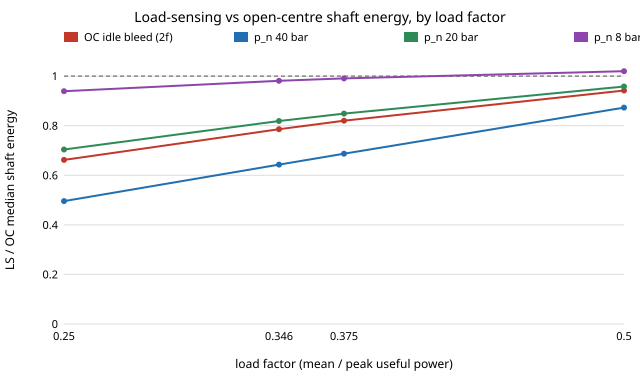
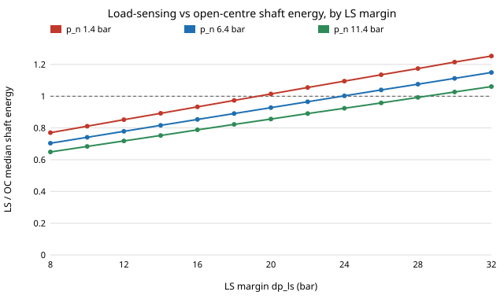

# Does load-sensing pay on a small excavator? Duty-cycle and margin sensitivity of three open hydraulic circuits, with parts-cost payback

*Draft (milestone 6), written with AI assistance (Claude Code). Not submitted. Every number below is copied from a results file under `experiments/` and can be regenerated by the command beside it. Where an input is assumed rather than sourced, the text says so; the conclusions are stated only to the extent those inputs allow.*

Target venue: International Journal of Fluid Power, or the Bath/ASME Symposium on Fluid Power and Motion Control (short paper). An aim, not a claim of acceptance.

## Abstract

Small excavators (1.5 to 3 t) are built with fixed-displacement open-centre hydraulics, load-sensing (LS) pumps, or, in research prototypes, independent metering. We ask which circuit a small shop can build from catalogue parts to come closest to stock energy use, and where the ranking flips. We build an open, stdlib-only energy model of the three circuits over a piecewise-constant work cycle and test its conclusions against the margins we could source. Our main result is negative for a simple story: the ranking of LS against open-centre is **not structural**. With sourced margins (25 bar LS differential limiter, 6 bar spool drop) LS uses more shaft energy than open-centre on a cycle with no idle time (median ratio 1.04), and 21% less at the load factor (0.35) of the one measured electric-excavator trace we found, and the break-even is set by one unmeasured number, the pressure an open-centre block holds with its levers neutral (about 6 to 11 bar at that load factor). Read from an excavator-class valve's own bypass curve (about 11 bar at 45 L/min), LS wins for both sourced margins, up to a break-even margin of 28 bar; with a 1.4 bar catalogue-valve drop the 25 bar margin loses. At retail parts prices the extra cost of an LS pump does not repay in fuel within 2,000 h in any cell of the grid we swept (shortest 2,566 h). Boom-lowering energy recovery returns roughly 1 to 12% of working-time shaft energy over a swept range of arm mass and drop height. Independent metering saves a median 34 to 36% of LS energy in the model but is an ideal bound. We list what a measured hydraulic trace would have to show to confirm or overturn each claim.

## 1. Introduction and related work

Vukovic, Leifeld and Murrenhoff (*Energies* 10(5), 687, 2017, doi:10.3390/en10050687) give a measured Willans-style fuel model of an 18 t excavator and show that hydraulic efficiency alone can mislead. Eriksson and Palmberg (*Proc. IMechE Part I* 225(2), 2011, doi:10.1243/09596518JSCE1111) review independent metering. Williamson (Purdue PhD thesis, 2010) reports measured fuel reductions on a displacement-controlled 5 t machine. Briganti (Politecnico di Torino MSc thesis, 2021/22) simulates a midi LS excavator and is our source for the 25 bar limiter, 0.92 volumetric and 0.96 hydraulic-mechanical efficiency. Juza and Hermanek (2023) measured an open-centre block (6 bar spool drop, efficiency 0.8834). The open-hardware literature (Pearce, *Science* 337, 2012; Open Source Ecology) publishes designs without energy accounting. What we add is narrow: an open, runnable comparison that reports **how the ranking depends on the unsourced inputs**, with a price and payback from public catalogue listings. Citation status: the entries above were confirmed by web search only; the DOI registry was unreachable, so each must be opened and run through `research/_shared/cite_check.py` before submission.

## 2. Model

Each cycle phase lists actuator load pressures and flows. Hydraulic power is p Q. Open-centre: full pump flow at the highest load pressure plus the spool drop. LS: summed demand at the highest load pressure plus the LS margin. Metered: each actuator at its own pressure plus a small drop. Shaft energy divides by pump efficiency. For a single actuator the LS energy is exactly useful x (1 + dp/p) / eta, which the test suite checks (`tests/test_circuits.py`, 6 tests). Idle phases (milestones 2f to 2h) charge open-centre a bleed through its centre bypass at a neutral pressure p_n and LS its idle demand at (p + margin) plus a standby flow.

Loads come from a force model (`experiments/physics_cycle.py`): dig force from Reece's earthmoving equation, lift from bucket-plus-soil weight on a lever, swing from inertia plus friction. Its soil parameters, lever ratios, 45 L/min pump and 180 bar relief are assumed typical ranges, not opened sources.

## 3. Results

All ratios are medians over 5,000 to 20,000 seeded model cycles.

**3.1a A sourced neutral pressure reverses the idle ranking (milestone 2i).** Reading the open-centre neutral drop from the Salami VD8A sectional-valve catalogue (about 1 bar per section at the 75 L/min nominal flow; 8-spool curve about 12.7 bar at 90 L/min; Q-squared scaling) gives 1.1 to 3.2 bar at our 45 L/min pump for 3 to 8 sections, below the 6 to 11 bar break-even. At load factor 0.346 the median LS/OC is then 1.08 to 1.12 (LS worse in 72 to 80% of cycles), and 1.02 to 1.03 with an assumed extra 5 bar for return line and cooler (`neutral_sourced_results.txt`). The abstract's "21% less" therefore holds only if the neutral path holds 6 to 8 bar or more; this is one valve family and the LS margin is still unsourced.

**3.1b The load-sensing margin reverses it again (milestone 2j).** The 25 bar margin is one thesis model of a midi excavator. Rexroth Canada's A10VO manual (Module 3A, s. 7.2) gives a factory standby setting of "usually 200 PSI" (13.8 bar), and reseller listings give a 14 bar LS differential for A10VO DFR units. With dp_ls 14 bar and the same sourced valve drop, the median LS/OC at load factor 0.346 is 0.893 (extra neutral drop 0) and 0.817 (extra 5 bar): load-sensing is ahead (`dpls_sourced_results.txt`). At 25 bar it is 1.115 and 1.021. The sign of the circuit gap therefore turns on a margin on which the two sources disagree by 11 bar; we found no excavator main-valve value and no standby flow.

**3.1c The boundary, not a point (milestone 2l).** Sweeping the LS margin from 8 to 32 bar against three open-centre neutral pressures (valve-only 1.44 bar from 2i, plus an assumed 5 and 10 bar) at load factor 0.346, the median LS/OC ratio rises monotonically with the margin and crosses 1.0 at a margin of 19.3 bar (neutral 1.44 bar), 23.9 bar (6.44 bar) and 28.4 bar (11.44 bar): about 0.92 bar of margin per bar of neutral pressure (`ranking_map_results.txt`). A machine whose LS margin is below the line favours load-sensing; above it, open-centre. The 14 bar Rexroth value sits below all three lines and the 25 bar thesis value above the first two, which is why 2i and 2j disagreed.

**3.1d An excavator-class valve's neutral drop puts the break-even at 28 bar (milestone 2n).** Danfoss's PVG 32 Technical Information (BC152886483664, rev. May 2021, p. 16) plots the open-centre input module's bypass pressure drop in neutral: about 8.5 bar near zero flow rising to about 16 bar at 140 L/min (figure reading, +-0.5 bar). At the model's 45 L/min pump that is 10.9 bar. With load factor 0.346 and an assumed 2 L/min LS standby flow, the median LS/OC ratio crosses 1.0 at a margin of 28.0 bar (27.5 to 28.4 over the reading band), so LS uses less shaft energy than open-centre for both sourced margins: median ratio 0.759 at 14 bar and 0.949 at 25 bar, with LS worse in 0.8% and 33.6% of cycles (`pvg_neutral_results.txt`). This was predicted before running from the 2l line (28.0) and reverses 2i, which used a 1.4 bar drop from a 75 L/min catalogue valve. The drop is the input module's bypass path only, from one manufacturer, paired with a Rexroth margin from a different machine; we have not shown which path a given excavator's neutral flow takes.

**3.1 The ranking depends on idle time and neutral pressure.**

| Condition (LS shaft energy / open-centre) | Median | Share of cycles LS > OC | Source file |
|---|---|---|---|
| Sourced margins, no idle time | 1.043 | 62.5% | `physics_cycle_sourced_results.txt` |
| Load factor 0.5 | 0.942 | 34.9% | `idle_sensitivity_results.txt` |
| Load factor 0.375 | 0.820 | 12.5% | same |
| Load factor 0.346 (measured trace) | 0.786 | 8.4% | same |
| LF 0.346, p_n 8 bar, no standby | 0.981 | 43.9% | `idle_models_results.txt` |
| LF 0.346, p_n 8 bar, 6 L/min standby | 1.035 | 61.1% | same |





*Figure 1 (`experiments/figure.py`, parsed from `idle_models_results.txt`; LS standby 0): the ranking moves with the open-centre neutral pressure; 8 bar is the only curve above 1, and only at load factor 0.5.*

The load factor 0.346 is mean over peak electrical input power of one **electric** excavator (Zenodo 18862594, CC-BY-4.0), a different and larger machine; it fixes a shape, not a hydraulic load. The break-even neutral pressure above which LS wins is 6.4 to 10.8 bar at that load factor, depending on standby flow (`idle_breakeven_results.txt`). The only sourced neutral drops are a 1.4 bar sectional-valve catalogue figure and a 10.9 bar PVG 32 bypass-curve reading (3.1a, 3.1d); they differ by 9.5 bar and the ranking sign follows them.

**3.2 Independent metering.** The ideal-metering to LS ratio is 0.64 to 0.66 across all force-model conditions and below 0.85 in every cycle. It is a lower bound: no valve dynamics, no pump-controlled alternatives, no price.

**3.3 Payback (H5).** Retail listings read 2026-10-29: Kawasaki K3VL28 LS piston pump $1,707.99; a 28 cc gear pump GBP 113.40; a 3-section open-centre monoblock $342.99; diesel $6.276/gal (secondary summary). No public price exists for an LS sectional valve; its premium is swept at 1 to 5 times the monoblock. At load factor 0.346 and an assumed BSFC of 250 g/kWh, payback is 181,000 h (8 bar neutral), 7,400 h (20 bar) and 2,860 h (40 bar) with the pump premium alone; the best cell is 2,566 h (`payback_results.txt`). H5 (payback within 2,000 h) is refuted on these parts. The comparison is a piston LS pump against a gear pump, so it also prices non-energy differences.

**3.4 Energy recovery.** Boom-lowering recovery, E = (m_arm + m_load) g dh with a round-trip efficiency eta_rt, returns a median 3.3% (open-centre) and 3.2% (LS) of cycle pump-shaft energy at 300 kg, 0.8 m, 0.7, and 10.0% to 11.8% at 600 kg, 1.2 m, 0.92 (`regen_bound_results.txt`, `regen_uncapped_results.txt`). The cap on the lift phase binds in 0% of cycles at the central point and 75% at the upper corner. Arm mass, drop height and round-trip efficiency are swept, not sourced (the efficiencies are from abstracts only), and no idle time is added, so these are upper bounds on the working-time share.

**3.5 Cycle time: the open-centre valve can be slower, and charging for it does not change the ranking (milestones 3a to 3f).** An uncompensated open-centre valve shares pump flow by its spool openings, so a high-pressure actuator can stall while a light one runs; load-sensing does not. In a steady-state flow-sharing model (orifice sections sized to pass their demand alone, a bypass that closes at a rate k per unit of section area, no operator feathering, dig phases capped at a factor-2 stall bound; `flow_share_shape_results.txt`), the open-centre median cycle-time penalty at the 10.9 bar neutral drop is 5.8% at k = 1 and 0.0% for k from 1.5 to 5, with a 95th percentile of 21.6% at k up to 1.5 and 0.07% at k = 5. At the 1.44 bar sectional-valve drop the median is 21.6% for every k up to 2, so a low neutral drop leaves little pressure rise to unstall the heavy actuator. Load-sensing's own pump-limit penalty on the sampled cycles is 0.00% (`flow_share_ls_results.txt`). Rows at k of 20 or more size the sections for a supply pressure above the 250 bar relief setting, outside the model's validity, and are not used. Charging the open-centre pump its full power for the stretched seconds (an upper bound on the energy cost of slowness) moves the break-even LS margin from 28.0 bar to 35.8 bar at k = 1, 31.1 at k = 1.5, 29.4 at k = 2, 28.3 at k = 3, 28.0 at k = 5, and 29.5 at k = 10 (not monotone: the 95th-percentile tail of the penalty is enough to move a cycle-mean ratio; `time_penalised_results.txt`). Charging slowness can only help load-sensing, so the energy ranking at both sourced margins stands and strengthens when the bypass closes slowly. Replacing the closing law with spool sizes read from the same manual's pressure-drop curves (p. 99, work-port-to-tank drop at maximum travel, used as the rating point; read error about 1 bar) gives a median open-centre time penalty of 6.25% at 1.0 times rated flow (2.64% at 1.2 times, 16.81% at 0.8 times), and the time-penalised break-even moves to 36.1 bar (34.0 to 38.9 across that reading); at the 14 bar margin LS/OC is 0.663 against 0.757 with no penalty (`time_penalised_rated_results.txt`). This was predicted to lie between 30 and 38 bar before running and did. The rating point is cross-checked against a second, independent figure of the same manual: its P to A flow curves at 10 and 20 bar margin (pp. 95 and 96, digitised, read error about 2 L/min) give a full-travel flow of 1.14 times the rated flow at 10 bar (median over the five spools), which for an orifice means the rating applies at a drop of about 7.3 bar (spools A to E), the same median as the 7.3 bar read from the p. 99 curves; the median flow exponent between the two margins is 0.53 against the orifice 0.50, with spool-to-spool scatter from 0.38 to 0.96 (`pvg_flow_rating_results.txt`). The penalty depends on pump size: scaling the pump flow with demands fixed, and charging load-sensing its own pump-limit factor, the median net open-centre penalty is 17.51% at 0.8 times the 45 L/min pump, 6.25% at 1.0 times, 0.00% at 1.2 times and 0.00% at 1.5 times (95th percentile 21.62% at 1.2 times and 10.68% at 1.5 times; `pump_size_results.txt`; predicted before running). Pricing the larger pump in energy (open-centre delivering its full flow at the highest load pressure, plus a neutral drop read from the PVG 32 curve at the scaled flow) moves the time-penalised break-even LS margin from 36.1 bar at 1.0 times to 40.0 bar at 1.1 times and 44.5 bar at 1.2 times, with no crossing below 60 bar at 1.5 times (`pump_size_energy_results.txt`; predicted before running), so removing the starvation penalty with a bigger pump makes open-centre worse in energy; parts cost is still not charged. In fuel and parts terms (`pump_cost_results.txt`, predicted before running; the energy half of the prediction was refuted), a pump 1.2 times larger raises mean open-centre shaft energy per cycle by 14.1% (88.0 to 100.5 kJ, idle neutral flow included) and cuts mean cycle time by 2.55%; at 1.5 times the figures are 34.8% and 4.70%. Valuing the saved time, the break-even value of a machine hour is $7.67 at 1.2 times and $10.27 at 1.5 times with pump price proportional to flow ($8.82 and $11.84 at three times that slope), so a larger pump pays in money wherever a machine hour is worth more than about $9 even though it loses in shaft energy; the pump price is one retail listing scaled linearly and is assumed. The energy penalty rests on charging open-centre the whole pump flow at the highest load pressure in every work phase. Letting a fraction f of the surplus flow (pump flow minus demand) be charged instead (`surplus_fraction_results.txt`, f swept and not sourced), the time-penalised break-even LS margin at 1.0 times pump falls from 36.1 bar at f = 1 to 27.5 bar at f = 0.5 and 18.8 bar at f = 0, and at 1.2 times from 44.5 bar to 31.7 bar and 18.8 bar; the prediction that it would fall below 28 bar at f = 0.5 and below 14 bar at f = 0 was refuted on both bounds. Even a perfectly demand-matched open-centre circuit only beats load-sensing once the margin exceeds about 19 bar, so the sourced 14 to 30 bar margin range straddles the break-even whatever f is, but f is not a valve property for a fixed pump: surplus flow can only leave through the bypass at the pump pressure, which must exceed the heaviest load, so shaft power is Q p and f = 1 is exact (flow-continuity solution over 2,000 random phases: pressure error 6e-14 bar, energy error 5e-16 relative; widening the bypass lowers the pressure and starves the actuators in all 8,000 cases; `fixed_pump_identity_results.txt`). The f < 1 rows therefore describe a pump that unloads or follows demand, i.e. the load-sensing family, and the fixed-pump break-even stays at 36.1 bar (1.0 times) and 44.5 bar (1.2 times). The bypass closing law is a one-parameter family, not a measured area curve, and no compensator dynamics or line dynamics are modelled. The compensator's steady-state loss is not missing: load-sensing is charged the whole pump-to-load margin on all flow (`tests/test_circuits.py`, milestone 3o), so every break-even margin above is a total pump margin, spool and compensator together.

## 4. Threats to validity

1. No measured hydraulic pressure and flow trace; H4 is untested.
2. The idle model is an assumption, and the neutral pressure is read from one manufacturer's 75 L/min-class valve catalogue (a figure reading, valve only; section 3.1a), not from an excavator block; the whole LS-versus-OC ranking reduces to it and to the unsourced LS margin.
3. Margins come from two different machines, one simulated.
4. The force model's lift phase carries 5.6 times the gravity work of the bucket load (median), so its phases are not purely gravitational.
5. Parts are retail listings of different brands; the LS valve price is unsourced; diesel is from a secondary summary.
6. No dynamics, leakage, line losses or thermal limits; cycle time is a steady-state flow-sharing model with an assumed bypass closing law and stall bound (section 3.5); no real-machine validation.

## 5. What would settle it

(a) A measured hydraulic trace of a small excavator (pressure and flow per actuator), to test H4 directly. (b) A measurement of the neutral pressure drop of an actual excavator block, to choose between the 1.4 and 10.9 bar readings, and an LS standby flow from a pump datasheet. (c) A quoted price for an LS sectional valve. (d) Arm and boom masses for the class. Each removes one swept input from Sections 3.1, 3.3 and 3.4.

## Reproduce

```bash
cd research/heavy-hydraulics
PYTHONPATH=src python3 -m pytest tests -q
python3 experiments/physics_cycle.py --sourced > experiments/physics_cycle_sourced_results.txt
python3 experiments/idle_sensitivity.py > experiments/idle_sensitivity_results.txt
python3 experiments/idle_models.py > experiments/idle_models_results.txt
python3 experiments/payback.py > experiments/payback_results.txt
python3 experiments/figure.py
python3 paper/check_numbers.py
PYTHONPATH=src python3 experiments/regen_bound.py > experiments/regen_bound_results.txt
```
