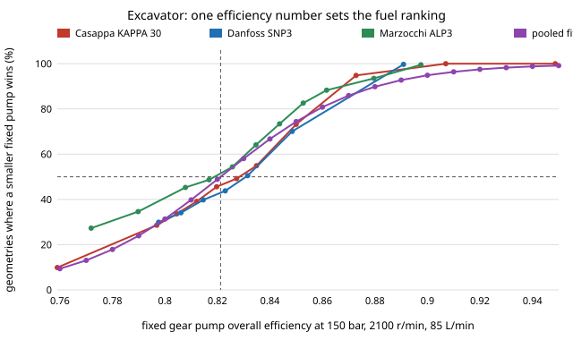
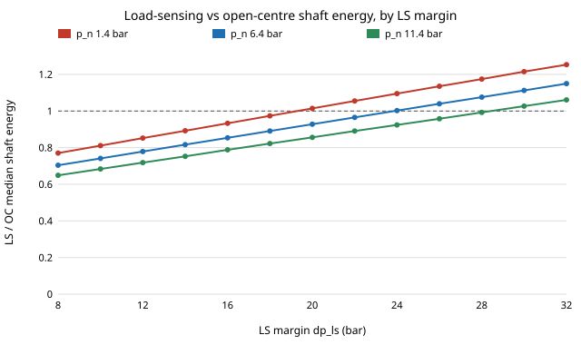

# When does a fixed gear pump beat load-sensing on a small excavator? One pump efficiency at 150 bar decides, on a measured wheel loader and measured excavator motion

*Manuscript (milestone 6s; gear-pump section restructured at milestone 7u and cut to journal length at milestone 7v, with the selection-rule detail moved verbatim to `paper/supplement.md`, cited here as Supplement S1 to S5). The full technical report `paper/draft.md` keeps every result in milestone order with its sensitivity runs. Written with AI assistance (Claude Code). Not submitted. Every number is copied from a results file under `experiments/` and is checked, in this file and the supplement, by `python3 paper/check_numbers.py --paper manuscript.md`. Where an input is assumed rather than sourced, the text says so.*

Target venue: open. The International Journal of Fluid Power and ASME, the two venues named in the proposal, both ask authors to confirm that generative AI did not create the content, which this paper cannot do; see `paper/VENUE.md` (milestone 7w). An aim, not a claim of acceptance.

## Abstract

Small earthmovers use fixed-pump open-centre or load-sensing (LS) hydraulics. We ask which a small shop building from catalogue parts should choose for the least fuel. An open energy model reproduces the measured pump energy of a 6 t LS wheel loader within 2.3% over 18 Y-cycles; there the answer is LS: the best fixed pump (53.5 cc) still burns 11.5% more. For a small excavator, priced on public joint motion of a 7.5 t class machine over 384 cylinder-geometry readings, the answer is set by one number: the fixed gear pump's overall efficiency at 150 bar, read at the size the fuel optimum picks (85 L/min). One logistic curve in that efficiency describes three makers' break-even sweeps and crosses 50% at 0.821. Adding the pump's no-load drag predicts four held-out Rexroth families within 0.0001 to 0.0052; over eight families the left-out RMS is 0.0022 against 0.0113 for a constant, and a rule pricing drag and LS standby power by idle hours predicts idle settings and maker families left out of the fit with an RMS of 0.0056 over 308 cases. The makers' own curves put the same pump at 0.759, 0.849 and 0.898, on both sides of the 50% point, while a bench test of a Casappa KP30 of 44 cm<sup>3</sup>/r reads 0.913; with it a smaller fixed pump beats LS in all 384 geometries. The excavator's choice therefore reduces to a bench test of one pump at one operating point; selection curves are not a safe substitute.

**Keywords:** load sensing; open centre; gear pump efficiency; compact excavator; wheel loader; fuel consumption; digital twin

## 1. Introduction

A builder of a small excavator or loader chooses between two circuits. A fixed-displacement gear pump feeding an open-centre valve is cheap and robust, but it delivers its whole flow all the time, at the highest load pressure while anything moves and through the valve's neutral path when nothing does. A variable pump with a load-sensing (LS) control delivers what the valves ask for at the highest load pressure plus a margin, but it costs more, runs at part stroke where piston pumps are less efficient, and idles at a standby pressure on its full displacement. Which burns less fuel is usually treated as settled in favour of load-sensing. This paper asks whether it is settled for the small machines a shop would build from catalogue parts, and if not, what single measurement would settle it.

Related work prices the circuits on large machines or in simulation. Vukovic, Leifeld and Murrenhoff (*Energies* 10(5), 687, 2017, doi:10.3390/en10050687) give a measured Willans-style fuel model of an 18 t excavator and show that hydraulic efficiency alone can mislead. Eriksson and Palmberg (*Proc. IMechE Part I* 225(2), 2011, doi:10.1243/09596518JSCE1111) review independent metering. Williamson (Purdue PhD thesis, 2010) reports measured fuel reductions on a displacement-controlled 5 t machine. Briganti (Politecnico di Torino MSc thesis, 2021/22) simulates a midi LS excavator. Juza and Hermanek (2023, doi:10.17221/77/2021-RAE) measured an open-centre block. None of these isolates which input of the open-centre versus LS comparison decides it, and none uses public measured records that a reader can rerun.

The contributions are four.

1. An open energy model of the two circuits, checked on a public measured LS wheel-loader record (pump energy within 2.3%), and an exact closed form for the break-even LS margin as a volume ratio times the pressure at which surplus flow is pushed (Sections 2 and 3.1 to 3.2).
2. On the loader, a fuel comparison on the record's own ECU fuel signal: no fixed pump size matches LS (Section 3.1).
3. On public motion of a small excavator, a fuel comparison with sourced engine, idle and pump inputs, showing that the ranking is set by the fixed pump's efficiency and not by the circuit (Sections 3.3 and 3.4).
4. One curve, fitted on three makers' pump families and checked out of sample, that maps that efficiency to the share of cylinder geometries in which a smaller fixed pump wins; a second number, the pump's no-load drag, tested on four held-out families and across 22 idle conditions; and the observation that makers' selection curves and a bench test of the same pump sit on opposite sides of the curve (Sections 3.5 to 3.7 and 4).

## 2. Data and model

### 2.1 Circuit energy

Each sample (or model phase) lists actuator load pressures and flows; hydraulic power is p Q. Open-centre delivers the full pump flow at the highest load pressure plus the spool drop while any section moves, and its flow through the neutral bypass at a neutral pressure p_n when none does. Load-sensing delivers the summed demand at the highest load pressure plus the margin m while moving, and a standby flow at standby pressure when still. Shaft energy divides by pump efficiency; Sections 3.4 and 3.5 replace the single efficiency of Section 3.1 with measured efficiency maps for each pump. For a fixed pump, f = 1 (all surplus flow at pump pressure) is not an assumption: surplus can only leave through the bypass at the pump pressure, which must exceed the heaviest load, and a flow-continuity solution over 2,000 random phases confirms it (pressure error 6e-14 bar; `fixed_pump_identity_results.txt`). The full model, including a steady-state flow-sharing model of open-centre slowing, is in the supplement (draft, Sections 2 and 3.5); the test suite checks the single-actuator identity E_LS = useful x (1 + dp/p) / eta.

### 2.2 Measured wheel loader

A public 440 s record of a 6 t LS wheel loader loading gravel (Linjama et al., Zenodo doi:10.5281/zenodo.10639199, CC BY 4.0) gives 2 ms samples of cylinder and pump pressures, piston positions, engine speed and ECU fuel rate over 18 Y-cycles. Its median LS margin during motion is 24.9 bar (standby 30.8 bar). The open-centre machine is a counterfactual on the same motion: a fixed pump of the loader's own 63 cc, or smaller, with actuators slowed wherever demand exceeds the pump, so that the same volume is delivered over a longer record.

### 2.3 Measured excavator motion

The `fuxi-robot/excavator-motion` dataset on Hugging Face (CC BY-NC-SA 4.0; range-read, nothing redistributed) has two machines. Folder `490`, a 49 t class machine by our reading, carries 8 unlabelled pressure channels; folder `75`, an XCMG of the 7.5 t class by our reading of its file names, carries ten truck-loading recordings (16.0 min) of joint angles and speeds but no pressure. We turn joint speed into cylinder flow with the published cylinders of the XCMG XE80E (bore x rod x stroke: boom 110 x 75 x 922, arm 95 x 60 x 885, bucket 85 x 55 x 742 mm) and its 219 L/min LS pump, each cylinder's rod speed being a constant lever times joint speed. No lever was fitted, and the cylinders' p99 demand without swing comes out at 218.8 L/min, within 0.1% of the published pump maximum, which is a check the method passed. Because the levers and swing share are not known, every excavator result is reported over 384 geometry cases (independent lever factors of 1 to 2.5 per joint, both bucket signs, swing share 0, 0.5 or 1). The excavator load pressure is the 49 t machine's moving median taken as a share of its top pressure (0.392) on the small machine's 316 bar maximum, 130 bar; the two halves of the excavator model come from different machines, which Section 5 lists first.

### 2.4 Fuel accounting

The excavator files carry no fuel signal, so we never price the longer open-centre record with one borrowed rate. We compute instead the break-even rest-of-machine fuel rate f<sub>t</sub>*: the fuel the rest of the machine may burn per hour of extra working time before load-sensing wins again. Per hour of LS work, open-centre minus LS fuel is the pump-energy difference times a Willans slope b plus f<sub>t</sub> (tau &minus; 1), with tau the time ratio, and f<sub>t,max</sub> is the largest f<sub>t</sub>* over fixed pump sizes on a 0.5 L/min grid. Under the slowing model the fixed pump runs flat out over the stretched time, which gives tau as an explicit function of the volume ratio; it reproduces every simulated time ratio within 0.0012 (`excavator_fuel_breakeven_results.txt`). The slope b = 0.2332 L/kWh is the loader record's refitted Willans slope.

The number f<sub>t,max</sub> is then set against the engine's no-load fuel rate, from the tractor-test standard. The ASABE D497.6 general model fitted to over 500 Nebraska tests (Grisso et al., Virginia Cooperative Extension publication 442-073, 2010; after Grisso, Kocher and Vaughan 2004, doi:10.13031/2013.17455) reads Q = (0.2203 X + 0.0965) P<sub>rated</sub> L/h at full throttle, with a reduced-throttle factor 1 + 0.877 (N &minus; 1) at no load. Carried to the XE80E's 54.6 kW engine at 2100 rpm over a power-equivalence factor and a full-throttle no-load speed that are swept, not sourced, the no-load rate is 3.99 to 5.06 L/h (`asabe_no_load_fuel_results.txt`). A smaller fixed pump wins in a geometry when its f<sub>t,max</sub> exceeds that rate.

Machines also log hours with no function moving. Trade-press reporting of manufacturer telematics (Moore, Construction Equipment, 24 March 2020) gives 38% idle over about 75,000 Komatsu machines and 28 to 30% for a Volvo CE fleet; we use S = 0.38 centrally and sweep 18 idle settings (three neutral readings, standby flow 0 to 5 L/min, idle pump speed 1.0 or 0.5 of working speed). The neutral pressure is read from Danfoss's PVG 32 Technical Information (BC152886483664, rev. May 2021, p. 16), the LS standby flow (2 L/min) is assumed.

### 2.5 Pump efficiency evidence

Load-sensing is priced on the one measured part-stroke map found: Kauranne's 45 cm<sup>3</sup>/r axial piston pump tested to ISO 4409 at four locked strokes (doi:10.3390/en15114030), digitised at 1500 r/min and scaled by displacement fraction to the XE80E's 104.3 cm<sup>3</sup>/r. Below its smallest tested stroke the loss is continued with a fitted stroke-independent term, which is 0.78 of the full-stroke loss at 150 bar. The fixed pump is priced four ways: that piston pump at full stroke (0.840 at 150 bar), and three makers' external gear pump families read exactly from the vector paths of their catalogues, Casappa's KAPPA 30 catalogue (K 05 T A, 2012, pp. 9 to 11), Danfoss's GearMe Aluminum Group 3 technical information (BC319661777599en-000202, 2023, pp. 19 to 21) and Marzocchi's ALP catalogue ("Serie ALP", printed pages 38 and 43 to 46). The fourth is one bench test of the class: Frosina, Senatore and Rigosi (doi:10.3390/en10081113, CC BY) tested a Casappa KP30 of 44 cm<sup>3</sup>/r on its maker's bench with a shaft torque meter and a flowmeter; we read its raster figures by pixel. To compare families on one axis we use the efficiency index E, the family's overall efficiency at 150 bar and 2100 r/min interpolated at 85 L/min of 20 bar flow, the size the fuel optimum selects.

## 3. Results

### 3.1 The measured loader: load-sensing wins whatever fixed pump it is given

The model's constant-margin LS rung reproduces the loader's measured pump hydraulic energy to within 2.3% (ratio 1.023), a weak test because both sides share the measured flow, and it models 0.942 L of fuel against the record's 0.935 L. A fixed 63 cc open-centre pump on the same motion needs 1.54 times the LS pump energy (per-cycle 95% interval 1.46 to 1.63) with a 10 bar spool drop and adds 14.7% to measured fuel (`measured_loader_results.txt`, `measured_motion_results.txt`).

Shrinking the fixed pump trades surplus flow for time. Open-centre matches LS pump energy at the measured margin only at 28.51 cc, where the record takes 1.3885 times as long (`measured_pump_size_results.txt`). Priced on the record's own fuel signal, with the rest of the machine burning 5.15 L/h over the extra time (the record's mean rate less the work pump's share; 5.99 and 1.48 L/h are the two other readings), open-centre burns 13.0% more fuel than LS at 63 cc, 11.5% more at the fuel-minimising 53.5 cc and 26.2% more at the energy-parity size (Figure 1). No size from 25 to 63 cc on a 0.5 cc grid matches LS under any fuel-rate reading and any pump efficiency from 0.75 to 0.95, nor in any of the 18 Y-cycles (per-cycle best size median 54.5 cc, 45 to 60 cc). The minimum penalty is 10.2 to 12.7%, and 6.2 to 6.8% only if the extra time ran near idle (`measured_fuel_time_results.txt`).


*Figure 1 (`experiments/fuel_time_figure.py`, `measured_fuel_time_results.txt`): on the measured loader the fuel curve is flat from about 50 to 63 cc and climbs steeply below 45 cc; the pump size moves the penalty between surplus flow (large pump) and a longer working day (small pump), but does not remove it.*

### 3.2 The break-even margin is a volume ratio times a pressure

Load-sensing energy in this model is affine in the margin m and open-centre energy does not depend on it, so each cycle has an exact break-even m* = (S + D + I) / B: surplus pump flow dropped at the highest load pressure while moving, pump flow times the spool drop, idle bleed net of LS idle work, over the volume LS delivers. It reproduces every grid break-even of the force-model sweeps within 0.075 bar (`breakeven_closed_form_results.txt`). Writing r for the fixed pump's volume over the LS volume while moving, the surplus term is exactly V (r &minus; 1) p_s, where p_s is the pressure the surplus is pushed at, so m* = beta [(r &minus; 1) p_s + r d] + I / B. On the loader r = 1.78, beta 0.995 and p_s = 99.5 bar, below the demand-weighted working pressure of 133.9 bar because the fixed pump's surplus arrives when demand, and so pressure, is low (covariance term &minus;27.1 bar). The exact break-even margin is 87.0 bar (per Y-cycle 59.0 to 143.0) against the 24.9 bar measured; a rule that uses the working pressure in place of p_s overstates it 1.268 times (`measured_volume_ratio_results.txt`). A designer can therefore place a machine from a flow log and a pressure trace: the break-even margin is how far the fixed pump overshoots demand, times the pressure at which it overshoots.

On the excavator's derived flow the same ratio is large: a fixed pump sized at the p99 of demand delivers 2.38 times the oil the work uses (per file 2.31 to 2.51), and 1.95 to 3.08 over the 384 geometries (median 2.44), against the loader's 1.78 on its own 63 cc pump (`measured_excavator_flow_results.txt`). At 130 bar that puts the break-even margin at 139.1 bar, several times any margin sold. On the stock-size pump, open-centre loses on the excavator as on the loader.

### 3.3 On the excavator a smaller fixed pump is cheap in time, so the engine decides

The difference from the loader is the shape of the demand: a median of 90 L/min against a p99 of 240 L/min. A fixed pump half the stock size covers most samples and slows only the peaks. Halving the 219 L/min pump to 109.5 L/min lowers the volume ratio from 2.175 to 1.209 and costs 1.108 times LS's record time; at a 20 bar margin the equal-energy pump is 108.0 L/min at 1.114 times the time, and over the 384 geometries 1.046 to 1.686 (median 1.197), against the loader's 1.3885 at energy parity (`measured_excavator_pump_size_results.txt`).

Whether the cheaper time also saves fuel turns on f<sub>t,max</sub> (Section 2.4). With one pump efficiency for both circuits, f<sub>t,max</sub> over the 384 geometries has a median of 1.00 L/h (p10 0.42, p90 1.71, range 0.33 to 3.00) (`excavator_breakeven_geometry_results.txt`), against a loader value of 0.14 L/h. A builder's two flow-log numbers, the stock pump's volume ratio and the peakiness of demand, predict it with a power law of in-sample R<sup>2</sup> 0.749 and a held-out median relative error of 17.3% (p90 41.0%) (`excavator_threshold_screening_results.txt`); Figure 2 shows how the share of geometries in which a fixed pump wins moves with the rest-of-machine rate. Against the tractor-test no-load rate of 3.99 to 5.06 L/h every threshold is too small: with equal pump efficiencies a smaller fixed pump wins in 0% of the geometries at every working speed from 1500 to 2200 rpm (`asabe_no_load_fuel_results.txt`). On this reading the excavator agrees with the loader. The next three sections show that the equal-efficiency reading is the one that does not hold.


*Figure 2 (`experiments/threshold_screening_figure.py`, `excavator_threshold_screening_results.txt`; one pump efficiency for both circuits): share of the 384 geometry cases in which a smaller fixed pump burns less fuel than LS, under every one of 108 parameter sets, at central parameters, and under at least one set; at 1.48 L/h the three shares are 0.0%, 18.2% and 72.1%, and at the engine's no-load rate of 3.99 to 5.06 L/h the central share is 0%.*

### 3.4 Pump efficiency reopens the excavator

A fixed pump runs at full stroke; an LS pump follows demand, here about 0.4 of stroke. On Kauranne's measured map at 60 C and a 150 bar outlet the fixed pump reads 0.840 at full stroke, while the excavator's LS pump averages 0.769 at the central geometry (0.681 to 0.791 over the geometries). On a 130 bar load that difference outweighs a 20 bar margin: the median f<sub>t,max</sub> rises from 0.95 to 3.32 L/h and a smaller fixed pump now beats the no-load rates in 17.2 to 32.8% of geometries (`excavator_part_stroke_eta_results.txt`). The reversal is narrow: at the central geometry a fixed pump at 0.808 instead of 0.840 (0.962 of the curve) hands the ranking back.

Two more measured effects favour the fixed pump. Below the map's smallest tested stroke a stroke-independent loss dominates (efficiency at 0.1 of stroke is 0.440, not the 0.672 a flat hold gives), and charging it raises the median threshold from 3.32 to 4.63 L/h, so a smaller fixed pump wins in 44.3 to 66.7% of geometries (`excavator_loss_below_x0_results.txt`). With idle hours at S = 0.38, LS idles at its standby drag on the full displacement, 2.96 kW, while a fixed pump circulates its flow through the neutral at 2.00 kW at 60 L/min and 10.53 kW at the stock 219 L/min; the two are equal at 83.4 L/min. The best fixed pumps sit below that crossover, so idle time credits them: a smaller fixed pump beats 3.99 L/h in 74.0% of geometries and 5.06 L/h in 47.9%, and 71.4 to 91.1% over the 18 idle settings (`excavator_idle_standby_results.txt`). The margin is thin: with the drag charged but before idle hours, over the 256 geometries where a fixed pump wins at 3.99 L/h it loses again at a median 0.950 of the piston pump's full-stroke efficiency. The excavator's ranking is therefore set by the fixed pump's full-stroke efficiency to within a few points.

### 3.5 Gear pumps: three makers, one bench test, one curve

The fixed pump on a small open-centre machine is usually an external gear pump. At 2100 r/min and 150 bar Casappa's curves give 0.713 to 0.795 over eight sizes from 26.7 to 73.8 cm<sup>3</sup>/r, Danfoss's a median 0.835 over ten SNP3 sizes from 22.1 to 88.2 cm<sup>3</sup>/r, and Marzocchi's 0.801 to 0.908 (median 0.882) over eleven ALP3 sizes from 20 to 87 cm<sup>3</sup>/r. Repricing the break-even with each family as the fixed pump, at S = 0.38 and the central idle setting, a smaller fixed pump beats 3.99 L/h in 9.9% of geometries on Casappa's curves, 70.1% on Danfoss's and 99.5% on Marzocchi's (Table 1). Casappa's catalogue disagrees with itself: its formula page states an overall efficiency of about 0.88, at which the share would be 95.6% (`excavator_gear_pump_results.txt`).

The bench test resolves the catalogue question for one pump. Frosina et al.'s KP30 draws 109.08, 110.72 and 113.25 Nm at 150 bar and 1000, 1500 and 2500 r/min against an ideal V p / 2&pi; of 105.04 Nm, with volumetric efficiencies of 0.9673 and 0.9811 at 1500 and 2500 r/min. At 2100 r/min that is hydro-mechanical 0.9359 and overall 0.9130, against 0.764 from the same maker's catalogue power curves for the same size: the catalogue's torque is 1.155 to 1.182 times the bench's (`kp30_bench_results.txt`). Six reading variants leave it at 0.8811 or above. Built into a pump family (bench torque scaled by displacement, bench volumetric efficiency), it makes the fixed pump win in 100.0% of geometries, with a median break-even rest-of-machine fuel rate of 8.08 L/h against no-load rates of 3.99 to 5.06 L/h, and in 100.0% in every one of the 18 idle settings (`excavator_gear_pump_bench_results.txt`). Swapping halves shows what carries it: bench moving efficiency with the catalogue's idle drag still gives 100.0%, catalogue moving efficiency with the bench's drag only 13.3%.

Scaling each family's moving efficiency by a factor c and placing every sweep point at its index E gives 29 points from three makers. One logistic share = 100 / (1 + exp(&minus;(E &minus; E<sub>50</sub>) / w)) fits them all with E<sub>50</sub> 0.8212 and w 0.0270 and an RMS residual of 5.62 points (Figure 3; `gear_pump_evidence_results.txt`). Fitted on two makers and asked about the third, it misplaces the third maker's crossing by &minus;0.0091 (Casappa), &minus;0.0118 (Danfoss) and +0.0062 (Marzocchi), with a worst left-out RMS residual of 8.91 points. The index matters: on each family's median efficiency instead of the 85 L/min size the crossings spread 0.0291, on the index 0.0121. The curve runs from 10% to 90% of geometries between 0.7619 and 0.8805, and the unscaled catalogue and bench points sit on it (Table 1). The crossing does not depend on the logistic: probit, complementary log-log and log-log fits cross at 0.8191 to 0.8229, a model-free isotonic fit at 0.8250, and an exact maker-level bootstrap (all 27 draws of three makers with replacement) puts E<sub>50</sub> between 0.8128 and 0.8260 (`gear_pump_form_results.txt`). The tails do depend on it. The complementary log-log, slow to start and steep at the top, fits better (pooled RMS 4.33 against 5.62 points; worst left-out RMS 7.85 against 8.91) and puts the 10% and 90% points at 0.7479 and 0.8707; over the four forms they span 0.7479 to 0.7730 and 0.8707 to 0.8914.



*Figure 3 (`experiments/gear_pump_evidence_figure.py`, sweeps parsed from the committed results files, curve from `gear_pump_evidence_results.txt`; dashed lines 50% and E<sub>50</sub>): three makers' gear pump families scaled by c and placed at their efficiency at 150 bar, 2100 r/min and 85 L/min, with the pooled logistic fit, which crosses 50% at 0.8212.*

| Fixed pump (efficiency source) | E | Share | Curve | Kind |
|---|---|---|---|---|
| Casappa KAPPA 30 | 0.7590 | 9.9% | 9.1% | catalogue |
| Danfoss SNP3 | 0.8485 | 70.1% | 73.3% | catalogue |
| Marzocchi ALP3 | 0.8975 | 99.5% | 94.4% | catalogue |
| Casappa KP30 (Frosina et al.) | 0.9130 | 100.0% | 96.8% | bench test |
| Axial piston pump at full stroke (Kauranne) | 0.8400 | 74.0% | 66.7% | ISO 4409 test, not on the index |

*Table 1: for each efficiency source, its index E (overall efficiency at 150 bar, 2100 r/min and 85 L/min), the share of the 384 geometries in which a smaller fixed pump beats LS at a 3.99 L/h no-load rate (S = 0.38, central idle setting) and the pooled curve of Figure 3 at that E. Source: `gear_pump_evidence_results.txt`.*

### 3.6 Drag as a second number, tested on four held-out families

Pump shape moves the crossing less than idle drag does. Crossing every family's moving-efficiency shape with every family's idle drag (Casappa, Danfoss, Marzocchi and the bench KP30; 16 cells, each swept in E) puts all sixteen crossings between 0.8069 and 0.8300 (`gear_pump_shape_results.txt`), and scaling one family's idle-power curve from zero to twice its value moves the crossing almost linearly, by 0.0187 per kW of idle power at 85 L/min, with the four shapes' slopes within 0.0012 of each other (`gear_pump_drag_results.txt`). The two-number rule this gives, E<sub>50</sub> = 0.8277 + 0.0187 (kW &minus; 3.57), was then tested on four Bosch Rexroth families that played no part in it (Supplement S1 and S2). The AZPG (RE 10093) crosses at 0.8040: the committed rule predicts 0.8091, an error of 0.0052, where the single pooled number misses by 0.0172. The AZPN (RE 10091), whose largest size gives 75.58 L/min, failed its registered test by +0.0293 because its index was extrapolated past that size; read where the model holds the largest size, the committed rule is off by 0.0001. That reading was a diagnosis after a failure, so it was fixed in the code and tested on two more families registered before any number was computed from them: the AZPU (RE 10 098) lands 0.0011 from the committed rule, against 0.0142 for a constant, and the AZPF (RE 10089), whose largest size gives 58.87 L/min, 0.0008. Over all eight families crossed (64 cells), E<sub>50</sub> = 0.8238 + 0.0177 (kW &minus; 3.57), and each family left out in turn is predicted with an RMS of 0.0022 against 0.0113 for a constant (`gear_pump_eight_results.txt`; Table 2).

Pumps run outside their size range are harder. A builder short of displacement may spin a small pump faster (capped at the rated 3000 r/min) or drive it through a step-up gear, priced from the measured spur-gear losses of Anderson and Loewenthal [NASA TP-1622]; both add drag above the family's largest size. Over fourteen readings (six families held, and the AZPF and AZPN each held, spun, geared, and geared with a 98% drive) the drag rule's left-out RMS rises to 0.0084. Charging the drive's extra drag only at the optimum's picks above the largest size (kW<sub>o</sub>) and adding a shape number k<sub>w</sub>, the family's efficiency averaged over the optimum's published picks and read against its index, gives the rule we recommend, E<sub>50</sub> = 0.7562 + 0.0182 kW<sub>o</sub> &minus; 0.4269 k<sub>w</sub>: left-out RMS 0.0056 on the fourteen readings, 34% below the drag rule, and 0.0017 on the held catalogue families (`gear_pump_holddrag_results.txt`; Supplement S3). For a pump inside its size range it reduces to the drag at 85 L/min with the shape number. The geared AZPN still sits 0.0065 below it.

### 3.7 Idle settings, and what a builder can read in place of the optimum's picks

Every rule above was fitted at one idle setting (PVG 32 neutral curve, 2 L/min standby, idle at working speed, S = 0.38). Rebuilt at all 18 idle settings and four other idle shares, the recommended rule beats the drag rule in all 22 conditions, but its intercept does not transfer: at half idle speed, where the load-sensing pump's standby power halves, the frozen rule misses by up to 0.0349 (`gear_pump_settings_results.txt`). Carrying the competitor's idle cost removes the refit. Pooled over all 22 conditions (4312 cells), a rule with two prices, the pump's drag kW<sub>o</sub> and the load-sensing pump's standby power P<sub>LS</sub>, each weighted by the model's idle hours per working hour H = S/(1 &minus; S), predicts each condition with that condition and the maker family both left out of the fit at an RMS of 0.0056 over the 308 left-out diagonals, 0.0057 on idle shares 0.20 and 0.50 left out together, and 0.0059 on the nine half-speed conditions when trained at working speed only (`gear_pump_onerule_results.txt`, an independently written replication registered before the result was known; Supplement S4). It puts a standby kW at 1.22 drag kW.

That ratio is a reading of the drag, not a price. The model charges idle as b (P<sub>LS</sub> &minus; P<sub>OC</sub>) h, so the two can only trade one for one, and kW<sub>o</sub>, read at 85 L/min, overstates the drag the optimum pays at the sizes it picks. With each pump's drag averaged over the model's own picks for that pump, standby and drag trade 0.98 for one and the one-price rule's left-out RMS falls to 0.0042 (`gear_pump_ownpick_results.txt`); reading the picks at the other maker groups' mean crossing, so the number being predicted does not leak in, leaves 0.0047 (`gear_pump_leak_results.txt`). Both are bounds: a builder does not have the optimum's picks. Table 2 lists what a builder can read in their place (Supplement S5). Fixed reads, the drag at the picks' median flow (72 L/min) or the mean of its quartiles (64 and 79 L/min), score 0.0065 and 0.0066, because the optimum sizes a pump with high or steeply rising drag down and a fixed read cannot follow it; the Danfoss family, whose idle curve bends most (1.781 over 64 to 79 L/min), breaks each one. A pick weight tilted by the pump's drag scores 0.0053, with its one constant learned from the Danfoss family alone. A table of picks indexed by that bend scores 0.0075 on measured rows, since no measured donor bends like Danfoss, and 0.0050 to 0.0052 on rows the model builds for synthetic bent curves anchored where the measured donors put the anchor (61.1 to 65.4 L/min); anchored at 79 L/min it scores 0.0059. Every gain over the two-price rule therefore rests on synthetic rows or on one family, so the two-price rule remains the form we recommend, and a second measured family with a strongly bending idle curve is the test the tables need.

| Rule | What the builder reads | Left-out panel | Left-out RMS | Source |
|---|---|---|---|---|
| Constant E<sub>50</sub> | efficiency at the index only | eight held families | 0.0113 | `gear_pump_eight_results.txt` |
| Drag rule | index E, drag at 85 L/min | eight held families | 0.0022 | `gear_pump_eight_results.txt` |
| Drag rule | index E, drag at 85 L/min | 14 readings, held, spun and geared | 0.0084 | `gear_pump_third_results.txt` |
| + k<sub>lo</sub> | adds efficiency at 57 L/min | 14 readings | 0.0068 | `gear_pump_third_results.txt` |
| + k<sub>w</sub> | adds efficiency over the published picks | 14 readings | 0.0069 | `gear_pump_chosen_results.txt` |
| kW<sub>o</sub> with k<sub>w</sub> (recommended) | catalogue drag at 85 L/min plus the drive's extra drag at the picks | 14 readings | 0.0056 | `gear_pump_holddrag_results.txt` |
| Two prices, H (kW<sub>o</sub>, P<sub>LS</sub>) | as above, plus the machine's idle share and standby power | 308 diagonals, 22 idle conditions | 0.0056 | `gear_pump_onerule_results.txt` |
| One price at 72 L/min | drag at the picks' median flow | 308 diagonals | 0.0065 | `gear_pump_onepoint_results.txt` |
| One price at 64 and 79 L/min | drag at the picks' quartiles | 308 diagonals | 0.0066 | `gear_pump_twopoint_results.txt` |
| Tilted pick weight | published picks tilted by the pump's drag | 308 diagonals | 0.0053 | `gear_pump_tilt_results.txt` |
| Pick table by bend, measured rows | drag bend 79/64 L/min, nearest donors | 308 diagonals | 0.0075 | `gear_pump_table_results.txt` |
| Pick table by bend, synthetic rows | drag bend, rows anchored at 64 L/min | 308 diagonals | 0.0052 | `gear_pump_bendtable_results.txt` |
| Same, anchored at 79 L/min | drag bend, rows anchored at 79 L/min | 308 diagonals | 0.0059 | `gear_pump_bendshape_results.txt` |
| Same, anchor read off the donors | drag bend, within-family anchor | 308 diagonals | 0.0050 | `gear_pump_anchor_results.txt` |
| Picks at the other groups' crossing (not builder-side) | the model's picks for the held-out pump | 308 diagonals | 0.0047 | `gear_pump_leak_results.txt` |
| Own picks (oracle) | the model's picks at the pump's own crossing | 308 diagonals | 0.0042 | `gear_pump_ownpick_results.txt` |

*Table 2: the selection rules in the order they were tested, each scored on maker families it was not fitted on. The three panels are not comparable with each other: the eight held families at the central idle setting; fourteen readings of the same families with the AZPF and AZPN also spun and geared (196 cells); and those fourteen across 22 idle settings and shares, with the condition and the maker family both left out (308 diagonals). The last two rows read the model's own picks for the pump being predicted and are bounds, not rules a builder can apply. Every synthetic-row table rests on bent curves no pump was measured on.*

## 4. Discussion

**A design rule in one number.** For a small excavator of this class, the circuit choice does not follow from the circuit. It follows from the overall efficiency of the gear pump the builder would fit, at 150 bar and 2100 r/min, at the size the fuel optimum picks. Above about 0.88 (0.8707 to 0.8914 over four curve forms) a smaller fixed pump on an open-centre valve beats load-sensing on fuel in nine geometries of ten; below about 0.76 (0.7479 to 0.7730) load-sensing does; the 50% point, 0.82, is the part of the rule that does not move with the form, nor by more than 0.015 with the curve shape or idle drag of the four families it was built on; in between the machine's linkage decides. A second number sharpens it: each kW of no-load drag at 85 L/min above 3.57 kW raises the 50% point by about 0.018, and over eight families, four of them held out when tested, E<sub>50</sub> = 0.8238 + 0.0177 (kW &minus; 3.57) predicts each family left out of the fit with an RMS of 0.0022. The efficiency must be read on a size the maker builds and the drag at the speed the pump will run; for a pump spun or geared past its size range, the drive's extra drag is charged only where the optimum picks (Section 3.6). For a machine whose idle setting or share differs from ours, the two-price rule of Section 3.7 carries the competitor's standby cost and needs no refit. The loader does not contradict this: its demand is smooth enough that a smaller pump costs too much time, and the threshold f<sub>t,max</sub> there (0.14 L/h) is under a tenth of its lowest measured fuel rate.

**Selection curves are not that number.** The three catalogues put the same 85 L/min pump at 0.759, 0.849 and 0.898, a range about twelve times the spread of the three crossings, and each also contradicts its own sizing text (Casappa states 0.88 against curves of 0.71 to 0.80). The one bench test of the class reads 0.913 against 0.764 from its maker's curves for the size. If that gap is typical, catalogue curves are drawn conservative for sizing a drive motor, which is their purpose, and they are the wrong input for choosing a circuit. A builder should ask for, or run, one ISO 4409 point at 150 bar on the candidate pump before choosing.

**A procedure a builder can follow.** (i) Log a working day of joint motion and one pressure trace; compute the stock pump's volume ratio and the pressure the surplus is pushed at (Section 3.2). (ii) Compute f<sub>t,max</sub> over fixed pump sizes with the measured or bench efficiency of each pump (Section 2.4). (iii) Compare it with the engine's no-load rate from the tractor-test model or the engine's own map. The scripts that do each step are in the repository and run on the public records used here.

**Where the force model misleads.** A synthetic small-excavator cycle built from Reece's earthmoving equation works at 24 to 46 bar, about a quarter of the loader's measured pressure, and on it the ranking turns instead on the open-centre valve's neutral pressure and the LS margin: the median LS/OC shaft-energy ratio crosses 1.0 at an LS margin of 19.3, 23.9 and 28.4 bar for neutral pressures of 1.44, 6.44 and 11.44 bar, and at 28.0 bar for the PVG 32 bypass reading (Figure 4; technical report `paper/draft.md`, Sections 3.1a to 3.1d). The sold margins (13.8 bar from Rexroth Canada's A10VO manual (Module 3A, s. 7.2), 25 bar from Briganti's model) straddle those lines, which is why a synthetic-cycle study can reach either answer. The measured records move the decision from the valve to the pump.



*Figure 4 (`experiments/ranking_map.py`, `ranking_map_results.txt`; force model, load factor 0.346, LS standby 2 L/min): the median LS/OC shaft-energy ratio rises with the LS margin and crosses 1 at 19.3, 23.9 and 28.4 bar for open-centre neutral pressures of 1.44, 6.44 and 11.44 bar.*

## 5. Limitations

1. No measured excavator fuel or pump-flow record was found. The excavator's flow is derived from one machine's joint motion through published cylinders and constant levers, and its pressure is a share of another machine's unlabelled channels; the 384 geometry cases bound the first, not the second.
2. The open-centre machines are counterfactuals on LS motion, slowed sample by sample with no change in how the operator drives, and the extra time is priced in fuel only; charging operator hours would favour LS.
3. The no-load fuel rate is a tractor-population model, not the excavator's engine; idle shares are fleet reporting; the LS standby flow is assumed.
4. LS is priced on one piston pump of unnamed make scaled by displacement, and below its smallest tested stroke on a fitted continuation.
5. The gear pump evidence is seven catalogue families from four makers (the four Rexroth families held out as tests) and one bench unit, tested on its maker's bench and reported in a CFD validation paper, all read by pixel from raster figures. A factorial over five families' shapes and idle drags moves the crossing by at most 0.0202 from the pooled 0.8212, mostly through idle drag. Eight families are eight folds, so the leave-one-family-out errors are a handful of numbers, not a distribution; the AZPN's agreement rests on an index reading chosen after its registered test failed (the AZPU and AZPF then tested it); the curve's 10% and 90% points depend on the chosen form by about 0.02; and the pick tables that beat the two-price rule rest on synthetic bent curves, since only one measured family of nine (Danfoss) bends strongly at full idle speed, and at half idle speed the Casappa KP30 bends as much (Supplement S5).

## 6. Conclusions

1. **On the one measured machine, load-sensing wins.** On the 6 t wheel loader the model's LS rung matches measured pump energy within 2.3%, and no fixed open-centre pump from 25 to 63 cc matches LS fuel per unit of work on the same motion.
2. **On a small excavator the ranking is not a property of the circuit.** On measured excavator motion priced in fuel it turns on the efficiency of the fixed pump open-centre is given.
3. **That efficiency is one number, and one curve maps it to the answer.** Read at 150 bar, 2100 r/min and the 85 L/min size the optimum picks, three makers' sweeps follow one logistic curve crossing 50% at 0.821 and predict each other's crossings within 0.012. A second number, the pump's no-load drag, predicts the crossing of a held-out fifth family (Rexroth AZPG) within 0.0052, where the single number misses by 0.0172; refitted on all five families crossed, it predicts each family left out of the fit with an RMS error of 0.0030, against 0.0119 for one number. A sixth family (Rexroth AZPN), whose largest size stops short of the index point, failed the registered test by 0.0293 because its index was extrapolated; read on its largest size, the rule as committed predicts it within 0.0001, and two further families registered first (Rexroth AZPU and AZPF) land within 0.0011 and 0.0008. Pooled over 22 idle settings and shares, a two-price rule in the pump's drag and the load-sensing pump's standby power predicts held-out conditions and maker families with an RMS of 0.0056.
4. **Selection curves are not that number.** For the same pump size the three catalogues read 0.759, 0.849 and 0.898, and the one bench test found reads 0.913; a held-out fourth catalogue (Rexroth AZPG) reads 0.912, so catalogues are not uniformly pessimistic either. With the bench pump, a smaller fixed pump beats load-sensing in all 384 geometries.
5. **What would change the conclusion** is a measured spread between units: if typical gear pumps of the class run about 0.08 below the one bench unit, the excavator answer returns to a coin toss. Multi-unit tests exist (Michael, Khalid and Wanke, SAE 2012-01-2041, sixteen external gear pumps from seven makers; Schänzle, Störmer and Pelz, Bath/ASME FPMC 2018, seven gear pumps); one of them, read at 150 bar and the class's size, is the next test.

## AI use

This paper was produced by AI agents (Claude Code), not only edited by them: the code, the experiments, the analysis and the text were generated by the agents, run by run, with the repository owner setting the research direction. Every number is copied from a results file produced by code in the repository and checked by `paper/check_numbers.py`, and every citation was looked up before use. A person who signs this paper as author takes responsibility for all of it, however it was generated.

## Data and code availability

Code, digitised curves and every results file are MIT licensed in the repository's `research/heavy-hydraulics` directory. The loader record (Zenodo, CC BY 4.0) is downloaded by the scripts; the excavator motion (CC BY-NC-SA 4.0) is range-read and not redistributed.

```bash
cd research/heavy-hydraulics
PYTHONPATH=src python3 -m pytest tests -q
python3 paper/check_numbers.py --paper manuscript.md
python3 paper/build_tex.py --source manuscript.md --pdf
```
