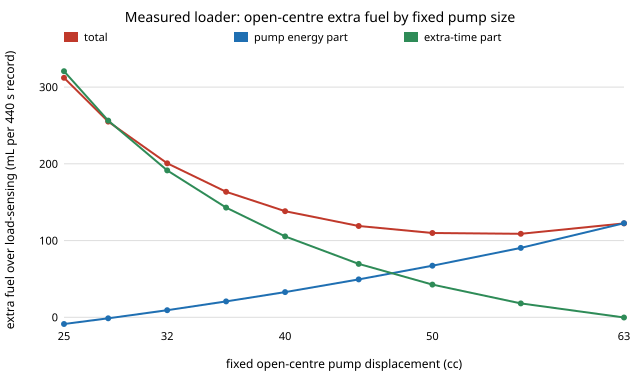
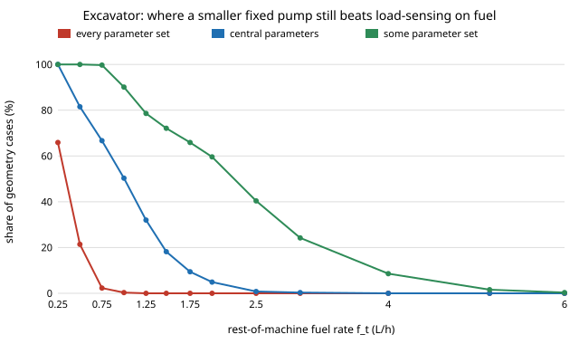

# When does a fixed gear pump beat load-sensing on a small excavator? One pump efficiency at 150 bar decides, on a measured wheel loader and measured excavator motion

*Manuscript (milestone 6s), cut from the full technical report `paper/draft.md`, which keeps every result in milestone order with its sensitivity runs and is cited here as the supplement. Written with AI assistance (Claude Code). Not submitted. Every number is copied from a results file under `experiments/` and is checked by `python3 paper/check_numbers.py --paper manuscript.md`. Where an input is assumed rather than sourced, the text says so.*

Target venue: International Journal of Fluid Power (full paper). An aim, not a claim of acceptance.

## Abstract

Small earthmovers use either fixed-displacement open-centre hydraulics or load-sensing (LS) pumps. We ask which a small shop should build from catalogue parts to burn the least fuel, and what that answer turns on. An open energy model reproduces the measured pump energy of a 6 t LS wheel loader within 2.3% over 18 Y-cycles; on that machine the answer is LS, since no fixed pump from 25 to 63 cc matches LS fuel per unit of work and the best size (53.5 cc) still burns 11.5% more. For a small excavator, priced on public joint motion of a 7.5 t class machine over 384 cylinder-geometry readings, with no-load engine fuel from the tractor-test standard and fleet idle shares, the answer is not structural. It is set by one number: the overall efficiency of the fixed gear pump at 150 bar, read at the size the fuel optimum picks (85 L/min). One logistic curve in that efficiency alone describes three makers' scaled break-even sweeps (Casappa, Danfoss, Marzocchi; RMS residual 5.62 points) and crosses 50% at 0.821; fitted on any two makers, it places the third maker's crossing within 0.012. Adding the pump's no-load drag as a second number (about 0.019 per kW) predicts a held-out fourth maker's crossing (Rexroth AZPG, 0.804) within 0.005, and, refitted on all five families crossed with each family left out in turn, every left-out family's crossing within 0.005. A sixth family whose sizes stop short of the index point (Rexroth AZPN) shows the efficiency must be read on a size the maker builds: extrapolated to it, the registered test fails by 0.0293; read as the model uses the pump, the committed rule is off by 0.0001. With that reading fixed and the predictions registered first, a seventh family (Rexroth AZPU) lands 0.0011 from the committed rule, against 0.0142 for a constant. An eighth (Rexroth AZPF), whose largest size stops at 58.87 L/min so the held reading prices every larger pump, lands 0.0008 from the seven-family rule. The makers' own curves put the same pump at 0.759, 0.849 and 0.898, on both sides of that threshold. The one bench test found, a Casappa KP30 of 44 cm<sup>3</sup>/r, reads 0.913, about 0.15 above its maker's curves, and with it a smaller fixed pump beats LS in all 384 geometries. The excavator's circuit choice therefore reduces to a bench test of one pump at one operating point, and selection curves are not a safe substitute for it. Code and every number are open.

## 1. Introduction

A builder of a small excavator or loader chooses between two circuits. A fixed-displacement gear pump feeding an open-centre valve is cheap and robust, but it delivers its whole flow all the time, at the highest load pressure while anything moves and through the valve's neutral path when nothing does. A variable pump with a load-sensing (LS) control delivers what the valves ask for at the highest load pressure plus a margin, but it costs more, runs at part stroke where piston pumps are less efficient, and idles at a standby pressure on its full displacement. Which burns less fuel is usually treated as settled in favour of load-sensing. This paper asks whether it is settled for the small machines a shop would build from catalogue parts, and if not, what single measurement would settle it.

Related work prices the circuits on large machines or in simulation. Vukovic, Leifeld and Murrenhoff (*Energies* 10(5), 687, 2017, doi:10.3390/en10050687) give a measured Willans-style fuel model of an 18 t excavator and show that hydraulic efficiency alone can mislead. Eriksson and Palmberg (*Proc. IMechE Part I* 225(2), 2011, doi:10.1243/09596518JSCE1111) review independent metering. Williamson (Purdue PhD thesis, 2010) reports measured fuel reductions on a displacement-controlled 5 t machine. Briganti (Politecnico di Torino MSc thesis, 2021/22) simulates a midi LS excavator. Juza and Hermanek (2023, doi:10.17221/77/2021-RAE) measured an open-centre block. None of these isolates which input of the open-centre versus LS comparison decides it, and none uses public measured records that a reader can rerun.

The contributions are four.

1. An open energy model of the two circuits, checked on a public measured LS wheel-loader record (pump energy within 2.3%), and an exact closed form for the break-even LS margin as a volume ratio times the pressure at which surplus flow is pushed (Sections 2 and 3.1 to 3.2).
2. On the loader, a fuel comparison on the record's own ECU fuel signal: no fixed pump size matches LS (Section 3.1).
3. On public motion of a small excavator, a fuel comparison with sourced engine, idle and pump inputs, showing that the ranking is set by the fixed pump's efficiency and not by the circuit (Sections 3.3 and 3.4).
4. One curve, fitted on three makers' pump families and checked out of sample, that maps that efficiency to the share of cylinder geometries in which a smaller fixed pump wins, and the observation that makers' selection curves and a bench test of the same pump sit on opposite sides of it (Sections 3.5 and 4).

## 2. Data and model

### 2.1 Circuit energy

Each sample (or model phase) lists actuator load pressures and flows; hydraulic power is p Q. Open-centre delivers the full pump flow at the highest load pressure plus the spool drop while any section moves, and its flow through the neutral bypass at a neutral pressure p_n when none does. Load-sensing delivers the summed demand at the highest load pressure plus the margin m while moving, and a standby flow at standby pressure when still. Shaft energy divides by pump efficiency; Sections 3.4 and 3.5 replace the single efficiency of Section 3.1 with measured efficiency maps for each pump. For a fixed pump, f = 1 (all surplus flow at pump pressure) is not an assumption: surplus can only leave through the bypass at the pump pressure, which must exceed the heaviest load, and a flow-continuity solution over 2,000 random phases confirms it (pressure error 6e-14 bar; `fixed_pump_identity_results.txt`). The full model, including a steady-state flow-sharing model of open-centre slowing, is in the supplement (draft, Sections 2 and 3.5); the test suite checks the single-actuator identity E_LS = useful x (1 + dp/p) / eta.

### 2.2 Measured wheel loader

A public 440 s record of a 6 t LS wheel loader loading gravel (Linjama et al., Zenodo doi:10.5281/zenodo.10639199, CC BY 4.0) gives 2 ms samples of cylinder and pump pressures, piston positions, engine speed and ECU fuel rate over 18 Y-cycles. Its median LS margin during motion is 24.9 bar (standby 30.8 bar). The open-centre machine is a counterfactual on the same motion: a fixed pump of the loader's own 63 cc, or smaller, with actuators slowed wherever demand exceeds the pump, so that the same volume is delivered over a longer record.

### 2.3 Measured excavator motion

The `fuxi-robot/excavator-motion` dataset on Hugging Face (CC BY-NC-SA 4.0; range-read, nothing redistributed) has two machines. Folder `490`, a 49 t class machine by our reading, carries 8 unlabelled pressure channels; folder `75`, an XCMG of the 7.5 t class by our reading of its file names, carries ten truck-loading recordings (16.0 min) of joint angles and speeds but no pressure. We turn joint speed into cylinder flow with the published cylinders of the XCMG XE80E (bore x rod x stroke: boom 110 x 75 x 922, arm 95 x 60 x 885, bucket 85 x 55 x 742 mm) and its 219 L/min LS pump, each cylinder's rod speed being a constant lever times joint speed. No lever was fitted, and the cylinders' p99 demand without swing comes out at 218.8 L/min, within 0.1% of the published pump maximum, which is a check the method passed. Because the levers and swing share are not known, every excavator result is reported over 384 geometry cases (independent lever factors of 1 to 2.5 per joint, both bucket signs, swing share 0, 0.5 or 1). The excavator load pressure is the 49 t machine's moving median taken as a share of its top pressure (0.392) on the small machine's 316 bar maximum, 130 bar; the two halves of the excavator model come from different machines, which Section 5 lists first.

### 2.4 Fuel accounting

The excavator files carry no fuel signal, so we never price the longer open-centre record with one borrowed rate. We compute instead the break-even rest-of-machine fuel rate f<sub>t</sub>*: the fuel the rest of the machine may burn per hour of extra working time before load-sensing wins again. Per hour of LS work, open-centre minus LS fuel is the pump-energy difference times a Willans slope b plus f<sub>t</sub> (tau &minus; 1), with tau the time ratio, and f<sub>t,max</sub> is the largest f<sub>t</sub>* over fixed pump sizes on a 0.5 L/min grid. Under the slowing model the fixed pump runs flat out over the stretched time, which gives tau as an explicit function of the volume ratio; it reproduces every simulated time ratio within 0.0012 (`excavator_fuel_breakeven_results.txt`). The slope b = 0.2332 L/kWh is the loader record's refitted Willans slope.

The number f<sub>t,max</sub> is then set against the engine's no-load fuel rate, from the tractor-test standard. The ASABE D497.6 general model fitted to over 500 Nebraska tests (Grisso et al., Virginia Cooperative Extension publication 442-073, 2010; after Grisso, Kocher and Vaughan 2004, doi:10.13031/2013.17455) reads Q = (0.2203 X + 0.0965) P<sub>rated</sub> L/h at full throttle, with a reduced-throttle factor 1 + 0.877 (N &minus; 1) at no load. Carried to the XE80E's 54.6 kW engine at 2100 rpm over a power-equivalence factor and a full-throttle no-load speed that are swept, not sourced, the no-load rate is 3.99 to 5.06 L/h (`asabe_no_load_fuel_results.txt`). A smaller fixed pump wins in a geometry when its f<sub>t,max</sub> exceeds that rate.

Machines also log hours with no function moving. Trade-press reporting of manufacturer telematics (Moore, Construction Equipment, 24 March 2020) gives 38% idle over about 75,000 Komatsu machines and 28 to 30% for a Volvo CE fleet; we use S = 0.38 centrally and sweep 18 idle settings (three neutral readings, standby flow 0 to 5 L/min, idle pump speed 1.0 or 0.5 of working speed). The neutral pressure is read from Danfoss's PVG 32 Technical Information (BC152886483664, rev. May 2021, p. 16), the LS standby flow (2 L/min) is assumed.

### 2.5 Pump efficiency evidence

Load-sensing is priced on the one measured part-stroke map found: Kauranne's 45 cm<sup>3</sup>/r axial piston pump tested to ISO 4409 at four locked strokes (doi:10.3390/en15114030), digitised at 1500 r/min and scaled by displacement fraction to the XE80E's 104.3 cm<sup>3</sup>/r. Below its smallest tested stroke the loss is continued with a fitted stroke-independent term, which is 0.78 of the full-stroke loss at 150 bar. The fixed pump is priced four ways: that piston pump at full stroke (0.840 at 150 bar), and three makers' external gear pump families read exactly from the vector paths of their catalogues, Casappa's KAPPA 30 catalogue (K 05 T A, 2012, pp. 9 to 11), Danfoss's GearMe Aluminum Group 3 technical information (BC319661777599en-000202, 2023, pp. 19 to 21) and Marzocchi's ALP catalogue ("Serie ALP", printed pages 38 and 43 to 46). The fourth is one bench test of the class: Frosina, Senatore and Rigosi (doi:10.3390/en10081113, CC BY) tested a Casappa KP30 of 44 cm<sup>3</sup>/r on its maker's bench with a shaft torque meter and a flowmeter; we read its raster figures by pixel. To compare families on one axis we use the efficiency index E, the family's overall efficiency at 150 bar and 2100 r/min interpolated at 85 L/min of 20 bar flow, the size the fuel optimum selects.

## 3. Results

### 3.1 The measured loader: load-sensing wins whatever fixed pump it is given

The model's constant-margin LS rung reproduces the loader's measured pump hydraulic energy to within 2.3% (ratio 1.023), a weak test because both sides share the measured flow, and it models 0.942 L of fuel against the record's 0.935 L. A fixed 63 cc open-centre pump on the same motion needs 1.54 times the LS pump energy (per-cycle 95% interval 1.46 to 1.63) with a 10 bar spool drop and adds 14.7% to measured fuel (`measured_loader_results.txt`, `measured_motion_results.txt`).

Shrinking the fixed pump trades surplus flow for time. Open-centre matches LS pump energy at the measured margin only at 28.51 cc, where the record takes 1.3885 times as long (`measured_pump_size_results.txt`). Priced on the record's own fuel signal, with the rest of the machine burning 5.15 L/h over the extra time (the record's mean rate less the work pump's share; 5.99 and 1.48 L/h are the two other readings), open-centre burns 13.0% more fuel than LS at 63 cc, 11.5% more at the fuel-minimising 53.5 cc and 26.2% more at the energy-parity size (Figure 1). No size from 25 to 63 cc on a 0.5 cc grid matches LS under any fuel-rate reading and any pump efficiency from 0.75 to 0.95, nor in any of the 18 Y-cycles (per-cycle best size median 54.5 cc, 45 to 60 cc). The minimum penalty is 10.2 to 12.7%, and 6.2 to 6.8% only if the extra time ran near idle (`measured_fuel_time_results.txt`).



*Figure 1 (`experiments/fuel_time_figure.py`, `measured_fuel_time_results.txt`): on the measured loader the fuel curve is flat from about 50 to 63 cc and climbs steeply below 45 cc; the pump size moves the penalty between surplus flow (large pump) and a longer working day (small pump), but does not remove it.*

### 3.2 The break-even margin is a volume ratio times a pressure

Load-sensing energy in this model is affine in the margin m and open-centre energy does not depend on it, so each cycle has an exact break-even m* = (S + D + I) / B: surplus pump flow dropped at the highest load pressure while moving, pump flow times the spool drop, idle bleed net of LS idle work, over the volume LS delivers. It reproduces every grid break-even of the force-model sweeps within 0.075 bar (`breakeven_closed_form_results.txt`). Writing r for the fixed pump's volume over the LS volume while moving, the surplus term is exactly V (r &minus; 1) p_s, where p_s is the pressure the surplus is pushed at, so m* = beta [(r &minus; 1) p_s + r d] + I / B. On the loader r = 1.78, beta 0.995 and p_s = 99.5 bar, below the demand-weighted working pressure of 133.9 bar because the fixed pump's surplus arrives when demand, and so pressure, is low (covariance term &minus;27.1 bar). The exact break-even margin is 87.0 bar (per Y-cycle 59.0 to 143.0) against the 24.9 bar measured; a rule that uses the working pressure in place of p_s overstates it 1.268 times (`measured_volume_ratio_results.txt`). A designer can therefore place a machine from a flow log and a pressure trace: the break-even margin is how far the fixed pump overshoots demand, times the pressure at which it overshoots.

On the excavator's derived flow the same ratio is large: a fixed pump sized at the p99 of demand delivers 2.38 times the oil the work uses (per file 2.31 to 2.51), and 1.95 to 3.08 over the 384 geometries (median 2.44), against the loader's 1.78 on its own 63 cc pump (`measured_excavator_flow_results.txt`). At 130 bar that puts the break-even margin at 139.1 bar, several times any margin sold. On the stock-size pump, open-centre loses on the excavator as on the loader.

### 3.3 On the excavator a smaller fixed pump is cheap in time, so the engine decides

The difference from the loader is the shape of the demand: a median of 90 L/min against a p99 of 240 L/min. A fixed pump half the stock size covers most samples and slows only the peaks. Halving the 219 L/min pump to 109.5 L/min lowers the volume ratio from 2.175 to 1.209 and costs 1.108 times LS's record time; at a 20 bar margin the equal-energy pump is 108.0 L/min at 1.114 times the time, and over the 384 geometries 1.046 to 1.686 (median 1.197), against the loader's 1.3885 at energy parity (`measured_excavator_pump_size_results.txt`).

Whether the cheaper time also saves fuel turns on f<sub>t,max</sub> (Section 2.4). With one pump efficiency for both circuits, f<sub>t,max</sub> over the 384 geometries has a median of 1.00 L/h (p10 0.42, p90 1.71, range 0.33 to 3.00) (`excavator_breakeven_geometry_results.txt`), against a loader value of 0.14 L/h. A builder's two flow-log numbers, the stock pump's volume ratio and the peakiness of demand, predict it with a power law of in-sample R<sup>2</sup> 0.749 and a held-out median relative error of 17.3% (p90 41.0%) (`excavator_threshold_screening_results.txt`); Figure 2 shows how the share of geometries in which a fixed pump wins moves with the rest-of-machine rate. Against the tractor-test no-load rate of 3.99 to 5.06 L/h every threshold is too small: with equal pump efficiencies a smaller fixed pump wins in 0% of the geometries at every working speed from 1500 to 2200 rpm (`asabe_no_load_fuel_results.txt`). On this reading the excavator agrees with the loader. The next three sections show that the equal-efficiency reading is the one that does not hold.



*Figure 2 (`experiments/threshold_screening_figure.py`, `excavator_threshold_screening_results.txt`; one pump efficiency for both circuits): share of the 384 geometry cases in which a smaller fixed pump burns less fuel than LS, under every one of 108 parameter sets, at central parameters, and under at least one set; at 1.48 L/h the three shares are 0.0%, 18.2% and 72.1%, and at the engine's no-load rate of 3.99 to 5.06 L/h the central share is 0%.*

### 3.4 Pump efficiency reopens the excavator

A fixed pump runs at full stroke; an LS pump follows demand, here about 0.4 of stroke. On Kauranne's measured map at 60 C and a 150 bar outlet the fixed pump reads 0.840 at full stroke, while the excavator's LS pump averages 0.769 at the central geometry (0.681 to 0.791 over the geometries). On a 130 bar load that difference outweighs a 20 bar margin: the median f<sub>t,max</sub> rises from 0.95 to 3.32 L/h and a smaller fixed pump now beats the no-load rates in 17.2 to 32.8% of geometries (`excavator_part_stroke_eta_results.txt`). The reversal is narrow: at the central geometry a fixed pump at 0.808 instead of 0.840 (0.962 of the curve) hands the ranking back.

Two more measured effects favour the fixed pump. Below the map's smallest tested stroke a stroke-independent loss dominates (efficiency at 0.1 of stroke is 0.440, not the 0.672 a flat hold gives), and charging it raises the median threshold from 3.32 to 4.63 L/h, so a smaller fixed pump wins in 44.3 to 66.7% of geometries (`excavator_loss_below_x0_results.txt`). With idle hours at S = 0.38, LS idles at its standby drag on the full displacement, 2.96 kW, while a fixed pump circulates its flow through the neutral at 2.00 kW at 60 L/min and 10.53 kW at the stock 219 L/min; the two are equal at 83.4 L/min. The best fixed pumps sit below that crossover, so idle time credits them: a smaller fixed pump beats 3.99 L/h in 74.0% of geometries and 5.06 L/h in 47.9%, and 71.4 to 91.1% over the 18 idle settings (`excavator_idle_standby_results.txt`). The margin is thin: with the drag charged but before idle hours, over the 256 geometries where a fixed pump wins at 3.99 L/h it loses again at a median 0.950 of the piston pump's full-stroke efficiency. The excavator's ranking is therefore set by the fixed pump's full-stroke efficiency to within a few points.

### 3.5 Gear pumps: three makers, one bench test, one curve

The fixed pump on a small open-centre machine is usually an external gear pump. At 2100 r/min and 150 bar Casappa's curves give 0.713 to 0.795 over eight sizes from 26.7 to 73.8 cm<sup>3</sup>/r, Danfoss's a median 0.835 over ten SNP3 sizes from 22.1 to 88.2 cm<sup>3</sup>/r, and Marzocchi's 0.801 to 0.908 (median 0.882) over eleven ALP3 sizes from 20 to 87 cm<sup>3</sup>/r. Repricing the break-even with each family as the fixed pump, at S = 0.38 and the central idle setting, a smaller fixed pump beats 3.99 L/h in 9.9% of geometries on Casappa's curves, 70.1% on Danfoss's and 99.5% on Marzocchi's (Table 1). Casappa's catalogue disagrees with itself: its formula page states an overall efficiency of about 0.88, at which the share would be 95.6% (`excavator_gear_pump_results.txt`).

The bench test resolves the catalogue question for one pump. Frosina et al.'s KP30 draws 109.08, 110.72 and 113.25 Nm at 150 bar and 1000, 1500 and 2500 r/min against an ideal V p / 2&pi; of 105.04 Nm, with volumetric efficiencies of 0.9673 and 0.9811 at 1500 and 2500 r/min. At 2100 r/min that is hydro-mechanical 0.9359 and overall 0.9130, against 0.764 from the same maker's catalogue power curves for the same size: the catalogue's torque is 1.155 to 1.182 times the bench's (`kp30_bench_results.txt`). Six reading variants leave it at 0.8811 or above. Built into a pump family (bench torque scaled by displacement, bench volumetric efficiency), it makes the fixed pump win in 100.0% of geometries, with a median break-even rest-of-machine fuel rate of 8.08 L/h against no-load rates of 3.99 to 5.06 L/h, and in 100.0% in every one of the 18 idle settings (`excavator_gear_pump_bench_results.txt`). Swapping halves shows what carries it: bench moving efficiency with the catalogue's idle drag still gives 100.0%, catalogue moving efficiency with the bench's drag only 13.3%.

Scaling each family's moving efficiency by a factor c and placing every sweep point at its index E gives 29 points from three makers. One logistic share = 100 / (1 + exp(&minus;(E &minus; E<sub>50</sub>) / w)) fits them all with E<sub>50</sub> 0.8212 and w 0.0270 and an RMS residual of 5.62 points (Figure 3; `gear_pump_evidence_results.txt`). Fitted on two makers and asked about the third, it misplaces the third maker's crossing by &minus;0.0091 (Casappa), &minus;0.0118 (Danfoss) and +0.0062 (Marzocchi), with a worst left-out RMS residual of 8.91 points. The index matters: on each family's median efficiency instead of the 85 L/min size the crossings spread 0.0291, on the index 0.0121. The curve runs from 10% to 90% of geometries between 0.7619 and 0.8805, and the unscaled catalogue and bench points sit on it (Table 1). The crossing does not depend on the logistic: probit, complementary log-log and log-log fits cross at 0.8191 to 0.8229, a model-free isotonic fit at 0.8250, and an exact maker-level bootstrap (all 27 draws of three makers with replacement) puts E<sub>50</sub> between 0.8128 and 0.8260 (`gear_pump_form_results.txt`). The tails do depend on it. The complementary log-log, slow to start and steep at the top, fits better (pooled RMS 4.33 against 5.62 points; worst left-out RMS 7.85 against 8.91) and puts the 10% and 90% points at 0.7479 and 0.8707; over the four forms they span 0.7479 to 0.7730 and 0.8707 to 0.8914. Nor does the crossing depend much on how a pump's efficiency moves away from the index point. Crossing every family's moving-efficiency shape with every family's idle drag (Casappa, Danfoss, Marzocchi and the bench KP30; 16 cells, each swept in E) puts all sixteen crossings between 0.8069 and 0.8300, at most 0.0143 from the pooled 0.8212 (`gear_pump_shape_results.txt`). Idle drag moves the crossing more than shape does (column-mean range 0.0138 against 0.0095 for shape, interaction at most 0.0043): the bench pump's lower drag, 2.85 kW at 85 L/min against 3.32 to 3.64 kW for the catalogue families, puts its column's mean crossing at 0.8114 against 0.8221 to 0.8252, about +0.0162 per kW of idle power. Of the synthetic shapes, a pressure tilt of &plusmn;0.05 per 100 bar moves the Casappa crossing by at most 0.0013, a size slope of &plusmn;0.10 per 85 L/min by up to 0.0086, because the fuel optimum picks a pump size away from 85 L/min in many geometries. Swept continuously, the drag effect is close to linear and does not depend on shape: scaling the Casappa idle-power curve from zero to twice its value moves the crossing from 0.7647 to 0.8983 on the Casappa shape, a slope of 0.0187 per kW of idle power at 85 L/min (0.0026 per bar of equivalent drag pressure), with the four shapes' slopes within 0.0012 of each other and the straight line off by at most 0.0035, slightly convex (`gear_pump_drag_results.txt`). A rule with the drag as a second number, E<sub>50</sub> = 0.8277 + 0.0187 (kW &minus; 3.57), calibrated on the Casappa shape alone, predicts the sixteen factorial cells with an RMS error of 0.0053 against 0.0066 for the single pooled 0.8212. Even a pump with no idle drag at all needs about 0.76 to 0.765. Both rules were then tested on a fifth family that played no part in any fit, index or form choice: Bosch Rexroth's AZPG, read from the vector curves of its data sheet (RE 10093). Its efficiency at the index point is 0.9124, above every family before it, its curves are nearly flat in pressure and size, and its idle power at 85 L/min is 2.58 kW, the lowest yet. Swept in E with its own shape and drag, it crosses 50% at 0.8040. The single pooled number misses that by 0.0172, outside the 0.015 the four families stayed within; the two-number rule, as committed, predicts 0.8091, an error of 0.0052. Swapping halves puts the cause in the drag: the AZPG shape with the Casappa catalogue's drag crosses at 0.8207, the Casappa shape with the AZPG drag at 0.8108 (`gear_pump_rexroth_results.txt`). Its catalogue point, at its own efficiency, makes the fixed pump win in 100.0% of geometries. Crossing all five families' shapes with all five drags (25 cells) puts every crossing between 0.8010 and 0.8300; drag now moves it about twice as much as shape (column-mean range 0.0194 against 0.0096). Refitted on all 25 cells, the rule is E<sub>50</sub> = 0.8241 + 0.0179 (kW &minus; 3.57) (in-sample RMS 0.0040 against 0.0084 for a constant). Leaving each family out in turn, shape and drag together, and fitting on the 16 cells that do not involve it, the drag rule predicts the left-out family's own crossing with errors of +0.0037, +0.0038, &minus;0.0002, +0.0006 and &minus;0.0042 (Casappa, Danfoss, Marzocchi, bench, AZPG; RMS 0.0030), against an RMS of 0.0119 for a constant fitted the same way, and its slope stays between 0.0162 and 0.0198 per kW over the five folds. A third number for shape, the relative change in efficiency from 85 to 150 L/min, does not help a left-out family (RMS 0.0046), so the rule stays at two numbers (`gear_pump_five_results.txt`). A sixth family, Bosch Rexroth's AZPN (RE 10091; sizes 20 to 36 cm<sup>3</sup>/r), was then digitised the same way as a fresh held-out test. Its largest size gives 75.58 L/min, short of the 85 L/min index point, and its idle power at 85 L/min is 2.49 kW, below every earlier family. As registered, with the index read by extrapolating efficiency over size to 85 L/min (0.9587), it crosses at 0.8342, and the committed rule misses it by +0.0293, worse than a constant (+0.0170). The miss is in the index, not the rule: the model holds the largest size's efficiency past it (0.9250), and the extrapolated index overstates that by the same factor that moves the crossing (0.9648 against 0.9650). Read where the model reads the pump, the AZPN crosses at 0.8050 and the rule as committed predicts 0.8049; refitted on all six families, E<sub>50</sub> = 0.8245 + 0.0183 (kW &minus; 3.57), and left out in turn the six families' crossings are predicted with an RMS of 0.0023 against 0.0120 for a constant. That reading was chosen after the registered test failed, so it is a diagnosis, not a confirmation (`gear_pump_six_results.txt`). It was therefore fixed in the code (the index holds the end size's efficiency outside a family's flow range, as the model does; the five families that reach 85 L/min are unchanged) and tested on a seventh family registered before any number was computed from it: Bosch Rexroth's low-noise AZPU (RE 10 098; ten sizes, 22.5 to 63 cm<sup>3</sup>/r, the largest giving 136.73 L/min, so the fix does not touch it). Its index is 0.8890 and its idle power at 85 L/min 2.45 kW, the lowest of seven. It crosses at 0.8030; the rule as committed predicts 0.8041, an error of &minus;0.0011, and a constant misses by &minus;0.0142. Refitted on all seven families crossed (49 cells), E<sub>50</sub> = 0.8239 + 0.0179 (kW &minus; 3.57), and left out in turn the seven families' crossings are predicted with an RMS of 0.0023 against 0.0120 for a constant (0.0037 against 0.0099 over all 91 held-out cells) (`gear_pump_seven_results.txt`). An eighth family then tests the held reading where it carries the whole answer: Bosch Rexroth's AZPF (RE 10089; ten sizes, 4 to 28 cm<sup>3</sup>/r), whose largest size gives 58.87 L/min, so 76.6% of the fixed-pump sizes the optimum can pick lie above it and are priced as its size 28 held. Registered before any number was computed from it, its index is 0.9103 and its idle power at 85 L/min 2.61 kW. It crosses at 0.8075; the seven-family rule predicts 0.8067, an error of +0.0008, and a constant misses by &minus;0.0060. Held at size 25 instead, the error is +0.0010. Over all eight families crossed (64 cells), E<sub>50</sub> = 0.8238 + 0.0177 (kW &minus; 3.57), and left out in turn the eight families' crossings are predicted with an RMS of 0.0022 against 0.0113 for a constant (`gear_pump_eight_results.txt`). A builder short of displacement would rather spin that size 28 faster than buy a pump that does not exist. Read off the sheet's own curves at the speed that gives each flow, capped at the rated 3000 r/min, its efficiency at the index point falls only to 0.9043 while its zero-pressure drag rises from 7.7 to 12.3 W per L/min, so its idle power at 85 L/min rises to 2.99 kW. The crossing does not move (0.8075), but the rule, which reads only the drag, now predicts 0.8135, an error of &minus;0.0060. With the AZPF and AZPN both spun, the eight-family fit is E<sub>50</sub> = 0.8230 + 0.0181 (kW &minus; 3.57) and the left-out RMS 0.0035 against 0.0115 for a constant (`gear_pump_spin_results.txt`): the rule holds, but its drag should be read at the speed the pump will run, and a spun pump is its worst case. Spinning needs a step-up drive. Priced from the measured spur-gear system loss of Anderson and Loewenthal [NASA TP-1622] (99.34% at full load, the no-load loss up to 65% of the full-load loss), it adds 0.14 kW of idle power to the AZPF and moves its crossing to 0.8094, so the rule's error is &minus;0.0066; the AZPN's crossing falls to 0.7988 and the rule misses it by &minus;0.0101, because the drive lowers the index point without touching the smaller pumps the optimum picks. With both families geared, the left-out RMS is 0.0051 against 0.0121 for a constant (`gear_pump_stepup_results.txt`): a geared pump should be read by its index and drag without the drive, or the drive priced directly. A third number registered for that case reads the shape below the index point, k<sub>lo</sub>, the family's efficiency at 57 L/min (the one flow inside every family's size range) over its index, minus one. Pooling fourteen readings (six families and the AZPF and AZPN each held, spun, geared and geared at 98%; 196 cells) and leaving each maker family out with all its readings, E<sub>50</sub> = 0.8200 + 0.0172 (kW &minus; 3.57) &minus; 0.1819 k<sub>lo</sub> predicts the left-out crossings with an RMS of 0.0068 against 0.0084 for the drag rule, 18% better, short of the 20% registered as the bar; on the held families alone it costs nothing (0.0022 either way) and on the geared panel it helps (0.0040 against 0.0051). The size slope above the index, tried in place of it, is worse than two numbers on every panel. The geared AZPN still sits 0.0070 below the three-number rule (`gear_pump_third_results.txt`), so the drag rule stays the headline and k<sub>lo</sub> a partial correction for pumps run outside their size range. The fuel optimum's picks, read over six families' own crossings, centre on 72.0 L/min (p10 58.0, p90 90.5), so a second shape number was registered that averages the family's efficiency over those picks, k<sub>w</sub>. It cuts the pooled left-out RMS to 0.0069, the same 18% as k<sub>lo</sub>, with the lowest held-family error of any rule (0.0017 against 0.0022), and it too leaves the geared AZPN below the rule (&minus;0.0082); the share of picks above a family's largest size does not help (0.0093) (`gear_pump_chosen_results.txt`). Two shape numbers chosen on different grounds reaching the same gain suggests that is what a shape read at 150 bar can buy, and that the AZPN's residual lies elsewhere. Reading the drag at the same picks, kW<sub>w</sub>, the family's idle power averaged over them (0.741 to 0.867 of the idle power at 85 L/min), was registered next. With k<sub>w</sub>, E<sub>50</sub> = 0.7598 + 0.0204 kW<sub>w</sub> &minus; 0.4269 k<sub>w</sub> predicts the left-out crossings with an RMS of 0.0059, 29% below the drag rule and the first rule to clear the registered 20%; the gain comes from spun and geared pumps, whose added drag sits above their largest size, where the optimum seldom picks. On the eight held catalogue families alone it is worse than the drag at 85 L/min (0.0034 against 0.0022), reading each pick at its own outlet pressure (median 151 bar) adds nothing, and the geared AZPN still sits 0.0068 below it (`gear_pump_pickdrag_results.txt`). That trade proved unnecessary. Keeping the drag at 85 L/min on the pump's own catalogue curve and adding only the extra drag of the overspeed or step-up drive, weighted by the picks above the largest size (kW<sub>o</sub>), gives E<sub>50</sub> = 0.7562 + 0.0182 kW<sub>o</sub> &minus; 0.4269 k<sub>w</sub>, whose left-out RMS is 0.0056, 34% below the drag rule, while on the held catalogue families it equals the k<sub>w</sub> rule by construction (0.0017); on the spun and geared panels alone it gives 0.0018 and 0.0030, the lowest of any rule. The geared AZPN still sits 0.0065 below it (`gear_pump_holddrag_results.txt`). This is the selection rule we recommend: for a pump in its size range it reduces to the drag at 85 L/min with the shape number; for one spun or geared past it, the drive's extra drag is charged only where the optimum picks. Every rule so far was fitted at one idle setting (PVG 32 neutral curve, 2 L/min standby, idle at working speed, S = 0.38). Rebuilt at all 18 idle settings and four other idle shares, the recommended rule beats the drag rule in all 22 conditions, by 17% to 43% (left-out RMS 0.0047 to 0.0064), with its drag slope +0.0175 to +0.0195 across the 18 settings and its shape coefficient negative throughout. Its intercept does not transfer: at half idle speed, where the load-sensing pump's standby power halves, the crossing rises by 0.02 to 0.03 and the frozen rule misses by up to 0.0349. Keeping both slopes and refitting only the intercept gives a left-out RMS of 0.0044 to 0.0076, within 1.25 times the fully refitted rule in every condition (`gear_pump_settings_results.txt`). The drag slope also scales with the idle share (+0.0087 at S = 0.20 to +0.0275 at 0.50), so a builder should derive the intercept, and for an unusual idle share the drag slope, from the break-even model at the machine's own idle setting. Carrying the competitor's idle cost removes that step. Pooled over all 22 conditions (4312 cells), E<sub>50</sub> = 0.8234 + 0.0524 S&middot;kW<sub>o</sub> &minus; 0.4350 k<sub>w</sub> &minus; 0.0664 S&middot;P<sub>LS</sub>, with P<sub>LS</sub> the load-sensing pump's standby power and S the idle share, predicts each condition with that condition and the maker family both left out of the fit at an RMS of 0.0051 to 0.0062, no worse than the per-condition refit; the same rule without a setting term misses half idle speed by up to 0.0298, and with P<sub>LS</sub> but not S it misses the idle shares 0.20 and 0.50 by 0.0117 and 0.0111. Trained on one idle speed and scored on the other, it stays within 0.0098 (`gear_pump_idlecost_results.txt`). At idle what moves the crossing is the drag difference weighted by idle time, with the competitor's standby kW counting about 1.27 times the fixed pump's. An independently written replication, registered before this result was known, reaches the same rule with the model's own idle hours per working hour, S/(1 &minus; S), in place of S: an RMS of 0.0056 over the 308 left-out diagonals, 0.0057 on idle shares 0.20 and 0.50 when both are left out of the fit, and 0.0059 on the nine half-speed conditions when trained at working speed only (S form 0.0057, 0.0057 and 0.0066). It puts a standby kW at 1.22 drag kW, and forcing the two to trade one for one costs 22% (`gear_pump_onerule_results.txt`). The 1.22 is a reading of the drag, not a price: the model charges idle as b (P<sub>LS</sub> &minus; P<sub>OC</sub>) h, so the two can only trade one for one, and kW<sub>o</sub>, read at 85 L/min, overstates the drag the optimum pays at its picked sizes (kW<sub>w</sub>/kW<sub>o</sub> 0.786 to 0.867 at the central setting; slope of kW<sub>w</sub> on kW<sub>o</sub> 0.880). With the pick-weighted drag kW<sub>w</sub> in the idle term the fitted ratio is 1.02, and the rule collapses to one price difference, E<sub>50</sub> = 0.8208 + 0.0359 H (kW<sub>w</sub> &minus; P<sub>LS</sub>) &minus; 0.435 k<sub>w</sub>, with H = S/(1 &minus; S): left-out RMS 0.0056 over 308 diagonals (the two-price rule 0.0056), 0.0059 on the unseen half-speed and idle-share conditions, at the cost of the Danfoss family (0.0080 against 0.0061), whose drag at the picks is the highest share of its drag at 85 L/min (`gear_pump_ratio_results.txt`). A builder lacks the pick distribution; read at its median flow instead (72 L/min), the drag still trades with standby near one for one (ratio 1.06), but the one-number rule's left-out RMS rises to 0.0065 and the Danfoss family's to 0.0142, so the two-price rule on kW<sub>o</sub> remains the practical form (`gear_pump_onepoint_results.txt`). Two reads do not rescue it: the mean of the drag at the picks' quartiles (64 and 79 L/min) comes within 2% of kW<sub>w</sub> for 13 of 14 variants, but across variants it carries only 0.859 kW of kW<sub>w</sub> per kW, a slope set by the Danfoss family's bending curve, and the one-number rule's left-out RMS stays at 0.0066 (`gear_pump_twopoint_results.txt`). A one-number rule needs the read's scale across pumps to be one, which a fixed catalogue read does not give; the two-price rule fits that scale. The form itself is sound: with each pump's drag averaged over the sizes the optimum picks for that pump (an oracle read, from the model's own picks at the central setting), the one-number rule's left-out RMS falls to 0.0042, below the two-price rule's 0.0056, and standby and drag trade 0.98 for one. Fixed reads fail because the optimum sizes a pump with high or steep drag down: the Danfoss family pays 0.782 of its pooled-pick drag at its own picks, and across pumps the own-pick drag carries only 0.743 kW per kW of the pooled-pick read (`gear_pump_ownpick_results.txt`). A builder lacks those picks. A builder-side stand-in, the published pick weight tilted away from the flows where the pump's drag exceeds the six families' mean (one constant, calibrated on the six families' own picks, 2.15 per kW), closes only a fifth of that gap: left-out RMS 0.0053 against 0.0056, standby and drag again trading 0.98 for one. The constant is learned from the Danfoss family alone: calibrated without it, the best tilt is 0.00, so the family that most needs the correction never receives it out of sample (`gear_pump_tilt_results.txt`). The practical form stays the two-price rule.


*Figure 3 (`experiments/gear_pump_evidence_figure.py`, sweeps parsed from the committed results files, curve from `gear_pump_evidence_results.txt`; dashed lines 50% and E<sub>50</sub>): three makers' gear pump families scaled by c and placed at their efficiency at 150 bar, 2100 r/min and 85 L/min, with the pooled logistic fit, which crosses 50% at 0.8212.*

| Fixed pump (efficiency source) | E | Share | Curve | Kind |
|---|---|---|---|---|
| Casappa KAPPA 30 | 0.7590 | 9.9% | 9.1% | catalogue |
| Danfoss SNP3 | 0.8485 | 70.1% | 73.3% | catalogue |
| Marzocchi ALP3 | 0.8975 | 99.5% | 94.4% | catalogue |
| Casappa KP30 (Frosina et al.) | 0.9130 | 100.0% | 96.8% | bench test |
| Axial piston pump at full stroke (Kauranne) | 0.8400 | 74.0% | 66.7% | ISO 4409 test, not on the index |

*Table 1: for each efficiency source, its index E (overall efficiency at 150 bar, 2100 r/min and 85 L/min), the share of the 384 geometries in which a smaller fixed pump beats LS at a 3.99 L/h no-load rate (S = 0.38, central idle setting) and the pooled curve of Figure 3 at that E. Source: `gear_pump_evidence_results.txt`.*

## 4. Discussion

**A design rule in one number.** For a small excavator of this class, the circuit choice does not follow from the circuit. It follows from the overall efficiency of the gear pump the builder would fit, at 150 bar and 2100 r/min, at the size the fuel optimum picks. Above about 0.88 (0.8707 to 0.8914 over four curve forms) a smaller fixed pump on an open-centre valve beats load-sensing on fuel in nine geometries of ten; below about 0.76 (0.7479 to 0.7730) load-sensing does; the 50% point, 0.82, is the part of the rule that does not move with the form, nor by more than 0.015 with the curve shape or idle drag of the four families it was built on; in between the machine's linkage decides. A second number sharpens it, and a held-out fifth family shows it is needed for a pump whose drag is far from the Casappa catalogue's (0.0052 error with it, 0.0172 without): each kW of no-load drag at 85 L/min above the Casappa catalogue's 3.57 kW raises the 50% point by about 0.018, and each kW below lowers it. Refitted on all five families, E<sub>50</sub> = 0.8241 + 0.0179 (kW &minus; 3.57), it predicts every family left out of the fit within 0.0042; a pump of a sixth make needs its drag read as carefully as its efficiency, and its efficiency read on a size the maker builds: extrapolated past the largest AZPN size, the index sends the rule 0.0293 wrong, read where the pump runs, 0.0001, and a seventh family read that way before it was scored (Rexroth AZPU, 2.45 kW) lands 0.0011 from the rule as committed. The loader does not contradict this: its demand is smooth enough that a smaller pump costs too much time, and the threshold f<sub>t,max</sub> there (0.14 L/h) is under a tenth of its lowest measured fuel rate.

**Selection curves are not that number.** The three catalogues put the same 85 L/min pump at 0.759, 0.849 and 0.898, a range about twelve times the spread of the three crossings, and each also contradicts its own sizing text (Casappa states 0.88 against curves of 0.71 to 0.80). The one bench test of the class reads 0.913 against 0.764 from its maker's curves for the size. If that gap is typical, catalogue curves are drawn conservative for sizing a drive motor, which is their purpose, and they are the wrong input for choosing a circuit. A builder should ask for, or run, one ISO 4409 point at 150 bar on the candidate pump before choosing.

**A procedure a builder can follow.** (i) Log a working day of joint motion and one pressure trace; compute the stock pump's volume ratio and the pressure the surplus is pushed at (Section 3.2). (ii) Compute f<sub>t,max</sub> over fixed pump sizes with the measured or bench efficiency of each pump (Section 2.4). (iii) Compare it with the engine's no-load rate from the tractor-test model or the engine's own map. The scripts that do each step are in the repository and run on the public records used here.

**Where the force model misleads.** A synthetic small-excavator cycle built from Reece's earthmoving equation works at 24 to 46 bar, about a quarter of the loader's measured pressure, and on it the ranking turns instead on the open-centre valve's neutral pressure and the LS margin: the median LS/OC shaft-energy ratio crosses 1.0 at an LS margin of 19.3, 23.9 and 28.4 bar for neutral pressures of 1.44, 6.44 and 11.44 bar, and at 28.0 bar for the PVG 32 bypass reading (Figure 4; supplement, Sections 3.1a to 3.1d). The sold margins (13.8 bar from Rexroth Canada's A10VO manual (Module 3A, s. 7.2), 25 bar from Briganti's model) straddle those lines, which is why a synthetic-cycle study can reach either answer. The measured records move the decision from the valve to the pump.


*Figure 4 (`experiments/ranking_map.py`, `ranking_map_results.txt`; force model, load factor 0.346, LS standby 2 L/min): the median LS/OC shaft-energy ratio rises with the LS margin and crosses 1 at 19.3, 23.9 and 28.4 bar for open-centre neutral pressures of 1.44, 6.44 and 11.44 bar.*

## 5. Limitations

1. No measured excavator fuel or pump-flow record was found. The excavator's flow is derived from one machine's joint motion through published cylinders and constant levers, and its pressure is a share of another machine's unlabelled channels; the 384 geometry cases bound the first, not the second.
2. The open-centre machines are counterfactuals on LS motion, slowed sample by sample with no change in how the operator drives, and the extra time is priced in fuel only; charging operator hours would favour LS.
3. The no-load fuel rate is a tractor-population model, not the excavator's engine; idle shares are fleet reporting; the LS standby flow is assumed.
4. LS is priced on one piston pump of unnamed make scaled by displacement, and below its smallest tested stroke on a fitted continuation.
5. The gear pump evidence is four makers' typical curves at 50 C (the fourth, Rexroth, held out as a test) and one bench unit, tested on its maker's bench and reported in a CFD validation paper, read by pixel from raster figures. The curve of Figure 3 is fitted on efficiency level; a factorial over five families' shapes and idle drags moves its crossing by at most 0.0202 from the pooled 0.8212, mostly through idle drag, so a pump with unusual drag needs the second number; five or six families are five or six folds, so the leave-one-family-out errors are a handful of numbers, not a distribution; the sixth family's agreement rests on an index reading chosen after its registered test failed, and its points are three families, not independent draws, so the bootstrap interval on its crossing rests on three clusters and is coarse; its 10% and 90% points depend on the chosen form by about 0.02.

## 6. Conclusions

1. **On the one measured machine, load-sensing wins.** On the 6 t wheel loader the model's LS rung matches measured pump energy within 2.3%, and no fixed open-centre pump from 25 to 63 cc matches LS fuel per unit of work on the same motion.
2. **On a small excavator the ranking is not a property of the circuit.** On measured excavator motion priced in fuel it turns on the efficiency of the fixed pump open-centre is given.
3. **That efficiency is one number, and one curve maps it to the answer.** Read at 150 bar, 2100 r/min and the 85 L/min size the optimum picks, three makers' sweeps follow one logistic curve crossing 50% at 0.821 and predict each other's crossings within 0.012. A second number, the pump's no-load drag, predicts the crossing of a held-out fifth family (Rexroth AZPG) within 0.0052, where the single number misses by 0.0172; refitted on all five families crossed, it predicts each family left out of the fit with an RMS error of 0.0030, against 0.0119 for one number. A sixth family (Rexroth AZPN), whose largest size stops short of the index point, failed the registered test by 0.0293 because its index was extrapolated; read on its largest size, the rule as committed predicts it within 0.0001. A seventh family (Rexroth AZPU), with that reading fixed and the predictions registered first, lands within 0.0011.
4. **Selection curves are not that number.** For the same pump size the three catalogues read 0.759, 0.849 and 0.898, and the one bench test found reads 0.913; a held-out fourth catalogue (Rexroth AZPG) reads 0.912, so catalogues are not uniformly pessimistic either. With the bench pump, a smaller fixed pump beats load-sensing in all 384 geometries.
5. **What would change the conclusion** is a measured spread between units: if typical gear pumps of the class run about 0.08 below the one bench unit, the excavator answer returns to a coin toss. Multi-unit tests exist (Michael, Khalid and Wanke, SAE 2012-01-2041, sixteen external gear pumps from seven makers; Schänzle, Störmer and Pelz, Bath/ASME FPMC 2018, seven gear pumps); one of them, read at 150 bar and the class's size, is the next test.

## Data and code availability

Code, digitised curves and every results file are MIT licensed in the repository's `research/heavy-hydraulics` directory. The loader record (Zenodo, CC BY 4.0) is downloaded by the scripts; the excavator motion (CC BY-NC-SA 4.0) is range-read and not redistributed.

```bash
cd research/heavy-hydraulics
PYTHONPATH=src python3 -m pytest tests -q
python3 paper/check_numbers.py --paper manuscript.md
python3 paper/build_tex.py --source manuscript.md --pdf
```
