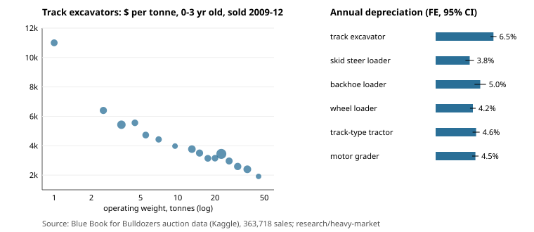

# How fast do excavators, skid steers and dozers lose value, and which size costs most per tonne?

**Status: milestone 1a of `heavy-market` (track 25, milestone 1), real data, preliminary.**
On 363,718 US auction sales of heavy equipment (1989 to 2012), a model with make-and-model and
sale-year fixed effects puts **annual depreciation at 6.5% for track excavators**, 5.0% for
backhoe loaders, 4.6% for dozers, 4.5% for motor graders, 4.2% for wheel loaders and **3.8% for
skid steers**. Among nearly new track excavators, **price rises only with operating weight to the
power 0.63**, so a mini excavator under 2 t sells for about **$11,000 a tonne** against about
$5,400 at 3 to 4 t and $1,900 at 40 to 50 t. Per tonne of steel, compact machines carry the most
price: that is where an open, shop-built machine has the most room.



**Live page:** https://marisstella.app/research/heavy-market/

**Programme.** Track 25 (`heavy`, open-source construction, mining and heavy equipment) in
[`../PROJECTS.md`](../PROJECTS.md), milestone 1 (`heavy-market`), feeding the parts-cost side of
the [`heavy-hydraulics`](../heavy-hydraulics/) programme ("which open circuit gets a small
excavator closest to stock for the least money"). Related labs: none has reviewed this.

**Not advice.** These are statistics of historical auction prices, not a valuation of any
machine, a price guide or financial advice.

## Question

Milestone 1 of track 25 asks where the money goes in owning a compact or mid-size machine and
which class has the widest gap between price and the cost of its parts. Step 1a answers the
part a public dataset can: (1) how fast does each class lose value, measured within a model so
that model mix does not bias it, and (2) how does price scale with machine size?

Hypotheses written before the run: H1, classes differ in depreciation rate (intervals do not
overlap for at least one pair); H2, depreciation is faster when machines are young; H3, price per
tonne falls with operating weight (elasticity of price to weight below 1).

## Data

[Blue Book for Bulldozers](https://www.kaggle.com/c/bluebook-for-bulldozers) (Kaggle competition,
2013, data from Fast Iron): 412,698 auction sales with sale price, sale date, year made, model id,
product group (track excavator, skid steer, backhoe, wheel loader, track-type tractor, motor
grader) and product class (operating weight band for excavators, rated capacity for skid steers).
The run read `TrainAndValid.csv` from a public GitHub mirror,
[omrgrcn/bluebook-for-bulldozers](https://github.com/omrgrcn/bluebook-for-bulldozers)
(sha256 of the csv `046cce58...136ae3`). Kaggle's competition rules govern the data; the session
could not open them, so the raw file is **not** redistributed here and only aggregate statistics
are published. Check the rules before any publication that uses the data.

Cleaning: drop rows with year made before 1950 (the file codes unknown as 1000), keep age 0 to 30
years (age = sale year - year made). 363,718 rows remain.

## Method

Per class, `log(price) = alpha_model + gamma_sale_year + beta * age + e`. The model effect absorbs
make, model and its spec; the sale-year effect absorbs inflation and the market cycle, so no price
deflator is needed and `beta` is the within-model, within-year price change per year of age.
Annual depreciation is `1 - exp(beta)`. Fixed effects are swept out by alternating projections
(the method of Gaure, *R Journal* 2013, [doi:10.32614/RJ-2013-031](https://doi.org/10.32614/RJ-2013-031); the DOI resolver was unreachable from the session, so the citation was checked against the R Journal article page by web search);
standard errors are clustered by model; singleton models are dropped. Code:
[`src/heavy_market/fe.py`](src/heavy_market/fe.py). The estimator is checked on synthetic data
where the slope is known, including a sale-year trend that would leak into a naive age slope
(4 tests).

Size scaling: for track excavators 0 to 3 years old sold 2009 to 2012, log price on log class
midpoint (tonnes), sale-year effects swept out, clustered by model; class bands with fewer than
20 such sales are left out.

## Reproduce

```bash
cd research/heavy-market
PYTHONPATH=src python3 -m pytest tests -q        # 4 tests, needs numpy
python3 experiments/depreciation.py <path>/TrainAndValid.csv > experiments/depreciation_results.txt   # ~6 s
```

## Results

Full output: [`experiments/depreciation_results.txt`](experiments/depreciation_results.txt).

| class | annual depreciation, FE [95% CI] | ages 0-10 | ages 11-30 | sales | models |
|---|---|---|---|---|---|
| track excavator | **6.5%** [6.2, 6.8] | 8.8% | 3.8% | 90,745 | 1,608 |
| backhoe loader | 5.0% [4.4, 5.7] | 6.4% | 2.7% | 76,338 | 293 |
| track-type tractor (dozer) | 4.6% [4.2, 5.0] | 8.0% | 2.9% | 71,370 | 621 |
| motor grader | 4.5% [4.1, 4.8] | 6.7% | 3.8% | 20,514 | 233 |
| wheel loader | 4.2% [3.9, 4.5] | 7.5% | 2.9% | 63,132 | 803 |
| skid steer loader | **3.8%** [3.4, 4.3] | 6.0% | 1.6% | 40,777 | 392 |

- **H1 holds:** track excavators lose value faster than every other class (their interval
  [6.2, 6.8] clears all the others), and skid steers slowest alongside wheel loaders.
- **H2 holds in every class:** depreciation in the first ten years (6.0 to 8.8% a year) is two to
  four times the rate after (1.6 to 3.8%). A single exponential rate is a summary, not a model.
- **Fixed effects matter:** a pooled regression without them gets dozers at 3.8% and graders at
  5.8%, and puts excavators (5.2%) below graders; model mix biases the naive figures by up to
  1.3 points either way.
- **H3 holds:** price elasticity to operating weight is **0.634 [0.604, 0.665]** (2,805 sales,
  395 models), so price per tonne scales with weight to the power -0.37 (each doubling of weight
  cuts price per tonne by about 22%). Medians by class: $11,000/t under 2 t, $6,400 at 2 to 3 t,
  $5,400 at 3 to 4 t, $4,400 at 6 to 8 t, $3,400 at 21 to 24 t, $1,900 at 40 to 50 t.
- Skid steers are cheap and flat: median nearly new prices $9,000 (under 700 lb capacity) to
  $15,500 (2,200 to 2,700 lb), and depreciation of 2.0 to 5.1% by capacity band.

## Limitations

- Auction prices, not new list prices, dealer margins or parts costs. They measure what a used
  machine is worth, which is the market floor an open machine competes with.
- Data ends in 2012 and is nominal dollars of each sale year; the depreciation rates are
  deflator-free by construction, the dollar-per-tonne figures are not (sales 2009 to 2012).
- Age is the only wear measure; machine hours are missing for most rows.
- Weight is the class band midpoint, not each machine's weight; the under-2 t band's midpoint
  (1 t) is the most uncertain point in the size fit.
- One dataset, one country; survivorship (machines that reach auction) is not modelled.

## Next steps

1. New list prices and dealer margins by class (manufacturer price lists, public dealer filings)
   for the same weight bands, to put a new-price line over the used one.
2. Ownership and operating cost per hour: depreciation from this step with sourced annual hours,
   plus fuel, wear parts and repairs (USACE EP 1110-1-8 publishes rates by machine class).
3. The open-BOM floor: a priced bill of materials for an open compact loader or excavator
   (Open Source Ecology's LifeTrac is the reference), to put the price-to-parts gap in dollars per
   tonne and answer which class and subsystem hold it.
4. A hedonic model with machine hours and spec (enclosure, coupler, stick) where present.
