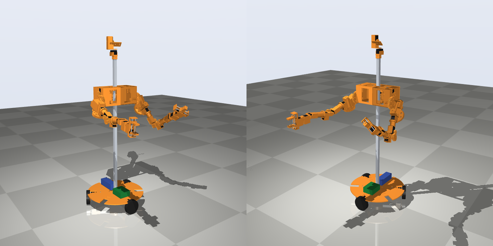
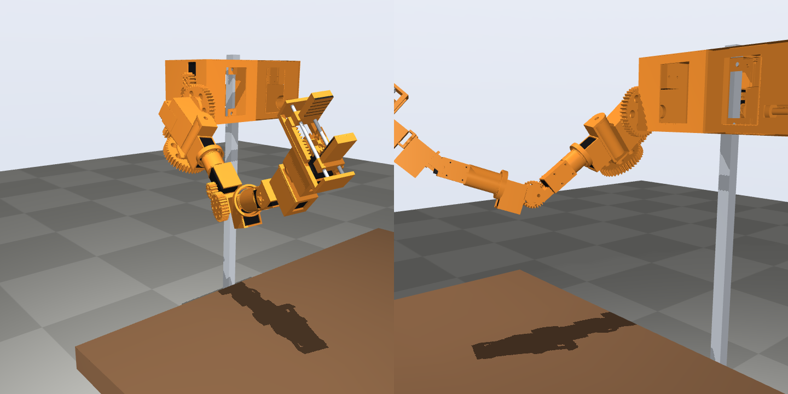
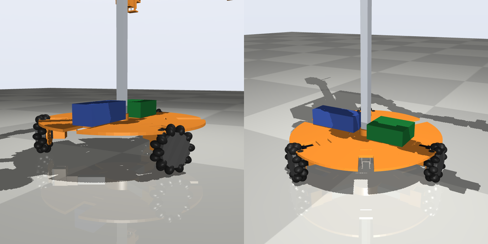
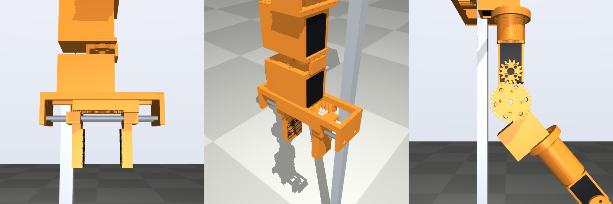
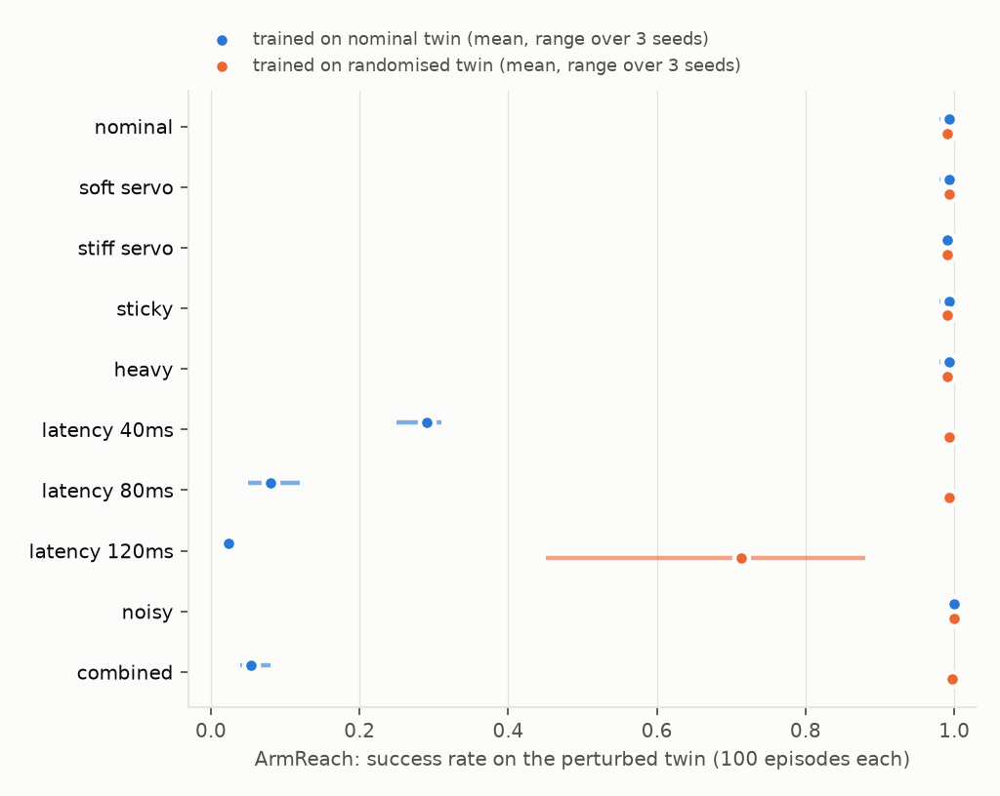
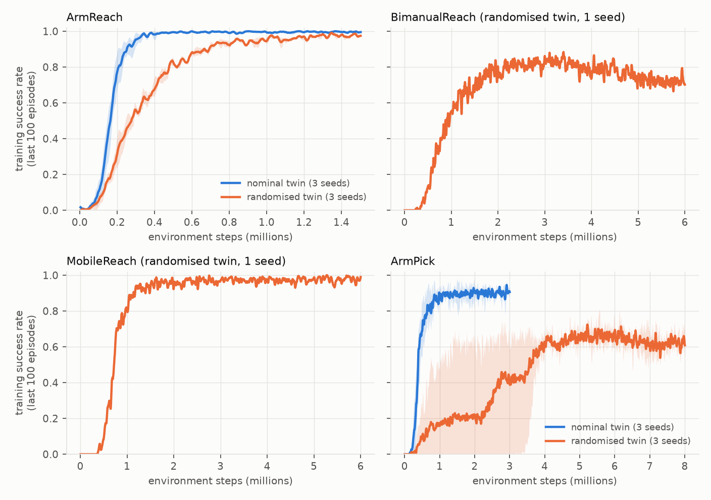
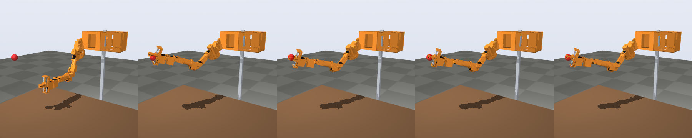
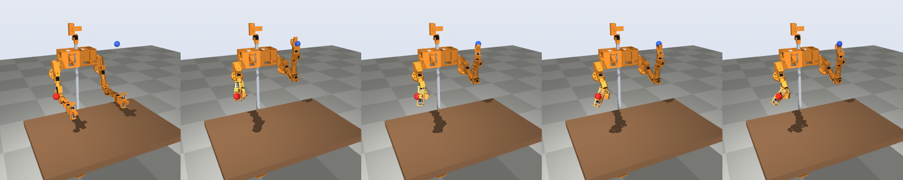
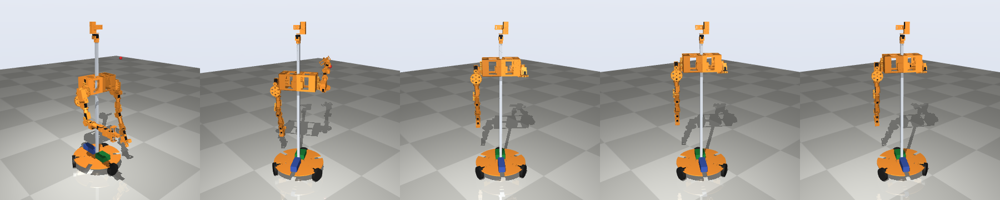
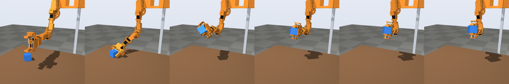

# homebot: a printable 22-DOF bimanual mobile manipulator and its MuJoCo twin

A home-assistant robot you can 3D print in PLA and build from cheap, easy-to-get parts. It has:
- two 7-DOF arms with parallel grippers;
- a pan/tilt camera head;
- a 0.5 m lift on an aluminium mast;
- a holonomic three-omni-wheel base.

**Live page:** https://duncan-haywood.github.io/oss-monorepo/research/homebot/

Every actuator is the same $14–16 Feetech STS3215 bus servo (22 in total), so each extra degree
of freedom costs about one servo and some filament. One parameter file generates three things
together, so they agree by construction:
- the printable parts (CadQuery: STL and STEP);
- the simulator model (MuJoCo), with masses taken from the printed geometry;
- the RL environments (Gymnasium).

A small driver runs the same joint-target interface on the real servos.

> **This is v2.** It has a 2:1 geared elbow and a parallel rack-and-pinion gripper with TPU pads.
> A CAD interference sweep checks every joint's range, a learned pick task (`ArmPick`) is added,
> and the cube's position comes from a camera and fiducial pipeline (`homebot.perception`). v1,
> with a direct-drive elbow and a pivoting jaw, is in git history (commit `c6562c97`); the
> README compares the two where it matters.

**Status: designed and simulated, not yet built.** Every number below comes from the code in
this directory: CAD, the MuJoCo twin, analyses and RL runs. Nothing has been measured on
hardware yet. `hardware/ASSEMBLY.md` lists what to measure on the first build so the twin can be
corrected.



| | |
|---|---|
|  |  |

## At a glance

| | |
|---|---|
| Actuated DOF | 22: 2 x (7 arm + 1 gripper), 2 head, 1 lift, 3 wheels (holonomic base) |
| Servo | Feetech STS3215, 12 V, 30 kg·cm stall, 45 rpm, 4096-count encoder, 55 g (datasheet) |
| Arm | shoulder pitch/roll (printed 3:1 spur gears), upper-arm yaw, elbow (printed 2:1), forearm roll, wrist pitch, wrist roll; 0.53 m from shoulder axis to gripper |
| Gripper | parallel jaws on a rack and pinion, 0–64 mm opening, about 37 N per jaw at the torque limit, printed TPU pads |
| Payload | 145 g held at full horizontal reach within the servos' continuous rating (300 g at 80 % reach, 560 g at 60 %); about 0.8 kg briefly within the peak torque |
| Lift and head | shoulder height 0.45–0.95 m (GT2 belt on a 1 m 2020 V-slot mast), camera at ~1.15 m |
| Base | 3 x 100 mm omni wheels at 0.2 m radius, 0.2 m/s and 1 rad/s commanded, 0.5 m/s² ramp |
| Mass (twin) | 2.32 kg one-arm desk build, 3.62 kg two-arm torso, 5.31 kg mobile robot |
| Cost (`hardware/BOM.md`) | **A** one arm: $291 ($230 budget route) · **B** two arms + head: $485 ($404) · **C** mobile: $948 ($627) |
| Filament | about 1.1 / 1.7 / 2.5 kg PLA for A / B / C, plus a few grams of TPU for the pads |

## Build it in three stages

1. **A. One arm on a desk post (8 servos).** Prints and tests the arm modules.
2. **B. Two arms and the head on the post (18 servos).** A bimanual table-top workstation.
3. **C. The mobile robot (22 servos).** Adds the base, lift and battery.

Guides: [`hardware/BOM.md`](hardware/BOM.md) (parts, prices, sources),
[`hardware/PRINTING.md`](hardware/PRINTING.md), [`hardware/ASSEMBLY.md`](hardware/ASSEMBLY.md),
[`hardware/WIRING.md`](hardware/WIRING.md) (bus ids, power, zero pose, directions). STLs are in
`hardware/stl/` (millimetres, `_mirror` = left side) and STEP files in `hardware/step.zip`.

## Quick start (simulation)

```bash
cd research/homebot
python -m venv .venv && . .venv/bin/activate
pip install numpy scipy mujoco gymnasium pyserial pytest stable-baselines3
pip install torch --index-url https://download.pytorch.org/whl/cpu
PYTHONPATH=src python -m pytest tests -q                   # 71 tests, ~45 s (the CAD tests need cadquery)
PYTHONPATH=src python experiments/view.py mobile           # interactive viewer (arm | torso | mobile)
PYTHONPATH=src python experiments/train.py --env ArmReach --dr --steps 1500000   # ~14 min on 4 cores
PYTHONPATH=src python experiments/train.py --env ArmPick --steps 3000000         # ~55 min
```

```python
import gymnasium as gym, homebot.envs
env = gym.make("homebot/MobileReach-v0", randomize=homebot.envs.Randomization())
```

Environments:
- `ArmReach`: one arm, 7 joints.
- `BimanualReach`: 14 joints.
- `MobileReach`: base twist, lift and 7 arm joints, on the fast planar base.
- `MobileReachRollers`: the same task on the roller-wheel base, for evaluation.
- `ArmPick`: one arm and its gripper, grasp a cube and lift it.

Actions are joint-target increments (metres of jaw travel for the gripper), exactly what the real
driver sends as goal positions. Control runs at 25 Hz on 500 Hz physics.

## How the design and the twin fit together

- **One source of truth.** `src/homebot/params.py` holds every dimension and datasheet value.
  `layout.py` turns it into a body tree. `cad/parts.py` and `cad/base_parts.py` cut the printed
  parts in those body frames. `mjcf.py` writes the MuJoCo model, with each body's inertia summed
  from its servos and bought parts plus its printed parts' mass properties
  (`hardware/mass_properties.json`). Those use a slicer-like shell model: 3 perimeters, 25 %
  infill, PLA. Changing a link length moves the brackets, the meshes, the masses and the model
  together.
- **Servo pockets from the measured envelope.** The STS3215 case was measured from the
  datasheet drawing and the SO-ARM100 servo mesh: 45.4 x 24.8 mm, output axis 10.2 mm from the
  near end, horn face 4.3 mm above the case, idler boss 32.9 mm below. Every cradle is cut from
  that envelope plus 0.3 mm clearance. The mesh was measured, not copied.
- **Four joint modules and a gripper.**
  - *Roll joints:* the servo sits in line with the link, and the upper-arm and forearm rolls
    run in a 6806 thin-section bearing so the servo only supplies torque.
  - *Pitch joint* (wrist): the child is a clevis bolted to the horn on one side and pivoting on
    an M4 shoulder screw on the other.
  - *Geared shoulder:* a 14:42 module-2 spur pair, profile-shifted ±0.3 to avoid undercut, with
    the joint on two 608 bearings and an M8 shaft. It triples torque to 6.1 N·m peak (torque
    register at 75 % to spare the PLA teeth). It also slows the joint to 90°/s and limits it to
    120° of travel, because position mode is single-turn.
  - *Geared elbow* (v2): a 15:30 module-1.5 pair. The servo sits 34 mm up the upper arm, and the
    forearm clevis turns on an M5 shaft in two 625 bearings. It doubles the elbow torque (4.1 N·m
    peak at the same 75 % register) and moves 55 g of servo toward the shoulder.
  - *Parallel gripper* (v2): an 18-tooth module-1.25 pinion on the gripper servo drives two racks
    in opposite directions. Each rack is part of a jaw carriage sliding on two 4 mm steel rods,
    so the jaws stay parallel and centred on the tool point. Both jaws are the same printed part,
    with snap-on TPU pads. The twin models the jaws as two slide joints coupled by an equality
    constraint, splitting the servo's reflected inertia, damping and friction between them.
- **Every joint range is checked against the parts.** MuJoCo ignores contacts between a body
  and its parent, so a range the printed parts cannot reach is invisible in the twin.
  `homebot.cad.interference` moves each arm joint through its range and intersects the exact
  CadQuery solids and servo envelopes on both sides of the joint. On v1 it found two errors:
  - the elbow's parts collided from about 1.7 rad, although the twin allowed 2.3;
  - a pivot boss overlapped its clevis cheek by 1.5 mm.

  v2 is clear on all eight joints. The elbow first touches between 2.15 and 2.2 rad, so its
  range is set to 2.0.



*The parallel gripper half open: from the front, and from below with the racks under the pinion.
Right: the 2:1 elbow stage.*
- **The servo model reproduces the torque-speed line.** A hobby servo is a brushed motor behind
  a saturating proportional loop: τ = clip(k_p e, ±τ_stall) − b ω, with b = τ_stall/ω₀ the
  back-EMF slope. In MJCF this is a force-limited `position` actuator plus joint damping b, so at
  saturation the twin delivers exactly τ_stall − b ω and reaches the datasheet's no-load speed
  (`tests/test_servo_model.py`).
  - Wheel servos in speed mode use the same construction with a feed-forward term.
  - Reflected rotor inertia (armature), Coulomb friction and the loop gain are not on the
    datasheet. They start from the SO-101 MuJoCo model's values, which came from an
    identification of the 7.4 V servo for Open Duck Mini with Rhoban's BAM (Duclusaud et al.
    2025). They must be re-identified for the 12 V servos you buy (`homebot.sysid`).
- **Head on the mast, not on the carriage.** The mast runs through the carriage, so a head
  there would hit it. A cap on the mast top keeps the camera at a fixed ~1.15 m overlooking
  both arms, like Stretch (Kemp et al. 2022).

## Engineering checks (from the twin)

`experiments/analyze.py` (results in `experiments/results/analysis.json`).

**Torque budget.** The table gives the worst static holding torque over 20,000 random arm poses
plus the straight-out poses, without and with a 200 g payload. "Continuous" is the datasheet
rated torque (10 kg·cm at 0.9 A) times the reduction; "peak" is the usable stall torque.

| Joint | Own weight (N·m) | + 200 g | Continuous | Peak | + 200 g vs continuous | vs peak | v1 vs continuous |
|---|---|---|---|---|---|---|---|
| shoulder pitch (3:1) | 1.96 | 2.99 | 2.71 | 6.09 | 111 % | 49 % | 103 % |
| shoulder roll (3:1) | 1.50 | 2.42 | 2.71 | 6.09 | 89 % | 40 % | 83 % |
| upper-arm yaw | 0.65 | 1.25 | 0.98 | 2.94 | 127 % | 42 % | 119 % |
| elbow (2:1 in v2) | 0.65 | 1.25 | 1.80 | 4.06 | **69 %** | 31 % | 120 % |
| forearm roll | 0.17 | 0.46 | 0.98 | 2.94 | 47 % | 16 % | 44 % |
| wrist pitch | 0.17 | 0.46 | 0.98 | 2.94 | 47 % | 16 % | 44 % |

Every joint stays under half of its peak torque. Gearing the elbow takes it from 120 % to 69 % of
its continuous rating. v2 adds 67 g to the arm:
- 28 g in the hand: the parallel gripper is 134 g with its servo and rods, against 106 g for v1's
  single jaw;
- 39 g at the elbow: gears, bearings and shaft.

That costs the shoulder pitch and upper-arm yaw a few points, and both still exceed their
continuous rating with 200 g at full reach. Long holds at full reach will heat them.

Payload held indefinitely (all joints within the continuous rating, arm level with the shoulder):

| Reach | v2 | v1 |
|---|---|---|
| 0.53 m (full) | 145 g | 135 g |
| 0.42 m | 300 g | 184 g |
| 0.32 m | 560 g | 240 g |

Within peak torque the v2 figures are 0.80, 1.12 and 1.60 kg. At the shorter reaches the elbow
was the limit in v1, so the gear raises what the arm can hold there by 60 % (0.42 m) and 2.3x
(0.32 m). Without the 3:1
shoulder gears, the shoulder would already be at 67 % of stall under the arm's own weight.

**Tip-over.** The kiwi base's support triangle has edges only R/2 = 0.1 m from the centre.
Margins come from the zero-moment point (Vukobratović & Borovac 2004) of the full twin, with
200 g in each reaching hand:
- Static margin: 92 mm with the arms down, 68 mm reaching forward low, 47 mm reaching to the
  side, 35 mm with both arms straight forward.
- The largest base acceleration before a wheel lifts falls as the lift rises: 3.6 m/s² with the
  arms down and the lift low; 0.63 m/s² with both arms forward and the lift at the top.

So the base ramps its velocity commands at 0.5 m/s², in the environments and in the driver.

**Gripper.** A scripted top-down pick (`experiments/scripted_pick.py`, IK plus the servo twin)
of a 4 cm, 60 g cube at 40 random table positions, lifted 12 cm:

| | v2 parallel jaws | v1 pivoting jaw |
|---|---|---|
| Held after the lift | **24 of 24** reachable placements | 32 of 34 reachable placements |
| Cube slip down the jaws | median 0 mm, max 2 mm | median 34 mm (22–53 mm) |
| Out of reach for a straight-down grasp | 16 of 40 | 6 of 40 |

- **Why slip goes away.** v1's single jaw squeezed at an angle, so the cube slid down until it
  wedged. The parallel pads close flat on two faces at the servo's torque limit (73 N in total).
- **Why more placements are out of reach.** The unreachable ones are all within 0.26 m of the
  post (0.18–0.26 m in front of it). A straight-down grasp there needs more elbow flex than the
  parts allow. v1 appeared to reach them only because its twin allowed an elbow angle (2.3 rad)
  that its own parts could not reach (above).
- **Droop.** The proportional servo loops let the hand droop 6 mm (median) below the commanded
  height under load.

## Twin fidelity and RL results

**Which twin errors matter for a learned policy?**

Policies are trained with PPO (Stable-Baselines3, 25 Hz, 8 parallel environments on 4 CPU cores).
They are then scored on 100 fixed episodes on the nominal twin and on nine perturbed twins, each
standing in for a real robot that differs from the model in one way. Success means the gripper
centre is within 3 cm of the target at the end of the episode.

*Randomised* policies saw a twin resampled every episode:
- servo gain x0.6–1.6;
- back-EMF damping x0.75–1.3;
- friction x0.4–2.5;
- reflected inertia x0.6–1.6;
- link masses x0.85–1.2;
- 0–150 g in the hand;
- 0–2 control steps (0–80 ms) of action latency;
- 3 mrad encoder noise;
- a 10 % unit-to-unit servo spread.

The twin's own encoder quantisation is applied everywhere.



*One v2 arm reaching a random point at the table: 3 seeds each, 1.5 M steps, about 14 min per
run. Success rate is the mean over seeds (range); the second figure is the median final
distance. The v1 arm's results are in brackets.*

| Twin the policy is tested on | Trained on the nominal twin | Trained on a randomised twin |
|---|---|---|
| nominal | 99 % (98–100), 2 mm [v1 100 %] | 99 %, 8 mm [98 %] |
| servo gain x0.5 | 99 %, 2 mm | 99 %, 6 mm |
| servo gain x2 | 99 %, 3 mm | 99 %, 10 mm |
| friction x3 | 99 %, 2 mm | 99 %, 8 mm |
| links +25 % and 200 g in the hand | 99 %, 2 mm | 99 %, 7 mm |
| **40 ms action latency** | **29 % (25–31), 41 mm** [10 %] | 99 %, 6 mm [99 %] |
| **80 ms action latency** | **8 % (5–12), 67 mm** [4 %] | 99 %, 7 mm [97 %] |
| **120 ms action latency** (beyond the randomised range) | **2 %, 92 mm** [2 %] | 71 % (45–88), 21 mm [81 %] |
| 10 mrad encoder noise | 100 %, 2 mm | 100 %, 9 mm |
| combined (gain x0.6, friction x2, mass x1.15, +100 g, 80 ms, 5 mrad) | **5 %, 83 mm** [3 %] | 100 %, 7 mm [98 %] |

- **Latency is what breaks a nominal policy, on both versions of the arm.** Trained on the exact
  twin, a policy ignores halving or doubling the servo gain, tripling friction, 25 % heavier
  links with 200 g in the hand, and encoder noise. A single control step of action latency
  (40 ms) takes it from 99 % to 29 % (v1: 100 % to 10 %).
  We expect about one step of delay on the real bus, though it is not measured: a sync read of
  20 servos at the default 0.5 ms return delay is about 12 ms before USB latency and inference
  are added.
- **Randomisation fixes this at a cost.**
  - Success stays at 99 % up to 80 ms.
  - At 120 ms, beyond anything it saw in training, it still reaches 71 % (45–88 % by seed).
  - The price is precision: the median final error rises from 2 mm to 8 mm.
  - It also needs about 2.3x the samples to reach 90 % training success (0.48–0.59 M steps
    against 0.20–0.28 M).
- **Measuring the real bus's latency is therefore the first sim-to-real job**, ahead of
  friction or mass identification.
- **Policies survive the hardware revision.** The randomised v1 policies, trained before the
  elbow was geared and the gripper replaced, run unchanged on the v2 twin
  (`experiments/cross_version.py`; v1 results in brackets):
  - one arm: 98 % [98 %];
  - both arms: 75 % [80 %];
  - mobile: 99 % nominal and 93 % combined [100 %, 97 %].



*Both arms, each reaching its own target (randomised twin, 1 seed, 6 M steps, 66 min).*
- 87 % success on the nominal twin (both hands within 3 cm; median worse hand 20 mm).
- 78–90 % under the single servo, mass and noise perturbations.
- 77 % at 40 ms and 58 % at 80 ms latency, 22 % at 120 ms.
- 75 % under the combined perturbation.

v1's policy (3 M steps) scored 80 % nominal but held up better under latency (86 % at 80 ms). We
trained v2 twice as long because v1 was still improving at 3 M. Instead, training success
peaked near 85 % at about 3 M steps and drifted down to 68 % by 6 M (figure above). With one
seed each, the differences between the two runs cannot be split between the arm change and the
longer training. The 14-joint task is the least settled result here.

|  |
|---|
|  |

*Whole robot, driving to a target and reaching it.* Targets lie 0.22–1.45 m from the base
centre and 0.29–1.09 m high (5–95 % ranges), in any direction. The policy commands the base
twist, the lift and 7 arm joints (randomised twin, 1 seed, 6 M steps, 77 min):
- **On the twin it trained on (planar base):**
  - 98 % success, median 6 mm, on the nominal twin;
  - 95–98 % under every single perturbation, including +25 % mass with 200 g in the hand
    and 120 ms latency;
  - 95 % (7 mm) under the combined perturbation (v1: 100 %, 99–100 % and 97 %).
- **Tipping.** None of the 1,000 planar-twin or 200 roller-twin evaluation episodes ended in a
  tip-over. On the planar twin that is the ZMP check; on the roller twin it is a physical tilt
  above 10°.
- **On the roller-wheel twin it never saw:** 98 % on the nominal roller twin (median 6 mm) and
  95 % under the combined perturbation (v1: 100 % and 96 %).
- **Why it transfers.** The policy closes the loop on the target position it observes, so the
  6–8 % base drift between the two twins (below) costs it almost nothing.



**A bug the second twin caught.** The first mobile run reported 93 tip-overs in 100 episodes
under +25 % mass on the planar twin, and none on the roller twin. The cause:
- MuJoCo precomputes subtree masses and divides by them when it computes centres of mass.
- Randomising `body_mass` without refreshing them scaled the computed centre of mass about the
  world origin.
- So the ZMP check flagged phantom tip-overs once the robot drove away from the origin.

It is fixed, with a regression test that fails on the old code, and the policy above was
retrained after the fix. Dynamics were never affected. Comparing two twins of different
fidelity is what exposed it.

### Picking with the parallel gripper (v2)

**Task** (`ArmPick`). One arm at the table edge grasps a cube and lifts it.
- **Cube placement:** random, 0.24–0.40 m in front of the post, at any yaw within ±45°.
- **Actions:** the policy moves the seven arm joints and the gripper by target increments. It
  starts with the gripper open (61 mm).
- **Observations:**
  - its joints;
  - the gripper servo's load (the STS3215 reports it);
  - the cube's position relative to the gripper and the table;
  - the cube's yaw;
  - the gripper's axes.

  There is no touch sensing. The cube position stands in for what a camera with a fiducial on
  the cube would give; no vision is simulated.
- **Reward:** staged and dense. It pays for approach, for each jaw touching the cube, and for
  lift while both jaws hold it; it penalises table contact. An episode lasts 6 s.
- **Success:** at the end of the episode the cube is at least 5 cm above the table and held
  between both jaws.
- **Extra randomisation:** on top of the reach list (minus the payload), cube edge 30–50 mm,
  mass 30–200 g, cube friction 0.3–0.8, pad friction x0.65–1.25, and a 5 mm error (per axis,
  fixed per episode) in the observed cube position.
- **Extra test twins:** slippery pads (x0.55), a 300 g cube, a 10 mm cube-position error.

*3 seeds per row; success on 100 fixed episodes per twin, mean (min–max over seeds).
Nominal-trained: PPO, 3 M steps, 55 min per run. Randomised: PPO with an entropy bonus (0.005),
8 M steps, 1.7–3.1 h per run.*

| Twin the policy is tested on | Trained on the nominal twin | Trained on a randomised twin |
|---|---|---|
| nominal (40 mm, 60 g cube) | **91 %** (89–93) | 77 % (71–87) |
| servo gain x0.5 / x2 | 90 % / 89 % | 77 % / 76 % |
| friction x3 | 86 % | 72 % (56–86) |
| links +25 % and 200 g in the hand | 92 % | 76 % |
| **40 ms action latency** | **41 %** (27–58) | 77 % (69–86) |
| **80 ms action latency** | **18 %** (10–27) | 63 % (56–69) |
| **120 ms action latency** | **8 %** | 48 % (47–49) |
| 10 mrad encoder noise | 93 % | 75 % |
| slippery pads (x0.55) | 89 % | 80 % |
| 300 g cube (beyond the randomised range) | 89 % (80–96) | 77 % |
| 10 mm cube-position error | 67 % | 61 % |
| combined | **27 %** (16–37) | **61 %** (52–71) |

- **Latency again decides whether a nominal policy works.** As with reaching, it shrugs off
  servo-gain, friction and mass errors, slippery pads and a cube five times the nominal mass.
  One 40 ms step of latency takes it from 91 % to 41 %.
- **For picking, robustness costs more.** Randomisation holds 77 % at 40 ms and 63 % at 80 ms,
  but it gives up 14 points on the nominal twin (77 % against 91 %). For reaching it gave up 2.
  It also needs about 6x the samples to reach 50 % training success: 0.73–3.75 M steps against
  0.32–0.43 M for nominal training.
- **Most failures are missed grasps, not drops.** On 300 twins drawn from the whole training
  distribution (`experiments/pick_diagnosis.py`), the randomised policies succeed 65 % of the
  time (60–73 % by seed); 4 % knock the cube off the table.
  - What they miss is mostly large cubes: 53 % for 45–50 mm against 67–71 % below 45 mm. With
    the jaws open to 61 mm, a 50 mm cube leaves about 5 mm per side. That is no more than the
    5 mm (per axis) error in where the policy believes the cube is.
  - The nominal-trained policies score 34 % on the same twins, falling from 56 % without
    latency to 11 % at two steps.
- **An optimiser detail that mattered.** The first randomised run, without the entropy bonus
  and for 5 M steps, let PPO's exploration noise collapse (action std 0.6 to 0.08). It stalled
  at 75 % on the nominal twin. With the bonus, seed 0 reaches 87 %, but two of three seeds
  stay near 71 %, so the seeds vary widely.
- **The policies grasp from the side, not from above.** When both jaws first touch the cube,
  the gripper is tilted a median 43–78° from vertical, depending on the policy
  (`experiments/pick_behaviour.py`, nominal twin). Unlike the scripted top-down grasp above,
  this reaches cubes close to the post. The six policies pick 60–93 % of cubes placed less than
  0.26 m in front of it (30 episodes each), where the scripted vertical grasp reached none.



**Is a 5 mm cube-position error realistic?** (`experiments/fiducial_pose.py`,
`homebot.perception`.) The pick policies are told where the cube is, with an error. To check that
error, the twin renders the head camera of the two-arm build at 720p with pixel noise, looking at
a 40 mm cube with a 30 mm ArUco marker on its top face. OpenCV finds the marker. The cube
position is where the ray through the marker centre meets the plane of the cube's top, using the
camera pose from the head's forward kinematics. Over 200 random placements:

| Head pose used for the estimate | Median horizontal error | 90th percentile |
|---|---|---|
| true head angles | 0.8 mm | 1.0 mm |
| angles as the servos report them (1-tick quantisation, ±0.5° backlash) | 3.5 mm | 6.2 mm |
| (full marker pose by PnP, true head angles) | 8 mm, plus 11 mm in height | 12 mm |

- **Head backlash, not pixels, sets the error.** At 640x480 the plane method still gives
  1.1 mm with the true head pose.
- **The randomised 5 mm per axis is in the right range.** Lens distortion, calibration error
  and lighting are not modelled, so a real camera will do somewhat worse.
- **Using the known table plane matters.** PnP from a 30 mm marker seen from 0.6 m gets depth
  wrong by about a centimetre.
- **The carriage blocks part of the view.** The marker is found in 179 of 200 images. Twenty of
  the misses are cubes within 0.265 m of the post, which the arm carriage hides from the head.
  That is the same zone a vertical grasp cannot reach, so it needs the wrist camera.

The same `homebot.perception` functions run on a real webcam image; only the camera calibration
changes (`pip install opencv-contrib-python-headless` for this part).

**Closing the loop through the camera is where picking breaks.** (`experiments/pick_camera_loop.py`)
Here the policy gets the cube position from rendered images at 5 Hz instead of from the
simulator:
- the last estimate is held while the marker is hidden;
- once the gripper servo reports a hold (jaws stopped short of closed, load at the limit), the
  cube is carried with the hand.

*50 paired episodes on the nominal twin, seed-0 policies; in brackets, success on the episodes
where the camera saw the marker at least once.*

| Policy | Simulator pose | Fixed camera | Pan/tilt head (backlash) |
|---|---|---|---|
| trained on the nominal twin | 96 % | 40 % (50 %) | 32 % (41 %) |
| trained on a randomised twin | 84 % | 32 % (36 %) | 32 % (36 %) |
| randomised, plus a camera observation model | 76 % | **50 %** (58 %) | 40 % (47 %) |

- **The marker is rarely visible.** Once the arm moves, it is detected in only 11–18 % of frames:
  the arm and hand hide the cube from above during the approach. In 6–11 of the 50 episodes the
  camera never sees it, mostly cubes near the post, behind the carriage.
- **The policies need continuous tracking.** They nudge the cube while closing in. With the
  estimate frozen they then miss it. In a 16-episode check, running perception at 25 Hz instead
  of 5 Hz made no difference. A wrist camera helped little: with a side grasp, it sees the
  top-face marker almost edge on.
- **Training on a model of the camera helps a little.** The third policy was trained with
  `Randomization.camera_model`, which models the camera without rendering:
  - estimates refresh every 1–5 steps;
  - they are held while the hand is within 6–15 cm of the cube or a frame drops out;
  - they sit on the table plane, and follow the hand while it holds the cube.

  This policy picks 50 % with the fixed camera, against 32–40 % for the others. But it gives up
  20 points with a perfect cube position (64 % on 100 episodes, against 84–87 %), and on the
  cheap model of the camera (`camera_5hz` twin) it is no better than the randomised policies:
  50 % against 44–60 %. One seed, so this is a direction, not a result.

So the twin says the next step for picking is perception, not dynamics: markers on more than one
face, a wrist camera with PnP at close range, the servo load as a touch signal, or policies
trained on images.

**Base twin: planar or rollers?** (`experiments/base_fidelity.py`, 12 random 12 s drives of about
1.8 m.) The fast twin moves the base on ideal planar joints, at 89x real time with the arms on
one core. The detailed twin rolls three omni wheels with 20 passive rollers each through contact,
at 10x real time. With identical wheel commands from the kiwi inverse kinematics (Siegwart et al.
2011):
- The planar twin stays within 1.5 cm (mean) of the ideal kinematics.
- The roller twin ends 14 cm (mean; worst 47 cm) and 10° away from it, about 7.6 % of the
  distance travelled.
- The gap barely changes when the wheel servos' speed-loop gain is raised 64x (6.4 % to 5.5 %),
  so it comes from roller contact, not speed tracking.

Which twin is closer to the real base is the first thing to measure on hardware (a 1 m square
drive). Until then, mobile policies should close the loop on what they observe rather than on
dead reckoning.

**System identification** (`homebot.sysid`, validated on synthetic data only). Fitting the
twin's single-joint model to 12 s of step responses on a test pendulum recovers gain, back-EMF
damping, reflected inertia and stall torque within 0.5 %, and friction within 9.1 %, for 8
random servos with ±2x errors. Encoder quantisation and 2 mrad noise are included. The
pendulum must be heavy: 0.5 kg at 15 cm. With 0.1 kg at 10 cm, the servo's own reflected
inertia (0.028 kg·m², 28x the pendulum's) dominates, and one of 8 fits converged to a solution
12 % off on *every* parameter with the same residual. That is a scale ambiguity, not noise.

## Reproduce

```bash
cd research/homebot
PYTHONPATH=src python -m pytest tests -q                  # 71 tests
PYTHONPATH=src python experiments/analyze.py              # torque, payload, stability, BOM, sysid,
                                                          # interference sweep (~8 min)
PYTHONPATH=src python -m homebot.cad.interference         # joint ranges vs the printed parts (~3 min)
PYTHONPATH=src python experiments/base_fidelity.py        # planar vs roller base (~3 min)
PYTHONPATH=src python experiments/scripted_pick.py        # gripper check (~1 min)
bash experiments/run_all.sh                               # all RL runs (~14 h on 4 cores)
PYTHONPATH=src python experiments/summarize.py            # RL tables
# pick analyses over the six pick policies (only the seed-0 policies ship; run_all.sh regenerates the rest)
PYTHONPATH=src python experiments/pick_diagnosis.py experiments/runs/ArmPick_dr_ent_s0   # failures by factor
PYTHONPATH=src python experiments/pick_behaviour.py experiments/runs/ArmPick_{nominal,dr_ent}_s{0,1,2}
PYTHONPATH=src python experiments/cross_version.py --runs <v1 runs>   # v1 policies on the v2 twin
MUJOCO_GL=egl PYTHONPATH=src python experiments/fiducial_pose.py      # camera + ArUco localisation (~3 min)
MUJOCO_GL=egl PYTHONPATH=src python experiments/pick_camera_loop.py experiments/runs/ArmPick_dr_ent_s0   # ~3 min
PYTHONPATH=src python -m homebot.cad.build                # rebuild STL/STEP/mass properties (needs cadquery)
PYTHONPATH=src python -m homebot.analysis.bom             # rebuild hardware/BOM.md
```

The randomised seed-0 policies ship in `experiments/runs/` (`ArmReach_dr_s0`, `BimanualReach_dr_s0`,
`MobileReach_dr_s0`, `ArmPick_dr_ent_s0`; `policy.zip` with its observation normaliser), with every
run's learning curve and evaluation. The v1 policies are in git history (commit `c6562c97`). Run
`experiments/filmstrip.py <run dir>` to watch one. Versions in `requirements.txt` (Python 3.11,
CPU only). Bringing up hardware is covered in
`experiments/hardware.py` (`set-id`, `calibrate`, `sysid-log`, `sysid-fit`) and `WIRING.md`.

## Builds on

- **Low-cost arms and mobile manipulators.** The servo choice and much of the practical
  know-how come from the open SO-100/SO-101 arms (TheRobotStudio, Apache-2.0), the LeKiwi base
  (SIGRobotics-UIUC, Apache-2.0), LeRobot (Cadene et al. 2024) and XLeRobot (Wang et al. 2025).
  XLeRobot is the closest prior design: two 5-DOF SO-101 arms on a LeKiwi base with a 2-DOF
  head, 17 servos, from about $660. homebot differs in three ways:
  - 7-DOF arms with geared shoulders and bearing-supported roll joints;
  - a lift;
  - a single parametric source for CAD and twin.

  No CAD or code from those projects is copied. Their STS3215 mesh was used only to measure the
  case. Low-cost bimanual and mobile-bimanual learning: ALOHA (Zhao et al. 2023) and Mobile
  ALOHA (Fu et al. 2024).
- **Mast-and-lift mobile manipulator for homes:** Stretch (Kemp et al. 2022).
- **Servo and actuator modelling for sim-to-real:**
  - an actuator model and simulated latency (Tan et al. 2018);
  - a learned actuator model (Hwangbo et al. 2019);
  - STS3215 parameters identified for Open Duck Mini with BAM (Duclusaud et al. 2025), used here
    as priors via the SO-101 MuJoCo model;
  - dynamics randomisation, including randomised action timing (Peng et al. 2018), after visual
    domain randomisation (Tobin et al. 2017).
- **Tools:** MuJoCo (Todorov et al. 2012), Gymnasium (Towers et al. 2025), Stable-Baselines3
  (Raffin et al. 2021), PPO (Schulman et al. 2017), CadQuery, OpenCV's ArUco markers
  (Garrido-Jurado et al. 2014). Servo protocol and control table: Feetech's FTServo SDK and
  LeRobot's Feetech tables.
- **Research directions:** digital twins of manipulation workcells and sim-to-real for
  manipulation, the HIRO Group (Alessandro Roncone, CU Boulder,
  <https://hiro-group.ronc.one/>); learning from demonstration and human-robot collaboration in
  simulation, the CAIRO Lab (Bradley Hayes, CU Boulder, <https://cairo-lab.com/>). Nothing here
  is affiliated with or endorsed by either lab; no specific paper of theirs is reproduced.

Full references: [`paper/refs.bib`](paper/refs.bib). White paper: [`paper/whitepaper.md`](paper/whitepaper.md).

## Limitations

- **Not built.** Fits, clearances, gear mesh, bearing seats and screw access are checked in
  CAD and simulation only. Expect a round of fixes after the first prints.
- **Servo parameters are priors.** Loop gain, armature and friction come from an identification
  of the 7.4 V servo. Speed-loop gain is a guess. Backlash (≤0.5° per the datasheet), deadband,
  temperature and current limits are not modelled.
- **Simplified physics.**
  - Printed parts are assumed rigid, with uniform density inside each part.
  - Gears have no backlash or tooth compliance.
  - The planar base cannot tip; tipping is predicted from the ZMP and ends the episode.
- **Mechanical limits.**
  - Geared shoulder pitch travels only 120° (−14° to +103°) because position mode is
    single-turn.
  - The elbow flexes to 2.0 rad (115°), limited by the parts.
  - The lift runs in speed mode, with the host counting turns.
  - The gripper opens 64 mm, which limits it to objects of about 45 mm with a 5 mm position
    estimate. Its rods and racks are unproven in print.
  - The elbow's printed pinion runs at about 38 MPa root stress at stall. Upper-arm yaw and
    shoulder pitch exceed their continuous rating holding 200 g at full reach.
- **Prices** were checked on 2026-10-02 from the retailers listed. A few are taken from other
  projects' BOMs and are marked as such. Small hardware is listed but not priced.
- **RL scope.**
  - The tasks are reaching and picking with privileged state. The pick task assumes the cube's
    position is known to about 5 mm, all the time. A rendered camera supports the 5 mm but not
    the "all the time": with the cube position from rendered images, picking drops to 32–50 %.
    The hardware loop does not yet run the estimator.
  - The pads are rigid boxes with a friction coefficient.
  - The randomised pick policies reach 77 % on the nominal twin, against 91 % for policies
    trained without randomisation.
  - No real-robot transfer is attempted.

## Next steps

1. Print and assemble stage A. Measure part masses, gear backlash and joint friction. Fit the
   servo parameters with `sysid-log` and update `params.py`.
2. Print and test the v2 gripper and elbow stage: rod fit and racking of the jaws, backlash of
   the 2:1 elbow, and whether the 38 MPa stall stress is survivable.
3. Run the 1 m square odometry test to decide between the planar and roller base twins.
4. Close the pick task's state gap: run `homebot.perception` on the real head and wrist cameras,
   with the wrist camera covering the zone the carriage hides. Then train on images. Test
   whether a wider jaw opening fixes the large-cube failures.
5. Collect teleoperated demonstrations with a mirrored leader arm for learning from
   demonstration, and add pick-and-place.

## Notes

Written with AI assistance (Claude). The design, code, analyses and text were produced in an
AI-assisted session and checked by the tests and scripts above. Citations were checked against
publisher DOI records, arXiv, proceedings pages and the cited repositories. MIT licence
(`research/LICENSE`).
