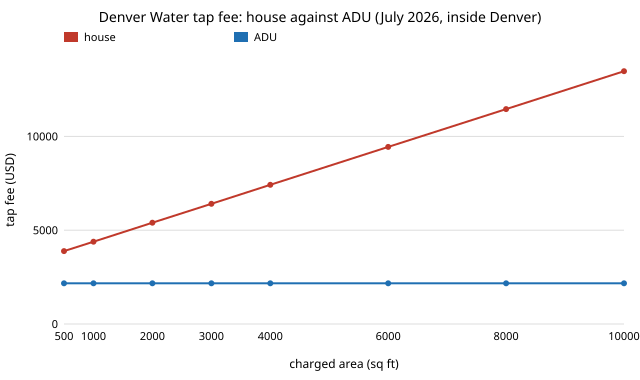

# house-adufees: what does Denver Water's 2026 tap fee cost a 480 sq ft backyard cottage (ADU) against a house?

Track 12 project, open-source residential construction (`PROJECTS.md`). It follows up [`house-market`](../house-market)'s next step, "price [`house-open-design`](../house-open-design)'s ADU under Colorado's fee schedules", for one fee that could be read from its source: Denver Water's system development charge (SDC, the "tap fee"). A 40-line stdlib model reads the schedule in [`data/sdc.csv`](data/sdc.csv) and reports what a house and an ADU pay. Produced with AI assistance (Claude). The schedule was read on 2026-10-20 from Denver Water's own page ([`data/sources.csv`](data/sources.csv)).

**Live page:** https://duncan-haywood.github.io/monorepo-projects/research/house-adufees/

**Headline.**
- **An ADU pays a flat $2,170 inside Denver Water's Denver service area from 1 July 2026** ($2,055 before; $3,030 outside Denver). A house pays $3,380 plus $1.01 per sq ft of charged area, so a house charged on 2,000 sq ft pays $5,400. The ADU pays 60% less than that house.
- **Per floor sq ft the ADU is dearer.** $2,170 over 480 sq ft is $4.52 per sq ft; the house is $2.70 per sq ft if 2,000 is its floor area. A flat fee favours the larger cottage.
- **The July 2026 step raised the ADU charge 5.6% and the 2,000 sq ft house charge 9.6%.**
- **Sewer side (new, read 2026-10-20 from Denver DOTI's own PDFs): a backyard cottage that shares the house's water tap pays about $2,745 in total for water SDC plus sewer permit fees; one that needs its own tap could pay up to $9,225.** DOTI's 2026 schedule charges $6,480 per residential unit ($410 SAFE + $6,070 METRO) plus a $425 application and a $150 inspection. Its residential requirements say a sanitary connection fee "may be required" for an ADU that does not share the main house's water service and that sharing "may avoid" it, but no ADU amount is published. So $9,225 treats the $6,480 per-unit fee as an upper-bound reading, not a quoted ADU fee. A 2,000 sq ft house on the same schedule pays $12,455.
- **Water is the small part of what `house-market` calls the "water and sewer SDC".** That report's $16,930 for a 2,000 sq ft Denver home less Denver Water's $4,925 (January step) leaves $12,005 for sewer and whatever else CSI folded in. DOTI's $6,480 per-unit sewer fee explains $6,480 of that, leaving $5,525 that no official schedule read here accounts for (CSI may include other charges or a different year). Do not scale `house-market`'s $16,930 down to an ADU on this page's say-so.

**Builds on.** `house-market` (the $16,930 figure, the Denver fee table) and `house-open-design` (the 480 sq ft ADU). It builds on none of the CU Boulder groups in `prompt.md`.

**Not advice, not a quote.** One fee from one utility's published schedule. The page does not say whether the per-sq-ft rate applies to lot or floor area, so `house_sdc` takes a "charged area" and the numbers above label it as such. A Denver Water "participation charge" or a 20% water-efficiency credit (the page mentions both) may change a real bill. Confirm with Denver Water and the City before budgeting.

## Reproduce
```bash
cd research/house-adufees
PY=$(python3 ../../platform/ci/pyenv.py pytest | tail -1)
$PY -m pytest -q tests          # 11 tests
$PY experiments/run.py          # writes experiments/results.txt
$PY experiments/figure.py       # writes experiments/sdc_vs_area.svg
```

## Results (`experiments/results.txt`)


| Inside Denver | Jan 2026 step | Jul 2026 step |
|---|---:|---:|
| ADU | $2,055 | $2,170 |
| House, 2,000 sq ft charged | $4,925 | $5,400 |
| House, 6,000 sq ft charged | $8,365 | $9,440 |

The house charge passes the ADU charge below 500 sq ft of charged area ($3,885 against $2,170 at 500 sq ft), so the ADU is cheaper than any house under this schedule.

**A consistency probe, not a check.** A search excerpt of a Colorado Sun report (2026-06-19; the page itself returned HTTP 429 and was not read) gives $10,450 for a single-family home in Denver. Solving the July schedule for the area that gives that figure returns 7,000 sq ft, which is lot-sized and not floor-sized. I solved for the area, so this is a reading consistent with the schedule rather than a test of it, and it suggests, without proving, that the per-sq-ft rate applies to lot area. If so, a 2,000 sq ft house on a 7,000 sq ft lot pays far more than the 2,000 sq ft row above, and the ADU's relative saving is larger.

### Sewer permit fees (`experiments/results.txt`, section H)
| Inside Denver, July 2026 water step | Water SDC | Sewer permit fees | Total |
|---|---:|---:|---:|
| ADU sharing the house's water tap | $2,170 | $575 | $2,745 |
| ADU with its own tap (upper-bound reading) | $2,170 | $7,055 | $9,225 |
| House, 2,000 sq ft charged | $5,400 | $7,055 | $12,455 |

Sources: DOTI "2026 Sewer Permit Fees" and "SUDP Residential Permit Requirements" ([`data/sources.csv`](data/sources.csv)). Covenant agreement for shared sewer service, plan review, impact, linkage and school fees are not in these totals.

## Limitations
- Two utilities' fees. Linkage, plan review, impact and school fees for an ADU were not found from an official source; DOTI publishes no ADU-specific sewer amount, and whether Denver Water's ADU SDC still applies when the tap is shared was not checked; third-party sites disagree, and none is used.
- The lot-or-floor ambiguity above. The ADU's flat charge does not depend on it.
- The schedule can change again; the model reads a CSV so a new schedule is one edit.
- Search-engine summaries of fee totals (for example $236,000 to $310,000 for a Denver detached ADU) came from commercial sites and are not used.

## Next steps
- Ask DOTI (WastewaterPermits@denvergov.org) what an ADU with its own tap pays, and read the linkage-fee schedule; then price the `house-open-design` ADU in dollars.
- Check the lot-or-floor reading against Denver Water's own definition or a worked example.
- Add Denver Water's 20% efficiency credit and its participation charges.

## Owner steps
None required. A fee estimate from Denver Water or the City for a real address is an owner step.

## Outside dependencies (vitamins)
Python standard library; pytest. The schedules are Denver Water's and Denver DOTI's.
